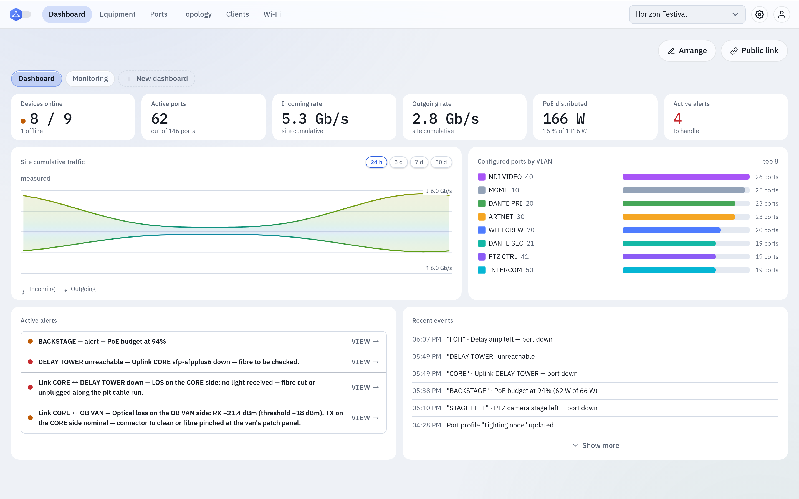
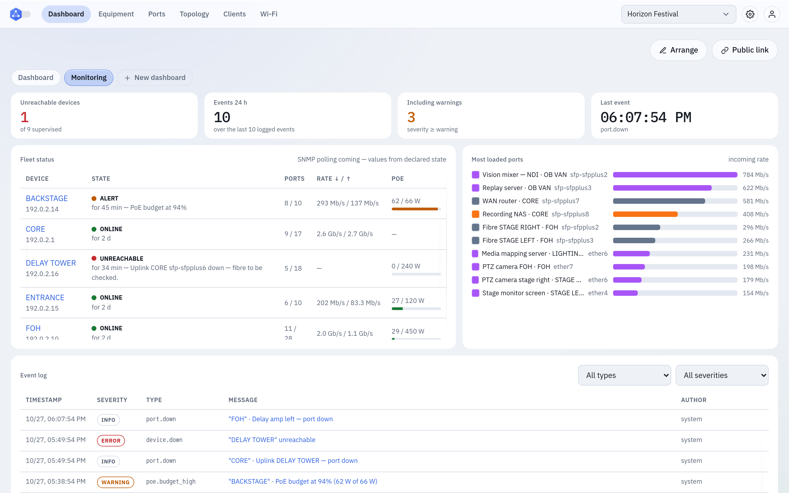
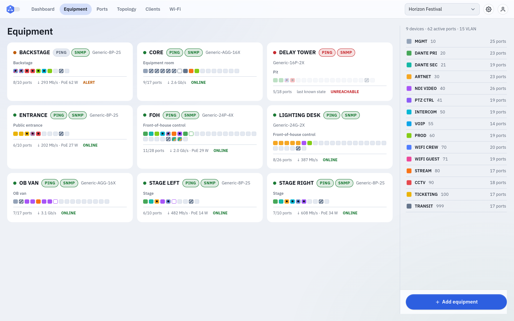
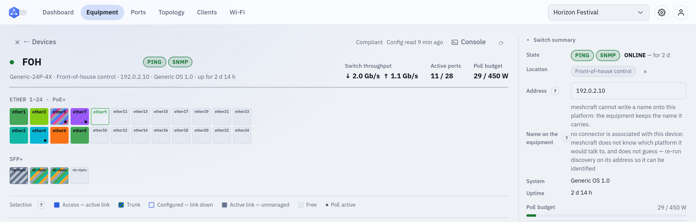
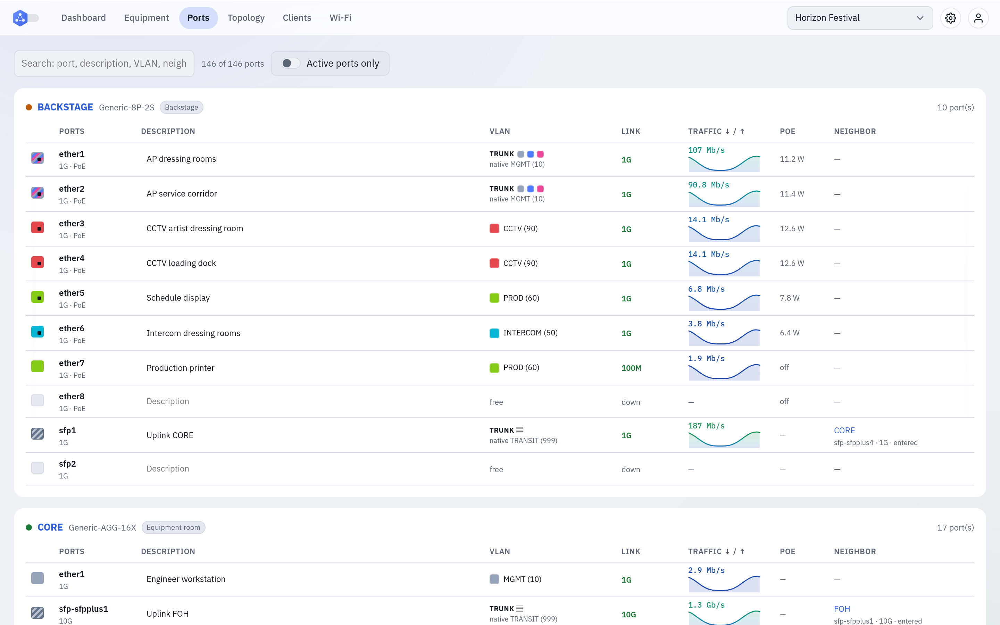
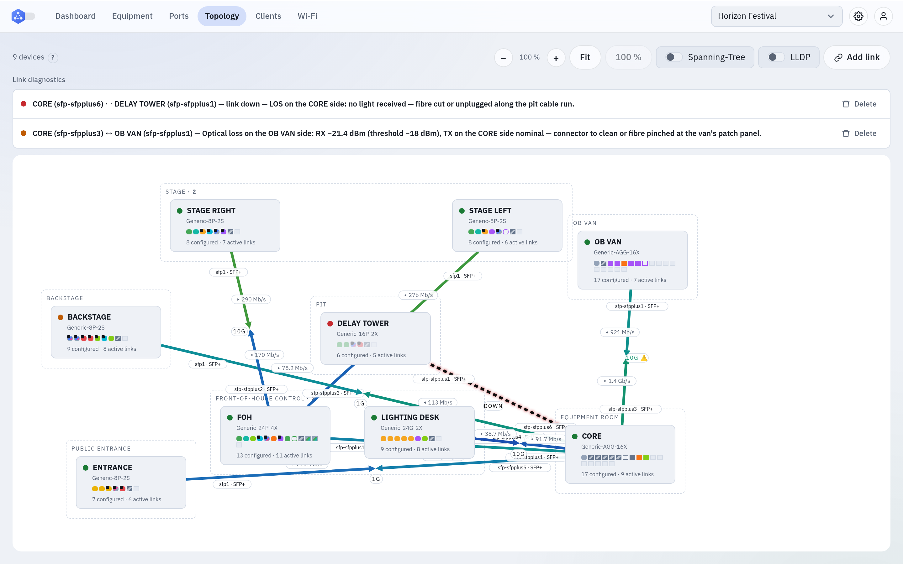
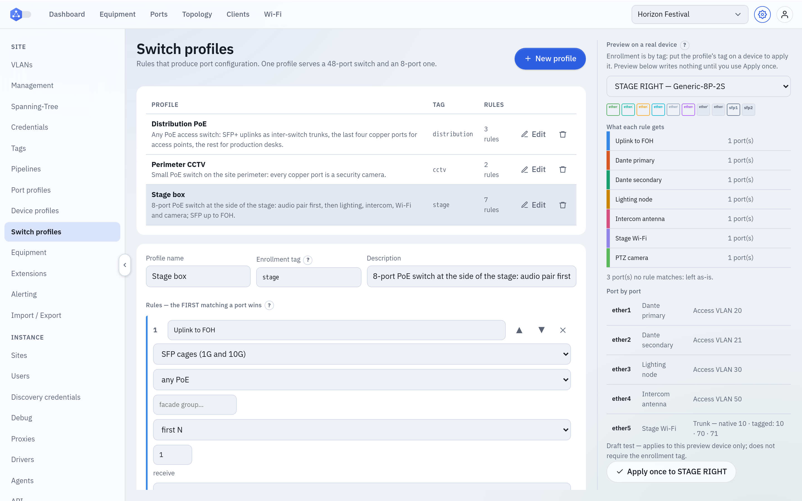
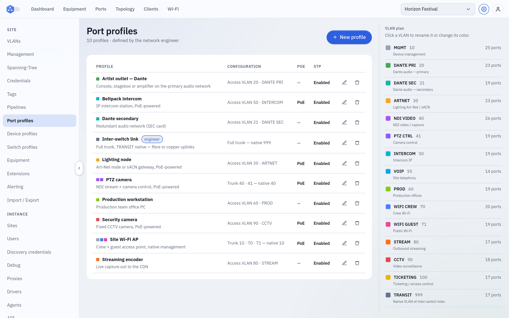
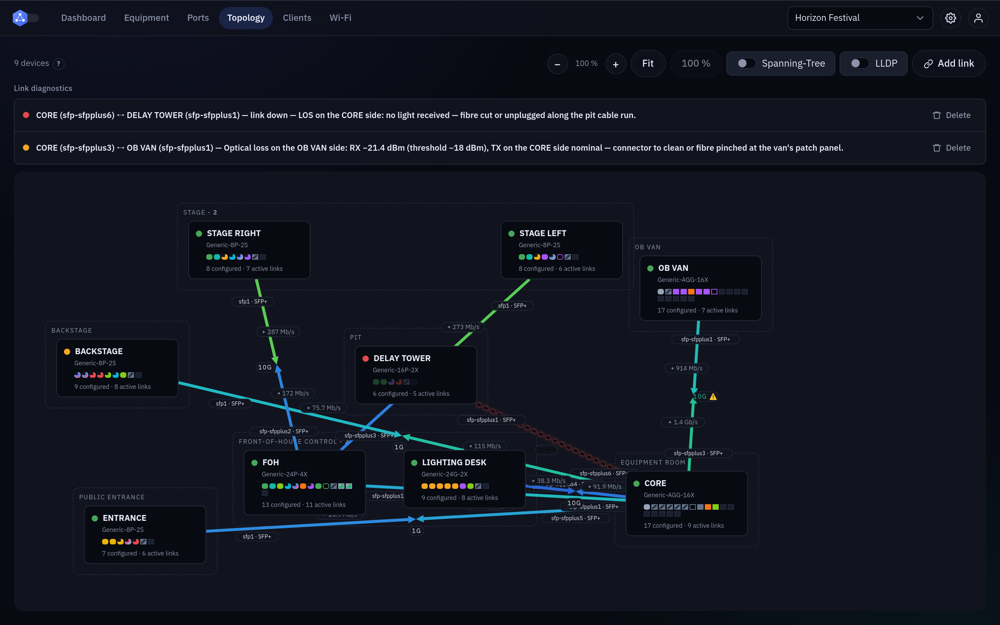

# meshcraft

[English](README.md)

Orchestrateur multi-constructeurs de switchs et routeurs réseau : un contrôleur
central qui découvre, configure et supervise des équipements via SSH/Telnet/HTTP,
directement ou à travers des **proxys** déployés dans des réseaux distants.

**Licence :** [AGPL-3.0-only](LICENSE)

## Origine

Le besoin de gérer un réseau de façon unifiée est né des **LAN parties** et des
événements associatifs où nous ne disposions que de **matériel hétérogène** —
constructeurs, générations et interfaces d'administration différents, sans le
luxe d'apprendre chaque plateforme avant l'ouverture des portes.

meshcraft est né dans le cadre de projets autour de
[Lyon e-Sport](https://lyon-esport.fr/). Gros remerciements à **DrumSlayer** et
**Emma-0**.

## Démarrage rapide

Prérequis : Docker (+ plugin Compose). **Tout se construit en conteneur.**

```bash
cp .env.example .env   # domaine public, contact ACME, compte admin
make build             # frontend Vite + Go + proxys multi-arch + image OCI du proxy
make up                # contrôleur + PostgreSQL + Caddy (TLS)
make logs              # le mot de passe admin initial y est affiché au premier démarrage
```

Compte initial : `admin@meshcraft.local` (mot de passe : `MESHCRAFT_ADMIN_PASSWORD`,
sinon généré et loggé une seule fois).

### HTTPS public

Le service `caddy` du compose termine le TLS et obtient/renouvelle seul les
certificats **Let's Encrypt** (ACME HTTP-01) pour `MESHCRAFT_DOMAIN`. Le domaine
doit pointer vers la machine et les ports 80/443 doivent être joignables. Le
contrôleur n'est exposé que sur `127.0.0.1:8080`.

Avec un front HTTPS valide, `docker pull <domaine>/meshcraft/proxy:latest`
fonctionne sans `insecure-registries`. En local sans domaine, laisser
`MESHCRAFT_DOMAIN=localhost` et utiliser http://localhost:8080.

## Captures d'écran

Prises sur le [site de démonstration](#site-de-démonstration) (festival fictif,
switchs génériques, télémétrie synthétique) ; interface en anglais.

**Dashboard** — compteurs du parc, trafic du site sur 24 h, ports par VLAN, alertes actives, événements récents.



**Monitoring** — état du parc avec durées de joignabilité, ports les plus chargés, journal.



**Équipements** — une carte par switch : bandeau de ports coloré par VLAN, débit, PoE, état.



**Détail d'un switch** — la façade de ports colorée par VLAN, avec le résumé du switch.



**Ports** — tous les ports du site, groupés par switch : VLAN, lien, trafic, PoE, voisin.



**Topologie** — le plan du site : cadres par emplacement, vitesses, débits bidirectionnels et diagnostics de liaison.



**Profils de switch** — des règles qui transforment une façade en configuration de ports, prévisualisées sur un vrai équipement avant toute écriture.



**Profils de port** — réglages de port réutilisables, à côté du plan de VLANs du site.



**Thème sombre** — la même topologie, en palette sombre.



## Documentation

La conception complète vit dans le vault Obsidian :

- Anglais (référence) : [`docs/en/`](docs/en/) — entrée [`docs/en/Index.md`](docs/en/Index.md)
- Français (traduction) : [`docs/fr/`](docs/fr/) (entrée : `Meshcraft - Index.md`)

Règles de contribution et conventions de code : [`CONTRIBUTING.md`](CONTRIBUTING.md).

## L'interface (aperçu)

Onglets principaux (menu latéral uniquement sous Configuration) :

- **Dashboard** — compteurs, alertes, débit 24 h, ports par VLAN, événements
- **Équipements** — inventaire et façades de ports ; ajout via découverte, IP, série, catalogue ou procédures de reset
- **Ports** — tous les ports du site groupés par switch
- **Plan** — synoptique ; les cadres suivent les places ; liaisons avec débit bidirectionnel
- **Monitoring** — journal, état du parc, ports chargés
- **Configuration** — VLANs, profils, groupes, sites, utilisateurs, proxys

## Plateformes prises en charge

Neuf connecteurs, chacun écrit contre l'interface d'administration propre à une
plateforme — il n'y a pas de repli SNMP générique qui prétendrait configurer un
commutateur qu'il ne connaît pas.

| Connecteur | Gamme | Atteinte par | Télémétrie | Vérifié sur matériel |
|---|---|---|---|---|
| `arista-eos` | Arista EOS (7000 / 720 / 750) | SSH, série | **gNMI en flux** | lectures + télémétrie |
| `cisco-ios` | Catalyst 2960 / 2960-X / 2960-XR (IOS 12.2–15.2) | SSH, série, Telnet | SNMP + traps | oui |
| `aruba-instant-on-1930` | Aruba (HPE) Instant On 1930 | web (`wcd`), SNMP | SNMP + web + traps | oui |
| `mikrotik-routeros` | MikroTik RouterOS (CRS…) | API binaire, SSH, Telnet, série, SNMP | API + SNMP + web, traps | oui |
| `mikrotik-swos` | MikroTik SwOS (CSS…) | web, SNMP | SNMP + web | oui |
| `ubiquiti-edgeswitch` | EdgeSwitch / UniFi Switch (FASTPATH) | SSH, série, HTTP | SNMP | oui |
| `fs-s3400` | FS.com S3400 PoE+ (CLI façon BDCOM) | SSH, série, HTTP | SNMP | oui |
| `fs-s3900` | FS.com S3900 / S3900-R | SSH, série, HTTP | SNMP | oui |
| `hpe-procurve` | HPE ProCurve 2600 | SSH, Telnet, web, SNMP | SNMP | **en pause** |

**Arista est la seule gamme collectée en télémétrie de flux**, et la seule sans
aucun canal SNMP : `internal/gnmipoll` s'abonne en gNMI/gRPC pour l'état des
interfaces, les compteurs, le LLDP et la santé. Tout le reste est interrogé par
`internal/snmppoll` depuis le proxy.

### Ce que « vérifié » veut dire ici, et ce que ça ne veut pas dire

La dernière colonne dit qu'un équipement réel a répondu — pas que chaque geste a
été exécuté sur un. La règle du projet est qu'un connecteur ne livre une forme de
commande qu'une fois observée, et ne déclare l'ÉCRITURE (`WritesExtra`) qu'une
fois cette écriture-là exercée : une écriture déclarée met un bouton à l'écran
dont le premier usage se ferait sur le commutateur de production de quelqu'un.

Donc aujourd'hui : huit gammes déclarent l'écriture d'état administratif par
port et six déclarent celle du spanning tree, tandis qu'**aucun connecteur ne
déclare le DHCP snooping** — les neuf en portent le code, aucun n'en a la
capture. La moitié télémétrie du connecteur Arista est capturée (EOS 4.28.13.1M),
ses écritures de configuration ne le sont pas. Chaque déclaration restante
attend la capture de cette écriture-là sur du matériel réel.

Le ProCurve 2600 est **en pause** : le connecteur existe, l'unité de labo
authentifie puis refuse le canal au-delà de quatre sessions simultanées, et il
n'est pas à reprendre sans décision explicite.

## Découverte et adoption

Un candidat découvert **n'a pas de site**. Une plage à scanner appartient au
proxy qui sait l'atteindre — le proxy **Local** est meshcraft elle-même. Le
site est choisi **à l'adoption** par un utilisateur `operator` sur ce site.

## Développement

```bash
make tidy         # go mod tidy (en conteneur)
make vet          # go vet
make test         # go test ./...
make fmt          # gofmt
make web-dev      # serveur Vite avec hot reload (API sur :8080)
```

## Site de démonstration

Importer [`samples/site-demo.json`](samples/site-demo.json) depuis la page parc
(festival fictif : switchs génériques, VLANs, profils, topologie).

## Structure du dépôt

```
cmd/controller/   contrôleur (API + SPA embarquée + registre OCI)
cmd/proxy/        proxy (enrollment + heartbeat + accès équipements)
cmd/mkoci/        layout OCI multi-arch du proxy sans buildx
internal/         api, auth, store (PostgreSQL), drivers, …
web/              SPA React + TypeScript (Vite), embarquée via go:embed
docs/en, docs/fr  vault d'architecture (anglais de référence, traduction française)
```
