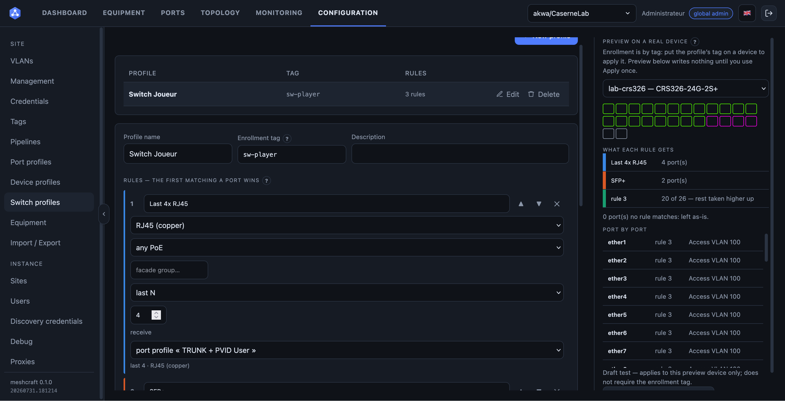

# meshcraft

[Français](README.fr.md)

Multi-vendor network switch and router orchestrator: a central controller that
discovers, configures, and monitors devices over SSH/Telnet/HTTP — directly or
through **proxies** deployed in remote networks.

**License:** [AGPL-3.0-only](LICENSE)

## Origin

The need for a unified way to manage a network grew out of **LAN parties** and
associative events where we only had **heterogeneous hardware** — different
vendors, different ages, different management interfaces, and no time to learn
each one from scratch before doors open.

meshcraft was born in the context of projects around
[Lyon e-Sport](https://lyon-esport.fr/). Huge thanks to **DrumSlayer** and
**Emma-0**.

## Quick start

Prerequisites: Docker (+ Compose plugin). **Everything builds in containers.**

```bash
cp .env.example .env   # public domain, ACME contact, admin account
make build             # Vite frontend + Go + multi-arch proxies + proxy OCI image
make up                # controller + PostgreSQL + Caddy (TLS)
make logs              # initial admin password is printed on first start
```

Initial account: `admin@meshcraft.local` (password: `MESHCRAFT_ADMIN_PASSWORD`,
or generated and logged once).

### Public HTTPS

The `caddy` Compose service terminates TLS and obtains/renews **Let's Encrypt**
certificates (ACME HTTP-01) for `MESHCRAFT_DOMAIN`. The domain must point at
the machine and ports 80/443 must be reachable. The controller is only bound
on `127.0.0.1:8080`.

With a valid HTTPS front, `docker pull <domain>/meshcraft/proxy:latest` works
without `insecure-registries`. Locally without a domain, keep
`MESHCRAFT_DOMAIN=localhost` and use http://localhost:8080.

## Screenshots




## Documentation

Full design lives in the Obsidian vault:

- French: [`docs/fr/`](docs/fr/) (entry: `Meshcraft - Index.md`)
- English: [`docs/en/`](docs/en/)

Code conventions: [`CLAUDE.md`](CLAUDE.md). Contributing: [`CONTRIBUTING.md`](CONTRIBUTING.md).

## Interface (overview)

Main tabs (side menu only under Configuration):

- **Dashboard** — counters, active alerts, 24 h aggregate throughput, ports by VLAN, recent events
- **Devices** — inventory with per-switch port façades; add via discovery, manual IP, serial, catalogue template, or factory-reset procedures
- **Ports** — all site ports grouped by switch
- **Plan** — full-page topology; dotted frames follow device placement; links show bidirectional throughput
- **Monitoring** — event log, fleet status, busiest ports
- **Configuration** — VLANs, profiles, groups, sites, users, proxies

## Discovery and adoption

A discovered candidate has **no site**. A scan range belongs to the proxy that
can reach it — the **Local** proxy is meshcraft itself. The site is chosen **at
adoption** by a user with the `operator` role on that site.

## Development

```bash
make tidy         # go mod tidy (in container)
make vet          # go vet
make test         # go test ./...
make fmt          # gofmt
make web-dev      # Vite dev server with hot reload (API on :8080)
```

## Demo site

Import [`samples/site-demo.json`](samples/site-demo.json) from the fleet page
(fictional festival: Generic switches, VLANs, port profiles, topology).

## Repository layout

```
cmd/controller/   controller (API + embedded SPA + OCI registry)
cmd/proxy/        proxy (enrollment + heartbeat + device access)
cmd/mkoci/        multi-arch OCI layout for the proxy without buildx
internal/         api, auth, store (PostgreSQL), drivers, …
web/              React + TypeScript SPA (Vite), embedded via go:embed
docs/fr, docs/en  architecture vault (bilingual)
```
