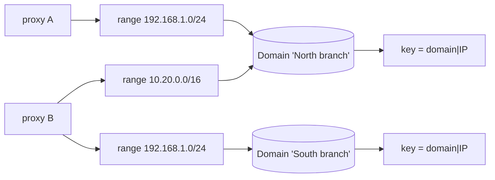

# Addressing domains

One sentence states the problem: **`192.168.1.10` identifies nobody.** The RFC 1918
space overlaps, and meshcraft by nature administers networks that do not know each
other. Two [[Proxy|proxies]] declaring the same range may be looking at two networks
totally foreign to each other — or at a single network, reached by two paths.

The **addressing domain** is the answer: the space within which an address designates
one machine and only one.

> [!important] A domain is DECLARED, never deduced
> Nothing meshcraft observes makes it possible to decide. Two proxies placed in two
> branches on `192.168.1.0/24` see exactly the same thing as two proxies placed in a
> single branch: same addresses, same fingerprints, often the same `.1` gateway.
> Deduction is therefore impossible, not merely difficult.

## Why the default is "distinct networks"

Because **the error is not symmetric**.

| Error | Consequence | Recovery |
|---|---|---|
| Wrongly separating two views of the same network | a duplicate in the adoption queue | one click |
| Wrongly merging two distinct networks | two devices fused into a single record | **none** |

A deduction is sometimes wrong. Since the cost of the two errors is out of all
proportion, we require a declaration and always fall back on the cautious side.

## What it repairs

Two very real defects, of very different severity.

**Discovery could not merge.** A candidate's identity key is
`serial number → MAC address → address`. The first two are global identities; the
third was folded onto the `(proxy, IP)` pair. That was the cautious half of the
answer — two distinct networks stayed distinct — but the other half was missing: two
proxies placed on **the same** network produced two candidates for a single silent
device, and nothing could ever bring them back together. Double adoption as a result.

**Monitoring attributed a state to the wrong device.** This is the serious defect, and
it had no safeguard. `DevicesWatchedBy` returns the whole fleet to every *global*
proxy, and the proxy indexes its state table **by address** (`cmd/proxy/monitor.go`).
Two sites on `192.168.1.0/24` and the proxy receives two targets at the same address:
the second silently overwrites the first. One of the two is never monitored again; the
other receives the state of the machine that actually answers on *that* network. A
green light on a switched-off switch — worse than no light at all.

> [!note] The attachment of migration `0022` does not replace the domain
> A device can now designate its **reference collector** (`devices.proxy_id`,
> [[Monitoring]] § *Choosing the collection point*), and one might think that settles
> the address conflict. It does not, and one has to see why the two mechanisms
> coexist:
>
> - the attachment restricts **SNMP** targets — where uniqueness is necessary
>   because there must be *one* address to write into the device;
> - it does **not** restrict ICMP, deliberately: two pings cost nothing and give a
>   better reachability truth, whereas a single collector loses any failover if its
>   proxy goes down.
>
> Yet it is precisely ICMP monitoring that indexes **by address**. The domain
> therefore remains the only safeguard against the overwriting described above, and
> the `null` regime — that of the whole fleet coming out of `0022` — is not concerned
> by the attachment at all. The arbitration of `SelectWatchTargets` applies to both
> lists, upstream: it decides **who exists** at an address, before the attachment
> decides **who polls**.

## The model

The domain is carried by the **scan range**, not by the proxy. The granularity is not
a detail: the same customer can have a shared server VLAN that two proxies both reach,
*and* two distinct office LANs reusing the same addressing plan. An attachment per
proxy cannot express this situation, which is nevertheless the common one.

Each proxy also has its **own domain**, that of everything it observes outside its
declared ranges: the manual probe of an arbitrary address, a candidate that came in
through the serial console. Without this fallback, these observations would have no
domain and would fall into a common space where all private addresses would be
confused.

The **most specific** range wins, as in a routing table: declaring `10.0.0.0/16` then
detaching `10.0.5.0/24` to another domain expresses an exception, and an exception
must take precedence over the general rule.

> [!note] A disabled range keeps its domain
> `enabled` only concerns **sweeping**. A disabled range remains the description of a
> real network and keeps answering the question "in which space does this address
> live?". Without that, disabling a scan would switch already-known candidates to the
> proxy's default domain, change their merge key, and duplicate them on the next pass.

## Monitoring arbitration

When several devices compete for an address for the same proxy, the one that wins is
**the one whose domain is declared on that proxy**: the proxy has a range in that
network, so it is legitimate to answer there.

If none is, or if several are, we do not invent: **all** are set aside, with their
reason. Saying nothing is better than saying something wrong — an unmonitored device
shows on screen, a wrong state does not.

This exclusion is made **visible**, and that is essential: a light that disappears
without explanation passes for a meshcraft failure. It appears as a banner on the
device's record (`devices.watch_excluded`, filled in on read), and a `watch.excluded`
event is emitted — but only at the **transition**, when no proxy takes charge of the
device any more. Since the monitoring configuration is recomputed at every proxy
connection, logging on every pass would drown the log ([[Event log]]).

Two details of `internal/api/watchexcl.go` that make all the accuracy of the signal:

- "new" is judged **at fleet scale**, not per proxy. A device one proxy sets aside may
  be perfectly monitored by another, and announcing it as excluded would be a false
  positive — it is the normal operation of a multi-proxy fleet, not an incident;
- a proxy that **disconnects** is forgotten. Its rejection reasons are worth nothing
  any more since it no longer monitors anybody, and keeping them would display an
  "unmonitored" unrelated to reality.

> [!note] The exclusion state lives in memory, never in the database
> A controller restart loses it and replays the events once when proxies reconnect.
> That is acceptable, and even useful: the problem itself is still there. Persisting
> it would require deciding when an exclusion expires, which a recomputation at every
> connection already settles for free.

## Rights

Reading domains is open (`GET /api/discovery/domains`): one must be able to choose one
when declaring a range. Their **creation**, modification and deletion are reserved
for the global-admin (`auth.RequireGlobalAdmin`), because bringing together the
discoveries of several proxies commits sites that a single site-admin does not
administer. A site-admin also cannot attach their range to the domain of a proxy they
do not administer (`checkDomainChoice`, refused with 403): they would direct their
discoveries into a neighbour's identity space (same escalation as the one closed by
migration `0007`, by another path — see [[RBAC]]).

Declaring the domain of a **device**, on the other hand, is reserved for the
`site_admin` and not the operator (`PUT /api/devices/{id}/address-domain`): the domain
decides which proxy is legitimate to monitor that address, so getting it wrong **cuts
off monitoring**. It is not of the same order as labelling a socket. The empty string
is accepted and removes the declaration — a wrong domain is worse than no domain, one
must be able to go back.

Deleting a domain that still carries ranges is refused by the database
(`on delete restrict` on `scan_prefixes`) rather than by the code: deleting would
silently change the identity of all the candidates it carries, and we prefer to let
the operator move their ranges first.

## Carrying over the existing data

Migration `0020_domaines_adressage.sql` is **semantics-preserving**: each proxy
receives its own domain, so `(domain, IP)` is worth exactly the old `(proxy, IP)`.
Nothing merges on its own. Grouping two proxies into the same domain remains an
explicit operator gesture.

## Known limits

**Merging is not retroactive.** Merging two domains does not recast the candidates
already queued: reclassifying them en masse could violate the uniqueness constraint of
the merge key. Subsequent observations merge normally, and the orphaned duplicate
disappears on its own through `PurgeStaleDiscovered`.

**A device entered by hand has no domain.** It comes from no range, so nothing says
in which network it lives. It stays monitored as long as it is alone on its address,
and loses the arbitration against a device whose domain is declared. Its record makes
it possible to declare it by hand (`PUT /api/devices/{id}/address-domain`).

## Where it is implemented

| Role | Location |
|---|---|
| Pure decisions (domain of an address, identity key, target sorting) | `internal/netscope/` |
| Schema and carry-over | `internal/store/migrations/0020_domaines_adressage.sql` |
| Persistence and merge key | `internal/store/discovery_store.go` |
| Choice of monitoring targets | `internal/api/watch_handlers.go` |
| Visibility of exclusions | `internal/api/watchexcl.go` |
| Entry of ranges and domains | `web/src/pages/add/ScanPrefixes.tsx` |

### Decided / shipped / open

This note describes a mechanism that is **entirely shipped**, which is rare enough to
be said — but it has edges, and they are what costs.

| Question | State |
|---|---|
| Domain declared, never deduced; "distinct networks" default | **shipped** — `netscope.DomainOf`, own domain per proxy |
| Most specific range wins, like a routing table | **shipped** — comparison on `Prefix.Bits()`, a range entered as a bare address counting as `/32` or `/128` |
| A disabled range keeps its domain | **shipped** — `Enabled` only concerns sweeping |
| `(domain, IP)` merge key as fallback after serial then MAC | **shipped** — `netscope.IdentityKey`, unique index `discovered_key_idx` |
| Monitoring arbitration, all set aside if the ambiguity persists | **shipped** — `netscope.SelectWatchTargets` |
| Visibility of the exclusion: banner + event at the transition | **shipped** — `internal/api/watchexcl.go` |
| Semantics-preserving carry-over | **shipped** — migration `0020`, one domain per existing proxy |
| **Retroactive** merging of two domains | **open** — recasting queued candidates could violate the key's uniqueness; the orphaned duplicate disappears through `PurgeStaleDiscovered` (30 days) |
| Domain of a device entered by hand | **shipped as a gesture**, `null` by default — and a `null` **loses** the arbitration against a declared domain |
| Assisted deduction ("do these two proxies see the same network?") | **rejected**, not postponed — see the first callout: deduction is impossible, not merely difficult |

See also: [[Discovery]], [[Proxy]], [[Unified monitoring and pipelines]].
