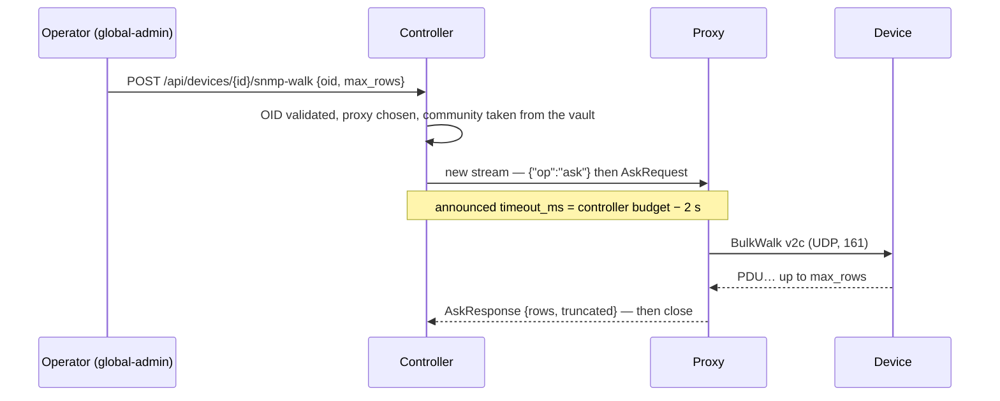

# Controller ↔ proxy protocol

A single link: **WebSocket over TLS (WSS, port 443)**, initiated by the [[Proxy]] and kept up permanently. It carries control, TCP streams, monitoring (configuration going down, events coming up) and the controller's **one-off questions** to the proxy. It crosses NAT/firewalls without any inbound configuration.

Two things do not travel over it, deliberately and documented below: **batches of metric samples**, which go through the controller's HTTP API, and the **heartbeat**, which precisely has to survive a broken tunnel.

## Multiplexing

**Binary** WebSocket messages, prefixed with a compact header:

```
+--------+-----------+------------------+
| type   | channel   | payload          |
| 1 byte | 4 bytes   | 0..64 KiB        |
+--------+-----------+------------------+
```

| type | Direction | Role |
|---|---|---|
| `CTRL` | ↔ | JSON control messages (channel open/close, RPC, heartbeat) |
| `DATA` | ↔ | raw bytes of a channel (TCP stream, large RPC response body) |
| `EOF` / `RST` | ↔ | clean end / abort of a channel |
| `WINDOW` | ↔ | flow-control credit (per-channel window, HTTP/2 style) |

- A **channel** = a tunnelled TCP stream, an RPC in flight, or the telemetry stream (channel 0 reserved for control, channel 1 for telemetry).
- **Per-channel flow control** is mandatory: without windows, a massive SNMP `walk` or a large firmware transfer would starve the interactive SSH sessions sharing the same WebSocket.
- Implementation: take inspiration from **yamux** (hashicorp) — we can even use yamux as is over a `net.Conn` adapter on the WebSocket, rather than rewriting the framing. Decision: **yamux over WS** for the MVP, custom framing only if a need justifies it.

> [!note] What is shipped (phase 0bis) and how channels translate into it
> `internal/tunnel` implements **yamux over WebSocket**. With yamux, the natural
> translation of a channel is not a number in a custom header but **one stream
> per connection**, preceded by a one-line JSON preamble:
>
> ```
> controller → proxy : {"op":"dial","host":"10.100.0.10","port":4443}\n
> proxy → controller : {"op":"dial_ok"}\n   or   {"op":"dial_err","err":"…"}\n
> then                 raw bytes, in both directions
> ```
>
> Channel 0 does not need to be reinvented for ping/pong: **yamux's keepalive**
> does it (20 s), within the orders of magnitude planned here. The controller is
> the yamux **client** (it is the one opening streams), the proxy the **server**.
> Authentication through the `X-Meshcraft-Proxy-Id` / `-Secret` headers
> **before** the upgrade, with the same pair as the heartbeat.
>
> The HTTP heartbeat stays in place next to the tunnel: it carries migration
> orders and works even where the WebSocket is blocked. A mechanism that
> depended on the tunnel to repair the tunnel would be worthless.
>
> What the proxy returns is an ordinary `net.Conn`: the probe, the HTTP client
> and, tomorrow, the drivers do not know where the connection starts from. That
> is the "a single code path" rule ([[Overview]]).
>
> Local safeguard: `MESHCRAFT_DIAL_ALLOW` (a list of CIDRs) bounds the
> destinations the proxy agrees to reach — configured **on the proxy's
> machine**, hence out of the controller's reach, as [[Proxy security]]
> requires. An unreadable allowlist does not degrade into "everything open": the
> proxy then refuses every dial and logs it.

### The three exchange patterns

Everything that crosses the tunnel comes down to **three patterns**, and a stream
never carries two: its preamble says which one, once and for all.

| Pattern | Who opens | Lifetime | What the stream returns | Contract |
|---|---|---|---|---|
| `dial` | the controller | the duration of the connection | a TCP **byte stream**, in both directions | `DialRequest` / `DialReply` |
| `watch` | the controller | permanent, one per session | **nothing** — it is an instruction, rewritten in full on every change | `WatchConfig` |
| `events` | the **proxy** | permanent, one per session | **transitions**, pushed when they happen | `Event` |
| `ask` | the controller | one round trip | **one answer**, then the stream closes | `AskRequest` / `AskResponse` |

Four rows for three patterns: `watch` and `events` are the two halves of the
**long-lived channel**, opened as two copies because a stream carries only one
preamble, hence only one direction of request. The third pattern, `ask`, is the
**one-off question** — why it had to be added, and what it makes possible, is
below.

## Control messages (channel 0, JSON)

```json
// controller → proxy: open a TCP tunnel
{"op": "dial", "ch": 42, "host": "10.1.2.3", "port": 22, "timeout_ms": 5000}
// proxy → controller
{"op": "dial_ok", "ch": 42}            // then DATA/WINDOW on channel 42
{"op": "dial_err", "ch": 42, "err": "connection refused"}

// RPC executed on the proxy side (SNMP, scan…)
{"op": "rpc", "ch": 43, "method": "snmp.walk",
 "params": {"host": "10.1.2.3", "version": "2c", "community_ref": "s3cr3t", "oid": "1.3.6.1.2.1.2.2"}}
{"op": "rpc_result", "ch": 43, "done": true, "result": [...]}   // streaming possible: done=false

// proxy → controller: raw telemetry (channel 1) — design, see note below
{"op": "syslog", "src": "10.1.2.3", "ts": "2026-07-26T10:00:00Z", "facility": 23, "severity": 4, "msg": "..."}
{"op": "trap", "src": "10.1.2.3", "ts": "...", "oid": "1.3.6.1.6.3.1.1.5.3", "varbinds": [...]}

// link lifecycle
{"op": "hello", "proxy_id": "px_...", "version": "1.4.0", "ifaces": [{"ip": "10.1.0.9/24"}]}
{"op": "ping", "seq": 812}  /  {"op": "pong", "seq": 812}
```

> [!warning] The raw trap does not cross the WAN
> The `{"op":"trap"}` line above is the original design: forward the datagram as
> is to the controller. That is **not** what was kept. A v2c trap is
> unauthenticated UDP; forwarding it would turn it, on arrival, into a source of
> state — and therefore a second path of truth that would have to be arbitrated
> against polling. The trap **stays local to the proxy**, where it only serves to
> bring a poll forward; what crosses the link is the transition derived from that
> poll, on the event channel below. See [[Monitoring]] §2.
>
> One nuance added since, and it reopens nothing: what also crosses is the
> **fact** that a trap was accepted (`trap.seen`, once per device and per proxy),
> with the local address it targeted. Not its content, not its varbinds, nothing
> from which a state could be inferred — only enough to verify an address the
> controller had written on a bet.
>
> The `{"op":"syslog"}`, for its part, remains an intention: the 514/udp
> listener is not shipped.

> [!warning] The generic `rpc` does not exist — what shipped is `ask`
> The `{"op":"rpc","method":"snmp.walk"}` / `{"op":"rpc_result"}` lines above
> are the original design: a named method call, with free parameters, with result
> streaming. **No code implements them.** What shipped in their place is
> narrower and stays so by choice: a **closed set of questions**, one answer per
> stream, no streaming, no writes (§ *The one-off questions*).
>
> Two consequences not to lose. The **scan** was never an RPC: the proxy sweeps
> the `prefixes[]` of its `WatchConfig` on its own, and reports `host.seen`. And
> the `snmp.set` of this example **will never exist**: the write question is not
> in the contract and will not be, because configuration goes through the
> connectors, which have their safeguards (plan, dry-run, verification read-back
> — [[Reconciliation]]).

## Monitoring: two long-lived channels

On top of the ephemeral `dial` streams come **two permanent streams**, one per
direction, opened when the tunnel is established and kept as long as it lives.
Same one-line JSON preamble, then a series of JSON lines — no extra framing to
invent:

```
controller → proxy : {"op":"watch"}    then WatchConfigs
proxy → controller : {"op":"events"}   then Events
```

The contract is carried by `internal/tunnel/control.go`, which is its reference.
These are the two halves of the **second** exchange pattern; the third — the
one-off question — has its own section below, and it is not a monitoring
channel: nothing regular goes through it.

### What the controller asks for (`WatchConfig`)

A `WatchConfig` **fully replaces the previous one**. Sending deltas would assume
both sides share a state — hence that they can diverge, and that some day they
must be resynchronised. A full replacement on every change makes the question
impossible.

| Field | Role |
|---|---|
| `targets[]` | devices to monitor (ICMP), with their controller-side `device_id` — **all** retained targets, attached or not |
| `prefixes[]` | local ranges to sweep |
| `ping_interval_ms`, `down_after`, `sweep_interval_s` | cadence and debounce |
| `snmp[]` | SNMP targets: IP, v2c community, `if_state` / `if_counters` cadences **in seconds**, `max_ifindex` bound |
| `trap_listen`, `trap_port` | whether this proxy must listen for traps, and on which port (0 = 162) |

`trap_listen` is only `true` if at least one target of `snmp[]` belongs to a
platform whose connector declares it can push traps: a trap coming from a device
this proxy does not poll would bring no poll forward, and opening 162/udp to never
receive anything is an attack surface with no upside. The port is filled in
**explicitly** even when it is 162: what the proxy will open must be readable in
what was sent to it, not in the default value of the binary version it runs.

Two choices can be read in this table. First, **the controller decides, the proxy
executes**: the cadences carried by `snmp[]` are **chosen** by an operations
policy and then bounded from below by the connector's floor — two distinct
notions, see [[Unified monitoring and pipelines]] §1.2 — and letting a proxy
decide to speed up would scatter across the fleet a rule that protects the
devices. The proxy therefore receives a number of seconds, never a floor to
interpret: what it will do is readable in what was sent to it. Second,
`trap_listen` is a **controller switch**, not a local configuration-file option:
the channel is turned off across a whole fleet without redeploying a binary in
every customer network. A proxy that does not listen is not degraded — it loses
responsiveness, not information.

What this channel removes is a dialogue. The confirmation poll that follows a
trap **is not an RPC**: the proxy does not ask the controller for permission to
query a device it is already monitoring. A WAN round trip at that point would
cost precisely the latency the trap is there to remove, and the proxy already
holds the IP, the community and the index bound in the `SNMPWatch` it was just
pushed. What is **one-off and requested** — a diagnostic walk — goes through the
third pattern, `ask`, described below; it is neither this channel nor a generic
RPC.

### What the proxy reports (`Event`)

**Transitions**, never a repeated current state. A hundred devices monitored at
1 Hz produce no message as long as nothing changes.

**With a resume point, and it was added after the fact.** Transmitting only
differences turns every loss into a permanent divergence: a device stayed
`unknown` for nineteen hours while it was answering, its only transition having
disappeared (the finding and its three possible causes are in [[Monitoring]],
§ *Device status*). When the stream opens, the proxy therefore re-announces the
current state of each target, as `device.up` / `device.down` events carrying
**`resync: true`**.

This flag is not decorative: it tells the controller to write the status
**without** logging a fact that just happened. The date of a missed flip is not
knowable — what is knowable is that the controller had missed it. Without it,
every reconnection would recount outages that never happened. The emission order
is imposed: **queue remainder, then snapshot, then live** — the events
accumulated during the outage are older than the snapshot, and delivering them
after it would overwrite the current state with a stale transition.

**The burst has an end, and it says so.** `resync` marks each event of the burst
and says nothing about the last one: the controller could therefore not tell
"this proxy is still re-stating" from "this proxy has nothing to say", and judged
a device's reachability against a set of witnesses still being assembled. At
controller startup, this produced a measured window of about nine seconds during
which one proxy's confirmed `down` was written while the proxy that actually
reaches the device had not finished — or not started — re-stating its own. Hence
`resync.done`, emitted between the snapshot and live, **even when there was
nothing to re-state**: "I had nothing to say" and "I have finished saying it" are
the same fact for the controller.

**Compatibility, because the fleet does not update in one block.** A proxy older
than this marker will never send it, and nothing on the controller side may wait
for it. The capability is therefore announced at the handshake, header
`X-Meshcraft-Proxy-Features`, value `resync-done` — **not** inferred from
`X-Meshcraft-Proxy-Version`, which is only a text stamped at build time (proxies
stamped `dev` have already circulated). Absent, the header means nothing other
than "we do not know": the controller then classifies the session as
`ResyncUnsupported` and behaves exactly as before. And because a proxy can
announce the capability and then die mid-burst, the corresponding wait on the
controller side is **bounded by a startup window**; past that delay, reachability
goes back to what it was (see `holdReach`, in `internal/api/reachability.go`, and
[[Monitoring]]).

| Type | What it records |
|---|---|
| `device.up` / `device.down` | ICMP reachability, after debounce — or a **re-announced finding** when the stream opens, if it carries `resync` |
| `host.seen` | an address answered in a swept range |
| `sweep.done` | end of a sweep, with its coverage |
| `resync.done` | **end of the resynchronisation burst**: remainder delivered, snapshot delivered, nothing left to re-state |
| `port.up` / `port.down` | transition of a faceplate port, derived from `ifOperStatus` |
| `trap.seen` | a trap from this device has just been **accepted** by this proxy, for the first time — the only **proof** event of the contract, with its `dest_addr` field |

Port events carry `ifindex`, `port_name` and `trigger`:

- **`ifindex` identifies, `port_name` illustrates.** `ifDescr` collides — on an
  Instant On 1930, the VLAN 42 interface is called "42", like physical port 42.
  Correlating by name would attribute a transition to the wrong port, which is
  worse than a gap: it is credible and wrong;
- **`trigger`** is `"poll"` for the ordinary cycle and `"trap"` for a poll brought
  forward by a trap. The field does not say where the truth comes from — it
  always comes from the poll — it says what saved the wait;
- **`detail`** carries only diagnostics, and it knowingly mixes two natures that
  must be told apart when reading: the `ifOperStatus` value when it falls outside
  `up`/`down` describes **this port** and comes from the poll; the trap label
  (`linkDown`…) qualifies the **burst** that woke the proxy, not the port. The
  second is a hint, never data.

> [!important] A `port.down` is never a reading of a trap
> The proxy computes its transitions by comparing two `if_state` polls, whatever
> triggered the second. No state is written from the content of an
> unauthenticated datagram ([[Monitoring]] §2). Corollary on the controller side:
> a `port.down` is handled **the same way** whether it carries `trigger:"poll"` or
> `trigger:"trap"` — the only difference is the time it arrived.

> [!warning] The same transition can arrive twice
> A device's eligibility for a proxy comes from its **site coverage**
> ([[Proxy]]), and an instance proxy covers everything: as long as no collector
> is declared — `devices.proxy_id` at `null`, the state of the whole existing
> fleet — several proxies legitimately poll the same device and will report the
> same transition. The protocol does not prevent it and does not have to:
> deduplication happens at the controller, on `(device_id, ifindex, type)` within
> a short window.
>
> What changed is upstream, not here: **attachment** ([[Proxy]], § *The reference
> collector*) restricts `snmp[]` to the reference collector alone, and therefore
> **prevents** the duplicate where it is declared instead of letting it happen
> and catching it afterwards. It does not make deduplication useless — it remains
> the behaviour of the `null` regime. And it is decided **at the controller**,
> which pushes the list, not in the protocol: a protocol that tried to elect a
> single emitter by itself would make the loss of a proxy detectable before it
> was repairable.

#### `trap.seen`: the only thing that verifies a claim

The other four events **record**; this one **proves**. It exists because writing
a trap destination into a device is a claim that is **otherwise unverifiable**.
The controller writes an address into it — the one the collecting proxy says it
uses to reach the device, obtained through `source_addr` — betting that the path
works **in the other direction**. Nothing guarantees it: a firewall, an
asymmetric route, an ACL on the management VLAN, and the device emits into the
void. The `statusCode 0` of the write says none of that — it says the device
**kept the line**, not that its datagrams arrive.

A received trap, on the other hand, is beyond dispute: it got through. Hence an
event whose only useful content is the fact that it exists.

- **emitted once per device and per proxy**, never on every trap (`firstSeen`,
  `cmd/proxy/trap.go`): a proof no longer changes once acquired, and a chatty
  fleet would turn the event channel into a log generator. It **re-arms** when
  the device leaves and then rejoins the watch list — hence on every tunnel
  reconnection and every fleet change — because a device that comes back comes
  back from a world where a firewall may have changed. Corollary on the
  controller side: the emitter's parsimony is not enough — without a bound, a
  proxy restart would announce "return path established" for the whole fleet at
  once. It is enforced **in the database**, in the `where` of the `update`
  (`store.ConfirmTrapPath`), which makes it immune to two simultaneous traps from
  two proxies;
- **emitted between the identity filter and the damping**, and the order is the
  meaning: what proves the path is that a trap **arrived and was recognised**,
  not that it obtained a poll. A trap absorbed by the coalescing window crossed
  the same firewall as the one that opened it. Never **before** the filter,
  however: a third party on the path would forge the proof of a device that
  emitted nothing.

##### `dest_addr`: the proof is only worth something if it is ATTRIBUTABLE

This is the field that required a fundamental fix, and the reason fits in one
sentence: the proxy's filter only looks at the **source IP**, and its socket
listens on the **wildcard address**. "A trap arrived here" is therefore not "the
address I wrote receives this device's traps" — a device emitting towards another
collector reachable on the same machine produced a proof with no relation
whatsoever to our claim.

The proxy therefore reports the **local address targeted by the datagram**, read
from the kernel (`ipv6.FlagDst` on an AF_INET6 socket, `ipv4.FlagDst` otherwise),
and it is the controller — sole holder of the claim — that confronts it with what
it wrote. Two properties not to lose:

- **the proxy does not fill in an "I don't know"**. Empty field when the kernel
  refuses PKTINFO, never the address it believes it uses to reach the device:
  that would compare the claim **with itself**, and make the verification
  tautological. A proxy also announces at bind time whether it can attribute
  (`destination_readable`), and says so **as a warning** when it cannot — keeping
  quiet would suggest a verification that does not take place;
- **the comparison is an EQUALITY**, and the controller performs it
  (`judgeTrapProof`, `internal/api/trapdest.go`). The address is unmapped on both
  sides: a dual-stack socket returns "::ffff:10.42.0.67" where the controller
  wrote "10.42.0.67", and comparing the texts would make attribution fail
  depending on the mood of the host's network stack.

**Four outcomes**, not two, because "no answer" and "another address" are not
handled the same way:

| Outcome | What the trap establishes | What we do with it |
|---|---|---|
| **confirms** — right proxy, address **equal** to the one written | our claim, in the strong sense | confirmation recorded, `trap.path_confirmed` as a notice: *the written address was a hypothesis about return routing; it is verified* |
| **unattributed** — right proxy, **unknown** address (`dest_addr` empty) | "this device's traps reach this proxy", and nothing more | confirmation **recorded anyway**, with a weaker sentence that names what is not verified |
| **other address** — right proxy, **another** of its addresses | the channel works, but not where meshcraft wrote it | **nothing recorded**, a warning in the application log |
| **foreign** — proxy that is not the destination's, or no destination recorded | a path exists for that proxy | noted at info level, never recorded |

> [!note] The second outcome is an operational choice, not a tolerance
> Refusing to record an unattributed proof would look more rigorous and would
> cost more: an entire fleet of **non-updated** proxies — or ones running on a
> kernel that refuses PKTINFO — would stay displayed as "never confirmed" while
> their monitoring is very much responsive. People would hunt for firewalls that
> do not exist. The acquired fact is therefore recorded, and it is the
> **vocabulary** that carries the nuance (`trapConfirmedMessage`): the traps
> *reach* the collector, which is not *the written address receives them*.
>
> The third one, however, refuses — and it is the case this whole verification
> exists to catch: the device carries a recipient meshcraft did not set (a line
> left over from a previous collector, a second monitoring tool), it emits
> towards it, and the address we wrote may be reachable by nobody. Writing "path
> verified" there would assert something about a path nothing has travelled.

> [!warning] The false negative is ACCEPTED, and the log names its two causes
> A proxy behind **address translation** receives its traps on a local address
> the controller never wrote: its proofs fall into "other address" and will
> therefore never be recorded, while its monitoring is responsive. That is the
> price of strict equality, and it is paid knowingly — the opposite (accept any
> address) would remove the only verification of the lot.
>
> What makes the price acceptable is that the warning carries **both** possible
> causes — "either the device carries a recipient meshcraft did not set, or this
> proxy receives its traps through address translation" — because they are
> repaired in **opposite** ways: an extra recipient is removed, an address
> translation is accepted. A message that named only one would send someone to
> dismantle the wrong half of the installation.

##### What the first hardware test established

The full path was validated on a real device — that is what makes the difference
between a plausible contract and a proven one:

| Observed fact | What it demonstrates |
|---|---|
| Instant On 1930 at `198.51.100.101`, behind a remote proxy | the ordinary case, not a loopback test bench |
| `source_addr` returns `10.42.0.67` — a **routed** address: none of the proxy's subnets contains the device | the obvious algorithm (look for the address of the right subnet) would have returned **nothing at all** — see § *`source_addr`* |
| the write succeeds, then a trap arrives **on that very address** | the return-routing hypothesis is verified, and the "confirms" outcome is not theoretical |
| the port transitions that follow carry `trigger: "trap"` | the fast path really serves, and the `trigger` field is what makes it observable |

> [!warning] `Event.TS` is a DIAGNOSTIC fact, never a date to order by
> Discovered during the same test, and the lesson goes well beyond traps. The
> proof was first recorded with the timestamp set by the **proxy**, whereas the
> date of the write comes from `now()` in the database, hence from the
> **controller**. Both columns sat in the same row and invited a meaningless
> comparison: the measured gap was **eleven seconds**, the proxy behind, which
> made the proof appear **before** what it proves. Not a violation of causality —
> a mix of clocks.
>
> The rule that comes out of it: **the controller is the only clock that can
> order its own claims.** A date supplied by a proxy says what the *proxy*
> believes; it is information about the state of the fleet, never a value to
> compare with what the controller wrote. The same defect existed in the
> heartbeat correlation, which compared a proxy's `ev.TS` with its sweep's
> `time.Now()`: its thresholds were therefore worth the **written** threshold plus
> the drift of a machine we do not control ([[Monitoring]], § *Anti-flap*).
>
> The corrective gesture is what to remember: the timestamp parameter was
> **removed** from the functions concerned, not documented. As long as it does
> not exist, nobody can feed a third party's date into it — a comment, on the
> other hand, gets bypassed without anyone knowing.
>
> `Event.TS` keeps exactly one use: **the drift itself**, logged as a warning,
> with **asymmetric** thresholds (`trapClockNote`) — 5 s behind, 1 s ahead. Lag
> is indistinguishable from slow transport: the event may have waited in the
> proxy's queue, then in a cut WAN. A date in the future has no innocent
> explanation; no transport makes time run backwards. And this measurement has a
> value of its own: nothing else in meshcraft monitors the proxies' clocks, and
> one without NTP drifts by minutes.

| Question | Status |
|---|---|
| `trap.seen` in the contract, emitted once per device and per proxy, re-armed on removal | **shipped** — `internal/tunnel/control.go`, `cmd/proxy/trap.go` (`firstSeen`, `forget`) |
| `dest_addr` read from the kernel (PKTINFO), empty when the kernel refuses, never filled in | **shipped** — custom socket rather than `gosnmp.TrapListener`, which only returns the source |
| Confrontation with the written address, four outcomes, bound in the database | **shipped** — `judgeTrapProof`, `store.ConfirmTrapPath` |
| Clock drift logged, proxy timestamp kept out of any comparison | **shipped** — `trapClockNote`, and the parameter removed from the signatures |
| Proof from a proxy behind address translation | **accepted false negative** — both causes are named in the log, neither is guessed |
| Proof from a **v3** trap | **out of scope by construction**: without a community, `classifyTrap` rejects it before anything else ([[Service identity and rotation]]) |

### Monitoring defaults

(The bounds of the one-off questions are in the next section.)

| Constant | Value | Why |
|---|---|---|
| `DefaultPingInterval` | 1 s | |
| `DefaultDownAfter` | 3 losses | one lost packet must not make the fleet blink |
| `DefaultSweepInterval` | 10 min | |
| `DefaultTrapPort` | 162 | the standard port (RFC 3411) |
| `TrapCoalesce` | 250 ms | a 48-port switch rebooting emits a burst of traps → **one** poll |
| `TrapMinPollGap` | 2 s | floor between two trap-triggered polls on the same device |

## The one-off questions (`ask`): the third pattern

`dial` carries traffic, `watch` the instruction, `events` the alert. What was
missing was the **question**: a fact the controller does not know, that only the
proxy can establish, and whose answer fits on one line. The contract is
`internal/tunnel/control.go` (`OpAsk`), which is its reference; `Hub.Ask`
(`internal/tunnel/hub.go`) holds the controller half, `cmd/proxy/rpc.go` the
proxy half.

```
controller → proxy : {"op":"ask"}\n   then an AskRequest\n
proxy → controller : an AskResponse\n   then the stream closes
```

### Why none of the other three streams could do it

The conclusion — adding a pattern to the protocol — is the most expensive of the
possible options, so the reasoning is written here rather than rediscovered:

- **`watch` goes in the right direction, but returns nothing.** It is an
  *instruction*: the controller says what to monitor, the proxy applies it.
  Slipping a query into it would require an answer, hence matching, hence shared
  state — exactly what the full replacement of the `WatchConfig` exists to avoid;
- **`dial` returns a TCP stream.** But SNMP is **UDP**: there is nothing to relay,
  no bytes to carry end to end. And "which source address would you use to reach
  this IP?" is not a connection to open — it is a read of the proxy's routing
  table, which no `dial` expresses;
- **the event channel goes the other way.** The proxy pushes what it has
  observed; the controller asks nothing there.

What remains is the real reason, and it is structural: **some facts are only
knowable from the proxy.** Not "easier to obtain from there" — knowable *only*
from there. A controller that inferred them from its inventory would produce a
credible and wrong answer (§ *`source_addr`*).

### One-off and stateless, deliberately

One question, one answer, the stream closes. Nothing to match, nothing to clean up
if the controller disappears midway, nothing to resynchronise after an outage: a
dead stream is a lost question, and a lost question is asked again.

> [!note] Why not a third permanent channel
> One more long-lived channel would have required **request/response
> correlation** — request identifiers, a table of in-flight questions, a cleanup
> delay, and handling answers that arrive after the caller has given up. That is
> the normal price of a *chatty* channel. These questions are asked **a few
> times a day, by hand**: paying for matching machinery at that rate would have
> been a bad trade, and one stream per question delivers the same service for
> the cost of a yamux open.
>
> The accepted corollary: `ask` is not a collection path. Continuous monitoring
> stays in `watch` / `events`, where it costs nothing per measurement.



### The two questions of the contract

| Question | What it asks | What it returns | What it unlocks |
|---|---|---|---|
| `snmp_walk` | walks `oid` on `ip`, in v2c | `AskRow`s `{oid, type, value}` + `truncated` | **discovering** the OIDs a device actually serves, instead of guessing them from a vendor MIB |
| `source_addr` | which local address would you use to reach `ip`? | an address, no mask, no port, no zone | having a **concrete address** to write into a device, rather than an inferred one |

#### `snmp_walk`: the device can say what it exposes

A vendor MIB says what a *range* is supposed to serve; a walk says what **this**
device, with **this** firmware, actually serves. The difference is the one between
writing a collector on a hypothesis and writing it on a survey — the same split
that the `web-probe` building block introduced for web connectors
([[Connectors]]). That is what makes affordable the sensors no standard MIB truly
normalises: SFP optical power, temperatures, per-port PoE.

Three details of the contract make the answer usable, and they are there to avoid
wrong diagnoses:

- **the value is TEXT, the type is next to it.** A `Counter64` does not fit into a
  JSON float without loss, and counters are precisely what one queries:
  `ifHCInOctets` on a loaded link exceeds 2^53 within a few months, and rounding
  does not show — one would read a wrong rate without ever knowing why;
- **the type is named as a MIB names it** (`Counter64`, `Gauge32`, `TimeTicks`…),
  including the three SNMPv2 responses that are not values: `NoSuchObject`,
  `NoSuchInstance`, `EndOfMibView`. Returning them as is **is** the diagnosis —
  it is exactly what one was trying to find out;
- **an `OctetString` is not text.** As soon as the bytes do not form printable
  text, the value is returned in hexadecimal prefixed with `0x`. Without that,
  `json.Marshal` silently replaces any non-UTF-8 byte with U+FFFD: a MAC address
  would arrive transformed, with nothing signalling the substitution.

> [!note] The diagnostic walk speaks like the poll, on purpose
> A question's SNMP session **inherits** the conventions of the ordinary poll —
> it does not copy them: `snmppoll.Dial` is the only entry point of an SNMP
> session in the whole product. **v2c**, 2 s timeout, a single retry, port 161 by
> default, empty community meaning `snmppoll.DefaultCommunity`.
>
> The stakes are not cosmetic. A manual walk that succeeded with broader
> parameters than the collector would lead one to conclude that monitoring
> "loses" OIDs the device exposes — when it is the question that would have
> cheated. And the reverse is worse: these conventions existed in **three
> copies** (the poll, the walk, the trap filter), and a divergence on one side
> produces no error, only two clients describing the same device differently.
> That is why a single constant carries the community fallback, and why a test
> checks it **on the wire** — by counting datagrams and timing the delay,
> because a timeout cannot be observed other than by waiting for it.

#### `source_addr`: the question that looks useless and is not

This is the point to understand, because the obvious algorithm seems sufficient:
take the addresses the proxy declares (`proxies.ifaces`, reported in the `hello`)
and keep the one in the device's subnet. **That is wrong as soon as the proxy
reaches the device through routing** rather than through a direct link.

Observed on the real installation: the proxy exposes `10.42.0.67/24` and
`172.17.0.1/16`, the lab device is at `198.51.100.101`. No match — and yet the
proxy reaches it. The obvious algorithm therefore returns **nothing at all**,
and an operator would conclude that the proxy cannot see the device.

Only the proxy's kernel knows, because only it has the routing table. The answer
is the address it **would use**, obtained by "connecting" a UDP socket to the
target: no packet is sent, the kernel resolves the route to choose the source
address, and `LocalAddr` reports it. No route ⇒ an explicit `Err`, never an
empty address: an empty answer would pass for success.

This address is what gets written into a device so that it emits towards the
right place. The batch that writes it — setting the trap recipient — lives
elsewhere; this protocol only carries the **question**. It now has a **caller**:
`internal/api/trapdest.go` asks it of the reference collector just before writing
the line into the device. It is still **not** an API route: "through which
address does this proxy reach this device?" remains internal data the product
uses, and the proof that the answer was right comes back through `trap.seen`
(§ *What the proxy reports*).

> [!warning] Read-only by construction, and for good
> There is **no** write question in the contract, and there will not be. This is
> not a first-release precaution to be lifted later: configuration goes through
> the connectors, which carry the plan, the dry-run and the verification
> read-back ([[Reconciliation]], [[Connectors]]). A write `ask` would be a second
> path for modifying the fleet, with no plan, no diff trace and no read-back —
> that is, exactly what [[Reconciliation]] exists to forbid. Nothing is prepared
> "for later" on the proxy side: opening writes would require redoing this
> reasoning first.
>
> Worth noting, because it surprises: the local `MESHCRAFT_DIAL_ALLOW` allowlist
> does **not** apply to the walk. It bounds the TCP relay, the only path through
> which arbitrary traffic flows; an SNMP read goes out like an ordinary poll or
> a range sweep, which do not consult it either. Two different rules for reaching
> the same device would end up allowing its monitoring while refusing its
> diagnosis.

### The bounds, and what each one prevents

| Bound | Value | Where it applies | What it prevents |
|---|---|---|---|
| `DefaultAskRows` | 500 rows | controller and proxy | what is returned when the question bounds nothing |
| `MaxAskRows` | 5000 rows | **on both sides**: `ClampAskRows` (hub), the API route, and `askMaxRows` on the proxy side | a walk under `1.3.6.1` returns tens of thousands of rows; the memory holding them is that of a proxy running on a minimal VM or a Raspberry Pi |
| `DefaultAskWait` | 15 s | `ClampAskWait`, **the same function** for both sides — two implementations, one per side of the tunnel, would have ended up diverging | what is granted when the question says nothing: enough to walk a 48-port `ifTable`, without tying up an HTTP request |
| `MaxAskWait` | 60 s | same | an HTTP request being held for ten minutes by a struggling proxy, even if whoever asks requests it |
| `maxAskResponse` | 8 MiB | controller, bounded read | a line of several hundred megabytes bringing down the **controller**, hence the whole fleet, for a diagnostic aimed at a single device |
| `askMargin` | 2 s | controller, subtracted from the announced budget | both sides expiring at the same instant (see below) |
| `askMinBudget` | 1 s | controller | a zero-budget question, which is not a question |
| `preambleWait` | 15 s, realigned on the granted wait + 5 s for writing | proxy | a peer that opens a stream without ever saying what it wants tying up a goroutine — and the preamble deadline killing the stream *before* a long answer is written |
| `maxOIDArcs` / max arc | 128 arcs, 2^32−1 per arc | controller, `normalizeOID` | an input field that overflowed, or an interface identifier stuck at the end of an OID (RFC 3416 / RFC 2578 §7.1.3) |

Four of these bounds deserve their sentence, because their absence would not have
shown right away:

- **the row cap is applied on BOTH sides**, and checked *on the answer*, not only
  requested in the question. A cap only one side checks is not one: the proxy may
  be **older** than the controller, and a bound applied only over there would be
  lifted by deploying an old binary. The API route clamps it a third time so it
  can return to the caller the bound **actually applied** — without which
  `truncated` cannot be interpreted;
- **the truncation flag is not a convenience.** Without it, a cut answer would
  pass for a complete table, and one would conclude a device lacks the OIDs one
  was looking for — the exact opposite of the question asked. Its semantics are
  strict: the *extra* row is not kept, it only serves to establish there were
  more. `truncated` therefore says "there was more", never "maybe", and a walk
  that lands exactly on the bound is not flagged truncated. It speaks **only** of
  `MaxRows`: a walk cut by a timeout says so in `Err`, with its cause;
- **the read is bounded on the controller side** because the answer comes from a
  binary deployed at a customer's, not necessarily of the same version. It is the
  defect the project fixed elsewhere (the body cap on metric batches), and 8 MiB
  is of the same order of magnitude: enough to hold 5000 rows at ~1.6 KiB — an
  SNMP value is text the device chooses, a `sysDescr` runs to hundreds of bytes;
- **the budget margin is what preserves the diagnosis.** The controller announces
  to the proxy a wait 2 s shorter than its own, so that the proxy **hands back
  control before** the deadline falls. Without this margin, both would expire at
  the same instant: the proxy's "I got no answer from the device" — the sentence
  that actually says what happened — would arrive after we stopped listening, and
  the failure would present itself as a silence from the proxy. We would have
  traded a diagnosis for a mystery for 2 s of budget.

### Failures are kept apart, because the gestures differ

Five outcomes, five distinct HTTP responses: four sentinels and one error type,
all public in `internal/tunnel`. Sorting is done on them and **never on the
text** of messages — sorting on strings does not survive the first rewording.
Lumping them into a single 502 "the question failed" would send people to look at
the device when a proxy needs restarting, or the reverse.

| Outcome | Sentinel | HTTP | The gesture it calls for |
|---|---|---|---|
| no tunnel with this proxy | `ErrNoTunnel` | 503 | restart the proxy, or its link — nothing is broken |
| the proxy answered "I couldn't" | `AskRemoteError` (with its `Detail`) | 502 | read the diagnosis: it comes from the machine that tried |
| nothing arrived in time | `ErrAskTimeout` | 504 | look at the device: silent on 161/udp, or a community different from the vault's — an agent that refuses a community **goes quiet**, it does not protest |
| stream closed without a line | `ErrAskClosed` | 502 | **upgrade the proxy** |
| unreadable answer (broken JSON, endless line) | `ErrAskUnreadable` | 502 | nothing on the fleet: a protocol defect between two binaries |

A proxy that *answered* with rows **and** an error still has its rows reported: on
a device that answers then goes silent, "here are the first 40 rows and here is
why it stopped" is better than nothing.

> [!important] A proxy that is too old closes the stream without a word — and we say so
> A proxy that does not know `ask` closes the stream it cannot serve: no answer,
> no error, no log. That is indistinguishable from an outage **unless** one
> distinguishes "closed without a line" (`ErrAskClosed`) from "nothing arrived in
> time" (`ErrAskTimeout`) — hence two sentinels where one would have been enough
> to fail the call. The returned message is explicit: *this proxy probably cannot
> answer one-off questions yet, upgrade it*.
>
> **This is the normal case on an installation whose proxy has not been
> redeployed**: the mechanism ships on the controller side *and* the proxy side,
> but a binary already running ignores the question. Three symptoms look alike
> and do not have the same cause: proxy too old (close), up-to-date proxy with no
> responder wired (`Err`: "this proxy answers no questions"), question unknown
> to this proxy (`Err`: "question unknown to this proxy: "…" (proxy older than
> the controller?)"). The last two **speak**, and that is deliberate: a silence
> cannot be repaired, a sentence can be read.

### The diagnostic route

`POST /api/devices/{id}/snmp-walk` is the controller half of `snmp_walk`, and the
only question exposed over HTTP.

- **`global-admin`, on top of `site_admin` on the device's site, and with no
  screen.** It follows exactly the precedent of `POST /api/devices/{id}/web-probe`
  ([[Connectors]]): same role — tuning a collector on a real device — same
  permission level, same absence of interface. Exposing it lower would be an
  escalation: the primitive makes **traffic leave from inside a customer's
  network**, towards an OID and a port chosen in the request (the address, for
  its part, is the device's management address — never a free address). It is a
  `POST` and not a `GET` because the question carries a body (OID, bounds);
- **the secret is passed per operation.** The v2c community is taken **from the
  site's vault** and never from the request; the proxy receives an address and a
  community, for the duration of one question — neither the vault nor a fleet
  identifier. Same rule as the connectors ([[Credentials]], [[SNMP identity]]).
  It never appears in a log, not even in debug, nor in the text of an error;
- **a v3 device is refused with its reason.** The walk is v2c, like the
  collector: there is no community to present, and querying anyway would only
  return a timeout — that is, a diagnosis that accuses the device of being silent
  when it is right to stay quiet. The v3 question will come with
  [[Service identity and rotation]]. Three other readable refusals precede any
  emission: non-numeric or malformed OID, no known SNMP plan, no community in the
  vault for this site;
- **the queried proxy is the one that collects**, chosen on the controller side
  with the same coverage predicate as collection: an attached device is queried
  by **its** reference collector, an unattached device by a covering proxy
  ([[Proxy]]). No substitution when the declared collector no longer covers the
  site: we **refuse**, because a walk answered from another point of the network
  is the answer to another question — and it would mask the real problem, the
  device no longer being collected by anyone;
- **the question leaves a trace.** A `device.snmp_walk` event (`info`, nothing
  changed on the device) is written to the [[Event log]] with the OID, the proxy
  and the number of values: a manual query of a production device must keep the
  name of whoever asked it.

`source_addr` is **not** exposed: "through which address does this proxy reach
this device?" is not a diagnostic for an operator, it is internal data the product
uses.

### Decided / shipped / open

| Question | Status |
|---|---|
| The `ask` pattern: preamble, one question, one answer, close | **shipped** (`internal/tunnel`, `cmd/proxy/rpc.go`) |
| `snmp_walk` and its `global-admin` diagnostic route | **shipped** (`internal/api/ask_handlers.go`) |
| `source_addr` | **shipped** on the contract side, the proxy side **and the caller side**: setting the trap recipient consumes it (`internal/api/trapdest.go`). Still not exposed over HTTP, and that will not change |
| Read-only (no write question) | **decided, final** — configuration stays with the connectors |
| SNMPv3 question | **open**, subordinate to [[Service identity and rotation]] |
| Answer in several fragments (walk beyond 5000 rows) | **not planned**: the bound exists so as not to have to stream |
| Exposing `snmp_walk` in the UI | **not done**, and not requested: a tuning tool, not a screen |

## What does not go through the tunnel

**Four** things **deliberately take another path, or none**:

1. the **HTTP heartbeat**, kept next to the tunnel — it carries migration orders
   and works where the WebSocket is blocked ([[Proxy versioning and updates]]). A
   mechanism that depended on the tunnel to repair the tunnel would be worthless;
2. the **raw traps**, which stay local to the proxy and only serve there to bring
   a poll forward — and, once per device, to prove the return path without any of
   their content travelling (callout above, [[Monitoring]] §2);
3. the **metric samples**, detailed below;
4. the **LLDP neighbour snapshots** (`POST /api/proxy/lldp`), added on
   29/07/2026.

Nothing else: control, TCP streams, monitoring and one-off questions all go
through the tunnel, and there is no write path to a device other than the
connectors, which dial **through** that same link.

> [!note] LLDP neighbours: why a FOURTH path, and why none of the three patterns
> It is the only addition of this kind since metrics, and the reasoning must be
> readable here so it is not rediscovered — the three tunnel patterns all seemed
> to fit:
>
> - **`watch` / `events`** carry only **transitions**, never a repeated current
>   state (§ *What the proxy reports*). A whole-table snapshot every sixty seconds
>   would violate that invariant, and the channel's 256-entry queue is sized for
>   rare flips. Manufacturing `neighbor.new` / `neighbor.gone` would make every
>   event loss **permanent** — exactly the defect that `resync` cost a lot to fix;
> - **`ask`** is explicitly *"not a collection path"* (§ *One-off and
>   stateless*). It is at the controller's initiative, by hand, a few times a day;
> - **`dial`** returns a TCP stream, and SNMP is UDP.
>
> What remains is the metrics pattern: periodic volume, pushed over HTTP,
> authenticated by the `(proxy_id, secret)` pair, and subject to the same **scope
> check** — the COLLECTION authority, since a snapshot comes out of polling. What
> sets it apart is that there is **no buffer**: a lost data point is lost
> forever, a lost neighbour snapshot is re-emitted a minute later, **fresher**
> than the one we would have replayed. Buffering would have cost memory to push
> out stale information. See [[LLDP neighbours]] §2.
>
> Another deliberate difference: the scope refusal is a **plain 403** where
> `/api/proxy/metrics` answers 200 while dropping out-of-scope samples. There, a
> batch mixes several devices, and refusing the whole would lose the legitimate
> measurements and then replay the same batch indefinitely; here one request =
> **one** device, there is nothing legitimate to save, and the proxy has no
> buffer to unblock.

The samples, then: the proxy buffers them and pushes them through the
controller's HTTP API (`POST /api/proxy/metrics`, authenticated by the
`proxy_id` / secret pair), in batches, **every 2 s** and up to **4 batches** per
wake-up (`flushEvery`, `maxFlushBurst`, `maxPerFlush` = 3000 samples —
`cmd/proxy/snmp.go`). That explains the latency asymmetry the UI shows: a port
transition arrives **immediately** through the event channel, the time series of
the same port waits for the buffer to drain. Doing the opposite — transitions in
the buffer — would make real time depend on the metrics ingestion rate.

It is the **frequency** that carries the throughput, not the batch size: 4 × 3000
every 2 s makes 6000 samples per second, and the burst is also what lets a
lagging buffer — back from a tunnel outage — catch up instead of chasing
collection forever. The full calculation, what it implies in number of devices per
proxy and what happens on overflow are in §2.4 of
[[Unified monitoring and pipelines]].

## Robustness rules

- **Application heartbeat** (JSON ping/pong every 20 s, 60 s timeout) on top of the WebSocket ping: detects half-open NAT connections.
- **Reconnection**: exponential backoff with jitter (1 s → 60 s max). On reconnection, all channels are dead: the controller marks in-flight jobs `interrupted` and replays them according to their policy ([[Reconciliation]] — never a blind replay of an apply).
- **Telemetry replay**: the proxy buffers what it cannot push and replays it with its original timestamp ([[Proxy]]). Two clarifications the original design did not make:
  - samples are buffered **in memory**, not on disk (`internal/metricbuf`, at-least-once delivery through `Take`/`Ack`/`Nack`). A lost point is re-sampled five seconds later, unlike a configuration change that never comes back by itself — writing every sample to disk would cost more than it saves. The buffer survives a **tunnel** outage, not a process restart, and saying so is better than suggesting a durability that does not exist;
  - **a trap is not replayed.** It is not data: it is a local trigger, whose only value is to be handled *right away*. Replaying it on reconnection would request a poll for a state the proxy has already read since, and would report a stale transition as if it had just arrived.
- **Versioning**: a `version` field in `hello` (UTC build timestamp) **and** an integer `protocol` field — the first says *when*, the second serves to refuse or cleanly degrade proxies that are too old. The `hello` also carries `os`/`arch` and the update report ([[Proxy versioning and updates]]). The protocol only adds fields (never a semantic change to an existing `op`). The arrival of `ask` is the first concrete case of an `op` a deployed proxy does not know: the degradation is not read in the `hello` but in the failure of the question, which **names** the cause instead of looking like an outage (§ *The one-off questions*). A new exchange pattern therefore deploys without coordination — the controller can ask it before the proxy fleet is up to date, which is the only realistic way to update binaries installed at customers' sites.
- **Limits**: max message size 64 KiB (fragmentation above), max number of concurrent channels per proxy (configurable, default 256).

## Security

See [[Proxy security]]: enrolment by single-use token, durable key-based identity, authentication on every connection, TLS verified on the proxy side (optional pinning). Device credentials **never** travel outside the TLS tunnel and are **never persisted on the proxy side**: the v2c community travels in the monitoring `SNMPWatch` and in the `AskRequest` of a one-off question — **per operation**, for the duration of the operation — and the proxy receives neither the vault nor a fleet identifier. Corollary upheld in the proxy's code: an operation secret appears in no log, not even in debug, nor in the text of an error — the `err` field of an answer travels all the way up to an operator's screen.
