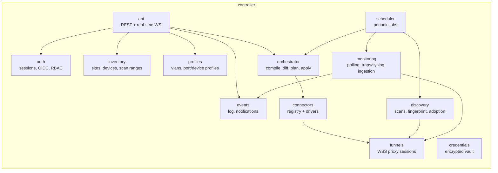

# Controller

Central server, **modular monolith in Go** (no microservices to start with — see [[Hard points and risks]]). A single binary that serves the API, the frontend (files embedded via `embed.FS`), the proxy tunnels and orchestration. Deployed as a container or a bare binary, scaling vertically first.

## Internal modules (Go packages) — the TARGET

> [!note] The breakdown below is a target, and the names did not survive
> None of the packages `inventory`, `profiles`, `orchestrator`, `connectors`,
> `monitoring`, `events`, `credentials` or `scheduler` exists under that name. It is
> not just a renaming: three of these boxes are **empty**, and two others landed
> somewhere other than where the diagram places them. The mapping table that follows
> the diagram says which — keeping it is what makes it possible to know, when a
> package is extracted, which box it comes from.



```
cmd/controller/main.go
internal/
  api/          # HTTP handlers (chi or echo), UI WebSocket hub
  auth/         # sessions, OIDC, RBAC middleware
  inventory/    # sites, devices, scan ranges, candidates, adoption
  profiles/     # vlans, port / device profiles, inheritance resolution
  orchestrator/ # compile → read → diff → plan → apply, job queue
  connectors/   # Driver interface + one package per platform
  tunnels/      # WSS server, multiplexing, ProxyHandle
  discovery/    # scan → fingerprint → adoption pipeline
  monitoring/   # SNMP polling, syslog/traps ingestion
  events/       # log, dedup, notifications
  credentials/  # envelope encryption, ordered attempts
  store/        # PostgreSQL access (sqlc or pgx), migrations
web/            # React SPA, embedded in the binary (go:embed)
```

### Where it really is, and what is empty

| Target box | Reality | Status |
|---|---|---|
| `api` | `internal/api` — **chi**, some forty handler files | **shipped** |
| `auth` | `internal/auth` (sessions, passwords) + `internal/secretbox` (encryption) | **shipped**; OIDC **open** |
| `inventory` | diluted: `internal/store` for persistence, `internal/api/devices_handlers.go` / `sites_handlers.go` / `discovery_handlers.go` for the gestures | **shipped**, never extracted |
| `profiles` | `internal/portrules` (the rules of [[Switch profiles]]) + `internal/siteconfig` (the exchange format); port and device profiles are `jsonb` handled in `api` | **shipped**, scattered |
| `orchestrator` | **does not exist.** The pure diff is `internal/recon`; applying is `internal/api/autoapply.go`; the connector call is made directly from `api` | **partial**, see below |
| `connectors` | `internal/driver` (the contract) + `internal/driver/instanton` (the only connector) | **shipped** |
| `tunnels` | `internal/tunnel` — `Hub` and not `ProxyHandle`, see below | **shipped** |
| `discovery` | `internal/discovery` | **shipped** |
| `monitoring` | deliberately split: `internal/snmppoll` (OIDs and sampling) runs **in the proxy**; `internal/api/watch_handlers.go` decides the lists and cadences; `internal/tsdb` writes the series; `internal/api/portevents.go` correlates | **shipped** for SNMP and traps, **nothing** for syslog |
| `events` | `internal/store/events.go` + `internal/api/events_handlers.go`. Flap correlation is **in memory** (`portevents.go`), never in the database | **shipped** |
| `credentials` | `internal/secretbox`, `internal/store/sitecreds.go`, `internal/pwgen`, `internal/tagging` (scope by tag) | **shipped** |
| `scheduler` | **empty box.** No scheduler exists — see the dedicated section | **open** |
| `store` | `internal/store`, **pgx** and numbered SQL migrations (no sqlc) | **shipped** |
| `web/` | `web/` in React + TypeScript, embedded by `//go:embed all:webdist` (`internal/api/spa.go`) | **shipped** |

Not having extracted `inventory` and `profiles` is not debt through negligence: they are the two domains whose boundaries have moved the most (tags, addressing domains, switch profiles all arrived later). Freezing a package around a domain that is still changing costs one refactoring per change. `orchestrator` and `scheduler`, for their part, are empty for another reason — those are decisions, taken below.

### api
- REST **written by hand** with `chi`. There is **no OpenAPI contract, no `oapi-codegen`, no generated TypeScript client**: the frontend's types are maintained by hand in `web/src`. It is an accepted debt, whose price is paid at every added field — and the benefit we did not get, a free typed client, is exactly what is missing when an `omitempty` changes meaning.
- All routes scoped per site via [[RBAC]] — **shipped** (`requireSite`, roles `viewer` / `operator` / `site_admin`).

> [!warning] Real time is SSE, not WebSocket
> The target announced "a single WebSocket `/ws/ui`, subscription per site". What is
> shipped is **`GET /api/sites/{id}/stream` in Server-Sent Events**, one stream per site
> (`internal/api/live_handlers.go`), and the gap is deliberate:
>
> - the stream is **strictly downstream**. The client has nothing to say: when it wants
>   something, it makes a REST request, which also gives it an error code and a typed
>   body. Paying for a bidirectional negotiation never to use it is complexity with no
>   return;
> - the browser **reconnects on its own**, at the delay the server dictates (`retry`
>   field). In WebSocket that loop is application code — to be written, tested, and
>   not got wrong;
> - it is **ordinary HTTP**: same session cookie, same middleware, same role check as
>   the rest of the API. A WebSocket upgrade leaves the HTTP pipeline and forces that
>   check to be redone by hand, which is precisely the kind of place where a right gets
>   forgotten;
> - a corporate reverse proxy lets a long HTTP response through far more often than an
>   upgrade.
>
> WebSocket, for its part, is used where the upstream direction really exists: the
> **proxies' tunnel** (`coder/websocket` + yamux). What **travels** in the SSE stream is
> a "this site has changed" and not the state itself — the screen asks again for what it
> needs, which avoids having two representations of the fleet to keep consistent.

### The configuration pipeline (formerly `orchestrator`)

Pipeline detailed in [[Reconciliation]], which carries the state of each step. In summary:

| Target step | Reality | Status |
|---|---|---|
| **compile**: profiles/groups + overrides → intent per device | `internal/portrules` produces a port configuration from a switch profile's rules; the full inheritance described in [[Profiles and groups]] is not built | **partial** |
| **read**: the connector reads and normalises | `instanton.Admin.ReadState` → `devices.observed` | **shipped** |
| **diff**: structured comparison | `internal/recon`, pure and tested | **shipped** |
| **plan**: the connector orders the operations | **non-existent as an object.** The order (create the VLANs, then write the ports, then save) is **hard-coded in `ApplyPorts`** | **decided, not built** |
| **apply**: dry-run, confirmation, rollback | direct apply with guards and verification read-back; **neither dry-run nor rollback** | **partial** |

> [!warning] There is no job queue, and human validation was removed
> No `jobs` table, no worker pool, no semaphore per site or per proxy —
> `golang.org/x/sync` is only an indirect dependency. What plays the role is smaller and
> lives in `internal/api/autoapply.go`: a **6-second batching** per device (configuring
> 48 ports triggers 48 modifications; without batching, 48 concurrent applies on a
> device that only accepts 5 sessions) and a **per-device lock** that forbids two
> simultaneous applies.
>
> And the explicit validation of §5 of [[Reconciliation]] was **deliberately
> removed**: *configuring forty-eight ports in the interface IS the approval*. Asking
> for it twice, on a product whose promise is to administer the fleet, durably leaves a
> fleet different from what the screen shows. What this does not authorise for all
> that: lifting the write guards, or replaying a failure in a loop — one attempt per
> change, an event if it fails, and the device visibly stays "in progress".
>
> What the job queue would buy when it arrives: resumption after a controller restart
> (today a pending batch is lost) and bounding the load on a whole-fleet deployment.
> Neither can be simulated with a `time.AfterFunc`.

### tunnels (Tunnel Manager)
- Terminates incoming WSS connections from proxies, enrolment authentication ([[Proxy security]]) — **shipped**.
- Heartbeat, disconnection detection, proxy status in the UI — **shipped** (`proxies.last_seen`, events `proxy.connected` / `proxy.disconnected`).

The intended uniform interface was this one:

```go
type ProxyHandle interface {
    DialTCP(ctx context.Context, host string, port int) (net.Conn, error) // tunnelled SSH/Telnet/HTTP
    SNMP(ctx context.Context, op SnmpOp) (SnmpResult, error)              // executed proxy-side
    Scan(ctx context.Context, spec ScanSpec) (<-chan ScanHit, error)      // ARP/ICMP/ports
    Events() <-chan ProxyEvent                                            // syslog/traps/listener status
}
```

This type **does not exist**. The real surface is that of `*tunnel.Hub`, addressed by proxy identifier rather than by handle, and its method set tells of a different architecture — more faithful, as it happens, to what we have learnt:

| Intended method | Reality | Why the shape changed |
|---|---|---|
| `DialTCP` | `Hub.Dial(ctx, proxyID, host, port) (net.Conn, error)` | **shipped**, and the property that matters is intact: it is a `net.Conn`. Connectors receive a `driver.Dialer` (`internal/driver/webfetch.go`) and `nil` means "direct" |
| `SNMP(op)` | **nothing of the kind.** Polling is not a call: it is `Hub.PushWatch(proxyID, WatchConfig)`, an **instruction** the proxy executes in a loop | One SNMP call per cycle would cross the WAN in UDP for every OID. The controller decides the list and the cadences, the proxy executes |
| `Scan(spec)` | **nothing of the kind.** The discovery sweep runs **on the controller** and tunnels its TCP connections (`discovery.Scan` + `Hub.Dial`); the proxy, for its part, does an **ICMP monitoring sweep** of its ranges, through the same `WatchConfig` | Two different needs that a single `Scan` conflated: identifying (TCP, banners, HTTP, authentication — hence platform intelligence) and *observing that an address answers* (ICMP, no intelligence) |
| `Events()` | `Hub.AcceptEvents(proxyID, handler)` — upstream channel of **transitions** | **shipped**. Likewise: we do not send up a state, we send up a change |
| *(absent from the target)* | `Hub.Ask(ctx, proxyID, AskRequest)` — one-off question, read-only | The missing pattern: some facts can be known **only** from the proxy (`snmp_walk`, `source_addr`) and neither of the two long-lived channels can ask for them |

The **internal proxy** does not implement this surface: it only covers the dial, through a nil `Dialer`. A consequence not to lose sight of, developed in [[Overview]]: a device reachable only by the controller is administrable but **not monitored**.

### scheduler — the box is empty, and it must be said

No scheduler exists. What runs periodically, and that is all:

| Task | Where | Cadence |
|---|---|---|
| Purge of expired sessions, purge of candidates never adopted for 30 days | goroutine in `cmd/controller/main.go` | 1 h |
| Closing of calmed port flapping (an **end** of flapping is observed by the absence of events: a clock is needed) | `Server.sweepPortFlaps` | 30 s |
| Rotation of the instance key | `cmd/controller/rekey.go` | on demand |
| ICMP monitoring, SNMP polling, sweeping of ranges | **in the proxy**, on instruction | 1 s / 5–30 s / 10 min |

What the target announced and which **does not exist**: periodic discovery re-scan, **daily re-read of the fleet to detect drift** (re-reading is a manual gesture, `POST /api/devices/{id}/read-state`, or a consequence of an apply), **configuration backups** à la Oxidized ([[State of the art]]), purging of events. Drift detection is the costliest of these absences: the arbitration mechanism is fully shipped ([[Reconciliation]]) but **nobody triggers the read that feeds it**.

## Points of attention

- **A net.Conn everywhere**: all device I/O goes through a `driver.Dialer` — `Hub.Dial` for a remote proxy, `nil` for direct. It is THE abstraction boundary of the system; never bypass it. The name changed (`ProxyHandle.DialTCP` → `driver.Dialer`), the rule did not.
- **Timeouts and contexts**: every device operation carries a `context.Context` with a deadline — **shipped**, including for automatic apply, which gives itself its own context because the HTTP request that triggered it ended long ago.
- **Multi-instance later**: proxy sessions are sticky per instance; moving to N instances = routing calls to the `Hub` through a bus. NOT to be built for the MVP — **and addressing by `proxyID` rather than by handle actually makes it easier**: it is already a key a bus could route.
- Connectors run in the controller's process behind timeouts, but **with no dedicated semaphore or `recover()`**: the only safety net is `middleware.Recoverer`, which only covers the HTTP path — a panic in the automatic apply goroutine would kill the controller. It is one of the arguments for extracting connectors into out-of-process plugins ([[Connectors]], § *Connectors as plugins*), deliberately postponed until a second vendor exists.
