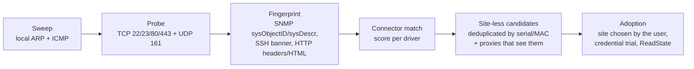

# Discovery — automatic discovery

The user declares **ranges to scan** on a [[Proxy]] (or on the controller's internal proxy for directly reachable networks). The pipeline discovers devices, identifies them, and offers them for **adoption** — the UniFi gesture we borrow.

> [!important] A candidate belongs to nobody
> A scan range belongs to the proxy that can reach it, **not to a site**.
> A device can therefore be discovered **from any proxy**, and what comes out of
> discovery is a *site-less candidate*. The site is chosen **at adoption**, by the
> user — it is the only moment a device acquires a site. The discovering proxy is
> only a witness: it does not become the owner of the device (see [[Proxy]],
> § *Reachability is an observed fact, not an attachment*).
>
> **Shipped**, and the rule holds where it matters: the site is never deduced from
> the proxy. One factual nuance though, because "witness" is a little generous
> today: for lack of access paths, `proxyOf` keeps the original candidate's proxy as
> the **default path** for all later operations on the device. It does not own it —
> no right, no site follows from it — but it is in fact the only path tried
> (callout § *Adoption*).

## Pipeline — the TARGET

1. **Sweep** — *target: run on the proxy side*. In reality the sweep runs **on the controller** and tunnels its TCP connections through the chosen proxy (`discovery.Scan` + `tunnel.Hub.Dial`): there is no `scan` RPC. The consequence is visible — it is **TCP only**: no ARP, no ICMP, hence nothing that filters the six probed ports. The proxy, for its part, does sweep its ranges over **ICMP**, but for *monitoring* and not for discovery: a `host.seen` creates no candidate (§ *What is implemented today*).
2. **Probe**: characteristic ports — 22 (SSH), 23 (Telnet), 80/443 and 8080/8443 (web). **Shipped.** 161/udp is **not** probed, for lack of an SNMP path in discovery, and the **MAC's OUI** is not used: without ARP, we do not have the MAC.
3. **Fingerprint** — in the intended order of reliability:
   - **SNMP** `sysObjectID` + `sysDescr` + `sysName`: the most reliable, and **not built**. The contract provides the slot (`driver.Evidence.SysDescr` / `SysObjectID`) but nothing fills it — discovery opens no SNMP session. It is no longer a protocol problem since the `snmp_walk` question exists ([[Controller-proxy protocol]]): it is a discovery batch to write, and it would make recognition certain where a regex on an HTML title remains a bet;
   - **SSH banner** (`SSH-2.0-Cisco-1.25`…) and post-login command output if a credential works — **shipped**;
   - **HTTP**: `Server` header and page title — **shipped**. Added to this now is the **reading of an authenticated page** when a web credential gets through (§ *Discovery credentials*): it is the device talking about itself, behind an authentication it required itself, and confidence rises to `ConfDeviceSelfReport` — but **only if the page brings a new fact**. Managing to log in does not prove we identified the device better, and confidence rising without a new fact is a quiet lie. The favicon hash and characteristic paths remain a target; it is often the only clue for web-only switches, and the `instanton` connector compensates with an enrichment hook (§ *What the trial against the real device taught us* in [[Connectors]]).
4. **Match** — **shipped, but not by the connectors.** Identification is done on a **pattern table living in discovery** (`internal/discovery/fingerprint.go`): about fifteen platforms recognised by regular expression on the banner, title or command output, the order of the array settling overlaps (Instant On **before** the generic HPE/Aruba entries, otherwise `hpe-procurve` would catch the range). Each entry also carries its platform's paging, identification and configuration-export commands. Failing that, `generic-ssh` / `generic-http`: the device still appears, unidentified rather than forced into a product range.

   The connector comes in **afterwards**, through an enrichment hook that specifies what the generic probe cannot see — exact model, serial, faceplate. It is platform knowledge, and it has no business in a generic probe. A failed enrichment does not make discovery fail; it leaves an explicit note, because one must be able to distinguish "the connector has nothing to say" from "the connector could not talk to the device".

   > [!note] `Driver.Fingerprint` and `driver.Best` are called by nobody
   > The target wants each connector to answer "is this device for me?" and the
   > registry to keep the best score above a threshold. Both exist in the contract
   > (`internal/driver/driver.go`) and `instanton` implements `Fingerprint` — but
   > **no production path calls them**: the registry is only consulted through
   > `driver.Get(name)`, to read capabilities once the driver name is already known.
   >
   > It is not serious today, with a single connector: its recognition is in the
   > discovery table, and it works. It becomes so with the second — two tables of
   > truth for the same question will end up contradicting each other, and it is the
   > one the operator does not see that will win. Merging them is easy (the patterns
   > are already data) and only awaits a decision: the table moves into the
   > connectors, or `Fingerprint` disappears from the contract. Leaving it in the
   > contract without calling it is the only choice that costs both.

   The promise "SNMP monitoring possible without configuration" for an unidentified device remains a **target**: without a connector, there is neither a cadence floor nor an SNMP identity to set. The fallback exists for the cadence half — `unknownFloorInterval`, 60 s, neither 5 s which would bet on the control plane of a device we do not know, nor nothing at all, which would deprive the least well-known devices of monitoring.
5. **Adoption** (user action; an auto-adoption rule per range would then have to name the target site explicitly — **not built**):
   - **choice of site** — it is the essence of the gesture: the candidate had none. **Shipped**, and the right is checked on *that* site;
   - name and location, proposed from the fingerprint and editable — **shipped**. The **group** is not offered at adoption; what is offered is **automatic tagging** (`autoTagDevice`), which plays the same filing role;
   - **carry-over of the physical faceplate** surveyed by the connector: without it, adoption in "push" mode produced a device **with no ports at all**, which is not "blank" but wrong. **Shipped**;
   - choice between **pushed** configuration and **import of the configuration read** (`ios` / `comware` dialects) — **shipped**;
   - **provisioning of the SNMP identity then of the trap recipient** — **shipped** (`provisionSNMP`), and **automatic, not offered**: adopting a device means making it manageable *and* observable. Leaving monitoring to a second manual gesture guarantees a half-monitored fleet in which every omission is invisible — a silent device is still monitored by polling, only thirty seconds later. A failure never makes adoption fail: it is logged and replayed.

   Two steps of the target are **not** done at adoption, and it is better to know where they are:

   - the **ordered trial of the site's [[Credentials]]** is a separate gesture, `POST /api/devices/{id}/credentials/apply`. What adoption uses are the **instance's standard** credentials tried during discovery;
   - the **full `ReadState`** is a separate gesture too, `POST /api/devices/{id}/read-state`. A freshly adopted device therefore has a null `observed_at` — and [[Reconciliation]] files it as `unknown`, which is the truth.

> [!warning] "Observed access paths" do not exist yet
> The target wants the proxies that see the device to be recorded as access paths,
> without any of them becoming its owner. What exists is narrower:
> `discovery_sightings` does record the proxies that saw a **candidate**, with
> latency and date, and the screen shows it — but **nothing of it survives
> adoption**. There is no `device_paths` table, and the path of an operation on an
> adopted device is chosen by `proxyOf`: the original candidate's proxy, failing
> that "Local". No latency comparison, no failover on error.
>
> The corollary is the one that matters for operations: the promise "a proxy that
> goes down does not make its devices inaccessible if they are reachable otherwise"
> is not kept today. And what was shipped instead goes the other way —
> `devices.proxy_id` **designates** a reference collector (migration `0022`,
> [[Proxy]]). The two do not contradict each other: one says what we **can** reach,
> the other which of the eligible ones **must** collect. But only the second is built.

## Special cases

- **Device reachable by several proxies**: it is not a conflict but the normal case, and even desirable — the device has several access paths. Observations are **merged** into a single candidate (key: serial, failing that MAC), which lists the proxies that saw it with their latency. Nothing for the user to choose, except the site at adoption.
- **Same IP seen by two proxies**: the ambiguity is real and cannot be guessed. `192.168.1.0/24` behind two proxies can be two networks foreign to each other (RFC 1918 overlaps from one site to another) **or** a single network reached by two paths, and nothing meshcraft observes distinguishes the two cases. The answer is therefore **declared**: the **addressing domain** (`address_domains` table, migration 0020, decision in `internal/netscope`) is the space in which an address designates one machine and only one. The fallback of the merge key is `(domain, IP)`, never `(proxy, IP)`. By default each proxy has its own domain — hence "distinct networks" — and bringing them together is an explicit operator gesture. The subject has its own note: [[Addressing domains]].
- **A candidate that ACQUIRES a serial number** (the connector surveyed it on the second pass) changes merge key: the first observation, filed under `(domain, ip)`, must be **absorbed** — otherwise the same device appears twice, once identified and once anonymous. Observed in a real test.
- **Inventory conflicts**: re-identification by **serial number** → a switch replacement with an identical IP is detected as a *new* device, not as the same one. **Shipped**, but the source of the serial number is not the one announced: neither `entPhysical` (no SNMP in discovery) nor `show version` in general, but what the **connector** can survey — on an Instant On, the hidden field `rlPhdUnitGenParamSerialNum` of the login page, readable **without authentication** ([[Connectors]]). A device from which no connector can draw a serial falls back on the `(domain, IP)` key, which is precisely the case the previous point handles.
- **Periodic re-scan**: **not built**, for lack of a scheduler ([[Controller]], § *scheduler*). A sweep is a gesture (`POST /api/discovery/prefixes/{id}/scan`). Two detail corrections that avoid looking for what does not exist: the event is called `discovery.scanned` and not `device.discovered` — the latter is **never written** ([[Event log]]); and the transition to `unreachable` comes from the **proxy's ICMP monitoring** after 3 consecutive losses, not from polling failures. What is purged automatically are the **candidates** never adopted for 30 days — never a device of the fleet.
- **LLDP as a discovery source** — *target, and the missing half is shipped*. **Collection** has existed since 29/07/2026 ([[LLDP neighbours]]): neighbours are surveyed over SNMP by the proxy, stored in `lldp_neighbors`, and a neighbour whose chassis belongs to no fleet device is reported **explicitly** as such — with its chassis, its system name and its `sysDescr`. On the reference fleet, three devices are in this case (an RB5009UG, a CRS305, an S3900). What remains a *target* is the **gesture**: nothing builds a discovery candidate from a neighbour, and [[Weathermap]] lists it without drawing it or offering to adopt it. The link is therefore now **visible without being actionable** — one step further than before, when it was invisible. `link.created` / `link.deleted` remain **entered** links ([[Event log]]), and the neighbourhood still produces no event.
- **Device unable to carry the site's management VLAN** (low end limited to VLAN 1, or to untagged): adoption into the site plan should be **refused**, with the reason and the ways out — keep the existing addressing while accepting the gap, or change the site plan ([[Management addressing]]). Pushing that VLAN would make the device unreachable. **Decided, not built**: the `site_mgmt_plan.strict_plan` flag exists in the database and in `model.MgmtPlan`, but **no code reads it** — adoption compares nothing with the connector's `Mgmt` capabilities. The safeguard that really exists is elsewhere and comes **later**: `mgmtPathOf` refuses the management *cutover* to a VLAN that no active uplink carries (`internal/api/conformity.go`). In other words we currently prevent losing a device, not adopting it into a plan it cannot carry — and the second protection is the one that would avoid the first situation.
- **IPv6**: a `/64` cannot be swept (2⁶⁴ addresses). v6 discovery will go through the local segment's neighbour table (Neighbor Discovery, `ff02::1`), LLDP/SNMP and manual addition by address — **target**, none of these paths exists, and ICMP monitoring itself is v4 only. What is **shipped** is the half that decides: a large v6 prefix is **declarable** (it is the truth of the site's addressing) but its **enumeration** is refused with its reason (`discovery.Enumerable`, `/112` floor); a management `/120` sweeps very well. The nuance compared with the previous wording matters: the refusal is at the **sweep**, not at entry — *declaring* a range and *knowing how to walk it* are two questions, and the discovery strategy is chosen at sweep time. Details in [[Docker deployment and IPv6]].

## Three entry points, a single pipeline

The interface exposes discovery through a dedicated section ([[Web interface]]), but everything ends up at the same fingerprint and the same candidate queue:

1. **Automatic sweep** of the ranges declared on a proxy.
2. **Manual add by IP**: same probe, on a single address, with the choice of credential — all of the instance's by priority, **just one** of them (`credential_id`), or a one-off credential not recorded — and the option to force the device type.
3. **Add by serial port**: the browser opens the serial port (Web Serial API, Chromium + HTTPS) and the controller only receives the captured text. It is the entry point for new or reset devices, which do not yet have a reachable IP.

> [!warning] This entry point does not exist on every device
> Some ranges have **no serial port** — that is the case of the Aruba Instant On
> 1930 ([[Connectors]]). For them, adding through the console is impossible and the
> only recourse in case of lost access is the reset button. The connector declares
> it (`SerialPort: false`), and the UI must stop offering an entry point that does
> not exist rather than leave the operator looking for a connector they will never
> have.

## Discovery credentials

These are the username/password pairs tried on a device **that meshcraft does not
manage yet**. They belong to the **instance** and not to a site — discovery comes
before the choice of site — and are set in the global configuration,
`/config/identifiants` (global-admin). They long lived in a site's "Add equipment"
menu: nobody looked for them there, and the operator retyped their password at every
probe. Not to be confused with the [[Credentials]] **installed** on a site's devices,
which are another subject and another screen.

They are tried **in order of priority**, and the declared kind says over which
transport:

| Kind | Tried | By what means |
|---|---|---|
| `any` | **yes** | SSH then web interface. The same pair often opens both — making the user enter it twice would make no sense |
| `ssh` | **yes** | SSH session (old algorithms accepted), then the platform's identification command |
| `http` | **yes** | `Authorization` header on the web interface, **read-only**, in the scheme the device announces in its `WWW-Authenticate` (`driver.AuthAuto`) — Basic or Digest |
| `telnet` | **no** | nothing. See below: the absence is declared, not left to silence |

The empty kind is that of the **one-off** credential entered when adding by IP: it
applies to all transports tried. Someone typing a password for "that switch there"
should not have to guess through where meshcraft will get in — and that was indeed
the defect: forced to `ssh`, this pair was never presented to a web-only range.

### The three outcomes of a web trial

There are three and not two, because they do not call for the same gesture:

1. **Authentication accepted** (`web_auth: ok`) — the credential used is named in
   the probe result (`credential_name`), and the page read serves for
   identification.
2. **Credentials refused** (`refused`) — the device **asked again** for
   authentication after seeing our credentials. It is there, and only there, that
   there is a password to correct.
3. **This interface does not authenticate at the HTTP level** (`no-http-auth`) — no
   page tried answers 401: **no credential was presented to anybody**.
   That is the case of UIs with a **login form**, the Aruba Instant On first among
   them: 200 to anonymous, session in a cookie after POSTing a form whose URL and
   fields you have to know. None of that can be guessed from a generic probe — it is
   the job of a [[Connectors|connector]]. Passing this limit off as a refusal would
   send people looking for a wrong password for hours.

Added to this is `error`: trial not completed (link cut, TLS refused, authentication
scheme `driver.WebSession` cannot present). Neither a refusal nor an absence.

> [!note] The root is not enough, and that is verified
> SwOS **and** RouterOS serve their home page with 200 to an anonymous user, and
> only require authentication on their **data** pages (`/sys.b` with Digest,
> `/rest/system/resource` with Basic). Sticking to `/` would therefore have
> concluded "this interface does not authenticate" on the two devices this batch
> unblocks. The probe therefore carries a small `driver → paths that authenticate`
> table (`internal/discovery/probe.go`), with the same weakness as the pattern
> table of `fingerprint.go`: it is platform knowledge filed in a generic probe, and
> its final place is in the connector. Meanwhile, having it there is the difference
> between a credential that is tried and a decorative one. For an unrecognised
> device, we try **only** the root: guessing paths would be sweeping the device
> blindly.

> [!warning] The `telnet` kind is not tried, and the screen says so
> meshcraft does not ship a telnet client. Authenticating over telnet is a blind
> dialogue of prompts in which a refusal cannot be told apart from a slow prompt: we
> would therefore not be able to **count** failures, and the protection against
> account lockout (§ *Safeguards*) would no longer hold. A telnet credential can
> still be recorded — the screen marks it "not tried", and the probe flags it in its
> **remarks** as soon as it meets a device whose port 23 is open. The rule is the
> project's: absence is declared.

> [!important] A secret that has become unreadable
> A credential whose secret can no longer be decrypted with the current instance
> key is **silently discarded** by discovery — and it is right not to fail entirely
> for one credential out of five. The result, however, is a row that exists in the
> database, displays like the others, "recorded" secret included, and is **never**
> tried. The discovery credentials screen is the only place where this can be
> seen: it marks those rows "unreadable — key changed". The key fingerprint
> (migration `0024`) makes the case rare, not impossible: it prevents starting with
> another key, it does not repair rows sealed before it existed.

## What is implemented today

So as not to confuse the target with the actual state:

| Step | State |
|---|---|
| TCP sweep (22/23/80/443/8080/8443), latency, transports | **shipped** — parallelism adapted to the range size (24 / 96 / 192) |
| Sweep **through a remote proxy** | **shipped** — WSS + yamux tunnel ([[Controller-proxy protocol]]). The "Local proxy only" restriction of the previous wording no longer applies; a stale comment remains in `handleRunScan`, announcing a `501` the code no longer returns |
| SSH banner, HTTP/HTTPS header + title | **shipped** |
| SSH session with the discovery credentials, output of the version command | **shipped** (old algorithms accepted: without them part of the real fleet is unreachable); stop after **2 failures on a host**, so as not to trigger AAA lockouts |
| **Trying credentials on the web interface** (Basic / Digest, read-only) | **shipped** — `driver.WebSession` + `SetAuth(AuthAuto, …)`, after SSH and only if SSH opened nothing. Three distinct outcomes, including "this interface does not authenticate at the HTTP level" (§ *Discovery credentials*) |
| Trying credentials over **telnet** | **not done, and declared as such** — no telnet client; the screen marks it "not tried" and the probe flags it on a device whose port 23 is open |
| Choosing a **recorded** credential for a one-off probe | **shipped** — `credential_id` on `POST /api/discovery/probe`: a password already entrusted to the instance is not retyped |
| Driver match + confidence + source of the clue | **shipped** — pattern table in `internal/discovery/fingerprint.go`, and **not** through `Driver.Fingerprint`, which nobody calls (callout of step 4) |
| Enrichment by the connector after identification (exact model, serial, faceplate) | **shipped** — the generic probe stays ignorant of vendor specifics ([[Connectors]]) |
| Reading and **importing** the configuration (VLANs, ports, faceplate) | **shipped**, `ios` and `comware` dialects |
| Addressing domain as fallback of the merge key | **shipped** — `address_domains` table, migration `0020`, `internal/netscope` ([[Addressing domains]]) |
| Manual add by IP, add by serial port, one-off probe | **shipped** — `POST /api/discovery/probe`, `/serial`, `/parse-config` |
| Searchable reset procedures | **shipped** — `GET /api/discovery/reset-procedures` |
| Taking over a device not yet adopted ("Configure Locally") | **shipped** for the Instant On family — `POST /api/discovery/onboard`, global-admin, and it is a **write**: see the safeguards |
| **Configuration writing by connector** | **shipped** on `instanton` — VLAN creation, port VLAN membership, SNMP identity, trap recipient, administration account, management VLAN cutover. What this connector does **not** write: PoE and spanning-tree (`WritableExtras` is empty, and documented as such) |
| **ARP** sweep | **to do** — and it is the costliest absence on this list: a device that filters ICMP *and* opens none of the six probed ports is invisible today |
| **ICMP** sweep in the discovery pipeline | **to do.** The proxy does sweep its ranges over ICMP every 10 min and reports `host.seen` / `sweep.done` — but the controller **logs them without creating a candidate**: answering ping says nothing about what a device is, and the identification sweep remains an explicit gesture. What is missing is therefore not the measurement, it is wiring it into the candidate queue |
| **SNMP** fingerprint (`sysObjectID`, `sysDescr`) | **to do** — no more protocol lock since the `snmp_walk` question |
| Periodic re-scan, IPv6 discovery | **to do** ([[Roadmap]]) |
| LLDP as a source | **collection shipped** ([[LLDP neighbours]]), **adoption of a ghost neighbour to do** |

## Resetting a device

The factory-reset procedure is platform knowledge: it therefore belongs to the **driver**, like the command that reads the configuration. Each driver declares two paths — through the CLI when administrator access is retained, through the hardware when it is lost — what is actually erased, and the known pitfalls. The interface makes them searchable by vendor, range or part number. Procedures whose gesture varies from one model to another are marked as to be confirmed on the product sheet: a wrong reset procedure costs time at best, access to the device at worst.

## Safeguards

- **Sweep rate bounded, but not adjustable.** Parallelism is **derived from the range size** — 24 connections on a `/24`, 96 beyond 1,024 addresses, 192 beyond 8,192 (`discovery.ConcurrencyFor`) — and a time budget bounds the whole (12 min on very large ranges). Stay polite on a small network, go fast on a large one, without ever looking like an attack. The announced **per-range** setting does not exist: it is a target, and its point is the slow link, which the prefix size does not predict.
- **Credential trials with cautious lockout** — **shipped**: `maxAuthFailures = 2`, but the bound is on the **host** and not on the account. We stop after two failures on an address, even if there are credentials left to try, and the bound **also applies on the web path** — a device's AAA policy counts failures from all origins combined, and the anonymous 401 used to detect authentication is presented by nobody and counts for nothing. It is more cautious than the announced rule, and for the right reason: what we protect is the network team's account on *that* device, whose AAA policy counts failures from all origins combined.
- **No write to the device during the sweep.** The probe only reads — banners, headers, a version command. One **exception**, and it must be named rather than left to contradict the rule: **onboarding** (`POST /api/discovery/onboard`) writes to a device not yet adopted, because some ranges cannot be managed before they have been taken out of waiting for their vendor portal. It is an explicit gesture, reserved for the global-admin, with the rights of the borrowed proxy, and the connector **checks the state before and reads back after** — not a side effect of the sweep.
