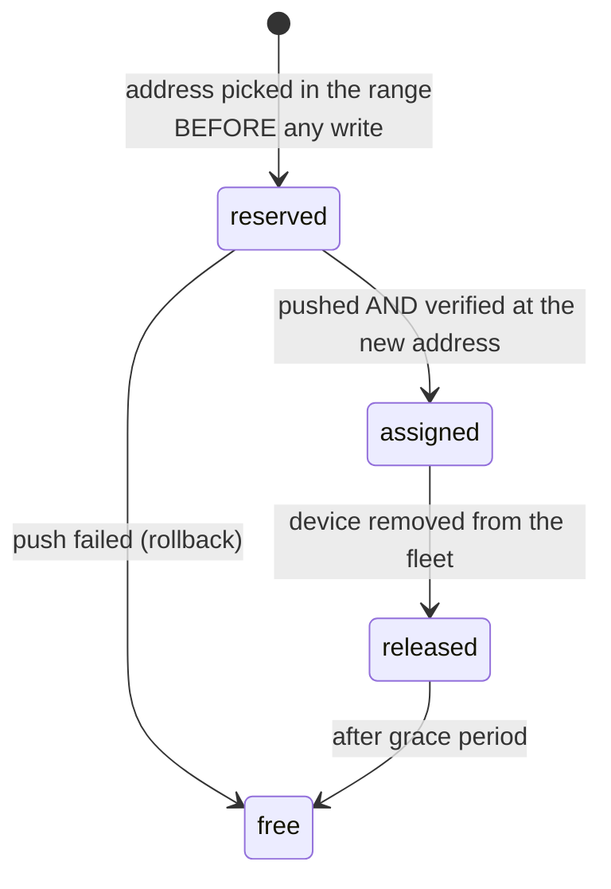
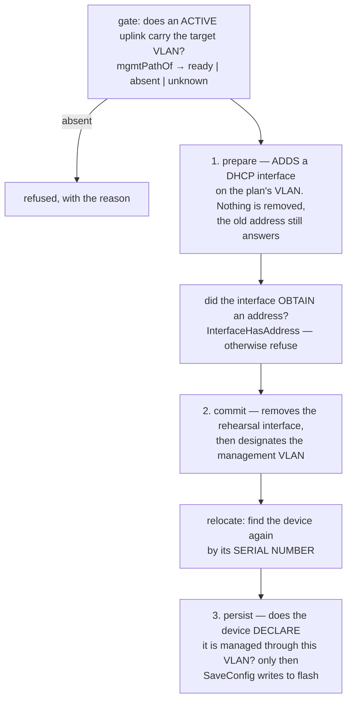
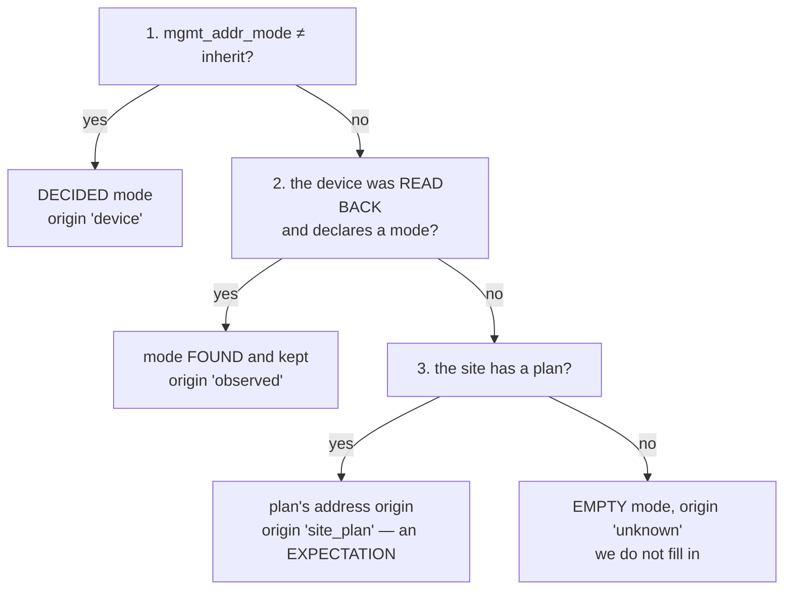

# Management addressing

How an adopted device is **reachable for administration**: keep what it has, or enter the site's addressing plan. It is the most dangerous decision in the product — getting it wrong cuts access to the very device you wanted to administer ([[Reconciliation]]).

## 1. Two modes, one decision per device

| Mode | What meshcraft does | When |
|---|---|---|
| **1 — Keep** (`keep`) | Touches **nothing**: management VLAN, address, gateway and routes remain the device's own. meshcraft merely **observes** them and connects through them. | existing fleet you do not want to renumber, device outside the plan, special case |
| **2 — Site plan** (`site_plan`) | Applies the **site's management plan**: management VLAN, address (allocated or DHCP), default gateway. | bringing a fleet into line, new device, any standardised deployment |

The mode lives **on the device**, not on the site: a site can have a plan and a few devices in `keep`. Changing it later is possible, but it is a **disruptive** operation (§5): you do not renumber a switch by accident.

> [!note] Decided, not built — the mode is not yet a piece of data
> `devices.mgmt_mode` does not exist. Every adopted device is today in a
> regime that **resembles** mode 1: meshcraft observes its address and never
> rewrites it on its own. The difference from a true mode 1 is that there is no
> **declaration** — so nothing distinguishes "keep, decided" from
> "not yet migrated", and nothing a future `apply` could refer to in order to
> abstain.
>
> What the code ships instead, and which is the dangerous gesture of the pair: the
> **cutover to the plan**, explicitly requested device by device (§5).
> That is the sound delivery order — first build the operation that cuts access,
> with its safeguards, before the label saying you do not want to perform it.

> [!important] Not to be confused with the ADDRESSING MODE, which is shipped (§8)
> The mode above (`keep` / `site_plan`) answers "does this device enter the site
> plan?", hence a question of **VLAN and subnet**. It does not exist yet.
>
> A neighbouring and **independent** question does exist in the database since
> migration `0027`: **how does this device obtain its address** *within* that
> subnet — DHCP or fixed address, with its gateway and DNS. A device can be in the
> plan with a static address, or outside the plan with DHCP: all four combinations
> make sense. The whole of §8 is devoted to this axis, and it carries the rule "a
> device found with a fixed address in the right management LAN stays there".

> [!note] Not to be confused with the "push / import" choice
> Adoption already asks one question: is the port and VLAN configuration
> **pushed by the platform** or **imported from the device** ([[Discovery]])?
> That is an **independent** axis: you can perfectly well import the existing port
> configuration *and* renumber management, or push a complete configuration *while
> keeping* the management address. Two questions, two answers.

In `keep` mode, the corresponding fields of the intent are **absent** — in the sense of rule 3 of the [[Standard data model]], "absent = not managed". That is what guarantees no `apply` will rewrite the addressing: it is not an intent marked "do not do", it is an absence of intent.

## 2. The site management plan

Defined once per site, in the administration area ([[Web interface]]), by a `site_admin` ([[RBAC]]):

| Setting | Detail |
|---|---|
| Management VLAN | the identifier, **and whether it is tagged or native/untagged**. Native VLAN 1 is a valid choice, and often the only possible one (§3). |
| Subnet | IPv4 and/or IPv6 of management (`10.10.0.0/24`, `2001:db8:1::/64`) |
| Default gateway | the address of the default route pushed to devices |
| DNS, NTP | optional. **Recorded only**: no connector pushes them yet, and the target remains to carry them with the rest of the intent ([[Standard data model]]) |
| Address origin | **External DHCP** or **meshcraft**. Recorded and validated; `meshcraft` currently has **no effect** for lack of an allocator (§2) |
| Usable range | if meshcraft: the portion of the subnet it allows itself to hand out (`10.10.0.50` → `10.10.0.199`). Validated on entry, never yet consumed |

### External DHCP or meshcraft: what it means exactly

> [!important] meshcraft is not a DHCP server
> - **External DHCP**: meshcraft configures the device's management interface as a
>   DHCP client and **allocates nothing**. The address obtained is observed, not
>   decided. A stable reservation on the DHCP side is still recommended —
>   otherwise the address can change under our feet, and it is up to the
>   customer's network to guarantee it, not for us to assume it.
> - **meshcraft**: it plays the role of **IPAM** — it picks a free address in the
>   range, reserves it in its database, and pushes it as **static configuration**
>   to the device. No DHCP packet is sent: nothing to listen to, nothing to run on
>   the [[Proxy]], and no additional critical service on the customer's site.
>
> The phrase "managed by meshcraft" therefore designates allocation, not distribution.

### Allocation: reserve before pushing, release as late as possible

> [!warning] Decided, not built — the table exists, the allocator does not
> This whole paragraph describes a **target**. `mgmt_addresses` is created
> (migration `0009`) and `store.MgmtPoolUsage` can **count** what it contains, but
> no code **inserts** anything into it: there is no reservation, no transition to
> `assigned`, no deferred release, no drift detection. The only management cutover
> shipped (§5) goes through the target network's **DHCP**, never through an address
> chosen by meshcraft.
>
> Saying so is what avoids looking for a faulty allocator: there is none yet.
> Keeping it is what avoids reinventing it differently the day the plan's
> `meshcraft` origin stops being a setting without effect.

Same logic as secret generations ([[Service identity and rotation]]): between the decision and the actual state of the devices there is time, and the database must never lie.



- **Reserve first.** An address is written to the database before being pushed: two simultaneous adoptions cannot pick the same one. A `(site, address)` uniqueness constraint guarantees it at the database level, not only in the code.
- **Never allocate an address already seen.** [[Discovery]] observes addresses in use: those are excluded from the range, even if the database believes them free. The network is always right against the inventory.
- **Deferred release.** The address of a deleted device is not immediately recyclable: a switched-off device may come back with its old configuration. Grace period, as for secret generations.
- **Range exhausted**: explicit error with the count ("0 free addresses out of 150, 150 assigned"), never a silent failure nor an overflow outside the range.
- **Drift**: a device answering at an address other than the allocated one produces an event (`mgmt.address_drift`), and the observed state is corrected — the database learns from reality.

## 3. Not every device can do a management VLAN

This is the hard case, and it is frequent at the low end: some devices only allow their management interface on **VLAN 1**, or only **untagged**. Pushing a tagged management VLAN to such a device makes it unreachable — exactly what the rule *never cut off your own hand* forbids.

It is therefore a **model capability**, declared by the connector ([[Connectors]]) and carried by the model catalogue. As it exists in `internal/driver/driver.go`:

```go
type MgmtCapabilities struct {
    VlanIDs   VlanSupport // "any" | "default_only" | "" (unknown)
    VlanRange [2]int      // bounds allowed for the management VLAN
    TaggedOK  bool        // management works on a tagged VLAN
    Static    bool        // static address allowed
    DHCP      bool        // DHCP client allowed
    DHCPFallback string   // fallback address if DHCP does not answer
    Notes     []string    // ORDERING constraints and vendor pitfalls
}
```

Two fields were not planned and imposed themselves at the first real survey.
`DHCPFallback` because a device that "has no address" has one anyway — the 1930
falls back to `192.168.1.1` — and believing otherwise sends you looking for a
silent device where it answers. `Notes` because most of what distinguishes an
`apply` that works from a lost device is not a checkbox but an **order of
operations**: *a VLAN with no member port cannot become the management VLAN*,
*SNMP is only allowed on the management VLAN*. Reducing that to booleans would
have forced inventing one capability per pitfall.

> [!warning] Declared, not yet consulted
> `MgmtCapabilities` is **filled in** by the `instanton` connector and readable by
> the catalogue API. No write path **queries** it today: the three checks at the
> bottom of this section are **decided, not built**. What really keeps hold is a
> check of another kind, shipped and verified — the management VLAN path (§5).

> [!warning] An unknown capability is assumed ABSENT
> For anything that can cut access, the unknown is treated as a refusal. A model
> for which we do not know whether it accepts a tagged management VLAN is treated
> as not accepting it: at worst we ask for a needless confirmation, at best we
> avoid bricking a device. The reverse — assuming the capability present — is paid
> for with a site visit.

### Consequence: adoption is blocked, with the reason

If the site plan requires a management VLAN the device cannot carry, **adoption in mode 2 is refused** with a message that says precisely what:

> "This model only allows management on untagged VLAN 1. The plan of site
> "Atelier Lyon" requires tagged VLAN 10. Adopting in mode 2 would make the
> device unreachable."

And three ways out, presented with the refusal:

1. **Adopt in mode 1** (keep the existing addressing) — the device is manageable, simply outside the plan. From then on it appears as **not compliant with the plan** in the UI, with the reason, rather than being forgotten.
2. **Change the site plan** to native/VLAN 1 management, if the site's fleet justifies it.
3. **Give up** on this device in this site.

> [!important] The block applies to mode 2, not to adoption in general
> Refusing any adoption would leave a device that was bought and plugged in
> permanently outside the product — a wall, not a safeguard. Mode 1 therefore
> stays open, but it takes an explicit gesture and the gap is **displayed**: a
> device outside the plan must be visible as such, not lost in the crowd.
> A site option, `site_mgmt_plan.strict_plan` (**enabled** by default), makes it
> possible to forbid even this workaround when the customer's policy requires it.
> The column exists, the screen offers it and the API records it — but **no code
> reads it**: it is today a setting without effect, and will remain so until
> adoption has capability gates to harden.

> [!note] First real case: the Instant On 1930 is NOT the limited case
> One expects an entry-level switch to be stuck on VLAN 1. The 1930 in fact
> accepts any management VLAN between 1 and 4092 ([[Connectors]]). The lesson is
> not "it was an unfounded worry" but "the capability is **surveyed**, it is not
> deduced from the price range". On the other hand it imposes an ordering
> constraint the plan must respect: a VLAN with no member port cannot be
> designated as the management VLAN.

The check will have to be applied in **three places**, because a single one always ends up bypassed: at adoption (the UI refuses before acting), at intent compilation (validation against capabilities, rule 5 of the [[Standard data model]]), and at plan/apply (last line of defence). **None of the three exists** — the target remains that one, and the redundancy is the point, not excessive zeal.

## 4. Which entry point chooses which mode

> [!note] Decided, not built
> No entry point asks a mode question today: there is no mode to set (§1). This
> table is the **target**, and it is worth keeping for a precise reason — the
> correct default depends on the entry point, and that is the kind of nuance
> nobody thinks of restoring once a single default has been coded everywhere.

The three entry points of [[Discovery]] do not have the same context, hence not the same default:

| Entry point | Proposed mode | Why |
|---|---|---|
| **Manual add by IP** | **explicit choice** between 1 and 2, default *keep* | the current address was typed in: it is a special case, the operator knows what they are doing |
| Automatic discovery | site plan (mode 2) | discovery serves to standardise a fleet; the gap to the plan is precisely what we want to reduce |
| Serial port (new device) | site plan (mode 2), **forced** | there is nothing to keep: the device has no reachable address yet |
| Catalogue model (pre-provisioned) | site plan (mode 2), **forced** | the device does not physically exist yet |

In every case where mode 2 will apply, the capability check of §3 will have to precede adoption.

## 5. Moving a device into the plan: the riskiest operation

Changing the management VLAN **and** the address is sawing off the branch you are sitting on: the current session dies in the middle of the operation, and the device reappears — or not — elsewhere. It is **shipped**, on `instanton`, and split into **three separate gestures** (`internal/api/recon_handlers.go`) because the safety net depends precisely on this separation.



What [[Reconciliation]] guarantees here, on top of its usual rules:

- **The gate is the VLAN's PATH, not a proxy's reachability.** `mgmtPathOf` looks for a port that carries **both** an active link and the target VLAN — native or tagged according to what the plan asks. Both matter: *"the VLAN is on the switch"* never meant *"it gets out of it"*. Three outcomes, and the undetermined one is a real one: a device never read back returns `unknown`, which **does not forbid** — answering `absent` would turn ignorance into a ban on a fleet largely not yet read back, and answering `ready` would do exactly the damage targeted. Only `absent` blocks, because it is a certainty, and one that costs a site visit.
- **The safety net is what is NOT written to flash**, not a backup. As long as `persist` has not happened, a power cut brings the device back to its previous addressing: that is what allows attempting the manoeuvre on equipment in service. Corollary stated on screen: this net becomes a **trap** as soon as the cutover is found good, since meshcraft then knows the new address and a power cut would bring the device back to the old one without anyone learning of it. Hence the third gesture, separate.
- **The rehearsal interface is the heart of the procedure.** `prepare` **adds** an IPv4 interface as a DHCP client on the target VLAN without removing anything: the device keeps its current address, hence stays reachable, and **proves** that a DHCP server answers in the target network. That is what turns the cutover from a bet into a verification. It must then disappear, because the device refuses to designate as management VLAN a VLAN that already carries an IP configuration — it is the **device** that will reinstall the address there, and that is the only truly delicate instant of the manoeuvre.
- **A favourable return code proves nothing**: after each write, the section is **read back**. It is the general lesson of this interface ([[Connectors]]) and it is applied here literally.
- **Management is never touched through the ports path.** So it is not "last in the plan's order": it is **outside** the port-writing path, and the cutover is an explicitly requested gesture. `instanton.ApplyPorts` carries the safeguard, and it is placed **on the port, not on the VLAN**: a port that is *both* an untagged member of a management VLAN *and* carrying a link never has its native VLAN changed. Three clarifications, each with a reason:
	- **two** VLANs count as management, the plan's **and** the one the device declares. They differ as long as a device has not been migrated — observed on a 1930: plan at 99, device at 1. Protecting only the former would allow rewriting the one carrying the session;
	- the **link** condition is what makes the safeguard usable. Out of the box, all 48 ports are untagged in VLAN 1, which is also the administration one: without it, no port would ever be modifiable and "adopting" would mean nothing. A port without a cable cannot carry any session;
	- **adding** tagged VLANs to a protected port remains allowed: it does not touch untagged traffic, hence not the session. And if **no** management VLAN is known — neither from the plan nor from the device — the write is **refused** entirely rather than attempted without guarantee. An explicit `force` lifts the safeguard; it is never enabled by automatic writing.
- **Verification at the NEW address, on the serial number.** `internal/relocate` sweeps the target subnet *and* accepts in parallel an address entered by the operator — who often knows it before the sweep finishes. The first of the two that **identifies the right serial** wins; an address is refused if the serial differs, because a recycled DHCP lease can designate another device and pointing meshcraft at the wrong hardware would be worse than finding nothing. Then `persist` requires the device to **declare itself** managed through the plan's VLAN: saving an unverified cutover would engrave an error.

> [!warning] Decided, not built — what the cutover does not repair yet
> First a scope limit: the shipped cutover is **DHCP only**.
> `AddManagementInterface` sets up a DHCP client, and nothing writes a static
> address on the target VLAN. A plan with origin `meshcraft` therefore changes
> nothing in the manoeuvre — it is §2 that is missing, not this section.
> Consequence to know: the success of the cutover depends on a DHCP server present
> in the management network, and that is precisely what `prepare` will **verify**
> before anything irreversible happens.
>
> Then, three legitimate consequences are **not** drawn today, and it is better to
> read them here than discover them on a fleet:
>
> - **the trap destination is not invalidated.** A change of management subnet
>   changes the return path, hence makes `trap_dest_addr` stale along with the
>   `trap_seen_at` proof that goes with it (migration `0023`). Only
>   `store.SetDeviceProxy` — a change of **collector** — forgets these
>   columns; `SetDeviceMgmtIP` only writes `mgmt_ip`. A claim kept after a change
>   of path is exactly the kind of lie `0023` exists to remove, and the management
>   cutover is the second path by which it comes back;
> - **no collector is recomputed** — the election is itself decided and not built
>   ([[Monitoring]], § *Choosing the collection point*), and the
>   `devices.proxy_id` attachment remains a **declaration** the cutover does not
>   touch;
> - **no `disruptive` marking nor maintenance window.** Neither exists in the
>   code; what the screen gives instead is the split into three gestures and the
>   reminder, at each step, that nothing is written to flash yet. It is less
>   ambitious and strictly more honest.
>
> And a clarification that is not a detail: `device_paths` is **named everywhere
> in the vault but is not a table**. The set of proxies that reach a device is
> persisted nowhere today — so there is nothing to invalidate after a cutover, and
> nothing to base an overlap on.

## 6. Data model

What is **in the database** (migration `0009`):

```sql
-- Site management plan: one row per site.
--
-- All addresses are `text`, not `cidr`/`inet`. This is not negligence: these
-- fields are entered in a form, and a strict PostgreSQL type would turn a typo
-- into an unreadable database error where the controller can say "gateway
-- 10.0.0.1 does not belong to subnet 10.10.0.0/24". Validation lives in
-- `validateMgmtPlan`, in a single place, and it is more talkative than a
-- constraint.
site_mgmt_plan(site_id pk fk sites,
               vlan_id int not null default 1,  -- 1 = default; see untagged
               untagged bool not null default true,   -- management on native VLAN
               subnet_v4 text, gateway_v4 text,
               subnet_v6 text, gateway_v6 text,
               dns text[], ntp text[],
               source text,                     -- dhcp_external | meshcraft
               pool_start text, pool_end text,
               strict_plan bool default true,   -- refuse the mode 1 workaround
               updated_by fk users, updated_at)

-- IPAM: management addresses allocated by meshcraft. Uniqueness is enforced by
-- the DATABASE, not by the code: two concurrent adoptions cannot pick the same
-- address. The table exists; nothing writes to it yet (§2).
mgmt_addresses(site_id fk, address text, device_id fk null,
               state text,                      -- reserved|assigned|released
               allocated_at, released_at null,
               primary key (site_id, address))
```

The per-device **addressing mode**, on the other hand, is in the database (migration `0027`, §8):

```sql
-- How THIS device obtains its address, independently of the VLAN.
--
-- `inherit` is the default and means "meshcraft imposes nothing": rule 3 of the
-- standard data model, "absent = not managed". A static device therefore stays
-- static without anyone having to declare it, and the whole existing fleet
-- starts in this state — the migration is semantics-preserving.
devices(… , mgmt_addr_mode  text not null default 'inherit',  -- inherit|dhcp|static
            mgmt_static_ip  text not null default '',         -- with prefix
            mgmt_static_gw  text not null default '',
            mgmt_static_dns text[] not null default '{}',
            mgmt_addr_by    uuid references users(id),        -- who decided
            mgmt_addr_at    timestamptz,                      -- and when
            -- What the DEVICE declares it carries, read by the connector.
            -- NULL = never read back, and that is information.
            mgmt_addr_observed    jsonb,
            mgmt_addr_observed_at timestamptz)
```

What remains a **target**: the plan membership mode.

```sql
-- Decided, not built. `devices.mgmt_mode` (keep | site_plan) does not exist:
-- every device is today treated as if it could enter the plan, and it is the
-- cutover itself that is an explicit gesture. Not to be confused with
-- `mgmt_addr_mode` above, which is another axis (§8).
devices(… , mgmt_mode text)                     -- keep | site_plan
```

> [!important] No `mgmt_conforms` in the database, and that is a decision
> An earlier version of this note planned `devices.mgmt_conforms` and
> `mgmt_exception`. Both are **abandoned**, and §12 says why: the site plan
> changes at any time, and a frozen boolean would lie from the first
> modification. Compliance is **computed on read** (`conformityWith`,
> `internal/api/conformity.go`) and enriches every device returned by the API.
> Keeping both columns as a target would have been keeping the contradiction.

The effective address stays in `devices.mgmt_ip` — **observed**, as today. `mgmt_addresses` will say what meshcraft *decided*; `mgmt_ip` says what it *finds*. When the two diverge, that is the drift of §2, and the finding will win.

## 7. What the UI must show

- **Site settings → Management** — *shipped* (`web/src/pages/MgmtPlan.tsx`): the plan (VLAN, subnets, gateway, address origin, range), with the **range occupancy** in plain words ("37 addresses assigned, 2 reserved, 111 free out of 150"). The three numbers are already computed — `MgmtPoolUsage` + `PoolSize` — but are all zero as long as nothing allocates: a range filling up must be visible **before** it is full, and the screen is ready for that.
- **The cutover** — *shipped* (`web/src/pages/MgmtMigrate.tsx`): the three gestures of §5, each with its verdict and its "not saved to flash" warning, and the block when the VLAN path is `absent`.
- **On the device record** — *shipped*: compliance with the plan, what the plan requires, and the reason for the gap in plain words.
- **On the device record, under the identity** — *shipped* (`web/src/pages/MgmtAddressing.tsx`): this device's **addressing mode** and the **three fields** address / gateway / DNS, with the choice *inherit / DHCP / fixed address* (§8). The placement is not indifferent: the address is already there, and "by what means did it obtain it?" arises at the moment you read it.
- **On inventory cards** — *shipped*: "Fixed IP" or "DHCP" on the location line, in two words, plus a `!` on hover when intent and device diverge. "Which devices of this fleet have a fixed address?" is asked in front of the inventory, not one record at a time.
- **At adoption** — *target*: the chosen mode, the address that will be allocated (before validating, not after), and the refusal of §3 with its three ways out.
- **Site view** — *target*: how many devices are outside the plan, and why. An 80 % compliant fleet must be visible; a silent gap is a gap that grows.

> [!note] The list of observed exclusions does not exist yet
> It would assume that [[Discovery]] feeds a list of addresses in use for this
> subnet, and that the allocator consults it. Both belong to §2. What already
> exists and is worth noting: the **reachability pre-flight**
> (`POST /api/discovery/reach-check`, `internal/driver/reach.go`), which can tell
> whether a proxy reaches a network — a `refused` there is **good news**, it
> proves the packet arrived. It is offered on the cutover screen, but as a
> **diagnostic tool** to trigger, never as a gate. It is moreover reserved to
> `global-admin` whereas the cutover itself is open to `site_admin`: a site-admin
> therefore sees the button and gets a 403. It is a rights gap to close, in one
> direction or the other.

Events in the [[Event log]] — what is **emitted** today, and what will follow:

| Event | State |
|---|---|
| `mgmt.plan_changed` | **shipped** — `handleUpdateMgmtPlan`, with the plan summarised in plain words |
| `mgmt.migration_prepared` | **shipped**, as a *warning*: the interface is set up and **nothing is saved to flash** |
| `mgmt.migrated` | **shipped**, as a *warning*, with the address obtained on the target VLAN |
| `mgmt.migration_persisted` | **shipped** — the cutover will survive a restart |
| `device.relocate_started`, `device.relocated` | **shipped** — with **who** found it, the sweep or the operator. The screen must be able to say so, if only to know whether the sweep is of any use |
| `mgmt.address_allocated`, `mgmt.address_released`, `mgmt.address_drift` | **decided, not built** — they belong to the allocator of §2 |
| `mgmt.plan_violation`, `mgmt.exception_granted` | **decided, not built** — they belong to the capability gates of §3 |

The three cutover events are **warnings**, not information, and the severity order is not cosmetic: between `prepare` and `persist`, the device carries a configuration a power cut would cancel. A log classifying that as a notice would let a transient state pass for an acquired one.


## 8. The per-device addressing mode: DHCP or fixed address

§2 decides the origin of addresses for a whole **site**. This paragraph decides for **one device**, and the two do not replace each other: a management network does have a dominant regime, but there are always devices that are not in it.

### 8.1 The survey that made it necessary

On the reference installation, **both CSS326 and the CRS326** carry a **static** address, in the **right** management subnet, on a site whose plan says "external DHCP". The three facts are in the connectors' captures, not in a memory:

| Device | Platform | What the capture says | Where |
|---|---|---|---|
| CSS326-24G-2S+ | SwOS 2.17 | `iptp:0x01` — "static" | `swos/testdata/sys.b`, `backup.swb` |
| CRS326-24G-2S+ | RouterOS 7.21 | `"dynamic":"false"` on `192.0.2.54/24` | `routeros/testdata/ip_address.json` |

These devices are **compliant** with the plan: their address is in the subnet, they answer, §12 shows them in green. And yet meshcraft could neither say by what means they had obtained it, nor display the three fields of a static configuration, nor record the decision to leave them that way. A device on a lease and a device with a fixed address looked **identical** — whereas what happens the day the DHCP server changes has nothing in common between the two.

### 8.2 "Keep the static address" is not a special case, it is the default

Three values, in `devices.mgmt_addr_mode`:

| Value | What meshcraft does with it |
|---|---|
| **`inherit`** *(default)* | **Imposes NOTHING.** The device keeps what it carries. It is rule 3 of the [[Standard data model]], "absent = not managed", applied to addressing. |
| **`dhcp`** | The operator wants this device as a DHCP client. |
| **`static`** | The operator wants a fixed address, and the three fields accompanying it are authoritative. |

The default does the work: a device adopted in the right management LAN but with a fixed address **stays** with a fixed address, without anybody's gesture. A consequence of form that makes the migration risk-free — the whole existing fleet starts in `inherit`, so nothing changes behaviour, and no row is rewritten.

### 8.3 The EFFECTIVE mode is resolved on read, in three steps

`api.effectiveAddrMode`, and **the order is the feature**:



Three decisions not to invert:

- **an explicit decision is not contradicted by a finding.** That is what allows switching a static device to DHCP: the intent then diverges from the observation, and that divergence is precisely what we want to **see** (§8.5);
- **the finding comes BEFORE the site plan.** The reverse would treat the three devices of §8.1 as gaps to correct, which is the opposite of the service rendered;
- **when none of the three answers, the mode stays EMPTY.** "meshcraft does not know how this device obtained its address" is accurate and is fixed by a read-back. "DHCP, probably" is not fixed — it spreads.

The origin is **shown on screen** along with the mode, and it is not decorative: it is what distinguishes "static, decided" from "static, found and kept" — the distinction §1 has been asking for from the start and that `devices.mgmt_mode` never managed to make.

### 8.4 Reading the mode on the device: `driver.MgmtAddrReader`

An **optional**, **read-only** interface of the contract ([[Connectors]]), with `driver.MgmtAddrState` for what it returns (mode, address, gateway, DNS, interface, notes). Kept out of `driver.State` for two reasons of a different nature: addressing is not read from the same pages as ports — so one read can succeed when the other fails — and what goes into `devices.observed` is compared with the intent and **triggers writes**, which management must never do through the ports path (§5).

| Connector | Implemented? | On what |
|---|---|---|
| **SwOS** | **yes** | `/sys.b`: `iptp` (0 "DHCP with fallback", 1 "static", 2 "DHCP only"), `cip` (**current** address), `ip` (configured address) |
| **RouterOS** | **yes** | `/ip/address` and its **`dynamic`** field — an address created by the DHCP client carries it as `true`. Plus `/ip/route` and `/ip/dns` for the gateway and resolvers |
| **Instant On** | **yes** | `IPv4InterfaceList.owner`: **2** = DHCP, **1** = static (lab survey `sw-labo-1930`); `3` = factory link-local. Gateway read from `IPv4RouteList`. |

Three details of the SwOS connector deserve to be here, because they cost you in operations:

- **the address returned is `cip`, the current one, not `ip`.** On DHCP, `ip` keeps the fallback address: displaying it would have someone copy into a browser an address the device does not answer on;
- **an unknown `iptp` does not translate into "static".** A firmware returning a fourth value produces an **empty** mode and a note;
- **"DHCP with fallback" is DHCP, and the fallback is stated in a note.** This device has an address *even when no server answers* — hence a CSS believed silent that answers elsewhere.

### 8.5 Drift: "what I want" versus "what it carries"

`api.addrDriftOf` is computed **only** on an explicit intent **and** a surveyed observation. An `inherit` cannot drift — it demands nothing — and a device never read back cannot be declared as diverging: that would turn ignorance into reproach, on a fleet largely not yet read back. It is the same arbitration as the VLAN path one (§5), and it is worth holding twice.

The **address** matters as much as the mode, and it is the most frequent gap: a static intent whose address does not match the one the device carries means the decision was never written, or that someone went behind it. The comparison ignores the **prefix** — SwOS does not carry it (`/sys.b` has `ip`, without a mask) whereas RouterOS returns `192.0.2.54/24` — otherwise a whole product range would be flagged in permanent drift for a difference of notation.

### 8.6 Capabilities are finally QUERIED

§3 has long noted that `MgmtCapabilities` is "filled in but never queried". It is queried here, on the four fields that decide what a screen is allowed to offer — and two of them are **new**:

```go
Static  bool // fixed address allowed
DHCP    bool // DHCP client allowed
Gateway bool // does the platform carry a management GATEWAY?
DNS     bool // … and RESOLVERS?
```

> [!warning] SwOS has NEITHER gateway NOR resolver, and that is an ESTABLISHED ABSENCE
> The **writable** field set of `/sys.b` is enumerated by the device's own
> configuration backup (`testdata/backup.swb`), hence exhaustive:
>
> ```
> sys.b:{id, wdt, dsc, pdsc, ivl, alla, allm, avln, allp, mgmt, prio, cost,
>        frmc, poe, igmp, igmq, igfl, igve, ip, dtrp, ainf, iptp}
> ```
>
> There is `ip` and `iptp`. There is **no** gateway field, **no** resolver, in any
> tab — and the platform's entire web interface fits in a single file that defines
> all its fields. The enumeration **exhausts** the question, as it exhausted it for
> the trap recipient ([[Connectors]]).
>
> **Operational consequence, and a major one: a CSS326 is reachable ONLY from its
> own subnet.** It has nobody to answer beyond its link, so no route will catch it:
> it is the collecting [[Proxy]] that must be placed in the right network, and that
> is not negotiable on the routing side.
>
> Hence the screen's behaviour: a field the platform does not carry is **disabled
> with its reason**, never displayed empty. The two read the same and lead to
> opposite gestures — "not configured" gets fixed, "the platform does not have this
> setting" gets worked around differently.

`validateDeviceAddressing` therefore refuses **on entry**: a mode the platform does not allow, a gateway or DNS on a platform that carries none, a gateway outside the device's subnet (it would be unreachable), a gateway equal to the device's address, a network address, a resolver that is not an IP address.

**The prefix is completed, never guessed.** An operator types `192.0.2.36`: the prefix is borrowed from the plan's subnet when the address is contained in it, and **required** otherwise — no plan, or address outside the subnet. Assuming `/24` would be inventing a mask, and a wrong mask makes a device silent as surely as a wrong address. An address **outside** the subnet is still accepted: it is the out-of-plan device of §1, which §12 already flags in orange; refusing here would build a wall where the product wants a warning.

**An unknown connector forbids nothing**, and this is the deliberate exception to the rule "an unknown capability is assumed absent". That rule protects **writes** to the device; for the addressing intent alone (recording without writing), refusing any annotation on a hand-entered switch would prevent no damage while making the screen unusable. Writes go through `ApplySameVLAN` / `MigrateVLAN` / `JumpVLAN`.

### 8.7 Writing the addressing: apply, migrate, jump

> [!important] Three distinct paths, driven by capabilities
> The intent is always recorded (`PUT …/mgmt-addressing`). **Writing** it to the
> device is a separate gesture, and the connector says which one is tenable:
>
> | Capability | Contract | Platforms |
> |---|---|---|
> | `ApplySameVLAN` | `driver.MgmtAddrWriter` — DHCP/static on the **current** management VLAN | RouterOS, SwOS |
> | `MigrateVLAN` | `driver.MgmtMover` — prepare / verify / cut over (dual path) | Instant On, RouterOS |
> | `JumpVLAN` | `driver.MgmtJumper` — single-address jump + save | SwOS |
>
> - **RouterOS**: same-VLAN apply and dual-path migrate via REST (`/ip/address`,
>   `/ip/dhcp-client`, bridge vlan + interface vlan). `OutOfBand` (serial / MAC-winbox)
>   remains the net if the session drops.
> - **SwOS**: same-VLAN apply and jump rewrite `/sys.b` after `GET /backup.swb`.
>   No `MgmtMover` — a single address, a single `avln`. Confirm the jump in
>   the UI (`confirmed=true`).
> - **Instant On**: VLAN migrate (DHCP) shipped; same-VLAN apply and mode read
>   via `IPv4InterfaceList.owner` (**2**=DHCP, **1**=static, lab survey). DNS
>   write not yet proven. No `OutOfBand` — do not save to flash until the cutover
>   is verified.

Endpoints: `POST …/mgmt-addressing/apply`, `POST …/mgmt-migrate/{prepare,commit,persist}`,
`POST …/mgmt-addressing/jump`.

Two smaller consequences, also not drawn: the **IPAM** of §2 still has no writer, so a `static` mode reserves nothing in `mgmt_addresses`; and the addressing read-back does not invalidate the trap destination, because it changes no address — it observes.

### 8.8 What triggers the read

`POST /api/devices/{id}/read-state` reads the addressing back **in the same gesture** as VLANs and ports: asking the operator for two clicks to read the same device would make them carry a boundary internal to the code. The failure of one does not take the other down, and the order guarantees it — the port state is recorded **before** addressing is attempted. Losing the VLANs of a whole fleet because an addressing page is unreadable on one product range would be a regression; the reason is shown on screen (`mgmt_addr_note`) rather than kept quiet.

## 11. What the implementation shipped

`site_mgmt_plan` and `mgmt_addresses` (migration 0009), the
`GET`/`PUT /api/sites/{id}/mgmt-plan` API, and the site's **Configuration → Management**
screen. Read open to the site's roles, write to `site_admin`.

A site without a plan does not return an error: it returns the **prudent default** —
native VLAN 1, external DHCP, meshcraft touches nothing. The UI says explicitly
that no plan is defined yet, rather than displaying values that would look like a
decision taken.

Validations refuse **on entry** what would break at deployment, when the device is
already half reconfigured:

- VLAN outside 1–4094;
- allocation by meshcraft without a subnet or without a range;
- range outside the subnet, or end before start;
- **gateway outside the subnet** — almost always a typo, and it would be pushed to
  a whole fleet;
- **gateway INSIDE the allocation range** — it would end up assigned to a device.

Then the **cutover** itself (§5), on `instanton`: three endpoints
(`prepare` / `commit` / `persist`), the VLAN path gate, the search by serial
number, and the screen chaining them.

### Decided / shipped / open

| Question | State |
|---|---|
| Per-site management plan, read and written | **shipped** — `site_mgmt_plan` (`0009`), `GET`/`PUT /api/sites/{id}/mgmt-plan`, *Configuration → Management* screen |
| Prudent default when there is no plan | **shipped** — native VLAN 1, external DHCP, `Configured: false` says explicitly that no plan is defined |
| Validation on entry (VLAN, subnet, gateway, range) | **shipped** — `validateMgmtPlan` |
| Compliance with the plan, computed, never stored | **shipped** — `conformityWith`, enriches every device returned |
| VLAN path gate before any write | **shipped** — `mgmtPathOf`: active link **and** target VLAN, `ready`/`absent`/`unknown` |
| Cutover in three gestures, nothing in flash before the third | **shipped** — `internal/api/recon_handlers.go`, `instanton` connector |
| Finding the device at its new address, by its serial | **shipped** — `internal/relocate`, sweep **and** operator input in parallel |
| Reachability pre-flight from a proxy | **shipped** as a tool (`reach-check`), **not** as a gate — and under a different right from the cutover |
| **Per-device addressing mode** (`inherit` / `dhcp` / `static`) | **shipped** — `devices.mgmt_addr_*` (`0027`), `PUT /api/devices/{id}/mgmt-addressing` (`site_admin`), and the three fields on the record (§8) |
| Fixed address found in place and KEPT | **shipped** — it is the `inherit` default: the finding comes before the site plan's origin (§8.3) |
| Reading the addressing mode on the device | **shipped** on SwOS (`iptp`), RouterOS (`dynamic`) and Instant On (`owner` 1/2) — `driver.MgmtAddrReader` (§8.4) |
| Drift between the addressing intent and the device | **shipped** — computed on read, never stored, and never on a device not read back (§8.5) |
| **Writing** the addressing to the device | **shipped** on RouterOS (apply + migrate), SwOS (apply + jump) and Instant On (apply + DHCP migrate) (§8.7) |
| Address allocation by meshcraft (IPAM) | **decided, not built** — table present, no writer; the plan's `meshcraft` origin is a setting without effect |
| Capability gates at adoption (× 3) | **decided, not built** — `MgmtCapabilities` is filled in and, since `0027`, **queried** for addressing (§8.6); the VLAN gates at adoption still do not exist |
| `strict_plan` | **decided, not built** — column recorded, never read |
| Per-device mode (`keep` / `site_plan`) | **decided, not built** — no column, no choice at adoption |
| Invalidating the trap destination after cutover | **open** — legitimate consequence of `0023` not drawn (§5) |
| `disruptive` marking, maintenance window | **decided, not built** |
| Dual-path cutover beyond Instant On / RouterOS | **open** — SwOS stays on jump; Instant On same-VLAN apply awaits the static capture |


## 12. Compliance: a gap is not a failure

Reachability and compliance with the plan are **two distinct axes**, and confusing
them would be a display mistake. A device can answer ping perfectly while being
outside the plan: it is not down, it is **to be migrated**.

> [!important] The addressing mode is NOT a third compliance state
> A **fixed** address in the right subnet is **compliant**. It is not a gap, it is
> a **modality** (§8) — and bringing it into this computation would display an
> orange warning on the three MikroTiks of the reference installation, which have
> nothing to reproach themselves for. Hence two distinct fields in the API
> response, `mgmt` and `mgmt_addressing`, and not a merged state.
>
> What **can** deserve flagging, on that other axis, is the **drift** of
> §8.5: meshcraft wants DHCP, the device carries a static address. The inventory
> marks it with a `!` on hover, the record shows it as a warning, and neither
> presents it as a failure — because it is not one.

- red = no longer answers (found by ICMP monitoring, [[Monitoring]]);
- **orange = outside the plan**, with the reason in plain words ("address 10.100.0.10
  outside the site's management subnet 192.0.2.0/24") and a
  **Migrate management** button;
- compliance is **computed on read**, never stored: the site plan can change at any
  time, and a boolean frozen in the database would lie from the first
  modification.

What is not yet verifiable is stated as such: the management **VLAN** requires a
read of the device, hence a session. As long as there is none, the screen displays
"VLAN not verified" rather than claiming a compliance it has not observed.

A third axis adds to the first two, and it is the one that decides whether the
**Migrate management** button is active: the **path of the target VLAN**.
`Migratable` requires the device to answer *now* **and** the path not to be
`absent` — but an `unknown` path does not block. The nuance is the heart of the
safeguard: *ignorance must not become a ban, a certainty must remain a ban.*
Otherwise a fleet largely not yet read back would be entirely unmigratable, which
would amount to having no button.

The migration therefore opens on this gate, and not on a network pre-flight: the
`reach-check` remains available alongside, as a diagnostic, with its own lesson —
a closed port there is good news, `refused` proves the packet arrived, whereas a
`timeout` does not distinguish "no route" from "silently filtered".
