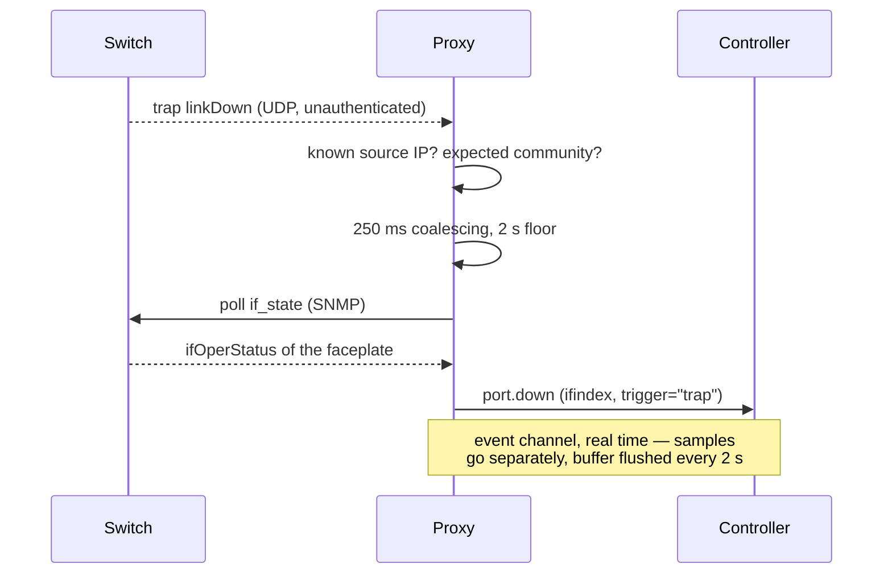
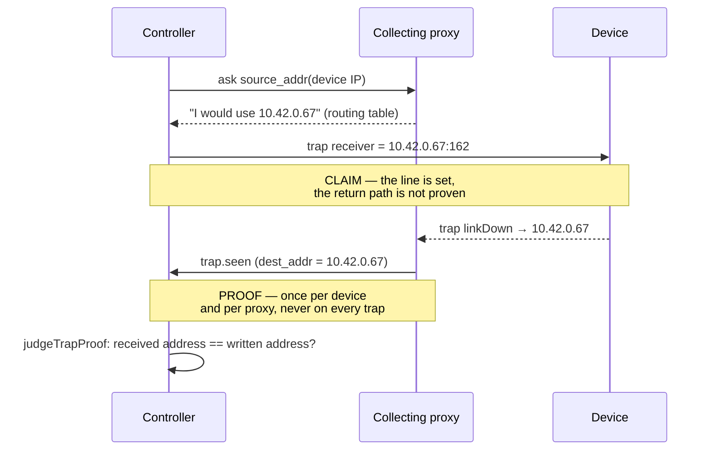
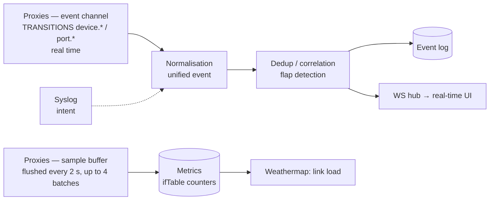

# Monitoring — SNMP, traps, syslog, polling

Meshcraft **deploys the monitoring configuration onto devices itself** (through the intent, section `services.snmp` / `services.syslog` of the [[Standard data model]]), then collects over three complementary channels.

## Choosing the collection point

A device **may** name its collector: `devices.proxy_id`, nullable ([[Proxy]], § *The reference collector: a DECLARED attachment* — migration `0022_rattachement_proxy`). What surrounds it has not changed: the controller still holds the **set of proxies that reach** a device (`device_paths`), which remains an *observed* fact. An attachment therefore does not say what a proxy **can** reach — it says which of the eligible proxies **must** collect. Two questions then look alike, and have very different answers:

- **receiving** a trap: the question does not arise. The datagram has already arrived at a proxy, which recognises the source IP in its own watch list and resolves `device_id` **locally** (§2). No collector choice is involved on reception;
- **writing into the device** the address it must send to — and, in the same stroke, deciding who polls it over SNMP: here a concrete IP is needed, and the set of paths is not enough.

There are two ways to obtain that single address, and the whole point of this section is not to confuse them: one is **shipped**, the other remains **decided, not built**.

### The declaration: the operator designates, meshcraft obeys — *shipped*

`devices.proxy_id` is the **reference collector**: the proxy that polls this device over SNMP, and the one whose address will be written into the device as the destination of its traps. Three properties give it its meaning, and [[Proxy]] develops them:

- `null` is a **regime**, not a forgotten setting: collection by coverage, every eligible proxy is a collector. It is the behaviour from before `0022`, hence the state of the whole existing fleet — the migration preserves semantics;
- the attachment grants **no coverage**. Site coverage remains the only way in because it is a *confidentiality* boundary; attaching a device to a proxy that does not cover its site does not move collection, **it stops it**. That is why writing a non-covering attachment is refused, not recorded "to see what happens";
- it does **not** restrict ICMP monitoring. *Determinism where uniqueness is required (SNMP, traps), redundancy where it is free (ICMP)*: two pings cost nothing and give a better truth about reachability.

Why the declaration **first**? Because it supplies the single address that was missing without deciding anything automatically. An elected collector would change on its own — a proxy connecting, a few milliseconds of latency gained elsewhere — and the trap destination already written into the devices would become **wrong without anyone touching anything**. The symptom would be a fleet that stops being reactive for a cause written down nowhere; the explicit gesture, on the other hand, can be logged.

### The DEFAULT at adoption: meshcraft proposes, once, and never comes back to it — *shipped*

`null` remained the default for **every** adopted device, and that default had a cost that
we ended up paying on real hardware: without a named collector, meshcraft cannot ask
**through which address** a device is reached, so it bounds the SNMP agent to the site
plan's subnet alone — and a proxy that reaches the management network through
**routing** is not in it.

> [!bug] Compliant community, agent active, walk SILENT — observed 29 July 2026
> On the fleet's CRS326-24G-2S+, `snmp-apply` answered "community already compliant:
> sources 192.0.2.0/24, read-only, agent active", and the walk timed out. The device
> log gave the answer: the proxy polls it from **10.42.0.67**, outside
> `192.0.2.0/24`. An agent that refuses a source **stays silent**, it does not protest — and
> silence does not distinguish "no agent" from "wrong source".
>
> The neighbouring CSS326, on the other hand, answered: SwOS has no source-bounding
> field at all. Two platforms on the same chassis, a single proxy, and only one of the two
> reachable — the worst possible signal to interpret, since it points the finger at the connector.

Adoption therefore now chooses a collector, and it is the **only** moment when the
question has a *measured* answer: the candidate carries its sightings (`Sightings`) — which
proxy saw it, at which address, with which latency. An hour later all that is left is
a list of proxies covering a site, and "which one can reach it?" becomes a
hypothesis again.

| Condition | Why it is not enough on its own |
|---|---|
| **cover the site** | an attachment grants no coverage: writing a non-covering proxy *stops* collection instead of moving it |
| **have seen the device** | the site is chosen at adoption: nothing guarantees that this site's proxies see the device, nor that the one that saw it covers this site |

Ties between several candidates are broken by **measured latency**, then last-seen
date, then identifier — the last criterion is not decorative: without it, two tied
proxies would yield a different collector on every adoption, and the same fleet adopted
twice would no longer compare. A **revoked** proxy is excluded: it stays in the coverage
list and no longer polls anything.

**Nothing is chosen** when no proxy meets both conditions, and that is a
result, not a failure: the coverage regime takes over, adoption succeeds, and it
**says so** in its warnings. Guessing would be worse — a collector that cannot reach
the device is dead collection that the screen would present as configured.

> [!note] This is NOT the election of the next section, and the difference is everything
> The objection written above against election still holds: "an elected collector
> would change on its own, and the trap destination already written into the devices
> would become wrong without anyone touching anything". This default **never changes
> on its own**: it is set once, when the device enters the fleet, written into
> `devices.proxy_id` as if it had been typed in, and nothing recomputes it afterwards. The operator
> changes it whenever they like; no proxy reconnection moves it.
>
> What adoption provides is therefore a **measured starting value** where there was
> only a `null`, not a dynamic policy.

And source bounds now combine **both** answers, because they answer
two different questions: the **plan subnet** (a stable declaration, which survives
a proxy redeployment) *plus* the **collector address as a /32** (today's proxy,
routed or not). The /32 is **omitted when the subnet already contains it**:
`addresses` is compared as a string to decide whether there is anything to write, and a redundant
/32 would rewrite the community across an entire compliant fleet on every pass.

### The election: deriving the collector from observed paths — *decided, not built*

The other answer derives the collection point instead of having it entered, and only at write time:

1. among the proxies that reach the device, the controller keeps the **preferred collector** — the fastest valid path, with stable preference (we do not switch targets for a few milliseconds, at the cost of redeploying device configuration for no reason);
2. if the platform accepts several receivers, a **secondary collector** is declared: telemetry survives the loss of a proxy without any redeployment. How many receivers a platform accepts is a **capability, not a generality** — and it is not assumed: the 1930 survey ([[Connectors]], "SNMP trap receivers") shows that the ceiling is only enforced when adding, hence cannot be determined read-only. Until it has been tested up to the point of refusal, the capability stays `false` and there is **no** secondary collector: advertising unverified redundancy costs an outage at the precise moment you were counting on it;
3. when the set of paths changes durably (proxy removed, new closer proxy), trap/syslog targets are recomputed and redeployed automatically — it is a configuration diff like any other ([[Reconciliation]]).

> [!warning] The secondary collector of point 2 will require a THIRD state, otherwise its traps are dropped
> An end-of-project discovery, verified in the code, concerning a
> **not built** feature: so it is not a defect to fix, it is
> a **constraint that redundancy will have to satisfy**, and it is better read here
> than discovered at switchover time.
>
> The chain, end to end. A proxy only processes a trap if its source IP appears
> in **its** SNMP watch list (`classifyTrap`, called by `onTrap`,
> `cmd/proxy/trap.go` — § *Identity by source IP* below). That list is
> exactly the `snmp[]` the controller pushes to it: `snmpCandidates`
> (`internal/api/watch_handlers.go`) → `cfg.SNMP` → `SetWatches` → `c.watches`. And
> `snmpCandidates` now excludes every device for which this proxy is **not** the
> collector (`Collector` false → counted as *delegated*). Mechanical consequence:
> **a proxy that is not a device's collector drops its traps**, verdict
> "unwatched source", at `Debug` level and in a counter.
>
> Today this is consistent and **desirable** — only the collector's traps
> count, since only it would perform the confirmation poll. But point 2 above
> promises that a secondary collector makes "telemetry survive the loss of a
> proxy without any redeployment". As things stand, no: a device sending to
> two proxies would see its traps **silently dropped by the second one**, and the only
> symptom would be a fleet that stops being reactive — the outage "at the precise moment
> you were counting on it", for the same capability and by a different path.
>
> What will therefore have to be shipped **with** redundancy: the controller sends
> the device in the secondary proxy's `snmp[]` **without** making it a collector.
> That is a **third state**, between "collector" and "delegated" — receive without
> polling — where `snmpCandidates` knows only two, `Collector` true or false.
>
> The `null` regime is not affected, and that is what allowed the constraint to go
> unseen until now: `Store.DevicesWatchedBy` projects `Collector` there as **true for
> every covering proxy**, so several proxies do receive the traps of the same
> device — that is the duplicate the end of this section deals with. The constraint
> only bites on **attached** devices, and election attaches by construction.

> [!warning] Election is decided, not built — the declaration does not replace it
> None of the three points above exists in the code: no "preferred
> collector", no secondary, no recomputation, and the `device_collectors` table of the
> [[Database schema]] is not created. This is not an oversight, it is the delivery
> order (§7 of [[Unified monitoring and pipelines]]): we learn to **read**
> before we **write** to the fleet. A page that presented election as
> done would have people hunting for a bug in code that was never written.
>
> And the declaration is not a disguised version of it: it delivers the **missing
> brick** — the single address — without automatic recomputation, hence without its
> risk. On the day election exists, it will only be able to **propose** an
> attachment, never impose it.

| Question | Status |
|---|---|
| A device's eligibility for a proxy = its site coverage | **shipped** — `Store.DevicesWatchedBy` derives it from `proxies.global` **or** from `proxy_sites` |
| Declared attachment to a reference collector | **shipped** — `devices.proxy_id` (migration `0022`), projected as `Collector` by `Store.DevicesWatchedBy` |
| SNMP targets restricted to the collector, ICMP targets left to every covering proxy | **shipped** — `snmpCandidates` in `internal/api/watch_handlers.go` |
| Writing an attachment: refusal of a non-covering proxy, logged change | **shipped** — `PUT /api/devices/{id}/collector`, `judgeCollector`, `device.collector` event as a warning |
| Protocol contract of the trap channel (`trap_listen`, `port.up`/`port.down`, `trigger`) | **shipped** — `internal/tunnel/control.go` |
| Deployment prerequisites (host mode, `NET_BIND_SERVICE`) | **shipped** — `internal/distrib` |
| Trap reception by the proxy and attribution by source IP | **shipped** — `cmd/proxy/trap.go` |
| Port transitions diffed on `ifOperStatus`, flap correlation | **shipped** — `cmd/proxy/trap.go`, `internal/api/portevents.go` |
| Election of a preferred / secondary collector, recomputation when paths change | **decided, not built** — and the secondary has a known prerequisite: a third "receives without polling" state in `snmpCandidates`, without which its traps are dropped (callout above) |
| Pushing the destination IP into the device | **shipped** — `internal/api/trapdest.go`: at provisioning and through `POST /api/devices/{id}/trap-apply`. The address is **asked** of the collector (`source_addr`), it is not inferred from the interfaces it declares, and the gesture **refuses** without a declared collector, a v2c plan, a community in the vault or the `Traps` capability — each refusal carrying its repair gesture |
| Verifying that the return path actually works | **shipped** — `trap.seen` + comparison of the datagram's destination address with the one written (§ *The first trap received is a PROOF*) |

What to take away **where nothing is declared** — the default regime, and that of the whole fleet coming out of the migration: `null` leaving **several proxies eligible for the same device** — and there are several instance proxies in the database, each covering all sites — two proxies polling the same fleet or receiving the same `linkDown` will emit **the same transition, twice**. Attachment **prevents** that duplicate where it is set; it does not exempt us from handling it. The controller must therefore always **deduplicate** on `(device_id, ifindex, type)` within a short window, otherwise every port flap would count double in the [[Event log]] and in flap detection.

**SNMP polling**, on the other hand, obeys the attachment: the `snmp[]` targets pushed to a proxy are the rows for which it is the collector, while the ping list stays complete. The trade-off is accepted and better read here than discovered: a single collector has **no automatic failover**. If the attached proxy goes down, the device stops being polled while it keeps being pinged by the other covering proxies — its indicator stays green and its status stays correct, only collection stops ([[Proxy]], § *The trap*). That is the price of determinism, and it is what justifies a collector change being a **warning** in the log. For a device directly reachable by the controller, the internal proxy plays this role and the target is the controller's IP.

## Device status: the proxy pings, the controller listens

The `up` / `unreachable` status does not come from SNMP polling but from
ICMP monitoring **run by the [[Proxy]]**:

- the controller sends each proxy the list of devices of the sites it
  covers and the ranges declared to it;
- the proxy pings at **1 Hz**, over a single raw socket for the whole fleet — a hundred
  devices cost a hundred packets per second, not a hundred sockets;
- it only reports **transitions**, with debounce: three consecutive losses
  before declaring unreachable, one reply to restore. Without
  this damping, a lost packet would make the whole fleet blink in the
  [[Event log]].

Having the controller ping through the tunnel would deliver the same information at
the cost of one WAN round-trip per second per device. And ICMP cannot be
tunnelled: it is not a TCP stream, there is nothing to relay — hence the
event channel of the [[Controller-proxy protocol]].

> [!note] A device silent to ping is not necessarily dead
> Many network devices filter ICMP. Ping gives a cheap status,
> not a truth: SNMP polling and successful sessions are what
> confirm. A device that does not answer ping but accepts a session
> is alive, and the UI must say which of the two signals is speaking.

> [!warning] A lost transition was lost FOREVER — observed
> A channel that only transmits differences turns every loss into a **permanent**
> divergence. That is the lesson of this defect, and it goes beyond ping.
>
> **The finding.** `lab-css326` (CSS326-24G-2S+, 192.0.2.36), adopted on 28/07,
> stayed `unknown` for **nineteen hours** while answering ping flawlessly. It
> was indeed in the instructions pushed to the proxy ("monitoring sent,
> devices: 12"), and `lab-crs326`, adopted in the same session, had indeed received
> its `device.recovered` at 20:47:40 — it never did. No reachability line for
> this device before 29/07 at 14:18:50, and what finally wrote its status
> was not monitoring: it was a **manual reboot** of the device, which
> produced `device.unreachable` then `device.recovered` within four seconds.
>
> **What is NOT proven**: which of the three mechanisms swallowed the event.
> None was observed losing anything; all three exist in
> the code, and 89 `proxy.disconnected` in the database say opportunities were not
> lacking. `emit` drops when its 256-entry queue is full; `SendEvents` took
> the event off the queue **before** writing it, so lost it if the tunnel went down
> during the write; and `SetConfig` keeps the in-memory state of targets already
> known, so a reconnection re-announced **nothing**.
>
> **Why it is the worst of silences**: the healthy state, the one that lasts, was the
> only one nobody ever confirmed. A failing device eventually produces
> a flip; a device that is fine no longer produces any, and its status therefore
> stayed wrong indefinitely. A transition channel needs a **resume point**.
>
> **Shipped**: the proxy re-announces the current state of every target when the event
> stream opens, hence on every reconnection (`Monitor.Snapshot`, events flagged
> `Resync` — see [[Controller-proxy protocol]]). Three points required
> attention, and each would have produced a defect of its own:
>
> - **the ORDER**. The queue backlog goes first, the snapshot next, live events
>   after. Events sleeping in the queue are OLDER than the snapshot:
>   delivered after it, they would overwrite the current state with a stale transition, and
>   a device that went down then came back during the outage would end up displayed unreachable
>   while it answers. A test locks this order — it does fail if inverted;
> - **not logging a repeat**. A re-announcement writes the status but only
>   logs if the value has CHANGED, otherwise the re-announcement becomes the noise it
>   was meant to avoid: that is exactly what we used to read, nine `device.unreachable`
>   per proxy restart on the demo fleet. Change detection
>   is in the same query as the write, otherwise two concurrent events
>   would log the same flip twice;
> - **the loss count has left `status_note`**. It GROWS while the device is
>   silent, so a note carrying it makes every snapshot "different" and
>   deduplication never bites. It now lives in the log message, where it
>   is informative; the note describes a stable state. Data migration `0026` for
>   rows already written — without it, the first re-announcement would have announced a
>   false flip and dated devices that went down three days ago as "for 0 min".
>
> **The hole is not entirely closed, and it is named rather than hidden**: on a
> CONTROLLER restart, the scope retained per proxy is empty and the first batch
> of events is refused until the first monitoring computation (see
> [[Proxy security]], § *scope*). The snapshot travels precisely in that batch and
> passes the same barrier: it is therefore **refused**. What was observed when deploying
> this batch is the refusal of a fact from that first batch ("no instructions pushed",
> authority `collecte_snmp`); that the snapshot suffers the same fate is **inferred** — the
> deployed proxy does not emit one yet. No consequence for correctness
> (the status lives in the database and survives a controller restart), but an event
> lost **during** an outage that ends with a controller restart remains
> lost. The repair would be to also re-announce on the **first instructions received**
> after a (re)connection, the moment the scope is guaranteed to be populated. **Not built.**

> [!note] `status_at` says since WHEN, not "how fresh it is"
> `status` alone conflated two situations that do not call for the same reaction: a
> device **never observed** — adopted five minutes ago, not yet pinged — and
> a device for which an observation was indeed established but never arrived. Hence
> `status_at` (migration `0025`): **NULL = never observed**, and the screen says so in
> plain words rather than showing `UNKNOWN` without explanation — an operator reading
> that looks for a fault where there is only a wait.
>
> What the date brings: "unreachable **for 2 h**" instead of "unreachable".
> The same word covered a reboot in progress and a device nobody saw
> go down three days ago. Read by the monitoring table, the device summary and
> the inventory (as a tooltip, that list being dense).
>
> **What it is NOT: a freshness measure.** The proxy only reports
> transitions, so a device online for three months carries a three-month-old date
> **without anything being late**. Reading this column as
> freshness would raise alerts on the healthiest fleet. Real freshness requires a
> **periodic heartbeat** from the proxy — an addition to the protocol, not a reading of this
> column. **Not built.**

> [!warning] A status is OBSERVED, not edited — path closed
> `status` and `status_note` were accepted as API input and written as is.
> Any save of a device form therefore republished reachability with the value
> the client had read when opening its screen, and the site plan explicitly sends
> `status` back in its `PUT`: **moving an icon was enough** to rewrite a
> stale observation, or even to bring back to `unknown` a device that monitoring had just
> declared online. The comment on `SetDeviceStatus` promised "an observation,
> never an inference"; a form could contradict it.
>
> To be distinguished from the defect above: this one is a path found **by reading the
> code**, not an incident observed in operation. Nothing proves it ever
> overwrote a status — and nothing proves the contrary, an overwrite leaving no
> trace.
>
> **Shipped**: both fields have left API input, `UpdateDevice`,
> `CreateDevice` and site configuration import. An imported file declaring
> `status: ok` injected an observation that nothing had established; the field stays in
> the format for **export**, where it faithfully describes what was observed at the time. The
> fields are **removed** from the input structure rather than silently ignored: the
> decoder does not forbid unknown fields, so a client still sending them
> is not broken, and the structure now tells the truth about what is editable.

## The three channels

### 1. SNMP polling (the reference state)
Run by the proxy, on the list and at the rates the controller pushes to it (`snmp[]` of the `WatchConfig` — one question per poll would make every cycle cross the WAN). Only aggregated results come back: the massive walk never crosses the WAN over UDP.

One-off diagnostics, on the other hand, go through a **question** to the proxy, not a generic RPC: the set is closed to two read-only questions ([[Controller-proxy protocol]], § *One-off questions*). That is what makes it possible to discover the OIDs a device actually serves — the optical sensors of an SFP, for example — instead of guessing them in a vendor MIB.

| Data | OIDs | Applied rate | Planned at design time |
|---|---|---|---|
| Port state (up/down, speed, duplex) | ifTable / ifXTable (`ifOperStatus`, `ifHighSpeed`) | **30 s** | 30–60 s |
| Traffic counters | `ifHCInOctets` / `ifHCOutOctets`, errors, discards | **5 s** | 60 s |
| Health | `sysUpTime`, `hrProcessorLoad`, `hrStorage`, `mtxrHealth` | **5 min**, *only where an `snmp` channel declares it* | 5 min |
| SFP optical diagnostics | `mtxrOpticalTable` | **60 s**, under the same conditions | *not planned here — see [[MikroTik telemetry]]* |
| Network tables | LLDP-MIB (topology → [[Weathermap]]) | **collected** since 29/07/2026, at **60 s** — see [[LLDP neighbours]] | 5–15 min |
| Network tables | BRIDGE-MIB / Q-BRIDGE (MACs per port) | *not collected* | 5–15 min |
| Inventory | entPhysical (serial) | *not collected* | 15 min |

The cycle now knows **four** metrics (`internal/snmppoll`) — `if_state`, `if_counters`, and the two sensor sets `health` and `optical_power` shipped with [[MikroTik telemetry]]. The wanted rates are `wantedStateInterval = 30 s`, `wantedCountersInterval = 5 s`, `wantedHealthInterval = 5 min` and `wantedOpticalInterval = 60 s` (`internal/api/watch_handlers.go`). **The inversion relative to the design is deliberate** on the first two rows — port state slows down because reactivity comes from the trap channel, traffic speeds up because a counter is used to draw a *curve* and a two-minute saturation cannot be guessed from two points. The full reasoning, the throughput this imposes on the proxy and the number of devices one proxy can drain are in §1.2 and §2.4 of [[Unified monitoring and pipelines]]. What the two new sets add to that throughput is **less than 1.3%**; what they cost is on the device, and it is quantified in §3.2 of [[MikroTik telemetry]].

> [!important] Sensors light up ONLY where the connector declares them — and that is a reversal
> `if_state` and `if_counters` fit entirely within MIB-II: every SNMP agent serves them, so asking a device whose connector we do not know for them is always a winning bet. That is what justifies the 60 s fallback floor for them.
>
> `health` and `optical_power` are the opposite. **There is no standard MIB for switch health** — `ENTITY-SENSOR-MIB` exists but MikroTik does not implement it — so the base is **proprietary** (MIKROTIK-MIB). Asking a device of another brand for them would only return "no such object": sixteen requests per cycle for nothing, across the whole fleet, indefinitely. A rate of **zero** therefore means "do not collect", and it is the **normal** regime of any device whose connector does not declare an `snmp` channel for these metrics — not a degraded case.
>
> A corollary worth knowing before hunting for a missing curve: a device's screen reads `Monitoring.Unavailable` to say whether there is anything to expect, and the silence in the log is **intended** — one line per device and per monitoring recomputation would say on every proxy connection that a site's twenty switches have no optical sensors, which is true, known, and will not change.

> [!warning] The declared channel does not CHOOSE the transport — it bounds the rate, and confusing the two was a defect
> The periodic collector runs on the proxy and speaks **only SNMP**. Yet the controller resolved the rate with `MonitoringCapabilities.Best(metric)`, which returns the fastest channel **across all kinds**: on a connector declaring a `web` channel at 5 s and an `snmp` channel at 60 s — the RouterOS case — the proxy ended up walking over SNMP twelve times faster than the connector allowed for SNMP. One channel's floor was being applied against **another** channel.
>
> **Shipped**: `MonitoringCapabilities.BestOfKind(kind, metric)`, and scheduling an SNMP poll now reads the SNMP floor and that alone. The full reasoning, including why RouterOS's SNMP floor was high *on purpose* and why it could come back down, is in §3 of [[MikroTik telemetry]].

> [!note] The rate is CHOSEN, the floor BOUNDS it
> These are two notions, and having conflated them was the defect fixed: a
> connector's `MinInterval` says "never more often than", not "every".
> Policy therefore chooses the pace, the floor only prevents it from going
> too low — and when the wanted rate drops below the floor, the
> substitution is **logged as a warning** with the device, the metric,
> the requested rate, the one retained and the origin of the floor. An operator who
> asks for 5 s and gets 30 s must not find out by comparing graphs.
> Floor retained when the connector is unknown: **60 s**
> (`unknownFloorInterval`) — neither 5 s, which would gamble on the control plane of a
> device we do not know, nor nothing at all, which would deprive the least well known
> devices of monitoring.

**The SNMP version is resolved per device, not chosen**: v3 authPriv when the platform supports it ([[Connectors]]: `SNMPv3` capability with its real algorithms), otherwise a dedicated **read-only** v2c community. A policy that demands v3 does not harden old devices, it deprives them of SNMP — they are then explicitly listed as unmonitored, with the reason. These accesses are part of the **service identity** that meshcraft installs and rotates itself: policy defined globally and overridable per site, secret generated **per device**, rotation by generations ([[Service identity and rotation]]).

### 2. SNMP traps (reactivity, and nothing else)

Received by the proxy's 162/udp listener ([[Proxy]], role 3), enabled by the controller — `trap_listen` / `trap_port` of the `WatchConfig` ([[Controller-proxy protocol]]): like the rest of monitoring, it is decided at the controller and switched off across a whole fleet without redeploying a binary.

**No vendor trap catalogue is decoded, and that is deliberate.** Only `linkUp` and `linkDown` are recognised, and only to **label** the burst for diagnostics. Decoding proprietary traps would be work to redo for every product line for information we re-read from `ifTable` the next millisecond anyway — it is the direct corollary of the principle below: if the trap's content establishes nothing, decoding it brings nothing. An unrecognised trap triggers the same poll as a `linkDown`; the poll is what will say what changed.

Listening is only requested from the proxies it serves: the controller enables `trap_listen` when **at least one retained SNMP target** of that proxy belongs to a platform whose connector declares `Traps` ([[Connectors]]). Two reasons, and the second is about security: a trap concerning a device this proxy does not poll advances no poll, and opening 162/udp on a management network never to receive anything there is attack surface offered for nothing in return.

#### A trap never carries the truth, only the urgency

A v2c trap is an **unauthenticated** UDP datagram: forgeable, losable, reorderable. Making it a source of state would give anyone on the path the power to **turn off a port on screen** — a one-packet denial of service, without touching the network. **No state is therefore written from the content of a trap.** The trap only **brings forward** the `if_state` poll that would have happened anyway.

That is the property that matters, and it is structural: **we add no path of truth to the system**, we accelerate an existing path. There is therefore nothing to arbitrate between two sources that might contradict each other, and the degraded mode is free.

| | without traps | with traps |
|---|---|---|
| Source of a port's state | `if_state` poll | `if_state` poll (the same one) |
| Correctness | unchanged | **unchanged** |
| Detection latency | the polling rate | **~1 s** |

> [!note] A broken trap channel does not degrade correctness
> Misconfigured device, lost trap, listener not started, proxy
> restarting: we fall back to the polling rate. It is an **acceleration**
> channel, never a channel accuracy depends on — which is why it
> can be switched off without breaking anything.

What remains is to say what the gain is worth **today**, because the figure has moved. The rate applied to port state is **30 s** (`wantedStateInterval`, §1): the fast path therefore brings detection from about 30 s down to about 1 s. There was a time when the controller sent the proxy the connector's *floor* as the rate — 5 s on an Instant On 1930 — and the observable gain was therefore only from 5 s to 1 s; that is no longer the case, the rate is chosen and the floor only bounds it (§1.2 of [[Unified monitoring and pipelines]]).

> [!warning] The factor of thirty is also a dependency: at 30 s, port reactivity DEPENDS on traps
> It is the other side of the trade-off, and it is the part not to lose when
> remembering the figure. Before this batch, a port going down showed up within 5 s **without
> traps**; it now takes up to 30 s. Yet the fast channel only exists if the
> devices have been told to send. Pushing the receiver **is now
> built** (§ *Choosing the collection point*), but it requires a **declared
> collector**: without an attachment, there is not one address to write but several, and
> the write refuses rather than engraving one at random. On a fleet coming out of the
> migration — `devices.proxy_id` at `null` everywhere — the proxy's listener therefore still only receives
> what devices configured **by hand** care to send it, and
> the effective detection latency of a downed port there is 30 s, full stop.
>
> What makes the trade-off tenable is that it is **reversible** — the wanted rate
> is a policy constant, not a property of the protocol. What makes it
> honest is the `trigger` field of port events: without it, a silent fleet and
> a reactive fleet produce exactly the same events give or take thirty seconds,
> which nobody notices on a screen.

#### The confirmation poll runs on the proxy

The trap arrives at the proxy; it is the **proxy** that immediately polls `if_state`, not the controller. A round-trip to the controller to ask it "poll this for me" would cost exactly the WAN latency we are trying to remove — and the proxy already holds everything it needs: the IP, the community and the index bound of the `SNMPWatch` the controller pushed to it. It is the same split as ICMP: **the proxy is the local executor**, the controller decides the list and the rates.

#### Transitions are computed by the proxy, on every poll

The proxy compares the observed `ifOperStatus` with the one it had, **whatever triggered the poll**, and only emits changes. It does so on the samples **already in hand**: the table has been read once, reading it again to draw a second conclusion would double the cost on the device and open the door to two divergent readings of the same instant.

Two consequences, to be read in this order:

- **port events work without traps**, at the polling rate. The trap does not create them, it brings them forward;
- they leave on the **event channel**, which is real time, whereas metric samples wait in the buffer flushed every 2 s — up to 4 batches per wake-up (`flushEvery` / `maxFlushBurst`, `cmd/proxy/snmp.go`). That is where perceived reactivity is won: a port's badge does not depend on the series ingestion pace.

The diff is on a **boolean state**, not on the value of `ifOperStatus`: `up` is value 1 and it alone, everything else is "not passing traffic". `lowerLayerDown(7)` is therefore a down port — classifying it elsewhere would force the screen to invent a third state to say the same thing — and a port oscillating between `down(2)` and `lowerLayerDown(7)` produces **no** event, since it is the same information said differently. The raw value is carried in the detail when it is out of the ordinary: we do not claim a port is in service when the device does not claim it.

Three silences, and each avoids inventing a fact:

| Situation | Event | Why |
|---|---|---|
| Port seen for the **first** time | none | we do not know what it would be the transition from — like the first ping, which produces neither `device.up` nor `device.down` |
| Port **gone** from the table | none | a removed stack member or a shrunken faceplate is an operational decision, not a failure |
| Poll returned **without** `ifOperStatus` | none, and the previous observation is **kept** | it is a partial read; overwriting it would make the next read a "first observation", hence silence on the real transition |

#### Identity by source IP, against the watch list

Only traps whose source IP matches an `SNMPWatch` known to this proxy, with the expected community, are processed. It is a **free anti-spoofing filter** — we do not ponder what a packet coming from an address we do not monitor has to say — and above all: the proxy resolves `device_id` itself. The question "which collector for this device?" **does not arise on reception**: the proxy does not ask the controller, it looks at its own list. It arises elsewhere — to designate who polls over SNMP, and to write the destination into the device (§ *Choosing the collection point*).

The attachment does, however, have a consequence at this level, and it is consistent: a proxy's watch list only contains the devices for which it is the collector, so the trap of a device **delegated** to another proxy arrives there as an unwatched source, and it is ignored. That is the right behaviour — that proxy would not perform the confirmation poll anyway — and it is also why the receiver written into the device must be **the** collector and not just any covering proxy. It is, however, what will rule out, as is, election's secondary collector: see the callout of § *Choosing the collection point*, which says which state is missing.

Three details that make the filter hold:

- an **empty** community in the `SNMPWatch` means `public`, not "any" — it is exactly the poll's fallback, and two different rules for the same watch would end up accepting the traps of a device we cannot even poll;
- **v3** traps arrive without a community and are therefore **rejected**. "We accept when we cannot verify" would be the opposite of a filter; v3 will come with service identity;
- the filter is **weak and we accept it**: a source IP can be spoofed. That is precisely why nothing from the content is written — at worst, an attacker obtains an early `if_state` walk, whose result comes from the device and not from them. What the filter protects is not correctness (already guaranteed by the poll), it is **cost**: it prevents a third party from making the fleet poll at will.

The three verdicts — accepted, unwatched source, unexpected community — are **counted** and reported periodically. None of them is raised to a warning: on a production network, receiving traps from devices we do not monitor is routine. But a channel that rejects everything and a silent channel look far too alike in a log for us to give up distinguishing them.

#### The first trap received is a PROOF, and it has an exact scope

Everything above describes a channel that **receives**. What remains is the question that cannot
be asked from the controller: does the device really send, and **to us**?
Writing a trap destination into it is a **claim** — meshcraft writes there
the address the collecting proxy says it uses to reach the device, betting
that the path works in the other direction. A firewall, an asymmetric route, an
ACL on the management VLAN are enough for it to send into the void, and the acknowledgement
of the write says nothing about any of that.

Hence **two distinct states**, and confusing them is the only costly misreading of the
mechanism: *the address is written* (`devices.trap_dest_addr`, the date coming from
`now()`) and *the return path is established* (`devices.trap_seen_at`, migration `0023`).
The second can only be obtained from an external fact: an **accepted** trap, reported by the
proxy as `trap.seen` ([[Controller-proxy protocol]], § *What the proxy reports*).
A device page that conflated them would suggest reactive monitoring that
does not exist.

**What the trap proves, exactly.** The filter of the previous § only looks at the **source
IP**, and the socket listens on the wildcard address: "a trap arrived here" is therefore
not "the address I wrote receives this device's traps". A device
configured towards another collector reachable on the same machine would manufacture a
false proof. What closes the gap is the **datagram's destination address**,
read from the kernel by the proxy and compared by the controller — sole holder of the
claim — with what it wrote. The four outcomes, the proxy's refusal to fill in an
"I don't know", and the accepted false negative of a proxy behind address
translation are detailed in [[Controller-proxy protocol]]; what matters here is
the operational consequence:

| What the operator sees | What it means |
|---|---|
| no destination recorded | nothing has been written — the state of every device without a declared collector, and it is **silent** in the fleet log because expected |
| address written, never confirmed | the line is in the device and **nothing has come back yet**. Monitoring remains correct, just not reactive: this is where you look for a firewall |
| return path established | a trap got through, and the address written is the one that received it |
| path established, **attribution not verified** | traps reach the collector — reactivity is secured — but this proxy could not say which of its addresses they were destined for (older binary, or a kernel refusing PKTINFO) |

> [!note] Confirmation is written only once, and the bound is not on the proxy side
> The proxy emits `trap.seen` only once per device, but it **re-arms** its
> counter as soon as the device leaves then re-enters its watch list — hence on
> every tunnel reconnection. Relying on its parsimony would write "return path
> established" **for the whole fleet at once** when a proxy restarts. The bound is therefore
> taken by the database, in the `where` of the `update`: two simultaneous traps coming from
> two proxies cannot produce two rows.
>
> And a confirmation **is about a path**: writing exactly the same address again
> keeps it, changing address or collector clears it. Without that, meshcraft would display
> as verified a destination that nothing has ever validated.

> [!warning] A date coming from a proxy cannot be ordered against ours
> The first hardware trial delivered a lesson that goes beyond traps, and it
> is developed in [[Controller-proxy protocol]] (callout *`Event.TS` is a diagnostic
> fact*): the proof was dated by the **proxy**, the write by the **controller**,
> and the **eleven-second** gap made the proof appear *before* what it
> proves. The same defect affected flap correlation, whose thresholds
> were therefore worth the written threshold **plus** the drift of a machine we do not control —
> "three minutes of calm" was worth 2 min 49 s on that installation, and something
> else on the neighbouring site.
>
> What to remember going forward: **the controller timestamps what it
> compares itself**, and the timestamp parameter was *removed* from the functions concerned rather
> than documented. The drift, for its part, is logged — and it is the only measure of the proxies'
> time that the product has.

#### Per-device damping

A 48-port switch rebooting emits a hundred traps within a few milliseconds. Two safeguards, held **per device**:

| Safeguard | Value | What it prevents |
|---|---|---|
| Coalescing window | 250 ms | a burst of traps → **one** poll. `ifTable` is read in full anyway: one port or fifty cost the same |
| Floor between two trap-triggered polls | 2 s | a port flapping in a loop → one walk per flap |

Without them, the fast path becomes an **amplifier aimed at the device already in trouble** — and on this product line, five sessions are enough to saturate it. The rule *a device monitored too much is a device you damage* ([[Unified monitoring and pipelines]] §1) **also applies to the fast path**: an event being urgent does not give us the right to poll without limit.

Two details that decide the real behaviour:

- the floor **delays**, it does not discard. A trap arriving just after a poll may signal a state that poll had not yet seen; dropping it would lose a true transition until the next ordinary cycle. A flapping port therefore produces at worst one walk every two seconds, which is exactly the intended behaviour;
- a poll brought forward by a trap **pushes the ordinary schedule back** by as much. Without that, the regular cycle would re-read the same table within the second: two walks for a single piece of information, on the very device that is having a problem.

#### Anti-flap lives in the controller, not in the proxy

The proxy emits **raw facts**: this port went down, at this timestamp. The controller **correlates** and aggregates into `port.flapping` with a counter. Proxy = fact, controller = correlation, and the reason is operational: the aggregation window becomes tunable **without redeploying a proxy binary into every customer network**. Putting anti-flap in the proxy would amount to freezing a product policy into machines we do not control.

#### Deployment prerequisite: binding 162/udp

The ground is already prepared: the `docker-compose` generated by the controller (`internal/distrib`) declares the proxy with `network_mode: host` and `NET_BIND_SERVICE`, precisely commented "syslog 514/udp, traps 162/udp". Host mode is not a convenience: **in bridge mode, a trap's source IP would be the Docker gateway's**, hence useless for attributing the message to a device — the source-IP filter above would no longer exist.

> [!warning] A failed bind is reported, not silenced
> Port 162 already taken by another collector, `CAP_NET_BIND_SERVICE` missing, bridge
> mode: the proxy **loses reactivity, not monitoring** — polling
> continues, port transitions continue. The rule is to say so **once
> and loudly**, then carry on without: the failure is logged as an error on the first
> refusal, with the probable cause named, and subsequent attempts (one per
> minute, the port may free up) stay silent. Re-emitting the error every
> minute would drown the log without teaching anything.
>
> The worst outcome would be to **pretend to listen**: an operator would think they
> see their ports go down within a second when they see them go down within thirty. That is
> why going into listening mode waits for bind confirmation before declaring itself
> active, instead of assuming that a launched socket is a bound socket.
>
> Finally, a fleet where nobody sends their traps and a fleet whose listener never
> started must remain distinguishable: that is the role of the `trigger` field of
> port events and of the periodic reception summary.

### 3. Syslog (the context) — *intent, not shipped*

> [!note] Nothing in this section is built
> The syslog listener is planned, not shipped, and is not in the same batch as
> traps. What follows is a design intent.

The proxy's 514/udp listener. RFC 3164/5424 parsing + per-connector patterns (`%LINK-3-UPDOWN`, login failures, PoE errors, STP flaps…). Two uses: feeding the [[Event log]] (messages ≥ configurable severity) and keeping the raw text (short retention, full-text search) for diagnostics.

The same rule as for traps will apply: a syslog message is unauthenticated text, it **contextualises** a state, it does not establish it.

## Controller-side processing

The two paths leaving the proxies have neither the same urgency nor the same transport: **transitions** go through the tunnel's event channel and arrive in real time; **samples** wait for the buffer flush. A port that goes down therefore does not wait for the metric that will say so.

- **Normalisation**: a transition reported by a proxy, a polling delta and (tomorrow) a syslog line produce the same event object (`device, port?, type, severity, ts, payload`) — the log does not know the source. The **trap does not enter here**: it produced no object, it only brought a poll forward (§2).
- **Two noises, two filters, in this order**: the inter-proxy **duplicate** is discarded first, the **flap** next. The reverse would be a misreading — an echo must never feed a flap counter, otherwise the threshold is reached twice as fast depending on the number of eligible proxies.
- **Correlation in memory, never in the database.** It is a window of a few minutes; a controller that restarts from a blank state is the **correct** behaviour: it will relearn that a port is flapping, logging true transitions in the meantime. Persisting this state would cost one write per flap at the precise moment the fleet is unwell. The structure is bounded in number of keys, so that a proxy reporting aberrant `ifIndex` values cannot bloat the controller's memory.
- **Observability of the fast path**: the `trigger` field (`"poll"` / `"trap"`) is logged in the **application** log, with the emitting proxy, on every transition. It does **not** appear in the [[Event log]]: "trap" is protocol vocabulary, not fleet information. The operator wants to know their port went down, not by which mechanism we learnt it — whoever is diagnosing meshcraft does. Without this line, a fleet where no device sends its traps would be indistinguishable from a reactive fleet: the same events, thirty seconds later, and nobody would ever notice that 162/udp serves no purpose.
- **A port going down is not a device going down**: the real-time notification uses the "link" category, not "device". Announcing a device change would make clients re-read the badges of the whole fleet for an event that does not concern them — and would blur the diagnosis these categories exist to make readable.
- **Naming the port in the log**: the faceplate name is what the operator has in front of them; failing that we write the SNMP label **and** the index. The label alone would lie — it collides — and the index alone would be unreadable.
- **Metrics**: the question is settled, it is **VictoriaMetrics** and not partitioned Postgres — see [[Unified monitoring and pipelines]] §3, which also decides the per-channel rates and what runs on the proxy side. Retention 90 d.
- **Device status**: `up` / `degraded` / `unreachable` computed by polling (+ heartbeat of the proxy itself: a proxy down ≠ 50 switches down — the UI displays it as such).

### The duplicate criterion

A transition is a duplicate if it targets **the same state as the previous one retained on this key** `(device_id, ifindex)`, less than two minutes apart. The word that carries everything is *previous*: we do not compare to "a state seen recently" but to the **last retained state**.

That is what saves legitimate round-trips. A `down`, an `up`, then a `down` within ten seconds has an `up` in between: each `down` is compared to an `up`, nothing is discarded. Conversely, **two consecutive transitions to the same state are impossible from a single observer** — a proxy only reports changes relative to its own state, so it necessarily alternates. The same state twice in a row means two observers, never two events.

The duplicate is **inert**: it does not count towards flapping, and it pushes back neither the calm horizon nor the purge horizon. It is an echo — it proves no activity that the original transition had not already proven.

### Anti-flap: the parameters, and why those

| Parameter | Value | Reason |
|---|---|---|
| Flap threshold | 5 transitions | no human gesture produces that many on the same port: unplugging a workstation makes 1, redoing a patch cord 2 or 3. At 5, it is no longer someone handling a cable, it is a cable giving out |
| Counting window | 5 min | about ten polling cycles. Any shorter and the threshold would become unreachable **without traps**: detection would only work on fleets that are already reactive, that is, those that need it least |
| Calm before closing | 3 min | at least three cycles at the slowest. With a silence shorter than the poll rate, a port flapping **more slowly** than we observe it would be declared calm then flapping in alternation: the oscillation detector would start oscillating, producing exactly the noise it exists to suppress |
| Deduplication window | 2 min | two cycles at the slowest, deliberately generous — the criterion above already rules out swallowing a real round-trip |

An **end** of flapping cannot be decided by an incoming event: by definition, it is observed through the **absence** of events. A clock is therefore needed, and it only starts at the first port event received.

### Severities do not follow intuition

| Event | Severity | Why |
|---|---|---|
| `port.up` / `port.down` | **info** | an access port going down because a user unplugs their workstation when leaving is the most mundane event on a network: hundreds a day across two thousand outlets. Engraving it as a warning would teach the operator to stop looking at the colour — and on the day of the real incident, it would be the six-hundredth warning line of the day |
| `port.flapping` | **warning** | nobody unplugs the same cable five times in five minutes. It is a physical defect: badly crimped patch cord, transceiver at end of life, duplex mismatch, STP loop. It is what we want to see, and what individual transitions drowned out |
| `port.flap_cleared`, stabilised **in service** | notice | it is fixed — good news |
| `port.flap_cleared`, stabilised **out of service** | **warning** | the port no longer flaps because the link is dead for good. The problem is still there |

That is the reversal that gives this batch its value: it is not the transition that is interesting, it is its **repetition**.

## Alerting

Decided and built by [[ADR-0024 — An alert is earned - the log decides, the description and the interconnect qualify]]. The sentence this section had carried from the beginning — "the [[Event log]] is the single source" — held: alerting is a **subscriber** of the log, not a second event model. `notify_deliveries.event_id` is a foreign key to `events(id)`, so every message is traceable to the row that caused it, and there is no `alerts` table.

**Six alertable types**, all already emitted: `device.unreachable`, `device.recovered`, `port.down`, `port.up`, `port.flapping`, `port.flap_cleared`. Nothing new is observed.

**Three classes, and an exclusion rule that is the heart of the matter.** A channel subscribes among `device`, `interco` (a port facing a fleet device) and `described` (a port carrying an operator label). A port event that is **neither** interco **nor** described produces **no** message: it stays in the log, visible on the port's page. It is the same reasoning as `portManaged` one step further — across two thousand outlets, alerting on everything produces a channel nobody reads — and the price is written down: a critical port that nobody has described stays silent. Each refusal increments `notify_channels.dropped_uninteresting`, so that the gap is a number on screen and not a silence.

> [!warning] "Description" does not mean `ifAlias`
> **No connector reads `ifAlias`**: OID `1.3.6.1.2.1.31.1.1.1.18` is walked nowhere, `mdpv1.PortState` has no such field, and MDP v1 could not carry it. What the Ports screen calls "description" is `devices.ports.<port>.label`, an **operator intent** that migration `0019` and `recon_handlers.go` actively protect from device reads. It is the better signal of the two: `ifAlias` says "someone wrote some text on this switch", often a predecessor; `label` says "someone described this port in meshcraft, in the screen meant for that".

**Flapping is handled by holding back, not by a second correlator.** `portevents.go` above keeps the "this port is flapping" decision; alerting only **waits for the question to be settled**. A key that is moving does not alert: each transition pushes the deadline back (`alertHold` 45 s for a port, `alertDeviceHold` 20 s for a device), capped at `alertHoldMax` 5 min. Six round-trips in two minutes produce **one** message. The cap is not decorative — see the gNMI hole below.

**We do not alert on our own gestures.** The log already knows we acted, timestamped, per device: a candidate whose device carries a gesture event (`config.applied`, `device.stp_apply`, `mgmt.applied`, `credential.installed`, `device.adopted`…) within the previous 10 min is **deferred**, not announced. A sweep **re-arms** it if the state is still bad when the window closes, so suppression only delays bad news — the `holdReach` doctrine. A manual maintenance window would have assumed someone remembered to open it, and on the night of 2026-10-24 nobody would have done so before rewriting eight MSTP regions.

**Delivery is an effect, not a condition.** The delivery slip is written to the database before any outgoing call: an unreachable channel cannot slow detection, it can only fail to be notified. Each channel carries `last_ok_at`, `last_error`, `consecutive_failures`, and the screen counts held and failed deliveries — that is how "the channel sent nothing" becomes a question that gets answered, **without a heartbeat** nobody reads. An explicit **test send** exists, because an integration that cannot be tried before the incident is an integration whose misconfiguration is discovered during the incident.

Channels: **Telegram** (bot token + `chat_id`) and **Slack** (incoming webhook URL, which is both address and secret). Both secrets go to the `internal/secretbox` vault and are registered in `store.SealedColumns()` — without that registration, they would be destroyed at the next key rotation.

| Question | Status |
|---|---|
| Classification, exclusion rule, alert key | **shipped** — `internal/api/alerting.go` (pure functions, tested without a database) |
| Filing delivery slips, grouping flaps in SQL | **shipped** — `Store.FileDelivery`, partial unique index `(channel_id, alert_key) where state='held'` |
| Attribution to our own gestures + re-arming | **shipped** — `attributedToGesture`, `Server.reArmPass` |
| Sending, exponential retries, channel health | **shipped** — `internal/notify`, `Server.RunNotifyQueue` |
| Administration screen, test send, traced reveal | **shipped** — `web/src/pages/Alerting.tsx`, `/api/sites/{id}/notify-channels` |
| Port transitions collected over **gNMI** | **known hole, predating alerting** — `cmd/proxy/gnmi.go` emits its transitions **without `IfIndex`**, and `portFlaps.observe` rejects anything with `IfIndex <= 0`. No `port.up`/`port.down`/`port.flapping` is therefore ever written for an Arista: the `link` column updates (that path matches by name), the screens are correct, and the log is silent. Alerting inherits the hole as is and makes it **visible**; `alertHoldMax` is what prevents an unstable Arista port from additionally being held indefinitely, since the `port.flapping` that should release it will never arrive |
| Periodic heartbeat, per channel | **decided, not built** — rejected as a *default* (a daily "all is well" message is something one learns to stop seeing), legitimate as an option for whoever monitors their alerting from outside |
| Manual maintenance window | **decided, not built** — useful for a gesture **outside** meshcraft (an electrician, a rack move), useless for ours, which the log already knows |
| Log purge | **not built, and more costly than before** — `events` declares itself append-only and no migration has ever added a TTL. Plugging alerting into it makes that absence more expensive |
