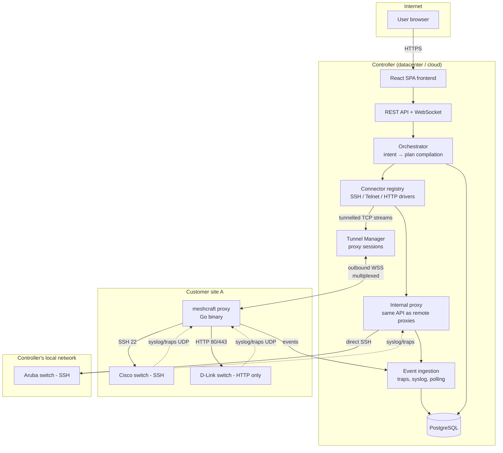

# Overview

## Global diagram — the TARGET

> [!note] This diagram is the target, not the state
> It describes the decided architecture, and it must be kept as is: it is what says
> *where* each building block to come will have to plug in. Three edges, however, do
> not exist in the code, and reading them as acquired sends you looking for a bug in
> the void — the exact list follows right after, with what is shipped.

| Diagram edge | State |
|---|---|
| `U → FE → API`, `API → DB` | **shipped** |
| `TM ↔ PA` (multiplexed outbound WSS) | **shipped** — yamux over WebSocket, `internal/tunnel` |
| `CONN → TM` then `PA → SW2` over HTTP | **shipped** — it is the path of the only existing connector |
| `PA → SW1` over SSH 22 | **shipped for discovery only** — banner and identification session (`internal/discovery`). No CLI *connector* exists, and nothing speaks Telnet |
| `SW → PA` with UDP **traps**, `PA → ING` | **shipped** — 162/udp, `cmd/proxy/trap.go` ([[Monitoring]] §2) |
| `SW → PA` with UDP **syslog** | **decided, not built** — no 514/udp listener. Only the ground is laid (`network_mode: host`, `NET_BIND_SERVICE` by `internal/distrib`) |
| `CONN → IPX → SW3` (internal proxy) | **half shipped**: direct dial, yes; local UDP (SNMP, ICMP, traps), no — see the callout below |
| `ORCH` as a distinct module | **does not exist under that name** — the read/diff/apply cycle lives in `internal/api` + `internal/recon` ([[Controller]]) |

## Components

| Component | Role | Tech ([[Technical stack]]) |
|---|---|---|
| [[Controller]] | API, orchestration, intent compilation, UI | Go (single binary, frontend embedded via `go:embed`) — **shipped** |
| [[Proxy]] | Point of presence in a remote network: TCP tunnels, sweeping, ICMP, SNMP, trap reception | Go (static binary) — **shipped**; syslog remains to be done |
| [[Connectors]] | Translation standard model ↔ vendor platform | Go. **A single connector shipped**, `instanton`, in `net/http` + home-made XML. Neither scrapligo nor resty is in `go.mod` — they will come with the first CLI or REST connector |
| Frontend | Multi-site SPA, [[Port rendering]], [[Weathermap]] | React + TypeScript, responsive. **Not yet a PWA**: no manifest, no service worker — hence no installation, no offline mode |
| Database | Configuration, inventory, events | PostgreSQL. **No partitioning** of events (simple table, migration `0003`) |
| Metrics | Traffic and state time series | **VictoriaMetrics**, not Postgres — decision settled in §3 of [[Unified monitoring and pipelines]] |

## Structuring decision: what runs where

The proxy is deliberately **dumb**: it knows no vendor. All the intelligence (drivers, parsing, diff) stays on the controller. The split reads as **three exchange patterns**, not a single "RPC" — the distinction is not cosmetic, it says who keeps control over what:

- **Tunnelled TCP** (`dial`): the driver runs on the controller, the raw TCP stream goes through the WebSocket tunnel ([[Controller-proxy protocol]]). A driver therefore never has two "local / remote" implementations. **Shipped.**
- **Monitoring instruction** (`watch`): the controller **pushes a list and cadences**, the proxy runs in a loop and only reports **transitions** (`events`). That is the path for 1 Hz ICMP, SNMP polling, continuous sweeping of ranges and listening for traps. It is not a procedure call: nothing is asked on the fly, everything is decided at the controller then executed locally — that is what makes it possible to switch off a channel across a whole fleet without redeploying a binary. **Shipped.**
- **One-off question** (`ask`): one question, one answer, the stream closes. The set is **closed at two questions, read-only** — `snmp_walk` and `source_addr` (`internal/tunnel/control.go`). **Shipped.** There is **no** SNMP `set` through this path, and there will not be: writing goes through the connectors, which have their safeguards.

What is **not** in this split, despite the diagram: **ARP** sweeping, and **syslog** listening.

> [!warning] The "internal proxy" is not a proxy, it is the absence of a tunnel
> The target is an internal proxy that **implements the same interface in-process**,
> so that there is only one code path. Reality is more modest, and it is better to
> know it before counting on it: the "Local" proxy (`store.LocalProxyID`, a row
> created by migration `0005`) is a **database row** on which directly reachable
> ranges are declared, and the only behaviour it carries is a **nil** `Dialer` —
> that is, a direct TCP connection (`internal/driver/webfetch.go`).
>
> The missing half is the one that does not tunnel. The "Local" proxy having no
> tunnel, it receives **no** `WatchConfig`: no ICMP ping, no SNMP polling, no trap
> listener. A device whose only path would be "Local" is therefore **manageable but
> not monitored** — its light stays `unknown` for lack of anyone to ping it.
>
> Fixing it costs little (the proxy code is already factored into `Monitor` and an
> SNMP collector), and ignoring it costs a monitoring that works in a demo behind a
> remote proxy and not at the place of someone who has deployed none.

### Attachment to a proxy now exists, path choice does not

Two statements have been reversed since the first draft, and they are not symmetric:

| Statement | Verdict |
|---|---|
| "A device is attached to no proxy" | **false since migration `0022`**: `devices.proxy_id` designates its **reference collector** — the proxy that polls it over SNMP and whose address is written into the device as the recipient of its traps ([[Proxy]], § *The reference collector*). `null` remains a **regime** — collection by coverage — and not a forgotten setting |
| "The controller keeps the set of proxies that reach it and picks a path for each operation" | **decided, not built.** There is no `device_paths` table: the only record of "who saw what" is `discovery_sightings`, which concerns **candidates** and does not survive adoption. An operation's path is chosen by `proxyOf` (`internal/api`): the original candidate's proxy, failing that "Local". No latency comparison, no failover on error |

The delivery order is deliberate and is worth reading as such: we shipped the **designation** before the **derivation**. An automatic collector election would change target on its own, and the trap destination already engraved in the devices would become wrong without anyone touching anything ([[Monitoring]], § *Choosing the collection point*). The explicit gesture, on the other hand, can be logged.

## Main flows

1. **Discovery**: the user declares a range to scan on a proxy → sweep → fingerprint → the device appears "to adopt", **without a site** ([[Discovery]]). Shipped, including through a remote proxy. The sweep is **driven by the controller**, which tunnels its TCP connections, not run by the proxy — nuance detailed in [[Discovery]].
2. **Adoption**: the user **chooses the site** → the device joins the chosen site, with its surveyed physical faceplate → automatic tagging → provisioning of the SNMP identity and the trap recipient. Shipped. What adoption does **not** do yet: try the site's [[Credentials]] (it is a separate gesture, `POST /api/devices/{id}/credentials/apply`), read back the current state (`POST /api/devices/{id}/read-state`), and remember the proxies that see the device as access paths.
3. **Configuration**: profiles + overrides compiled into port configuration → diff with the observed state → write, with safeguards and verification read-back ([[Reconciliation]]). Shipped, **without a plan step or intermediate validation**: configuring in the interface *is* the approval, and the write follows automatically after grouping.
4. **Monitoring**: meshcraft itself deploys the device's SNMP identity then trap recipient, towards the address of its **declared** collector (and not one derived from its access paths) → traps and polling come up through the tunnel → [[Event log]] + port states in near real time for the UI. Shipped. **Syslog** has nothing: no listener, no pushed configuration — you do not configure a fleet to send to a collector that does not exist.
5. **Web access**: for devices without SSH, driving through the HTTP connector — shipped, and it is even the case of the **only** existing connector. [[Web pass-through access]] for manual access remains a target; what exists is the read-only probe `POST /api/devices/{id}/web-probe`.
