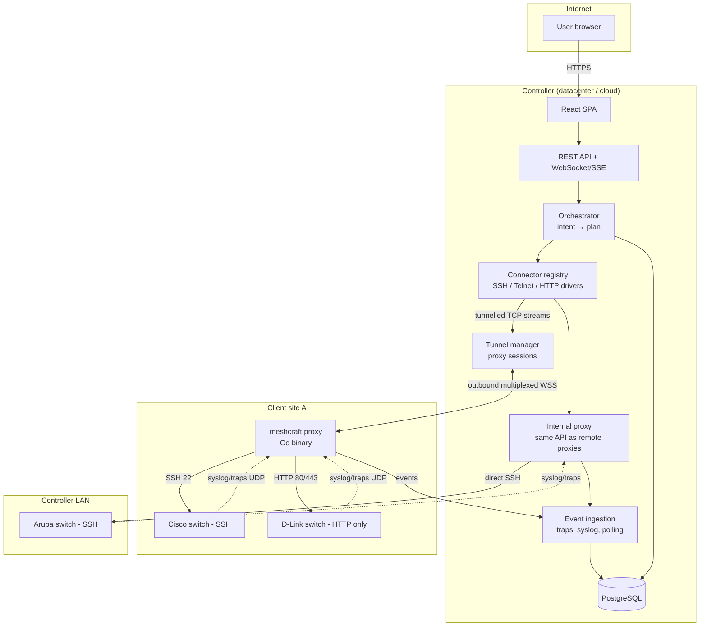

# Overview

## Target architecture

> [!note] This diagram is the target, not the live state
> It describes the decided architecture. Some edges are not yet in the code —
> see the status table below.

| Edge | Status |
|------|--------|
| `U → FE → API`, `API → DB` | **shipped** |
| `TM ↔ PA` (outbound multiplexed WSS) | **shipped** — yamux over WebSocket, `internal/tunnel` |
| HTTP via proxy | **shipped** — Instant On connector path |
| SSH via proxy | **shipped for discovery** — full CLI connectors still growing |
| SNMP traps UDP | **shipped** — 162/udp on the proxy |
| Syslog UDP | **decided, not built** |
| Internal “Local” proxy | **partial** — direct TCP dial yes; local UDP watch not fully equivalent |
| Distinct `ORCH` module | **not under that name** — read/diff/apply lives in `internal/api` + `internal/recon` |

## Where work runs

The proxy is intentionally **dumb**: it knows no vendors. Intelligence (drivers, parsing, diff) stays on the controller. Exchange patterns:

- **Tunnelled TCP (`dial`)** — driver runs on the controller; raw TCP flows through the WebSocket tunnel. One implementation for local and remote. **Shipped.**
- **Watch config (`watch`)** — controller pushes lists and intervals; proxy loops and reports **transitions**. ICMP, SNMP poll, continuous scan, trap listen. **Shipped.**
- **One-shot ask (`ask`)** — closed set of read-only questions (`snmp_walk`, `source_addr`). No SNMP `set` on this path; writes go through connectors. **Shipped.**

French deep dive: [Vue d'ensemble](../../fr/01-Architecture/Vue%20d'ensemble.md).
