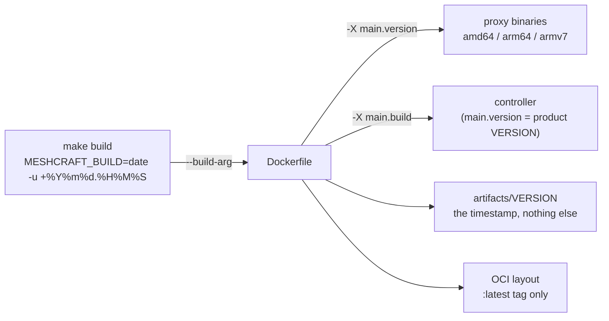
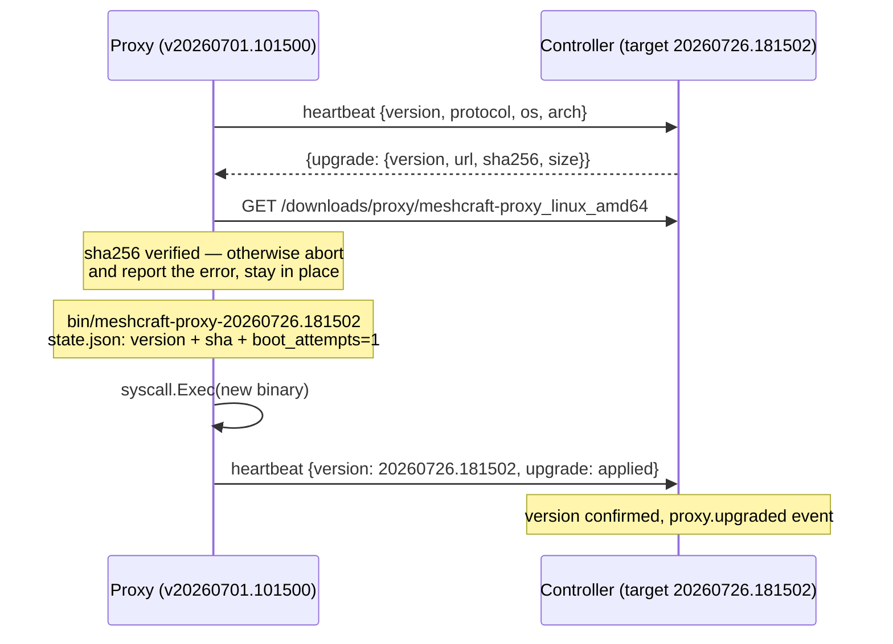

# Proxy versioning and updates

The [[Proxy]] is deployed at the customer's site, often without administrator access for us, and its lifecycle must remain **driven by the controller** — like instance migration (see [[Proxy]]): no intervention on the proxy's machine, ever.

This note settles two things: **how a proxy version is named** and **how an already deployed proxy moves to a newer version**.

## 1. The version number: `YYYYMMDD.HHMMSS` UTC

A proxy version is a **UTC build timestamp**: `20260726.181502`.

| Property | Why it matters |
|---|---|
| Monotonic | A later build is always "greater": no branches, no accidental rollback. |
| Fixed width (8 + 1 + 6) | **Lexicographic comparison is chronological comparison**: `IsNewer(a, b)` is an `a > b` on strings, without a semver parser. |
| UTC mandatory | `date -u`. Otherwise two builds on machines in different time zones break monotonicity, and daylight saving time breaks it twice a year. |
| Readable | An operator sees a proxy's age at a glance in the UI, without a lookup table. |

> [!warning] A timestamp says nothing about compatibility
> [[Controller-proxy protocol]] provides that "the controller cleanly refuses or degrades
> proxies that are too old". A build stamp does not make it possible to decide
> that: it says *when*, not *what*. We therefore carry **two distinct values**:
>
> - `version` (`20260726.181502`) — used to decide **what to update**. Shipped and
>   used: it is what `upgradeOffer` compares;
> - `protocol` (integer, `1` today — `cmd/proxy/main.go`) — will be used to decide
>   **what to refuse**, incremented only on a break in protocol semantics.
>   It is **reported and stored** (`proxies.protocol`) but **no refusal relies
>   on it yet**: the column is ready, the policy remains to be written. Keeping it
>   separate from now on is what will avoid improvising a date comparison
>   on the day something has to be refused.

The `VERSION` file at the root remains the **product version** (`0.1.0`), used to name releases and documentation. It plays no part in the update decision.

### Where the version is made

One stamp per build, computed once and propagated everywhere:



- The stamp is **passed as a `--build-arg`**, never computed in a `RUN`: a `date` in a Docker layer would make the build non-reproducible and cache-dependent. One value per `make build`, propagated to the three architectures **and** to the controller.
- **The build FAILS without it.** The `ARG` no longer has a default and the Dockerfile refuses anything that is not `YYYYMMDD.HHMMSS`. A `docker compose build` run without going through `make build` stops with the sentence naming the gesture, instead of producing an image whose proxy would be unreachable (see the callout below).
- The injection is **crossed**, and it is not an affectation: on the proxy, `main.version` carries the timestamp and `main.product` the product version; on the controller, the reverse — `main.version` carries `0.1.0` and `main.build` the timestamp. Each binary announces first what it is asked about: *which generation of proxy are you?* versus *which release of meshcraft are you?*
- The **source of truth for the controller** is what it actually serves. During implementation, `manifest.json` turned out to be useless: the controller writes `artifacts/VERSION` (the timestamp) and **hashes the binaries on demand**, with a cache keyed by `(name, mtime)` — hashing what you serve is strictly more honest than a manifest placed alongside, which can lie. `TargetVersion()` re-reads `VERSION` at most once per second, otherwise a whole fleet's heartbeat would turn into a burst of `stat()` calls.
- An **empty** target version offers nothing. That is the case of a local build without an artifacts directory, and the default is the right one: better to offer nothing than to offer the unknown.

> [!bug] The word "dev" blocked a proxy PERMANENTLY, and nothing said so — observed 29 July 2026
> `IsNewer` was a bare `candidate > current`, and its comment claimed that a
> version in another format "is never newer — it is simply
> different, which is enough to decide". The opposite is true, because in ASCII
> **digits sort before letters**:
>
> ```
> "20260729.213000" > "dev"   →   FALSE
> ```
>
> A proxy stamped `dev` is therefore newer than any build past, present and future. The
> controller no longer offers it anything, the interface shows it as **`up_to_date`** — the word
> one wants to read — and it stays that way forever. `proxy-lab` was in that state, and
> a `docker compose pull` changed nothing: the built-in registry served the same build,
> `dev` also being the **default of the Dockerfile's `ARG`**. The only possible repair
> was on the proxy's machine, which this page forbids in its first line.
>
> **Three fixes, and all three are needed** — each alone leaves a door open:
>
> | Where | What changes | Why it is not enough on its own |
> |---|---|---|
> | `Dockerfile` | `ARG MESHCRAFT_BUILD` without a default, and the build **fails** if it is not a timestamp | does not repair proxies already delivered with a bad stamp |
> | `distrib.IsNewer` | a **current** version that is not a timestamp is to be REPLACED without comparison; a **candidate** that is not one is never offered | does not say what produced such a binary |
> | `cmd/proxy/main.go` | the compile-time default is `out-of-build`, not `dev` | an honest word, but still an unpackaged `go run` |
>
> What this implies and must be accepted: a proxy compiled by hand will be offered
> the controller's packaged build. Refusing it requires `auto_upgrade = false` or a
> pin — an explicit decision, not a side effect of a string comparison.
>
> `internal/distrib` had **no tests**; the function that decides the whole update
> cycle has one now, and it fails against the old body.

> [!warning] Decided, not built — pinning by image is not possible today
> Two halves are missing, and they go together:
>
> - **`mkoci` writes only one tag**, `latest` (annotation
>   `org.opencontainers.image.ref.name`). It does not receive the version as a
>   parameter. And `distrib.ImageRef` hard-codes `:latest`: the generated
>   compose therefore **cannot** pin an image version;
> - **the built-in registry cannot 404 on an unknown tag.** `manifestByRef`
>   returns the index for **any** reference that is not a digest. A
>   `docker pull …/proxy:20260101.000000` would therefore succeed by serving the current
>   image — a missing pin would pass for a success, which is worse than an
>   error.
>
> Both must therefore be shipped together, in this order: the 404 first, otherwise the
> version tag "works" before it exists. And note that **none of
> this is needed for auto-upgrade**: `pin_version` (§4) already pins a
> version per proxy, and the proxy replaces its **binary**, not its container (§2).
> Pinning by image only serves the initial deployment and the path without
> auto-upgrade.

> [!important] The registry must make its index addressable by digest
> This one, on the other hand, is **shipped** and verified by a regression test.
> A `docker` client resolves the tag, reads the digest in `Docker-Content-Digest`,
> **then asks for the manifest again by that digest**. `mkoci` therefore writes the index
> **also as a blob**, and `manifestByRef` keeps a fallback that catches layouts
> produced before this fix. A detail that cost time: `Content-Length` must be
> explicit, including on `HEAD` — the docker client requires it. See
> [[Docker deployment and IPv6]] for the exact symptom.

## 2. Mechanism: binary pulled from the controller, verified, then `exec`

**Decision: the proxy replaces its binary, not its container.** It downloads the binary for its architecture from the controller, verifies its SHA-256, persists it in its state volume and performs a `syscall.Exec` — the process is replaced in place, the Docker image is not touched.

Rejected alternatives:

| Approach | Why not |
|---|---|
| Recreating the container via `/var/run/docker.sock` | Mounting the Docker socket = **de facto root on the customer's host**, for a cosmetic gain (the image tag). Contrary to the least privilege of [[Proxy security]], and impossible to defend in pre-sales. |
| watchtower-style sidecar | Third-party dependency installed at the customer's, Docker socket all the same, and the controller **loses control**: no progressive rollout, no per-proxy pinning, no failure reporting. |

The chosen approach has another merit: it is **identical outside Docker** (deb/rpm package, systemd unit), and it is already what [[Proxy]] announces — "opt-in auto-update pulled from the controller, binary verified before exec".

### The full cycle



The new process **announces its version itself** (the one injected into its binary at build time): the controller then stops offering the update. The loop is self-verifying — no state write on the controller side is needed to "know" it worked.

### State volume

```
/var/lib/meshcraft/
├── state.json
└── bin/                                  (0750)
    └── meshcraft-proxy-20260726.181502   (0750)
```

The binary is written under a temporary name **next to** its target, then renamed:
there is never a half-written file bearing an executable name. The announced
size is checked in addition to the SHA-256 — a truncated transfer that would by
some misfortune yield the right fingerprint does not exist, but the size difference is the most
readable diagnostic when the download breaks.

`state.json` gains a `binary` block:

```json
{
  "controller": "https://ctrl.example.com",
  "proxy_id": "…", "secret": "…",
  "binary": {
    "version": "20260726.181502",
    "sha256": "…",
    "boot_attempts": 1,
    "confirmed": false
  }
}
```

It is this record — not the mere presence of a file — that authorises execution: a binary dropped into the volume by a third party has neither an entry nor an expected SHA, and will never be executed.

### Bootstrapping at start-up (the `docker restart` case)

The image's entrypoint is fixed (`/usr/local/bin/meshcraft-proxy`, [[Proxy]]): after a container restart, it is **the image's binary** — hence the old version — that takes over. Every start-up therefore begins with a bootstrap:

```
if state.binary.version exists and ≠ version compiled into this binary:
    ├─ file SHA-256 matches the record?    otherwise → purge + image binary
    ├─ boot_attempts < 2?                  otherwise → image binary, upgrade_state=failed
    └─ boot_attempts++ then syscall.Exec(bin/meshcraft-proxy-<version>)
otherwise:
    we are already the right binary → carry on
first successful heartbeat: confirmed=true, boot_attempts=0
```

Three properties follow:

- **No exec loop**: after the `exec`, the process's compiled version equals the recorded version, the condition becomes false. An environment variable `MESHCRAFT_UPGRADED_FROM` serves as a secondary safeguard in case a binary announces a version inconsistent with its record.
- **No crash-loop**: a binary that dies before its first heartbeat uses up its two attempts (`restart: unless-stopped` relaunches the container), then the proxy **falls back to the image's binary** and reports the failure. Rollback is automatic and needs no hands on site.
- **Deliberate rollback is the same path**: the controller can offer an *earlier* version (pinning). The bootstrap therefore compares with `≠`, not with "newer": it is the controller's decision that is authoritative, not chronology. When the targeted version is the image's, the record is simply purged and the entrypoint resumes its role.

## 3. Protocol extensions

Compatible by field addition only, in line with [[Controller-proxy protocol]]. The phase 0 HTTP heartbeat carries them today; they will move as is into the `hello` of channel 0 when the WSS tunnel arrives.

**Proxy → controller** (`POST /api/proxy/heartbeat`):

```json
{
  "proxy_id": "…", "secret": "…",
  "version": "20260701.101500",
  "protocol": 1,
  "os": "linux", "arch": "amd64",
  "ifaces": [{"ip": "10.1.0.9/24"}],
  "upgrade": {"state": "failed", "version": "20260726.181502",
              "error": "expected sha256 … got …"}
}
```

`os`/`arch` come from `runtime.GOOS`/`runtime.GOARCH`: it is the proxy that knows what it runs on, the controller does not have to guess. The `upgrade` block is a **report** (`downloading` | `applied` | `failed`) and is only present when there is something to say.

**Controller → proxy**, alongside the existing `migrate` order:

```json
{"status": "ok",
 "upgrade": {"version": "20260726.181502",
             "url": "https://ctrl.example.com/downloads/proxy/meshcraft-proxy_linux_amd64",
             "sha256": "…", "size": 15728640}}
```

The **migration order takes precedence** over the update: change instance then update from the new one, never the reverse — the target version belongs to the instance hosting the proxy.

## 4. Steering: who decides, and at what pace

The update is an operational decision, not a side effect of the build. Columns added to `proxies` ([[Database schema]]):

| Column | Role |
|---|---|
| `auto_upgrade` (bool, default true) | The proxy follows the instance's target. When false, it only moves on explicit request. |
| `pin_version` (text) | Exact version targeted for this proxy — pinning or rollback. Takes precedence over the target. |
| `upgrade_state`, `upgrade_version`, `upgrade_error` | The proxy's last report, displayed as is in the UI. |
| `upgrade_started_at`, `upgraded_at` | Detection of in-flight updates and stalls. |

Decision rules, on the controller side:

- The **internal** proxy (`internal = true`, the instance's "Local" proxy) is never concerned: it is the controller process itself, it follows its image.
- The update is an action on the proxy itself: it therefore falls to the `site_admin` of **all** its covered sites, or to the `global-admin` ([[RBAC]]). A proxy shared between two sites is not updated on the decision of only one.
- A revoked proxy, or one carrying a migration order, receives nothing.
- **Progressive rollout**: at most *N* updates in flight for the instance — `maxUpgradesInFlight = 1`. An update is "in flight" when `upgrade_state` is `offered` or `downloading` **and** `upgrade_started_at` is less than fifteen minutes old. This time bound is what prevents the slot from staying blocked by a proxy that will never answer. The pace is **not** set per site: a proxy has no site ([[Proxy]]). A proxy already in flight on this version continues — it is a reminder of the offer, not a new candidate — and an explicit "update now" overrides the counter, since the operator asked.
- An `upgrade_state = failed` on the target version **suspends** offers for that proxy until a human gesture: no point replaying in a loop a binary that does not start.
- Without pinning or explicit request, we **never downgrade**: a target older than what is running signals a lagging controller, not a decision. With pinning, it is the reverse — the operator's decision is authoritative against chronology.
- A proxy that announces **no** version is not comparable: we wait for it to present itself rather than pushing a binary to it blindly.

> [!warning] Decided, not built — the safeguard based on observed overlap
> An earlier version of this note announced better than what exists: *"two
> proxies that are access paths (`device_paths`) of the same device are
> never updated at the same time"*. That is **not** what the code does, and it cannot
> be today: `device_paths` **is not a table**. The set
> of proxies reaching a device is persisted nowhere — there is therefore
> no overlap to consult.
>
> What actually protects is coarser and sufficient at the current scale: a
> **single** instance proxy in flight at a time, whatever it covers. The
> global ceiling is more conservative than a per-overlap ceiling — it even serialises
> proxies that have no device in common — so it cannot
> let through what the other would have blocked. What it costs is **time** on
> a large fleet, and that is the right direction for the compromise: we pay in slowness, not in
> risk.
>
> The target remains overlap, because it is the "update" version of the
> rule *never cut off your own hand* ([[Reconciliation]]) — but it has a
> named prerequisite, and it is better read here: **persist the observed
> access paths.** As long as they do not exist, any finer safeguard would be a
> fiction.

Each transition feeds the [[Event log]]:

| Event | When |
|---|---|
| `proxy.upgrade_offered` | **first** offer for this version only — logging on every heartbeat would teach nothing |
| `proxy.upgraded` | the proxy **announces** the targeted version: the only proof that counts |
| `proxy.upgrade_failed` | `failed` report from the proxy, with its error message as is |
| `proxy.upgrade_stalled` | offer left unanswered for fifteen minutes — "this proxy is probably too old to update itself" |
| `proxy.upgrade_policy` | change of `auto_upgrade`, of pinning, or immediate request |

There is **no** `proxy.upgrade_rolled_back`, and the absence is deliberate rather than an oversight: the bootstrap's automatic rollback is **reported as a failure**. That is what happened — a binary did not start — and naming it otherwise would take it out of the filter the operator watches, for a nuance of cause that is already in the message.

> [!note] A single clock, and it is respected here
> All update timestamps — `upgrade_started_at`, `upgraded_at`,
> `last_seen` — come from a **PostgreSQL** `now()`, hence from the
> controller's clock. The heartbeat carries **no date**: the proxy's `upgrade` block
> is a state and an error message, never an instant. It is the general rule of the
> vault ([[Event log]], § *A single clock*), and it is not
> theoretical: eleven seconds of drift were measured on a real proxy without NTP,
> enough to make a proof appear **before** what it proves. If the upgrade report
> ever carried a date, it would have to be a **diagnostic** fact —
> measuring drift — never a date that is ordered against the controller's.

On the UI side ([[Web interface]], Proxy page): version displayed with a badge *up to date* / *update available* / *in progress* / *failed* / *stalled*, an **Update now** button per proxy (`upgrade_requested`, consumed when the offer is issued — it bypasses `auto_upgrade` without modifying it), and the error of the last attempt in plain text.

## 5. Security

See [[Proxy security]] for the general framework; what is specific to updates:

- **Integrity**: SHA-256 mandatory, provided by the controller in the descriptor and verified before any `exec`. A non-conforming binary is deleted, never executed, and the failure is reported.
- **Transport**: download over the same TLS channel as the heartbeat, to the controller URL carried by the local state — not an arbitrary URL coming from the network. The proxy **refuses a descriptor whose URL is not on its current controller**.
- **Signature**: **decided, not built.** A detached ed25519 signature served next to the artifact, public key embedded in the binary. SHA-256 over TLS protects against corrupted transfer and a network intermediary, not against a compromised controller — the signature closes that hole. It is the commitment made in [[Proxy security]] ("signed binary, verification before replacement"). Correction of a false claim in this note: the descriptor **does not provide** the field — `distrib.Upgrade` carries `version`, `url`, `sha256`, `size` and nothing else. Adding it will be a field addition, hence compatible ([[Controller-proxy protocol]]), but it remains entirely to be done on both sides.
- **No Docker socket, no new privilege**: the update adds no capability to the two existing ones (`NET_RAW`, `NET_BIND_SERVICE`).
- A compromised controller could already `dial` anywhere from the proxy: updating does not widen the worst case, it makes it persistent. All the more reason for the signature, whose signing key does not live on the controller.

## 6. Out of scope

- **Controller update**: `docker compose pull && up -d` on the instance, with migrations applied at start-up ([[Controller]]). Nothing automatic: it is the instance's operator who decides.
- **Draining**: a proxy with active tunnelled sessions will have to let them finish before the `exec`, or cut them cleanly (`RST` on the channels). To be handled with the WSS tunnel, the `Draining` state of the [[Proxy]] lifecycle.
- **Download resumption**: a binary of about fifteen megabytes over a poor WAN link is downloaded again, not resumed. To be revisited if the field contradicts it.


## 11. What the implementation taught

Three defects existed only in the code, and only trials against a real
proxy brought them to light. They are noted here because they are reusable
elsewhere, not because they are anecdotal.

- **A proxy too old to understand the offer blocked the whole rollout.**
  It stayed in `offered`, never answered, and its timestamp was refreshed
  on every heartbeat — it therefore occupied the single progressive-rollout slot
  indefinitely, preventing *the other* proxies from updating. A
  repeated offer no longer refreshes the timestamp, and an offer unanswered after
  15 minutes goes to **`stalled`** with the reason in plain text ("this proxy
  is probably too old to update itself"). A waiting state
  must always be able to expire, otherwise it is a disguised deadlock.

- **The binary to download was behind the user session.** A proxy
  has no session: every attempt got an `HTTP 401`. `/downloads/proxy/`
  is therefore **anonymous**, which is consistent — the OCI registry already served
  exactly the same bytes to `docker pull` without authentication. An
  inconsistent protection does not protect, it breaks.

- **The failure report was overwritten by a new offer in the same
  heartbeat.** The state was read before recording the report, so that a
  failure immediately turned into an identical offer again: the proxy endlessly replayed a
  binary that did not work, exactly what §4 forbids. The report is
  now taken into account, and the state re-read, **before** any decision.

What was verified end to end against a real proxy, on an earlier
version: offer, download, SHA-256 verification, `syscall.Exec`,
confirmation at the first heartbeat; then, after `docker restart`, the automatic
switch to the volume's binary; then, with a deliberately corrupted binary, the
refusal to execute, the purge, the return to the image's binary and the reporting of
the failure — with effective suspension of subsequent offers.

### The mechanism runs on a real installation

Two chained auto-upgrades on **28 July 2026** on a customer deployment, from
build `20260728.003906` to `20260728.125146`, without intervention on the
proxy's machine. That is the point that matters: it is no longer a path tested in the
lab, it is the **normal** path by which this proxy takes its versions.
Two practical consequences:

- auto-upgrade is now the default delivery mode, and the compromise of
  §4 — a single proxy in flight — is measured against a real fleet rather than assumed;
- the reverse is true as well: every `make build` produces a *newer* version,
  hence an offer. A frequently rebuilt controller triggers as many update
  cycles, and it is `auto_upgrade` set to false or `pin_version` that stops it —
  not restraint in building.

### Decided / shipped / open

| Question | Status |
|---|---|
| Version = UTC build timestamp, lexicographic comparison | **shipped** — `distrib.IsNewer`, a `>` on strings |
| `protocol` separate from `version` to decide what is refused | **shipped as data** (`proxies.protocol`) — no refusal relies on it yet |
| Single stamp per build, propagated to proxy and controller | **shipped** — `--build-arg MESHCRAFT_BUILD` |
| `artifacts/VERSION` + on-demand hashing of served binaries | **shipped** — `manifest.json` abandoned |
| Offer descriptor in the heartbeat response | **shipped** — `distrib.UpgradeFor`, `nil` if nothing for this platform |
| Anonymous download, SHA-256 and size verified, URL bounded to the controller | **shipped** — `cmd/proxy/upgrade.go` |
| `syscall.Exec`, record in `state.json` **before** the exec | **shipped** |
| Bootstrapping at start-up, two attempts, fallback to the image's binary | **shipped**, and verified with a corrupted binary |
| Deliberate rollback via `pin_version`, including to an earlier version | **shipped** — the bootstrap compares with `≠`, not with "newer" |
| Progressive rollout with one proxy in flight, offer expiring to `stalled` | **shipped** |
| Two auto-upgrades on customer hardware | **shipped and observed** — 28/07/2026 |
| Safeguard based on observed overlap (`device_paths`) | **decided, not built** — prerequisite: persist access paths (§4) |
| ed25519 signature of the artifact | **decided, not built** — the field does not yet exist in the descriptor (§5) |
| `:<version>` image tag and registry 404 on unknown tag | **decided, not built** — to be shipped together, the 404 first (§1) |
| Draining tunnelled sessions before the `exec` | **decided, not built** — waits for the WSS tunnel's `Draining` state (§6) |
| Resuming an interrupted download | **rejected** — fifteen megabytes can be downloaded again; to be revisited if the field contradicts it |
