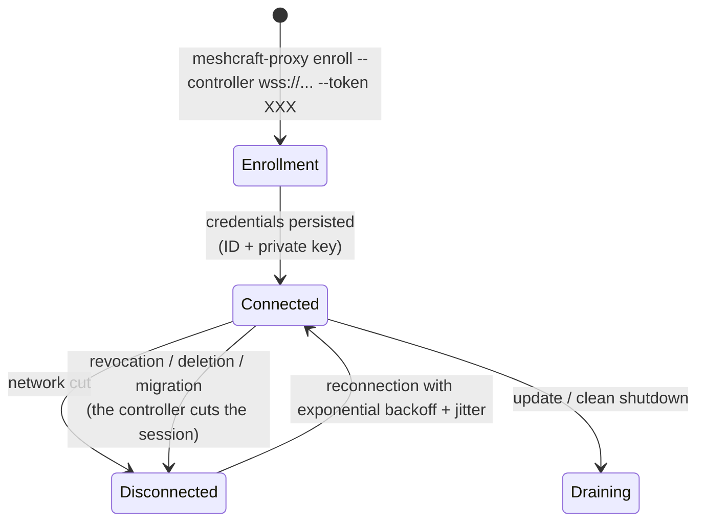

# Proxy

Agent installed by the user in a remote network. **Single static Go binary** (amd64/arm64, deb/rpm package + Docker image): no dependencies, minimal footprint, runs on a VM, a Raspberry Pi or a container.

## Roles

1. **Transport gateway**: open TCP connections to devices (SSH 22, Telnet 23, HTTP/S 80/443…) and relay them to the controller as multiplexed streams ([[Controller-proxy protocol]]). The proxy does not understand SSH: it copies bytes.
2. **Local UDP/scan executor**: what cannot be tunnelled over TCP is executed on site. Steering is NOT a generic RPC — it is pushed instructions (`snmp[]` of the `WatchConfig`) plus a **closed set of two read-only questions** ([[Controller-proxy protocol]], § *One-off questions*):
   - mass SNMP polling (gosnmp): the walk leaves from the proxy, only the results come back;
   - a **walk of an arbitrary OID**, read-only, for developing a connector;
   - the **source address** the proxy's kernel would use to reach a device — the only way to know where a device must send its traps when the proxy reaches it through routing;
   - [[Discovery]] scans: ARP (burst on the local segment), ICMP sweep, targeted TCP probes, reading LLDP tables via SNMP.

   > [!warning] There is no `snmp.set`, and there will not be one
   > An earlier version of this page listed `set` among the proxy's
   > operations. Nothing of the kind exists, and it is not a delivery delay: **no
   > write question will enter this contract**. Every write goes through a
   > [[Connectors|connector]], which carries the safeguards — plan, dry-run, verification
   > re-read, [[Reconciliation|rollback]]. A write path that
   > bypassed them would not be a shortcut, it would be the removal of the only
   > mechanism that prevents cutting off your own hand.
3. **Telemetry receiver**: listens for syslog (514/udp) and SNMP traps (162/udp). The site's devices are configured by meshcraft to point to the proxy's IP ([[Monitoring]]). Messages are timestamped, tagged with the source IP, and pushed to the controller.
4. **[[Web pass-through access]]**: relaying the user's HTTP sessions to a device's web UI.

## Lifecycle

- **Enrollment**: a `site_admin` (for their sites) or a `global-admin` (for the whole instance) generates in the UI a single-use token **carrying the coverage** of the future proxy. The proxy exchanges it for a durable identity — an identifier and a **shared secret**, not a key pair: the controller keeps only its fingerprint, but the proxy holds the secret in clear in its local state and replays it with every request. The key pair remains a target, with what it would change; details and consequences in [[Proxy security]].
- **Outbound connection only**: WSS 443 to the controller — traverses NAT and firewalls without any inbound rule.
- **Degraded mode**: if the tunnel goes down, the proxy keeps listening for syslog/traps and buffers to disk (bounded ring buffer, e.g. 50 MB); replay on reconnection. Devices do not lose their event history during a WAN outage.
  The **metric sample** buffer is a separate object, **in memory** and bounded in number of points: its depth, the outage duration it absorbs and its worst-case memory cost are quantified in [[Unified monitoring and pipelines]] §2.4, along with the throughput the upload drains.
- **Update**: opt-in auto-update pulled from the controller, or system packages. Version, protocol and the full sequence in [[Proxy versioning and updates]].

  > [!warning] The binary is NOT signed — integrity is verified, origin is not
  > This page long announced a "signed binary, signature verification
  > before exec". That is false, and the nuance is the one that matters in security. What
  > exists is a **SHA-256** fingerprint compared before `exec`: it proves that the
  > download was not corrupted **on the way**, not that it comes from us.
  >
  > The fingerprint arrives through the same channel as the binary. Whoever controls that channel
  > controls both, and the proxy then executes what it is given, with the rights
  > of an agent installed at the heart of a customer's network. A signature — public key
  > embedded in the proxy, verified outside the distribution channel — is what is
  > missing, and [[Proxy security]] carries it as a target.
  >
  > Saying it this way is not a detail of vocabulary: "signed" suggests a
  > trust anchor, and someone could rely on it to open the
  > distribution registry to a less secure network.

## Site coverage: the proxy's rights boundary

A proxy belongs to no device, but it is not for all that beyond any scope: it carries a **site coverage**, and that coverage is what decides **who can see and administer it**, and **for which sites it can serve as an access path**.

> [!important] Two notions not to confuse
> - **Instance proxy** (`global`): usable by all sites, administered
>   by `global-admin`s alone. It is the proxy a central IT department deploys
>   for everyone.
> - **Restricted proxy**: limited to the sites of its coverage. It is what a
>   site administrator deploying their own point of presence gets.
>
> An **empty** coverage does not mean "everywhere" but "**nowhere**".
> Without this rule, a site-admin removing their site from the last proxy would
> promote it to an instance proxy: a privilege escalation disguised as
> clean-up.

What coverage decides, and what it does not:

| Question | Answer |
|---|---|
| Who sees this proxy? | anyone with a role on a covered site — and everyone for an instance proxy |
| Who adds/removes a site from its coverage? | the `site_admin` of **that** site, and of that one only |
| Who renames, revokes, deletes, migrates it? | the `site_admin` of **all** covered sites, or a `global-admin` |
| Who promotes it to an instance proxy? | a `global-admin` alone |
| For which sites can it serve as a path? | the covered sites |
| Which proxy collects a device over SNMP? | coverage makes it **eligible**; the attachment (`devices.proxy_id`) **designates** among the eligible ones, and can never widen coverage (see below) |
| For which devices are its **facts** accepted? | those the controller **pushed** to it — coverage for reachability, attachment for ports and traps ([[Proxy security]], § *Least privilege* — the scope check) |
| What it **can** reach? | **unrelated**: it is observed (`device_paths`), not decreed |
| The site of a device it discovers? | **unrelated**: chosen at adoption, by an authorised human |

The last two rows are the heart of the model: coverage is an **operational** rule, not a theory about topology. Reachability remains an **observed fact**; coverage only says what we **allow ourselves** to do with it.

### The resulting lifecycle

- A `site_admin` **deploys their own proxy**: the enrollment token they generate carries, by default, all the sites they administer — adjustable at generation. They need to ask nobody anything to cover their own fleet.
- A `global-admin` deploys an **instance proxy** by default, or chooses a coverage if they want to partition it from the outset.
- The intended coverage is **frozen at token issuance**, not re-read at enrollment: the issuer's rights may have changed in between, and it is the intent of the moment that must count.
- A `site_admin` can **take their site out** of a shared proxy, and **put it back** later: they still see the proxy as long as one of their other sites covers it. On the other hand, removing the **last** covered site is refused — the proxy would become invisible, hence unmanageable without going through a `global-admin`.
- A `global-admin` **promotes** a restricted proxy to an instance proxy, or the reverse, by redefining its whole coverage.
- **Declaring a scan range** on a proxy requires rights on the proxy itself — all its sites. Otherwise, on a proxy covering A and B, the administrator of site A alone would have B's network scanned.
- A proxy's lifecycle events (`proxy.enrolled`, `proxy.upgraded`, `proxy.revoked`…) are **instance** events, without `site_id`: they have their own log ([[Event log]]). A coverage change, on the other hand, is logged **on the site concerned** — it is a decision that belongs to that site.
- **Revoking, deleting or migrating a proxy cuts its live session** — not only its next authentication ([[Proxy security]]). The messages of `proxy.revoked`, `proxy.deleted` and `proxy.migrated` say whether the cut actually took place, and one more instance event exists for cuts **nobody asked for**: `proxy.tunnel_cut`, as a **warning**, emitted by periodic revalidation when the database disowns an established tunnel (proxy revoked elsewhere, row deleted directly, revocation pronounced during a controller restart). It is the only proxy event without a human actor, and that is precisely its information: a proxy dropping without anyone having clicked.

### Reachability is an observed fact, not an attachment

- A **range to scan** is declared on a proxy — the one that knows how to reach it (the controller's internal proxy being a proxy like any other, see [[Overview]]). A range has no site: it does not know one yet.
- **A device belongs to no proxy.** The controller holds, for each device, the **set of proxies that reach it** (`device_paths`: last success, latency, verified transports). It is *observed* data, never entered.
- On each operation (configuration, `ReadState`, polling), the controller **chooses a path** in that set — the fastest still valid — and **fails over** to another on failure. A proxy going down therefore does not make its devices inaccessible if they are reachable otherwise, which goes in the direction of the rule *never cut off your own hand* ([[Reconciliation]]).
- A device's **site** comes from **adoption** ([[Discovery]]), decided by the user. It is never inferred from the discovering proxy.
- The proxy announces its local interfaces/IPs to the controller (IPv4 **and** IPv6): the UI can suggest ranges to scan.

Everything above remains true, and the attachment described below does not
contradict it: it does not say what a proxy **can** reach — that remains observed —
it says which of the eligible proxies **must** collect.

## The reference collector: a DECLARED attachment

A device **may** designate its collector: `devices.proxy_id`, nullable,
`on delete set null` ([[Database schema]], migration `0022`). It is the proxy
that polls it over SNMP, and the one whose address will be written into the device
as the destination of its traps.

The need does not come from a desire for tidiness, it comes from a wall. Without
an attachment, eligibility is **inferred** from a pair (site coverage, `global`
flag): with two instance proxies in the database — the ordinary case as soon as a
"Local" coexists with a remote proxy — the **same** device is monitored by
both. That is not a defect in itself for ping: two pings are better than
one. It becomes a wall as soon as something has to be written **into** the device,
because a trap receiver is **one** IP address and "several eligible
proxies" does not translate into an address. And for SNMP, two proxies
polling the same switch report each port transition **twice**: the
correlation can then only deduplicate them *after* the fact, never prevent them
([[Monitoring]], § *The duplicate criterion*).

> [!important] It is a DECLARATION, not an election
> Electing the collector — the first proxy connected, the one with the lowest
> latency — would make it **change on its own**, and the trap destination written into
> the devices would become wrong without anyone touching anything. A whole
> fleet would stop being reactive because of a millisecond of latency gained
> elsewhere. The operator designates, meshcraft obeys.
>
> The vault describes elsewhere an **election** of a "preferred collector" (with a
> secondary and recomputation when paths change): [[Monitoring]], § *Choosing the
> collection point*. It is **decided, not built**. The declaration does not
> replace it, it delivers its missing brick — the single address — without the
> automatic recomputation, hence without its risk. If election ever arrives, it will
> only be able to **propose** an attachment.

### The trade-off: determinism on one side, redundancy on the other

The attachment does **not** restrict everything, and the dividing line fits in one
sentence: *determinism where uniqueness is required, redundancy where it
is free*.

| Channel | Regime | Why |
|---|---|---|
| **SNMP** and trap destination | the attached proxy alone | a receiver address is unique; two collections double every port transition |
| **ICMP** (`up` / `unreachable` status) | every covering proxy, as before | two pings cost nothing and give a better truth about reachability; restricting ping would lose all failover on the day this proxy goes down |

A consequence of form: the list the controller sends to a proxy is **not**
filtered on the attachment, it **projects** it row by row. ICMP targets
take the whole list, SNMP targets only the rows for which this proxy is the
collector. Filtering the rows would have been the trap of this batch: the same list feeds
both channels, and restricting the rows would have restricted ping along with it.

> [!important] These two regimes are also the two granularities of what we ACCEPT from a proxy
> The same pair of sets serves as a **write boundary**: the controller only accepts
> a fact about a device if it asked **this** proxy to monitor it, at the
> granularity the fact requires — ICMP targets authorise `device.up` /
> `device.down`, SNMP targets authorise port transitions, `trap.seen` and
> port telemetry. A proxy reporting a port transition for a
> device it **pings** but for which it is **not the collector** is therefore refused,
> even if its coverage is impeccable: it does not poll it, it cannot know
> anything about its ports. Details, verdicts and residual window in
> [[Proxy security]].
>
> That is what gives the row-by-row projection described above a second
> reason to exist: the pushed instructions are **the** source of truth for what we
> will accept afterwards, and not a rule rewritten elsewhere that would end up saying something
> else.

Devices thus **delegated** to another collector are **counted** in
this proxy's monitoring summary, not listed: someone asked for it, it is a
normal operational fact, and one line per attached device on every proxy
connection would drown the log for information the device page already carries
in plain text.

> [!note] `null` is a regime, not a forgotten setting
> `null` = collection **by coverage**, exactly the behaviour from before
> migration `0022`: every eligible proxy is a collector. It is the state of the whole
> existing fleet, and the migration therefore **preserves semantics** — no
> monitoring changes as long as nobody has declared anything. Inventing
> an attachment in the migration would have been a guess: nothing in the database says
> which proxy *must* collect a device that two proxies reach equally
> well.
>
> Same reason for `on delete set null`: deleting a proxy must never
> delete devices — a `cascade` would erase part of the inventory when
> a box is removed. The correct fallback is a return to the coverage regime.

### The trap: the attachment grants NO coverage

> [!warning] A non-covering attachment does not move collection, it STOPS it
> Site coverage remains the **only** way in, and it is a
> **confidentiality** boundary, not a convenience: an attachment that widened it
> would disclose the name and address of a site A device to a proxy that only
> covers site B, through a gesture that has nothing to do with rights.
>
> Accepted consequence: attaching a device to a proxy that does not cover its
> site does **not** get it collected by that proxy — **it gets it collected by
> nobody**. Neither that one, which does not see it; nor those that cover the site, which
> are not designated. No more SNMP polling, no more receiver for its
> traps.
>
> And the symptom is treacherous: the device **keeps being pinged**, since
> ICMP stays by coverage. Its indicator therefore stays **green** and its state stays
> correct — only collection has stopped. It is exactly the kind of outage you
> do not find by looking at a fleet screen.

Three mechanisms cover it, and none replaces the others:

1. **the screen only offers covering proxies** — the list served to the device
   page is that of the proxies covering the site;
2. **the API refuses the others**, with a 422, with a message that names the
   *consequence* and not the rule: "the attachment grants no coverage,
   the device would no longer be collected by anyone". A UI is not an
   access control, and this route can be called directly. A curt "attachment
   refused" would send the operator looking for a missing right on their account
   whereas what is missing is the proxy's coverage;
3. **the device page carries a banner** when the *current* attachment is
   no longer covering. Refusal at write time is not enough: a coverage can be
   **narrowed after the fact**, elsewhere in the product, and invalidate an
   already written attachment. The banner is readable from the `viewer` role — it is those who
   look at the screen all day who will notice that a device no longer reports
   anything.

The third is not a stopgap, it is the only place from which the case can be seen. The
monitoring computation starts from a **proxy**: seen from the attached proxy, an uncovered
device is not even eligible; seen from any other proxy, it looks feature
for feature like a legitimately delegated device. Telling them apart would require
re-querying each site's coverage on every computation, for a verdict that would
change nothing about what this proxy must do — in both cases, it does not collect.
The device page, on the other hand, reasons about a **device**: it is from there, and from
there only, that the question has an answer. Detecting it server-side would mean
starting from the fleet, that is, running an audit, not a monitoring computation.

Writing an attachment is reserved to the `site_admin`, and for a stronger reason
than for its neighbours on the device page: a wrong addressing domain degrades an
arbitration, a **wrong collector stops collection**. It is not of the same order
as labelling a jack.

A collector change is logged as a **warning** in the
[[Event log]] (`device.collector`), with the old and the new
collector **named in plain text** — "none (collection by coverage)" when there is
none. Without this trace, the gesture would be undiagnosable three months later: the
symptom ("this switch no longer reports its ports") has no visible connection with a
drop-down ticked on a Tuesday, and the UUID of a proxy deleted since can no longer be read back.
Monitoring is pushed again to **both** proxies concerned, the old one included —
otherwise it would keep polling the device until its next
reconnection, that is, precisely the duplicate the attachment exists to
prevent.

## Implementation

| Topic | Choice |
|---|---|
| Language | Go ≥ 1.22 |
| WS client | `nhooyr.io/websocket` + home-made multiplexing layer (see [[Controller-proxy protocol]]) |
| SNMP | `gosnmp` |
| ARP scan | raw socket / `AF_PACKET` (CAP_NET_RAW) with ICMP + ARP table fallback if the privilege is missing |
| Syslog/Traps | native UDP listeners; ports < 1024 via `CAP_NET_BIND_SERVICE` |
| Local config | **no `proxy.yaml`**: a JSON state written by the proxy itself (controller URL, identifier, secret **in clear**), plus two environment variables — `MESHCRAFT_DIAL_ALLOW` to bound TCP destinations, open by default. Everything else is driven by the controller |
| Logs | JSON on stdout (journald/docker) |

The proxy is **free of business state**: it stores neither device credentials nor configurations. Every network secret stays on the controller ([[Credentials]]) and travels encrypted in the tunnel at the time of use — and even then, only the encrypted TCP bytes (SSH/TLS) cross it for secure protocols.
