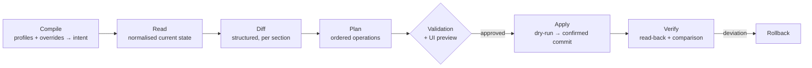

# Reconciliation — from desired to applied

The orchestrator's central pipeline ([[Controller]]): turning intent into actually applied configuration, **without ever losing control of the device**.

## Pipeline — the TARGET



| Step | Status | Where |
|---|---|---|
| **Compile** | **partial** — the rules of [[Switch profiles]] produce a port configuration; the full inheritance of [[Profiles and groups]] is not built | `internal/portrules` |
| **Read** | **shipped** | `instanton.Admin.ReadState` → `devices.observed` |
| **Diff** | **shipped**, pure and tested | `internal/recon` |
| **Plan** as an object | **decided, not built** — the order of operations is hard-coded in the write path | *(nothing)* |
| **Validation + preview** | **removed deliberately**, not forgotten — see the callout below | *(nothing)* |
| **Apply** | **shipped**, without dry-run or confirmed commit | `instanton.Admin.ApplyPorts`, `internal/api/autoapply.go` |
| **Verify** | **shipped** — nothing is taken as applied on the strength of a return code | same path, read-back + `recon.DiffPorts` |
| **Rollback** | **decided, not built** | *(nothing)* |

> [!warning] Human validation was REMOVED, and it is an operational decision
> The diagram places an approval between the plan and the apply. Applying is in
> reality **automatic**: `internal/api/autoapply.go`, triggered by any intent
> change, after a 6-second grouping window. The reason is simple — *configuring
> forty-eight ports in the interface IS the approval*. Asking for it a second
> time, on a product whose promise is to administer the fleet, amounts to asking
> the same question twice and leaves a fleet durably different from what the
> screen shows.
>
> What it does not allow for all that, and this is what makes the trade-off
> tenable: the write safeguards remain **intact** (§ *Apply*); a failure is
> **never replayed in a loop** — one attempt per change, an event if it fails, and
> the device visibly stays "in progress", re-appliable by hand; and only one apply
> at a time per device.
>
> The grouping is not a comfort: configuring a port triggers one change per port,
> and without it, changing forty-eight ports would launch forty-eight concurrent
> applies on a device that accepts only **five sessions**.

### 1. Compile
Inheritance resolution ([[Profiles and groups]]): site defaults → device profile → device overrides → port profiles → port overrides. Produces the complete `desired` intent ([[Standard data model]]). Deterministic and pure: compilable at any time for the UI preview.

**Partial.** What is shipped is the producing half: `internal/portrules` evaluates the rules of a switch profile and returns, port by port, the retained configuration **with the rule that won it** — and the preview exists (`POST /api/devices/{id}/switch-profile/preview`), which keeps the "compilable at any time" promise. The full inheritance chain, however, is not built: there is no site → device profile → overrides composition.

What is **not** done and that the previous version announced: **validation against the connector's capabilities**. It was replaced by a different trade-off, described in § *Three ways of not applying* — an intent is not discarded at compile time, it is applied if we know how, and we **say** what was left behind.

### 2. Read
The connector reads the device back (parsed CLI or API) → `observed` intent. Always read back just before applying — never a diff against a cached state. **Shipped**, and the rule is upheld all the way into `ApplyPorts`, which starts with a `ReadState`.

`ReadState` is however **not** part of the `driver.Driver` contract, which carries only `Info`, `Capabilities`, `Fingerprint` and `ResetProcedure`: it is a concrete API of the connector, called directly by `internal/api`. Extracting the read/write contract is **deliberately postponed** until a second vendor exists — freezing a contract on the first one's assumptions means freezing all of them ([[Connectors]], § *Path from what exists*).

### 3. Diff
Structured field-by-field comparison, respecting the "absent = unmanaged" rule: meshcraft does not touch settings outside the model. Output: a list of typed changes (`port.GE4.pvid: 20 → 30`), displayed as is on the device's page. **Shipped** — but it is read there **after** the apply and not before approval, since there is no approval: it is the banner of remaining deviations, not a preview.

The "absent = unmanaged" rule only plays in **one** direction, and that is what makes it usable: a port meshcraft does not manage is ignored, but a port it manages and the device no longer carries is a very real deviation (`presence: port unknown to the device`).

### 4. Plan — *decided, not built*

The driver orders operations according to the platform's constraints: create VLANs before assigning them, change the PVID before removing the old VLAN, **touch the management VLAN last**. The plan also materialises the safety strategy (see below). For CLI platforms, the plan would be a list of command blocks; for REST APIs, a list of calls; for the webform, a sequence of POSTs.

> [!note] The order exists, the object does not — and that is what is missing
> Nothing this step describes is wrong in **substance**: the order is indeed
> respected, and it is even exactly the one announced — create the missing VLANs,
> then write the ports one by one, then save to flash (`instanton.ApplyPorts`).
> The vendor constraint that imposes it is documented: assigning a port to a
> non-existent VLAN is refused by the device, and the reverse order would leave
> half the plan applied.
>
> What does not exist is the **plan as an object**: nothing that can be computed,
> displayed, reread or replayed. The order is code, not data. What that forbids,
> concretely: the preview before approval, the dry-run, resuming an interrupted
> apply at the step where it stopped, and the timed rollback — all four assume
> being able to hold the list of operations in hand.
>
> It is also the reason why extracting the connector contract waits for a second
> vendor: `Plan()` is the method whose signature depends most on the platform,
> and inferring it from a single webform would be inferring it from nothing.

### 5. Apply — never lock yourself out

Risk no. 1: pushing a config that cuts off access to the switch (change of mgmt VLAN, of IP, of uplink trunk). Strategies in order of preference, to be chosen according to `Capabilities.Commit` (`driver.CommitStyle`):

| Platform can do | `CommitStyle` | Strategy | Status |
|---|---|---|---|
| commit confirmed (Junos, AOS-CX checkpoint) | `commit_confirmed` | commit with timer; meshcraft confirms after checking reachability | **target** — no shipped platform |
| archive/rollback (IOS `archive`, `configure replace`) | `archive_rollback` | snapshot before apply, timed rollback armed, disarmed after check | **target** — no shipped platform |
| **apply then save** (Instant On) | `apply_then_save` | the change takes effect immediately but does not survive a reboot until it is saved: **a free rollback**, provided one applies, verifies, *then* saves | **shipped for the management switchover** (§ below), **decided otherwise for port writes**: `ApplyPorts` saves to flash itself, before the caller reads back. The argument is explicit and not a bad one — *an apply that a reboot cancels is worse than a refused apply, because it was observed as successful*. But it closes the safety net: a write that cuts access is burnt in before anyone could notice |
| nothing (web-only, old CLI) | `immediate` | **application-level rollback**: back up the config beforehand; after apply, reachability test; if lost > timeout, restore | **target** — and there is no raw config backup to restore (`BackupConfig` does not exist) |

> [!warning] `Commit` is declared, nobody reads it
> The capability is filled in with its vendor justification — on an Instant On,
> "*Changes take effect immediately but are not retained across a switch reset
> unless you click Save Configuration*" gives `apply_then_save`. But **no code
> branches a strategy on it**: `ApplyPorts` always does the same thing. The
> declaration therefore has the value of recorded knowledge, not of behaviour —
> and it is exactly the kind of field one must say is dormant, otherwise people
> believe an arbitration is taking place.
>
> The most frustrating part is that the safest strategy in the table is that of
> the shipped platform, and that it is **free**: not saving to flash lets a power
> cut roll everything back. The management switchover makes full use of it (three
> separate gestures, § below); port writes do not.

Status of the safeguards announced as systematic:

| Safeguard | Status |
|---|---|
| **Per-device serialisation**: one apply at a time | **shipped** — per-device lock in `autoApplier` |
| Concurrency bounded **per site and per proxy** | **decided, not built** — no semaphore; without it, a whole-fleet deployment has no ceiling |
| **PORT safeguard**: a port carrying administration untagged and an **active** link never has its native VLAN rewritten | **shipped** — and it is the safeguard that was actually built, in place of those below. Details in § *Apply: writing without locking yourself out* |
| **Reachability watchdog**: after any change touching management/uplinks, re-test access (TCP + login) before marking the apply successful | **partial.** There is **none** on port writes: the read-back that follows proves the configuration is there, not that the device stays reachable tomorrow — it is the same session that wrote and reads back. The **management switchover**, on the other hand, has one, and a real one (§ below). The pre-flight building block exists elsewhere and is not wired into apply: `driver.CheckReach`, whose trick is that **a closed port is good news** — a `connection refused` proves the packet arrived, whereas a timeout does not distinguish "no route" from "silently filtered" |
| **Risky changes flagged**: `disruptive` diff in the preview, explicit confirmation required | **replaced.** Without a preview, there is nowhere to flag it. The shipped mechanism does the opposite and is better: the apply **spares** the dangerous port, writes it into `last_apply.skipped` with the reason, and the screen asks the question — **force** or **give up** — knowingly. A warning one can click without reading protects nobody; an unmodified port does. See the callout below: the question must be asked **where the gesture is triggered**, not only on the device page |
| **Management addressing switchover**: pre-flight, management last, watchdog at the new address | **shipped, in three separate gestures** — and it is the only place in the product where the `apply_then_save` strategy is exploited. `prepare` adds a DHCP interface on the target VLAN **without removing or saving anything**: the device keeps its address, hence stays reachable, and acquires the new one — the switchover becomes **verifiable** instead of a bet. `commit` **refuses** if that interface has not obtained an address. `persist` **refuses** if the device does not itself declare that it is administered through the plan's VLAN, and it has only said so at the address at which meshcraft has just reached it: saving an unverified switchover would burn in an error. The **pre-flight** also exists, but it does not check what was announced — `mgmtPathOf` looks for a port with an **active link** that already carries the target VLAN, and not for a proxy reaching the subnet. It is the right criterion, and it is stricter: "the VLAN is on the switch" never meant "it leaves it". Details in [[Management addressing]] |

### 6. Verify & drift

Post-apply read-back: `observed == desired` on the modified scope, otherwise the apply remains dated as incomplete, with the detail. **Shipped** (§ *Attribution* below). A deviation attributable to the device creates a `config.drift` event in the [[Event log]]; the UI offers "re-apply" or "absorb". **Shipped.**

> [!warning] Nobody triggers the periodic read-back
> It is the costliest hole on this page, because everything around it is built.
> Drift detection assumes a read-back of the fleet; there is **no scheduler**
> ([[Controller]], § *scheduler*). A read-back arrives through two paths only: the
> button (`POST /api/devices/{id}/read-state`) and the end of an apply.
>
> Exact consequence: a drift **exists** as soon as an operator reads back, and
> never before. A switch modified by hand stays `in_sync` on screen as long as
> nobody clicks — and the `config.drift` event is only emitted at the moment of
> that read-back, hence **dated the day it was seen**, not the day it happened.
> The timestamp-based attribution mechanism, for its part, is ready to use it: it
> is really a background task that is missing, not a decision.

## Jobs — *decided, not built*, but the transcript is there

There is **no** `jobs` table: no intent revision, no plan, no duration persisted, and nothing to resume after a controller restart (a burst waiting to be grouped is lost).

What was shipped instead holds the most useful part of the promise, and it should not be underestimated: the **`pipelines` / `pipeline_steps`** tables (migration `0016`) keep, for each operation on the fleet, the device, the author, the result and **the full transcript** of the connector's session — step by step, with the detail of each. It is indeed the connectors' debug tool no. 1 and the audit trail announced. The transcript already existed, but was only returned in the HTTP response of a request: it disappeared as soon as the page was closed. Attaching it to a pipeline makes it consultable **after the fact**, that is at the precise moment one needs it.

Three step states, and the third is the one that required the most care: `done`, `failed`, and `skipped` — neither success nor failure, a **decision**. Filing a safeguard under one of the other two made it invisible, which is exactly what made it look like a bug. And an apply that leaves deviations is marked **blocked** and not failed: confusing them would make people relaunch an operation that would do exactly the same thing again.

A failure is **never replayed automatically**, as intended — but by a simpler rule than the one announced: one attempt per intent change, full stop. There is no state read-back before replay because there is no replay.

## Shipped: Read, Diff, Apply and drift arbitration (§2, §3, §5, §6)

The **Read**, **Diff**, **Apply** and **Verify** steps are in place on the
Instant On connector, as well as the whole drift arbitration. What remains out of
scope: the **Plan** as an object, the preview of operations before approval
(removed deliberately, callout in § *Pipeline*), the timed **rollback**, the
**raw config backup**, the **job queue**, and the **periodic read-back** that
would feed drift detection. The **transcript**, for its part, is archived — it is
the only piece of §*Jobs* that exists.

### Read

`Admin.ReadState` (Instant On connector) reads the device back with two sections,
without modifying anything: `wcd?{VLANList}` and `wcd?{VLANInterfaceMembershipTable}`.

There is **no** "PVID per port" section on this range: its interface computes it
itself from untagged membership. meshcraft does the same — a port's PVID is the
VLAN of which it is an untagged member. Aggregates (`TRK…`) are ignored as long as
LAGs are not modelled: better an incomplete and honest state than a complete and
false one.

The read state lives in `devices.observed`, **next to** `devices.ports`, which
carries the intent. Conflating them would mean never being able to say which of
the two is behind.

### Diff

`internal/recon`, pure and tested. Two rules that avoid the warning light that
cries wolf:

- **telemetry is not an intent**. Rate, link and PoE are not compared — otherwise
  the whole fleet would blink permanently;
- an `all` trunk is not comparable to an enumeration, since the device always
  enumerates. The deviation is only flagged if the device carries NO tagged VLAN.

### Attribution: blue or orange

It is the question that decides everything, and it is settled on the timestamps
(`observed_at`, `desired_changed_at`, `applied_at`) rather than by guesswork:

| Situation | State | Rendering |
|---|---|---|
| never read back | `unknown` | nothing, and we say so |
| no deviation | `in_sync` | nothing |
| never applied by meshcraft | `pending` | faded **blue** dots |
| intent modified since the last apply | `pending` | **blue** dots |
| apply already done, deviations remaining | `pending` + `apply_stalled` | **blue** dots + banner |
| deviation without intent change | `drift` | **orange** dots + banner |

> [!warning] Blue covered two opposite situations
> "Not applied yet" and "applied, but incomplete" displayed identically, and the
> second **never** resolves itself: meshcraft only re-applies after an intent
> change, and there will not be one. A switch left half-configured was therefore
> indistinguishable from a switch being configured, and displayed nothing.
>
> `apply_stalled` separates them by comparing the timestamp of the last apply
> with that of the last change. If the apply happened **after** the change and
> deviations remain, nobody will resolve them: the "Configuration not fully
> applied" banner offers to re-apply or to absorb.
>
> The case was produced in bulk by `all` trunks, silently discarded by the apply
> (see below).

> [!important] There is no drift from what was never applied
> A freshly adopted device necessarily differs from the intent, without anyone
> having touched it. Counting it as drift would make the alert scream on every new
> fleet — and the first reflex would be to switch it off.

Only **drift** raises a banner: it is the only case requiring human arbitration.
The two outcomes are symmetrical, because whether meshcraft or the switch is right
is an operational question, not a tooling one:

- **absorb** (`POST /api/devices/{id}/config/import`) — shipped. Port labels are
  kept (the device does not know them), and the site's missing VLANs are
  **created**, otherwise the imported intent would reference unknown VLANs;
- **re-apply** (`POST /api/devices/{id}/config/apply`) — shipped, see below.

A read-back **never** writes the intent. Without this rule, a drift would absorb
itself on the first refresh and nobody would see it.

Events: `config.drift`, `config.absorbed`.

### Apply: writing without locking yourself out

Three things learnt from the device, each at the price of an explicit refusal on
its part — which is better than a silent success:

1. **We write per INTERFACE, not per VLAN.** The first version wrote
   `VLANInterfaceMembershipTable`: the device answered `statusCode 0` without
   changing anything. The failure was only seen because the apply READS BACK and
   compares. The right section is `VLANInterfaceISList`, and it also matches
   meshcraft's per-port model.
2. **A VLAN is created with `set`, not with `add`.** The dispatcher looks for a
   `<action>_<Section>` function and answers "function name not found :
   add_VLANList".
3. **The device expects a DELTA, not a full state.** `set` adds tagged VLANs,
   `delete` removes them, and the native VLAN is only sent back if it changes.
   Sending it the whole list gives "wrong Vlans List have specified".

The safeguard is at the **port**, not the VLAN: a port currently an untagged
member of a management VLAN never has its native VLAN rewritten. It is very
probably through it that the current session passes. **Adding** tagged VLANs to it
remains allowed — that does not touch untagged traffic.

The management VLANs considered are the site plan's **and** the one the device
declares (`ManagementInterfaceGlobalSetting`). They differ as long as a device has
not been migrated: observed on a 1930, plan at 99 and device at 1. Protecting only
the first would have spared an unused VLAN while rewriting the one carrying the
session.

Nothing is taken as applied on the strength of a return code: the device is read
back, compared, and only then is the apply dated (`applied_at`). It is that date
that will attribute the FOLLOWING deviations to the device rather than to
meshcraft.

Events: `config.applied`, `config.apply_failed`, `config.forced`.

> [!bug] A refusal shown on a screen nobody looks at is not a refusal — observed 30 July 2026
> The spared-ports banner lived only on the **device page**. Yet a port intent is
> written from **three** places: the device page, the **Ports** page, and the
> **switch profile preview**. In the last two cases, the chain was:
>
> ```
> the operator writes an intent  →  the automatic apply starts a second later
>                                →  the safeguard spares the port
>                                →  the refusal lands on a screen they are not looking at
> ```
>
> They therefore left convinced their change had gone through. It is the same
> defect as the unavailability reasons that never left the connector's code:
> knowledge that does not reach the place where the question arises does not
> exist.
>
> The banner is now on all **three** screens, and it offers **two** outcomes
> instead of one — because a refusal leaves only two exits and meshcraft cannot
> choose:
>
> | Outcome | What it does | Why it is not enough on its own |
> |---|---|---|
> | **Force** | re-applies with `force`, safeguard lifted | the operator may NOT know their topology; it is a second step, with confirmation |
> | **Give up** | absorbs the device's configuration (`config/import`), which also clears `last_apply` | without it, since the apply never replays on its own, the banner stayed displayed indefinitely and the only gesture offered was the risky one — **a screen that offers only the risky gesture pushes people to take it** |
>
> An ergonomic detail that matters: the back button of a confirmation is called
> "Go back" and not "Cancel". On this banner, "cancel" designates abandoning the
> **change** — two meanings for one word, on two neighbouring buttons one of
> which is irreversible.

#### Three ways of not applying, and they must be told apart

An apply can leave work aside for three reasons that call for entirely different
reactions. Confusing them means either offering a button that does nothing, or
letting people believe a configuration is in place when it is nowhere.

| Cause | Field | What the operator can do |
|---|---|---|
| Safety safeguard | `last_apply.skipped` | **force**, knowingly |
| Outside the connector's capabilities | `last_apply.unsupported` | nothing — it has to be implemented |
| Apply failure | `last_apply.error` | **replay**, or abandon the intent |

Each has its banner, and the tone follows: warning for the safeguard and for the
failure, **information** for the platform limit — an orange banner calls for an
action, and there is none to take.

Capabilities are declared **in the package that writes**
(`internal/driver/instanton/capabilities.go`), and not in the API layer: the day a
section becomes writable, the declaration and the code that writes it change in
the same place. A capability declared far from the write ends up announcing
something other than what happens.

> [!note] The device stays "up to date" despite an intent that cannot be applied
> A port's PoE is recorded by meshcraft and no connector writes it yet. That is no
> reason to mark the device as behind indefinitely: everything that is supported
> is applied, the device is dated as such, and the banner says what was left
> behind. What was not acceptable was silence.

#### The "all" trunk is a floor, not a list

`tagged: "all"` does not exist on a device: its interface wants an enumeration. The
apply therefore discarded these ports — silently, without even counting them among
the spared ports. A trunk configured in the interface never reached the switch and
nothing said so.

"all" is now resolved to **the list of the site's VLANs**, by the same function
for the apply and for the diff (`recon.Resolve`): if the two diverged, the apply
would write a list that the diff would immediately flag as a deviation, for life.

But it is a **floor**, not an exact set. "all" is a wildcard, not an enumeration
the operator typed in: making it an exact set would allow the apply to **remove**
from a trunk any tagged VLAN the site does not declare — on an uplink, an outage,
and the safeguard only covers the native VLAN. An explicit list, on the other hand,
is indeed an enumeration: removal is legitimate there.

A site with no declared VLAN leaves "all" unresolved: the empty list does not mean
"no tagged VLAN", it means we do not know yet.
