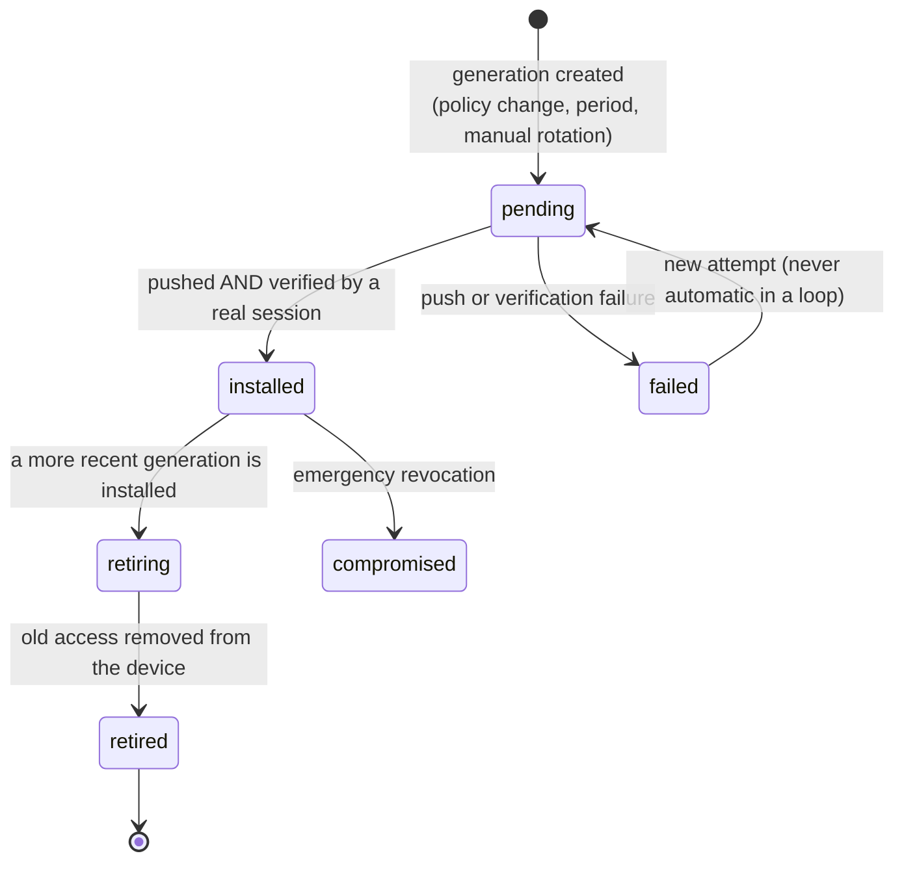

# Service identity and rotation

Meshcraft does not settle for using the credentials it is given: it **installs its own** on the devices, and takes responsibility for their life cycle. It is this identity — administration account, SNMP user, telemetry subscription, collection targets — that this note describes, along with the mechanism that makes it possible to **change it on a fleet that is never in a uniform state**.

## How to read this note

§1 to §10 are the **design**, written before building, and it still holds: it is what produced the decisions we do not revisit. §12 to §15 describe what is **shipped and verified**, and **correct** the design on two major points — the scope of the secret (§12) and the real state of generations (§13).

| Question | Status |
|---|---|
| **Administration** identity: setting it, verification through a real session, transcript | **shipped** — `POST /api/devices/{id}/credentials/apply` (§15) |
| **SNMP** identity: negotiation, tag per algorithm pair, setting it, read-back | **shipped** — see [[SNMP identity]] |
| Append-only **generations**, trial order based on observed state | **shipped** — migration `0011`, §13 |
| A site is born with its credential, old sites caught up at startup | **shipped** — migration `0010`, §14 |
| Revealing a specific generation | **shipped** — §13.6 |
| Instance **policy** overridable per site, lockable fields | **decided, not built** — no `service_policy` table |
| **Automatic** (periodic) rotation | **decided, not built** — rotation is exclusively manual and requires a supplied secret |
| **Deployment** of a generation to the fleet (push, verify, retire, in bulk) | **decided, not built** — creating a generation does not push it |
| Service **CLI** account (SSH), ed25519 public key | **decided, not built** — the only setting goes through the device's web interface |
| gNMI **streaming telemetry**, certificates, expiries (§8) | **built, without an authority** — the subscription exists and authenticates with a site credential of kind `gnmi` (a device account, not a community). The transport can do TLS (`transport_tls`: `verify` / `skip-verify` / `plaintext`, migration 0039), but NOTHING issues a certificate yet: a site without an authority falls back to `skip-verify`, and `plaintext` remains possible and explicit |
| `external_aaa` | **decided, not built** |
| **Purge** with a grace period, `retired` / `compromised` states | **decided, not built** — see the callout in §13.2 |
| Fleet view "distribution of generations", what blocks a purge (§10) | **partial** — the per-generation count exists, the rest does not |
| `svc.*` events | **renamed** — the real family is `credential.*` (§10) |

## Three families of credentials, not to be confused

| Family | Who supplies it | Role | Where |
|---|---|---|---|
| Credentials of the existing fleet | the user | get into a device already in place | [[Credentials]] |
| Discovery credentials | the user, at instance level | tried at discovery on what meshcraft does not manage yet — SSH, and HTTP authentication for interfaces that ask for one | [[Discovery]] |
| **Service identity** | **meshcraft generates them** | what meshcraft installs on the device and then uses to operate it | this note |

The third is of a different nature: meshcraft is its **owner**. Nobody types it, nobody remembers it, and it is meshcraft that answers for its presence on each device.

## 1. What is pushed

| Component | Content | Preference | Capability ([[Connectors]]) | Status |
|---|---|---|---|---|
| Administration account | user (default `mcadmin`), password | — | `Admin.EffectiveUsername` | **shipped** (§15) |
| SNMP | v3 authPriv user if the platform can, otherwise a **read-only** v2c community | resolved by capability, see §2.1 | `SNMPVersions`, `SNMPv3{auth[], priv[]}` | **shipped** ([[SNMP identity]]) |
| Telemetry targets | trap destination **derived** from the declared collector ([[Monitoring]]) | one target | `Monitoring.Traps` | **shipped for v2c traps**; syslog not shipped; **two** targets not shipped |
| Service CLI account | user, ed25519 public key, fallback password, privilege level | public key | `LocalUsers`, `SSHPubkeyAuth` | **decided, not built** |
| Streaming telemetry | gNMI/gRPC subscription: device account passed in gRPC metadata; dial-**in** (the proxy dials to 6030) | dial-in | `GNMI` | **built** — credential of kind `gnmi`, `internal/gnmipoll`, `cmd/proxy/gnmi.go`. The client certificate remains to be done |
| HTTP/API account | local account, only for web-only platforms ([[Web pass-through access]]) | — | `HTTPLocalUsers` | **not applicable** — on the shipped range, the administration account *is* the web account |

What the platform cannot do is not worked around: the plan carries a *not applicable* mention with the reason, visible in the preview. A silently ignored setting would be worse than a refused one. **Shipped** in the sense that every refusal to set (no declared collector, no v2c plan, no capability) carries its reason and its repair gesture ([[Monitoring]], `trapdest`).

> [!note] The "service CLI account" has no CLI to be installed on
> The first supported range offers **neither SSH nor a serial port**: its only
> administration door is its web interface ([[Connectors]]). The service account
> does exist — it is §15 — but it is set through an HTTP form, not through an SSH
> session, and there is **no** ed25519 public key to deposit.
>
> This is not a regression on the design, it is the order of the fleet: the public
> key is the right authentication mode and will remain so, but writing it before a
> connector can carry it would have produced code never exercised — the lesson
> learnt from the SNMPv3 path, written and tested well before there was a device
> that accepted it ([[SNMP identity]]).

## 2. Policy is global, overridable per site — secrets are per device

This is the distinction that structures everything else:

> [!important] Policy ≠ secret
> **The policy** says *how* meshcraft installs itself: service account name,
> authentication mode, SNMP algorithms, telemetry mode, rotation period, whether or
> not factory defaults are removed. It is defined **at instance level** and
> **overridable per site**.
>
> **The secret**, on the other hand, is **generated per device**. A service password
> shared by 200 switches means a single compromised device hands over the whole
> fleet. Since no human ever has to type it, nothing justifies sharing it. What
> remains shared is what is not secret (SSH **public** key, telemetry CA) or what an
> operational constraint explicitly imposes (a single community expected by a
> third-party collector).

> [!warning] Both halves of this box have since been contradicted
> The second half — "the secret is per device" — was **overturned by operations**:
> §12 settles on a **per-site** secret, accepting the cost. It is the only design
> reversal in this note, and it is justified.
>
> The first half — the policy — is **decided and not built**: there is no
> `service_policy` table, hence no site override, no lock, no origin badge. What
> stands in for it today is **hard-coded**: an SNMP floor of `sha256`/`aes128`, a
> desired account name of `mcadmin`, no rotation period. The box stays written
> because the *policy / secret* distinction is what will prevent, on the day it is
> built, storing both in the same table — which would have made a policy change a
> rewrite of secrets.

Policy resolution, with the inheritance grammar already in place ([[Profiles and groups]]): **the site's value if defined, otherwise the instance value** — "absent = inherits". The UI always shows the origin (badge *inherited from the instance* / *overridden for this site*) and offers "revert to inheritance". **Target**: this grammar is implemented nowhere today, not even for the profiles it draws on ([[Profiles and groups]]).

Two guards on overriding, also **targets**:

- A `global-admin` can **lock** a field: it becomes a floor that sites cannot lower. A locked field shows as such, it does not disappear from the site's UI.
- Site overriding belongs to the `site_admin`, the instance policy to the `global-admin` ([[RBAC]]).

### 2.1 SNMP v2c or v3: a resolution, not a choice

**The SNMP version is not a policy setting: it is determined by what the platform can do.** No policy can turn a switch that ignores v3 into a switch that understands it, and an operator should not have to know, device by device, what their fleet supports.

This principle is **shipped**, and it is `internal/snmpprov` that carries it: a **pure** package, with no database or network, that takes the connector's capabilities and returns a plan. The policy only expresses a **minimum requirement**, and the effective mode is **resolved per device**:

| `snmp.require` (policy) | Compliant v3 platform | Weak v3 platform (MD5/DES) | v2c-only platform |
|---|---|---|---|
| `best` (default) | v3 authPriv | v3 with what it has, **flagged non-compliant** | v2c RO community |
| `v3` | v3 authPriv | v2c RO if `allow_weak_fallback`, otherwise SNMP **not managed** | SNMP **not managed**, device listed |
| `off` | — | — | — |

The logic of this table is written and tested; what is missing is **the place where the operator would choose `require`**, for lack of a policy table. The `best` default is therefore the only regime reachable today.

Three consequences to accept:

- **`v3` is not a switch, it is a filter.** Requiring v3 on a mixed fleet does not harden the old devices: it deprives them of SNMP. They appear in an explicit list (*"7 devices without SNMP: platform without v3"*), with the number and the reason. The worst outcome would be a half-unmonitored fleet without anyone seeing it. **`RequireV3` is implemented as a filter**; the explicit list remains to be shown.
- **The capability is not a boolean.** A platform can announce v3 while offering only MD5/DES, which is no better than v2c. The connector therefore declares the algorithms really available (`SNMPv3{auth: [...], priv: [...]}`) and the policy carries a floor (`auth ≥ SHA-256`, `priv ≥ AES-128`). What does not reach it is deployed but **marked non-compliant**, never presented as safe. **Shipped**: the floor, the flag, and the non-compliance note **recorded in the vault** — not merely computed at display time.
- **The resolution is recomputed**, not frozen: a firmware update that adds v3 switches the device over at the next cycle — it is a configuration diff like any other ([[Reconciliation]]), hence an add → verify → remove rotation, not a wild rewrite. **Partial**: provisioning is indeed replayed when a device's inputs change (model, IP, group), and it is idempotent. What does not exist is the **v2c → v3 switchover** itself, for lack of a connector that declares v3 — and for lack of a v3 collector, see the opening callout of [[SNMP identity]].

> [!note] v2c is only for reading
> When the v2c fallback applies, meshcraft only deploys a **read-only** community,
> and never an RW community: configuration writes go through the connector (CLI or
> API), never through an `snmp set`. An RW community on a fleet is a root password in
> cleartext on the network.
>
> **Shipped, and guaranteed three times**: the write constants do not exist in the
> connector, the entry is hard-coded read-only, and the verification read-back
> **refuses** a community that comes back with another mode. There is no `snmpset`
> anywhere in the repository, neither on the controller side nor on the proxy side.

The same reasoning applies to the other components: SSH public-key authentication falls back to a password if the platform cannot store a key, and streaming telemetry is simply absent where it does not exist. The policy says what we want, the capabilities say what is possible, and **the gap is shown** — this is rule 5 of the [[Standard data model]] ("capabilities filter") applied to credentials. The gap *is* shown, and better than planned: a device's page also says what its platform **does not expose** for monitoring, distinguishing an absence **observed** on hardware from an absence **assumed** from documentation.

Escape hatch to plan for from the start: `external_aaa`. For a customer with TACACS+ or RADIUS, meshcraft **installs no local account** and uses the supplied AAA account. Creating local accounts on a fleet with centralised AAA is an operational fault, not a feature. **Decided, not built** — and it is a gap to know about before going to production with such a customer, because §15 does create a local account, with nothing to dissuade it.

## 3. History: generations, never an overwrite

The problem the naive model does not see: changing a password in the admin does not change it on the devices. Between the moment of the change and the end of the deployment — which can last days, a device switched off, a site cut off — **the fleet carries several secrets at once**. Overwriting the secret in the database means losing access to everything not yet updated.

Hence the rule: **a secret is never overwritten, a generation is added.** Secrets are an *append-only* table, and the real state of each device is **observed** data, like access paths ([[Proxy]]). **Shipped** — that is §13.

The **intended** life cycle:



> [!warning] Two states out of five are alive — and the main one's name has changed
> The shipped schema declares `pending`, `active`, `retiring`, `retired`,
> `compromised`. The diagram above says `installed` where the database says
> **`active`**: it is the same state, and one needs to know that to read a row.
> `failed` does not exist at all for generations.
>
> What the code really **writes**:
>
> | State | Written? |
> |---|---|
> | `active` | **yes** — a generation is born `active` |
> | `retiring` | **yes** — the old one moves to it when a new one is created |
> | `pending` | never written; only read as a condition for moving to `retiring` |
> | `retired` | **never written** — no route, no function |
> | `compromised` | **never written** — there is no "declare compromised" |
>
> `retired_at` is therefore never filled in, and the diagram's emergency revocation
> has no button. This is not an inconsistency in the schema: the five states were
> created from the outset because adding a value to a `check` on an append-only table
> in production costs more than planning one too many. But reading the diagram as an
> inventory would have one looking for a transition that does not exist.
>
> The gap that **bites** is `pending`: today a generation is `active` from its
> creation, before any push. The trial order makes up for it (§13.3, rank 3: "active
> not yet observed"), but the "how many devices carry what" count counts as active a
> generation that may be nowhere.

State is carried **per device and per component**: the same fleet can be on generation 7 for SSH and generation 3 for SNMP, which is normal and must be readable in the UI. **Shipped at component level** — the `admin` credential and the SNMP credentials each have their generations — and state is indeed observed per device (`device_credential_state`).

## 4. Deploying a rotation is a reconciliation

No special path: a rotation enters the [[Reconciliation]] pipeline like any configuration change. What is specific to it is **the order of operations**:

```
1. add the new access              (the new account / v3 user / certificate)
2. verify through a REAL session   (new SSH connection, real SNMP get)
3. only then, remove the old one
```

Never the reverse, never "modify in place" when the platform allows coexistence. It is the *never cut off your own hand* rule applied to credentials: between step 1 and step 3, the device accepts both, so no window of inaccessibility exists.

> [!important] This order is shipped **per device**, not **per fleet**
> This is the distinction that decides what an operator can do today.
>
> **Shipped**: on a given device, `POST …/credentials/apply` does exactly the three
> steps — and the account **rename** case does them in the strictest sense, since the
> device has no "rename" operation. The new account is created, the configuration is
> **saved to flash** so that a power cut does not leave the device with only the old
> account, a **new session** is opened under the new name, and **only then** is the
> old one deleted. A deletion failure does not fail the gesture — the target account
> works, which is what matters — but it is **said** (`credential.stale_account`),
> because a residual account is an open door nobody would know about.

> [!warning] On RouterOS, the old credential SURVIVES removal — observed
> Open defect, captured on a CRS326-24G-2S+ running RouterOS 7.21beta3 during the
> connector's validation campaign.
>
> After an `admin` → `mcadmin` rename, meshcraft re-reads `/rest/user`, no longer
> finds `admin` there, and concludes "already absent — nothing to do". The table
> tells the truth: it carries only one row, named `mcadmin`. But **the old pair keeps
> opening the device**, eight minutes after the gesture and without a reboot — and it
> is not an authentication cache that would expire, since a wrong password, an
> invented account and `mcadmin` with the old secret are all three refused with 401.
> It really is that old pair, and it alone, that answers.
>
> The consequence is the one `credential.stale_account` exists to prevent, through a
> path the warning does not cover: **meshcraft believes an access is closed when it
> is open**, and the event does not fire since, from its point of view, there was
> nothing to delete.
>
> What this teaches goes beyond the range: **the account list is not proof that a
> credential no longer works.** The only proof of a removal is of the same order as
> the proof of an addition — a real attempt. The countermeasure is therefore
> symmetrical to step 2: after a rename, TRY the old pair and emit
> `credential.stale_account` if it answers, instead of concluding from a read.
> Not built.
>
> **Not built**: deploying the rotation **across the fleet**. Creating a generation
> pushes it nowhere. There is no scheduling, no progress, no resumption — the operator
> calls `apply` device by device. What is missing is the entry into the
> [[Reconciliation]] pipeline, not the sequence.

- **Verifying** means opening a session with the new secret through the [[Proxy]], not observing that a command came out without error. A `username` accepted by the CLI and refused at login is a classic. **Shipped**, and it is the most systematically held principle of the whole batch: nothing is recorded on the strength of a return code.
- **Failure**: the old generation stays installed, the new one is flagged, the device appears in the UI. Two attempts at most per account, as at discovery, so as not to trigger AAA lockouts. **Shipped for attempts** (`triesPerAccount`, case-insensitive); marking the generation `failed`, no — there is no state for it. The failure lives in `device_credential_state.last_error` and in the `credential.apply_failed` event.
- **Platforms without coexistence** (a single `enable` secret, no second user): add-then-remove is impossible. The change is marked `disruptive`, requires a maintenance window, a fresh backup and the [[Reconciliation]] reachability watchdog. We say so instead of hiding it. **Decided, not built** — no `disruptive` marking exists. Note that the *reverse* case is already handled cleanly: when the target account **is** the one we just came in through, it is a simple password change, with no coexistence to orchestrate.
- **Concurrency**: serialised per device (existing lock), and never two devices that serve as each other's access path at the same time. **Decided, not built** for this path.

> [!important] The intent references the credential, never the generation
> In the [[Standard data model]], `services.snmp.v3.user_ref` is
> `cred://svc-snmp`, with no generation number. The generation is resolved **at apply
> time**. Otherwise every rotation would create an intent revision for the whole
> fleet, and the configuration history would become unreadable — "the configuration
> changed" would be confused with "the secret rotated".
>
> **Held**: nothing in the code lifts a generation number into an intent. Resolution
> does happen at use, through the order of §13.3.

## 5. Choosing the right secret at use

This is where history pays off. To open a session, meshcraft tries in this order — **shipped**, see §13.3 for the exact version and the test that locks it:

1. the generation the device is **known** to carry;
2. **retiring** generations — the device may not have been cleaned up yet;
3. **active** generations not yet observed — the case of a job interrupted after the push but before confirmation ([[Controller-proxy protocol]]: a cut job is never replayed blindly, but the secret may very well have been installed);
4. the original credentials supplied by the user ([[Credentials]]) — the safety net that catches a device restored from an old backup.

Two attempts per account, immediate stop beyond that. **When a connection succeeds with an unexpected generation, the observed state is corrected** — exactly like a configuration drift: the database learns from reality, it does not decree it. **Shipped** (§13.4).

§15 completes this list **at both ends**, and the implementation adds a fifth rank the design had not seen: the secrets the device carries on behalf of **another** credential (`PreviousInstalls`), with the account name that goes with it. It is the catch-up for a re-tagging: changing a device's tag changes the credential the scope assigns to it, without changing anything on the device.

## 6. Retention: never purge a secret still in service

- A generation is **never** purged as long as a known device carries it, nor as long as a device has been `unreachable` since the rotation. A switch turned off for three months restarts with the old secret: the day it comes back, it must be reachable.
- Purge is possible when all more recent generations are confirmed across the whole fleet, after a **grace period** (default 90 days). The UI always says what is blocking: *"3 devices still on generation 4"*.
- A `compromised` generation is the exception: removed from devices and purged without delay.
- Purging erases **the value, not the history**: who triggered the rotation, when, on what scope, with what result, stays in the [[Event log]]. That is the history audit requires; it never needs the secrets themselves.

> [!note] Nothing in this section is built, and it is **the right direction to err in**
> There is no secret purge, no grace period, no `compromised` state. The consequence
> is that the vault **grows without ever forgetting**: all generations of all
> credentials remain, sealed.
>
> It is not urgent — a few dozen bytes per rotation — and it is the safe default: the
> risk this section addresses is purging **too early** a secret that a switched-off
> device still carries, which bricks it. Purging nothing bricks nothing. The
> computation building block is in fact already written: `RetirableGenerations` can
> say which generations are retirable and, if not, the reason for the block in plain
> words — see the callout in §13.2 on its real status.

## 7. Do not lock the customer out

Three non-negotiable rules, which follow from the fact that meshcraft now holds the access:

1. **Meshcraft never deletes what it did not create.** Every pushed object is marked as managed by meshcraft; the customer's pre-existing accounts, communities and keys are not touched, even when the policy asks for hardening. **Held for SNMP**: the connector sets its **own** v3 group (`meshcraft-ro`) instead of reusing a factory group, precisely because factory groups carry a write view — reusing one would have given meshcraft's v3 user a right no line of code asked for.
2. **Removing factory defaults** (`public`/`private`, factory admin account) is opt-in, and refused until service access has been verified on that device. Hardening before having proven access is how you brick a device.
3. **Emergency access (break-glass).** If meshcraft holds the only credentials of a fleet, a meshcraft outage makes that fleet unadministrable. An emergency access export must therefore exist: per device or per site, reserved for the `global-admin`, requiring re-authentication, **traced** in the log, and notified to the other administrators. It is the only exception to the rule "a secret never leaves the API" ([[Credentials]]) — denying it would not make it go away, it would just let the secrets out through an untraced path.

> [!warning] Rule 2 is half held, and the other half is subtler than an opt-in
> The **second** half is held in the strong sense: nothing is removed before a **real
> session** has proven the new access (§4, §15). That is indeed the guarantee that
> prevents bricking.
>
> The **first** — "opt-in" — is not, and not through oversight: on this range, the
> device indexes its accounts by name and has no rename operation. Asking for an
> `mcadmin` account on a device that only has `admin` therefore *mechanically* means
> creating the one and removing the other — removing the factory account is
> **implied by the choice of name**, not ticked separately. There is no setting to
> say "keep `admin` too".
>
> Two practical consequences: an operator who wanted to keep the factory account must
> ask for the name `admin`; and if deletion fails, the old account **stays active**
> and it is a warning, not a silent success. The behaviour is defensible, but it is
> not the one "opt-in" announces.
>
> Rule 3, for its part, does not exist in this form: see the last callout of
> [[Credentials]] — what is shipped is the single, traced reveal, for the
> `site_admin`.

As a last resort there remains the factory reset procedure described by the connector ([[Discovery]]): knowledge, documented, never executed in the operator's place. **Shipped** — and the screen distinguishes procedures **observed** on hardware from those **assumed** from documentation.

## 8. The case of certificates: rotation becomes a deadline — *decided, not built*

> [!note] Nothing in this section exists in the code
> There is no telemetry certificate, no gNMI, no CA — the `GNMI` capability is filled
> in by no connector, and the shipped range has no equivalent. The section is kept
> because the reasoning it carries cannot be invented at switchover time.

A telemetry certificate has an expiry date: rotation is no longer a good practice, it is a **dated obligation**. Consequences:

- renewal triggered at two thirds of the lifetime, never at expiry;
- a device whose certificate would expire before its next rotation slot raises an alert, not a silent failure;
- the **CA**'s expiry is a whole-fleet event: it is planned, with a replacement CA deployed in parallel before switchover — the same add → verify → remove pattern, at fleet scale;
- the CA's private key is protected like the master key: outside the database ([[Credentials]]).

The `not_after` column of §9 was planned for that, and it is the only thing in this section that exists in the database.

## 9. Data model

What the design planned:

```sql
-- Policy: one instance row, plus one per overriding site.
service_policy(id pk, scope text, site_id fk nullable, kind text,
               spec jsonb, locked bool, updated_by fk users, updated_at)

-- APPEND-ONLY secrets: one row per (device, component, generation).
service_secrets(id pk, device_id fk, kind text, generation int,
                secret_enc bytea, state text,
                created_at, activated_at, retired_at, not_after timestamptz,
                unique(device_id, kind, generation))

-- OBSERVED state on the device, corrected by what sessions observe.
device_service_state(device_id fk, kind text, installed_generation int,
                     installed_at, last_verified_at, last_error text,
                     primary key(device_id, kind))
```

> [!important] None of these three tables exists — but two have an equivalent
> `service_policy` has **no** equivalent: the policy is not built.
>
> The other two exist under other names, and the difference is not cosmetic: it
> carries the reversal of §12.
>
> | Planned | Real | What changes |
> |---|---|---|
> | `service_secrets(device_id, kind, generation)` | `credential_generations(credential_id, device_id, generation)` — migration `0011` | the generation hangs off a **credential**, not a device. `device_id` exists but stays empty: that is the `per_device` option, never exercised |
> | `device_service_state(device_id, kind, …)` | `device_credential_state(device_id, credential_id, installed_generation, installed_at, last_verified_at, last_error, installed_username)` — migrations `0011` + `0012` | the state observes **which credential** the device carries, and under **which account name** — a column the design had not planned and without which the administrator is sent to log in with a non-existent account |
>
> `activated_at` and `retired_at` exist; `retired_at` is never filled in (§13.2).
> `not_after` is planned for the certificates of §8.

Encryption is the vault's ([[Credentials]]): **AES-256-GCM**, a single instance key — the KEK → DEK envelope is not built, and the key is outside the database only if `MESHCRAFT_SECRET_KEY` is set.

## 10. Interface

An instance section **Service identity** (global policy, locks, rotation periods) and, on each site, the same page with the origin of each value and the "revert to inheritance" button. Plus a fleet view that does not lie:

- distribution of generations (*42 devices on generation 7, 3 on 6, 1 failed*), clickable to filter;
- what blocks a purge, what blocks a hardening;
- for each device: installed generation, last verification, last error;
- manual rotation (immediate or in the next window), emergency revocation, emergency export.

**What is shipped**: the *Configuration → Credentials* screen, with the list of credentials, their scope, whether a secret is present, the rotation date, the count of devices per generation, the reveal, manual rotation and the `per_device` toggle. **What is not**: the instance section and inheritance (no policy), filtering by generation, what blocks a purge (no purge), emergency revocation and emergency export. And "rotation in the next window" has no window: rotation is immediate and requires a new **supplied** secret — there is no automatic draw at rotation, unlike site creation (§14).

> [!note] The events are not called `svc.*`
> The real family is `credential.*`, and it is finer than the planned list:
> `credential.generated`, `credential.updated`, `credential.rotated`,
> `credential.mode_changed`, `credential.deleted`, `credential.revealed`,
> `credential.installed`, `credential.apply_failed`,
> `credential.apply_unconfirmed`, `credential.stale_account`,
> `credential.scope_ambiguous`. Searching for `svc.*` in the [[Event log]]
> returns nothing.
>
> Two are missing, and they are exactly those whose features do not exist:
> `svc.retired` (nothing moves to `retired`) and `svc.breakglass_exported` (there is
> no export). The first rename to do on the day of the purge is therefore to stay
> within `credential.*`, not to create a second family.

## 12. Operational decision: the secret is per SITE, not per device

§2 recommended a secret **per device**: a single compromised device then does not
hand over the fleet. Operations decided otherwise, and the reason is solid: an
administrator must be able to log in to any device on their site without consulting a
list of two hundred passwords. The trade-off is **accepted** — it widens the radius of
a compromise to one site.

The nuance that makes it workable: password policies differ from one model to another
(maximum length, forbidden characters). A site therefore defines a **default**
credential, plus as many credentials **per device group** or **per tag** as needed. A
device takes the most specific one that targets it, and at equal specificity the one
with the highest priority — the remaining ambiguity being **flagged** rather than
settled ([[Credentials]]).

Shipped (migration 0010, `site_credentials`, *Configuration → Credentials* screen):

- the **list never returns a secret**, only its presence and its rotation date — one
  does not read a password by accident when opening a page. The query does not even
  select the sealed field;
- the **reveal** is a separate call (`POST …/reveal`), reserved for the `site_admin`,
  and **logged with the requester's identity**. Untraced cleartext access would be
  worth less than no vault at all. Seeing a credential remains an `operator` right:
  *seeing* and *reading* are not the same permission;
- a credential requested by its UUID must belong to the site in the URL, otherwise a
  site admin could read another site's secrets by guessing an identifier. The same
  check covers deletion, rotation and mode change;
- the screen states plainly that the encryption key lives **in the database** as long
  as `MESHCRAFT_SECRET_KEY` is not set.

## 13. Generations: shipped (migration 0011)

§12 left generations pending. They are here, and they decide the product's most
delicate behaviour: **between two rotations, the fleet is never in a single state**.

### 13.1 Setting a secret always opens a generation

Creating a credential, changing its password from the edit screen, or clicking "new
generation" are **the same act** and go through the same code (`addGenerationTx`).
Two distinct paths would end up diverging, and the day they diverge the history lies
about what is really set.

A detail that follows from §12 and must be known: `AddGeneration` **also** updates
`site_credentials.secret_enc` and `rotated_at`. The vault therefore always carries the
current generation, otherwise an ordinary reveal would return the old pair — the exact
opposite of what the person pressing the button is asking for.

### 13.2 The old generation moves to `retiring`, never to `retired`

This is the point that makes rotation safe. A retiring generation **stays valid**: as
long as a device carries it, it is the only password that opens its door. A switch
turned off during the rotation will come back with the old secret, and meshcraft must
still know how to get in.

> [!warning] "Never to `retired`" is literally true: there is no path
> The move to `retired` **cannot** happen, for lack of code that writes it: no route,
> no function. `RetirableGenerations` **exists** and does exactly what this paragraph
> describes — it only returns a generation if **zero known devices** carry it, and
> otherwise the reason for the block in plain words ("3 device(s) still carry this
> generation") — but **nobody calls it**. It is a calculator without a consumer.
>
> A benign and intended consequence: a retiring generation stays so indefinitely, and
> the trial order keeps trying it. One more secret in the list costs one attempt;
> forgetting it too early costs an unreachable device. But the sentence "the move to
> `retired` is only possible when…" described a door, whereas there is no door yet.
>
> What remains to be wired is narrow: a route that calls `RetirableGenerations`,
> writes `retired` and `retired_at`, and returns the reason for refusal as is. It is
> also the prerequisite for the purge of §6.

### 13.3 The trial order, locked by a test

`SecretsForCredential` returns the secrets **in order**, and that order is not
intuitive:

1. the generation the device is **known** to carry (observed state);
2. **retiring** generations, from most recent to oldest — a device not yet updated
   necessarily carries an old one;
3. **active** generations not yet observed — a push interrupted after the write but
   before confirmation;
4. then nothing: the caller completes with the original [[Credentials]].

`retired` and `compromised` generations are excluded — the exclusion is written, even
though nothing produces them yet (§13.2).

Trying the most recent first would fail on the whole lagging fleet. This ranking is
locked by `internal/store/generations_test.go`, which replays the SQL sort key in Go: a
wrong order only shows at the moment a device left behind becomes unreachable, that is
to say too late.

Each returned secret also carries the **reason** for its position ("installed on this
device", "retiring, more recent"…), and it is this reason that goes up to the §15
transcript — which makes it possible never to write the secret itself there.

### 13.4 We learn from reality, not from intent

`NoteInstalledGeneration` records the generation that **really** worked, including —
and above all — when it is not the expected one. The database learns from the device
exactly as for a configuration drift ([[Reconciliation]]). It is this observation, and
not the intent, that feeds the "how many devices still carry what" count.

Its counterpart, added along the way: `NoteInstalledUsername`. Recording the
generation without the **account name** under which it worked left half the
information missing — see §14.

### 13.5 Option: one secret per device — *decided, not exercised*

`site_credentials.per_device` switches a scope to a **distinct secret per device**.
§12 had settled for the per-site secret in the name of the administrator's comfort;
this option makes the trade-off reversible **per site**, once direct access goes
through meshcraft rather than through the operator's memory. Generations are then
indexed by `device_id`.

> [!warning] The flag can be ticked but does nothing
> The column exists, the route exists (`PUT …/credentials/{id}/mode`), the trial order
> reads it, and the screen shows it. But **no caller ever creates a generation with a
> `device_id`**: the only two write paths pass an empty string. Toggling it therefore
> changes the label on screen and the event's wording, and nothing else.
>
> It is not useless — the *read* half of the mechanism is in place, which is the risky
> half — but an operator who ticks the box believes they have partitioned their fleet
> while they still share one secret per site. As long as per-device generation does
> not exist, the box should be disabled on screen rather than misleading.

### 13.6 Revealing a specific generation

When a device has been left behind, it is **its old** password that is needed, not the
new one. `POST …/generations/{n}/reveal` gives it, with the same named logging as the
ordinary reveal, and the same check that the generation does belong to a credential of
the site in the URL.

## 14. A site is born with its credential

A site without a credential is a site where meshcraft can set nothing: every adopted
device would stay on its factory password — that is to say, often NONE — until someone
thought of creating one. The safe default is therefore to create it ourselves.

When a site is created, meshcraft generates:

- a password of **16 alphanumeric characters** (uppercase, lowercase, digits), drawn
  without modulo bias, with at least one character of each class. The alphabet is an
  OPERATIONAL constraint, not an affectation: depending on the model, switch interfaces
  reject the space, the quote, the ampersand, and some truncate silently. A secret
  refused by half the fleet protects nothing (`internal/pwgen`, tests included);
- a user name **`mcadmin`** — "ideally", because many ranges admit no administration
  account other than `admin`.

The name that can really be set is decided by the connector
(`Capabilities.Admin.EffectiveUsername`), and it is the name **really set** that is
recorded per device (`device_credential_state.installed_username`, migration 0012).
Recording the desired name would send the administrator to log in with an account that
does not exist.

Sites created before this automation are caught up at controller startup
(`BackfillSiteCredentials`), and the catch-up is logged: the operator must be able to
find out WHEN a secret appeared, not only that it exists. The catch-up is idempotent —
it only creates if there is no site-scoped `admin` credential — and its failure **does
not prevent the controller from starting**: a site without a credential is a gap, not
an outage, and refusing to start would deprive the operator of the screen where they
would fix it.

## 15. Setting the identity on a device

`POST /api/devices/{id}/credentials/apply` is the culmination of the mechanism.
Required right: `site_admin` on the device's site.

The entry order is that of §13.3, completed at both ends:

1. the **password supplied by the operator** (`current_secret`), if there is one —
   the case of taking over a device configured before meshcraft, of which the database
   has no trace. It is never stored;
2. the generations, in the order of `SecretsForCredential`;
3. the secrets the device carries on behalf of **another** credential
   (`PreviousInstalls`), with the account name that goes with it — the catch-up for a
   re-tagging, which changes the assigned credential without changing anything on the
   device;
4. the **factory account with no password**, LAST. Putting it first would make the
   whole fleet already taken over fail.

**Account names** are ordered too, and not in the order one would think: the
**observed** name first (`installed_username`), then the desired name, then `admin`,
without duplicates and case-insensitively. Starting with the desired name would fail
on a device already renamed on which we only want to change the password.

Two attempts at most per account, so as not to trigger a lockout — with a **slot
reserved in advance** for the factory account, otherwise a fleet already taken over
exhausted the budget and a new device became unadoptable.

Nothing is recorded on the strength of a return code: after the write, a **new
session** is opened with the new secret. It is that session that proves the setting,
and only then are `NoteInstalledGeneration` and `NoteInstalledUsername` called. A form
accepted but without effect would otherwise leave the database convinced of a success.
When the setting is not confirmed, the event says so (`credential.apply_unconfirmed`)
instead of counting a success.

The **rename** case applies the order of §4 in the strictest sense — create, save to
flash, prove through a session, and only then delete the old account. See the callout
of §4 for what this implies for removing the factory account (§7, rule 2).

`dry_run` stops after authentication: knowing that we can get in, without changing
anything.

Each step is recorded in a **transcript** returned to the operator, and that transcript
**never** carries a secret — only the account name tried and the reason for its position
in the order. The code in fact retrieves the secret that worked by **replaying the
order of candidates**, precisely so as not to have to store it in the transcript. On a
range with neither SSH nor a serial port, where a mistake costs a trip on site, a silent
failure is the worst of outcomes.

What remains: **deploying** a generation to the devices, in bulk. Creating the
generation does not push it — that is the connectors' write path ([[Connectors]]),
device by device, with verification, and today it is the operator who chains the calls.
