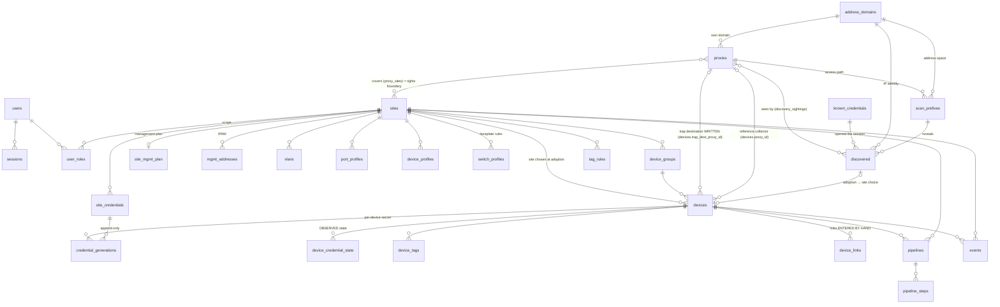

# Database schema

A single **PostgreSQL** (config + inventory + events), accessed through **`pgx`** with
SQL queries **written by hand** in `internal/store/*.go`, migrations run by a
**home-grown embedded migrator**. Metrics are not in Postgres
([[Unified monitoring and pipelines]] §3). The underlying choice is discussed in [[Technical stack]].

> [!warning] Three tooling discrepancies not to propagate
> [[Technical stack]] still announces "pgx + **sqlc**, **goose** migrations" and
> "PostgreSQL **16**". None of the three is true in the repository, and the nuance changes
> what you go looking for when you want to add a query:
>
> - **no `sqlc`**: no generator, no `queries.sql`. The SQL lives in the
>   functions of `internal/store/` and the `scan` is written next to it. Looking for a
>   queries file to regenerate is a waste of time;
> - **no `goose`**: `Store.Migrate` (`internal/store/store.go`) reads
>   `migrations/*.sql` through `go:embed`, sorts them by name, and applies the ones
>   that are missing — **one transaction per file**, recorded in
>   `schema_migrations`. So: no `-- +goose Up`, no `Down` section, and
>   **no rollback**; a migration is corrected by a following migration;
> - **PostgreSQL 17** (`postgres:17-alpine` in the `docker-compose`).
>
> This page describes the actual state. Correcting [[Technical stack]] belongs to that page.

> [!note] How to read this page
> The schema carries both what is **built** and what was **designed then put on
> hold**. Both are worth writing down, but confusing them is expensive in both
> directions: believing built what does not exist sends you hunting a bug in code
> that was never written — or writing a query against an absent table; erasing a
> target because it is not built would lose the decision and its argument.
>
> Three regimes, marked everywhere:
>
> - **in the database** — the table exists, you can query it today;
> - **target** — decided, **not built**. No query may rely on it; what plays the
>   role today is named every time;
> - **abandoned** — another decision replaced it, and which one.
>
> Tables of the **target** regime are grouped at the end of the page, never mixed with
> the real SQL, and **absent from the diagram** below.

## What can be queried today

**31 tables in the database**, `schema_migrations` included. The table serves as a
safeguard: if a name is not in it, it does not exist.

| Domain | Tables **in the database** | Migration |
|---|---|---|
| Accounts, sessions, rights | `users`, `sessions`, `user_roles` | `0001` |
| Sites | `sites` | `0001`, `0002` (`plan`) |
| Proxies | `proxies`, `proxy_sites`, `enroll_tokens` | `0003`, `0004`, `0006`, `0007`, `0008` |
| Addressing domains | `address_domains` | `0020` |
| Discovery | `scan_prefixes`, `discovered`, `discovery_sightings`, `known_credentials` | `0005`, `0020` |
| Vault | `instance_secrets` | `0005` |
| Site network | `vlans`, `site_mgmt_plan`, `mgmt_addresses` | `0001`, `0009`, `0018` |
| Site credentials | `site_credentials`, `credential_generations`, `device_credential_state` | `0010`, `0011`, `0012`, `0013`, `0017` |
| Profiles | `port_profiles`, `device_profiles`, `switch_profiles`, `device_groups` | `0001`, `0021` |
| Tags | `device_tags`, `tag_rules` | `0013` |
| Devices | `devices`, `device_links` | `0002`, `0014`, `0015`, `0019`, `0020`, `0022`, `0023` |
| Pipelines | `pipelines`, `pipeline_steps` | `0016` |
| Log | `events` | `0003` |
| Migrator | `schema_migrations` | created by `Store.Migrate` |

And the reverse, which is the real use of this table — **what is not in the database**,
with what plays the role today:

| Name | Regime | What plays the role today |
|---|---|---|
| `device_paths` | **target** | nothing. Eligibility is **deduced** from coverage (`Store.DevicesWatchedBy`) |
| `device_collectors` | **target** | `devices.proxy_id` — declared, not elected (`0022`) |
| `device_intents` | **target** | `devices.ports` + `desired_changed_at` / `applied_at` — current state, **no history** |
| `ports_state` | **abandoned** | `devices.observed` + `observed_at` (`0014`) |
| `jobs` | **abandoned** | `pipelines` + `pipeline_steps` (`0016`) |
| `config_backups` | **target** | nothing |
| `device_positions` | **abandoned** | `devices.pos_x` / `devices.pos_y` (`0002`) |
| `service_policy` | **target** | nothing: no instance policy and no locked floor |
| `service_secrets` | **renamed, shipped** | `credential_generations` (`0011`) |
| `device_service_state` | **renamed, shipped** | `device_credential_state` (`0011`) |
| `scan_ranges` | **renamed** | `scan_prefixes` (`0005`) |
| `lldp_links` | **renamed + target** | `device_links`: the links exist, **entered by hand**, not discovered |
| `credentials` | **renamed, split** | `site_credentials`, `known_credentials`, `credential_generations`, `device_credential_state` |
| `metrics_port` | **abandoned** | VictoriaMetrics ([[Unified monitoring and pipelines]] §3) |

## Overview

Tables **in the database** only.



## Tables in the database

The SQL below is **descriptive**: real column names and types, constraints that
carry a decision. The source of truth remains `internal/store/migrations/`, and the
migration headers carry the long argument.

### Accounts, sessions, rights

```sql
users(id uuid pk, email text unique, pw_hash text,
      display_name text, is_global_admin bool, created_at)
-- NO TOTP column: two-factor authentication is not built.

-- Opaque-token session: only the HASH is in the database, never the token.
sessions(token_hash bytea pk, user_id fk users on delete cascade,
         created_at, expires_at)

user_roles(user_id fk users, site_id fk sites, role text,   -- viewer|operator|site_admin
           primary key(user_id, site_id))                   -- check constraint on role
```

### Sites

```sql
sites(id uuid pk, name text unique, created_at,
      plan jsonb)   -- synoptic zones, dimensions (see Weathermap); free format
                    -- versioned by site-config
```

### Proxies, coverage, enrolment

```sql
-- NO site_id: there is no "owning" site (removed in 0006). Instead, a COVERAGE
-- of sites which is the proxy's rights boundary (see Proxy):
--   global = true  → instance proxy, usable everywhere, global-admin;
--   global = false → restricted to proxy_sites. EMPTY list = covers nothing, never
--                    "everywhere" (otherwise removing the last site would promote
--                    the proxy to an instance proxy).
-- It does not say what the proxy can reach — and nothing in the database says so:
-- it is DEDUCED on read (Store.DevicesWatchedBy), see "device_paths" at the end.
proxies(id uuid pk, name text,
        secret_hash bytea,          -- hash of the enrolment secret, NOT a pubkey
        version text, protocol int,
        os text, arch text, internal bool, global bool,
        created_at, last_seen timestamptz, ifaces jsonb, revoked bool,
        -- Migration to another instance: order dropped, consumed at heartbeat.
        migrate_url text, migrate_token text, migrated_at timestamptz,
        -- Update: see Proxy versioning and updates
        auto_upgrade bool, pin_version text, upgrade_requested bool,
        upgrade_state text, upgrade_version text, upgrade_error text,
        upgrade_started_at timestamptz, upgraded_at timestamptz,
        address_domain_id fk address_domains null)  -- on delete set null
-- version = UTC build timestamp YYYYMMDD.HHMMSS, comparable as text;
-- protocol = tunnel compatibility, independent of the build date.
proxy_sites(proxy_id fk, site_id fk, primary key(proxy_id, site_id))

-- Enrolment token: single use, short TTL. It carries the coverage the proxy
-- will take — FROZEN at issue, because the issuer's rights may change before
-- the token is consumed.
enroll_tokens(id uuid pk, token_hash bytea unique, created_by fk users,
              global bool, site_ids uuid[],
              created_at, expires_at, used_at)
```

### Addressing domains

```sql
-- The space in which an IP address designates one machine and only one. DECLARED,
-- never deduced: wrongly merging two networks fuses two devices into one record,
-- which cannot be undone, whereas a duplicate is deleted in one click.
-- See Addressing domains, and the header of 0020_domaines_adressage.sql.
address_domains(id uuid pk, name text, note text, created_at)
```

Migration `0020` is **semantics-preserving**: each existing proxy received its
own domain, `id` taken from the proxy's — which made the data carry-over exact
without a join. **This is not an intrinsic link between the two objects**: domains
created afterwards have their own identifier, and a query joining
`address_domains.id` to `proxies.id` would work on the migrated fleet and then break
silently.

### Discovery and adoption

```sql
-- "Known standard" credentials of the INSTANCE, tried by priority during
-- discovery. Secret encrypted at application level (AES-GCM, internal/secretbox),
-- never read back by the API. Distinct from site_credentials: these are what we
-- TRY, those are what we INSTALL.
known_credentials(id uuid pk, name text, kind text,   -- ssh|telnet|http
                  username text, secret_enc bytea,
                  priority int, enabled bool, created_at)

-- Range to scan: belongs to the proxy that can reach it, NOT to a site
-- (at discovery the site is not yet known — it is chosen at adoption),
-- and ALSO to the domain that says in which network these addresses live.
-- `prefix` is TEXT, not cidr: ranges are validated at application level.
scan_prefixes(id uuid pk, proxy_id fk proxies on delete cascade,
              prefix text, enabled bool, note text,
              last_run_at timestamptz, last_result text, created_at,
              address_domain_id fk not null,   -- on delete RESTRICT
              unique(proxy_id, prefix))

-- Candidates produced by discovery: WITHOUT A SITE by construction. An adopted
-- candidate STAYS in the database, for audit.
discovered(id uuid pk, source text,            -- scan|manual|serial
           proxy_id fk proxies null,           -- witness proxy; null = "Local"
           ip text, mac text, serial text, hostname text,
           vendor text, model text, driver text, confidence int,
           transports text,                    -- readable list: "ssh,https"
           fingerprint jsonb,
           raw_config text,                    -- config read (SSH or serial console)
           credential_id fk known_credentials null,
           note text, first_seen, last_seen,
           adopted_device_id fk devices null,  -- non null = consumed candidate
           adopted_site_id fk sites null, adopted_at,
           address_domain_id fk null)
-- Merge key, carried by a unique EXPRESSION index (not a column constraint):
-- serial, else MAC, else (domain, IP). The fallback on the domain is what 0020
-- changed — two proxies on the same network used to produce two candidates for a
-- single silent device, which nothing could bring back together.
--   discovered_key_idx unique on
--     coalesce(nullif(serial,''), nullif(mac,''),
--              coalesce(address_domain_id::text,'sans-domaine') || '|' || ip)

-- A candidate seen by several proxies is normal, not a conflict.
discovery_sightings(discovered_id fk on delete cascade, proxy_id fk on delete cascade,
                    ip text, latency_ms int, last_seen timestamptz,
                    primary key(discovered_id, proxy_id, ip))
```

### Vault: where the key lives

```sql
-- Instance encryption key, used FOR LACK OF MESHCRAFT_SECRET_KEY.
instance_secrets(name text pk, value bytea, created_at)
```

A single AES-256-GCM key for the whole instance (`internal/secretbox`), and its
location is the only setting: environment variable — the key is **outside the
database**, a PostgreSQL dump does not hand over the secrets — or, failing that, drawn
at random on first start and stored in `instance_secrets`, **in the database it
protects**. The controller logs it and the UI shows it: saying so is better than
letting people believe otherwise.

> [!note] The per-site KEK → DEK envelope is a **target**
> [[Credentials]] describes a *master key → per-site DEK → secrets* hierarchy, whose
> benefit is real: rotating one site's key without re-encrypting the others. It
> is not built — **no DEK table, no `dek_id` column** on
> `site_credentials` nor on `credential_generations`. A query selecting
> `dek_id` fails. What key rotation does today is a global re-encryption
> (`internal/store/rekey.go`), which is exactly the cost the target avoids.

### Site network: VLAN, management plan, IPAM

```sql
vlans(id uuid pk, site_id fk, vlan_id int check between 1 and 4094,
      name text, color text, purpose text,
      unique(site_id, vlan_id))
-- Every site has a VLAN 1 "Default" (0018_default_vlan, see Default VLAN).

-- Site management plan: administration VLAN, subnets, and origin of the
-- address. See Management addressing.
-- Addresses and prefixes are TEXT, not cidr/inet: validation is at
-- application level, as for scan_prefixes.
site_mgmt_plan(site_id pk fk, vlan_id int, untagged bool,
               subnet_v4 text, gateway_v4 text,
               subnet_v6 text, gateway_v6 text,
               dns text[], ntp text[],
               source text,                   -- dhcp_external | meshcraft
               pool_start text, pool_end text,
               strict_plan bool,              -- refuse adoption outside the plan
               updated_by fk users, updated_at)

-- IPAM: uniqueness is enforced by the DATABASE, not by the code — two
-- simultaneous adoptions cannot pick the same address. meshcraft ALLOCATES, it
-- does not distribute: the address is pushed as static configuration.
mgmt_addresses(site_id fk, address text, device_id fk devices null,
               state text,                    -- reserved|assigned|released
               allocated_at, released_at null,
               primary key(site_id, address))
```

### Credentials: what meshcraft installs, and what the fleet carries

Four tables, and their separation is the heart of the matter. §9 of [[Service identity and rotation]]
describes a model in `service_policy` / `service_secrets` / `device_service_state`:
**two of the three are shipped under other names**, the third is not. The detail
is at the end of the page.

```sql
-- OPERATIONAL DECISION: one password per SITE, not per device. The spec
-- recommended the opposite — a compromised device then does not hand over the
-- fleet. Operations settled it: an administrator must be able to log into any
-- device of their site without looking up 200 passwords. The trade-off is
-- accepted, and `per_device` lets a site choose the other regime.
-- The SCOPE is a triple, because the reasons for giving a particular secret
-- are not mutually exclusive: the group (legacy), the TAG (see Tags and
-- credential scope), and the kind. Empty = site default.
site_credentials(id uuid pk, site_id fk, group_name text, tag text,
                 kind text,                   -- admin|ssh|snmp_v2c|snmp_v3…
                 username text, secret_enc bytea,
                 secret2_enc bytea null,      -- SNMPv3: the SECOND passphrase (0017)
                 per_device bool, priority int, note text,
                 rotated_at, created_at, updated_by fk users)
--   site_credentials_scope_key unique (site_id, group_name, tag, kind)
-- secret2_enc is nullable and that is the point: only snmp_v3 has two phrases.
-- Forcing a second one elsewhere would create a secret nothing consumes, hence a
-- secret nobody rotates and everybody forgets.

-- APPEND-ONLY: changing a secret CREATES a generation, it never overwrites anything.
-- The fleet is not in a single state during a rollout — a device switched off, a
-- site cut off — and overwriting the secret in the database would lose access to
-- everything not yet updated.
-- The two v3 phrases rotate TOGETHER: the generation carries the PAIR. Separating
-- them would leave, after rotation, "which privacy phrase goes with this one?"
-- unanswered — and getting the pair wrong does not produce a readable error, it
-- produces silence: the v3 agent drops the packet it cannot decrypt.
credential_generations(id uuid pk, credential_id fk site_credentials on delete cascade,
                       device_id fk devices null,   -- null = shared secret of the scope
                       generation int,
                       secret_enc bytea, secret2_enc bytea null,
                       state text,   -- pending|active|retiring|retired|compromised
                       created_at, activated_at, retired_at, created_by fk users,
                       unique(credential_id, device_id, generation))
-- `retiring` is not `retired`: replaced, but devices still carry it, so still
-- valid for logging in.

-- State OBSERVED on the device, corrected by what sessions find, never
-- decreed. Does not say the same thing as credential_generations.state: that one
-- is about the SECRET, this one about the DEVICE.
device_credential_state(device_id fk on delete cascade,
                        credential_id fk site_credentials on delete cascade,
                        installed_generation int, installed_username text,
                        installed_at, last_verified_at, last_error text,
                        primary key(device_id, credential_id))
```

### Profiles and tags

```sql
-- Three profiles of the SAME shape (id, site_id, name, spec jsonb, unique per site),
-- and that is not decorative: `store.profileTable` is parameterised by `kind`, so the
-- CRUD, the /api/sites/{id}/profiles/{kind} routes, the events and the site
-- resolution of the real-time stream hold for all three without one more line.
port_profiles(id uuid pk, site_id fk, name text, spec jsonb, unique(site_id, name))
device_profiles(id uuid pk, site_id fk, name text, spec jsonb, unique(site_id, name))
-- Rules that produce the port configuration from the device's FACEPLATE
-- (see Switch profiles, migration 0021). The only one of the three that is
-- executable today: the device profile carries the common services (STP,
-- SNMP, syslog) and its implementation is still to be done.
switch_profiles(id uuid pk, site_id fk, name text, spec jsonb, unique(site_id, name))

-- LEGACY. The group no longer has a screen: its device profile is compiled
-- nowhere, and its only living function — choosing a credential — is better
-- served by a tag (see Tags and credential scope). Kept because
-- `site_credentials.group_name` refers to it by NAME on imported fleets.
device_groups(id uuid pk, site_id fk, name text,
              device_profile_id fk device_profiles null, unique(site_id, name))

-- Tags set on a device. The group was not enough: it is UNIQUE per device, and
-- it already carries the profile. Yet a product range that caps passwords at 16
-- characters, a location entrusted to a contractor and an isolated range can all
-- concern the SAME device.
device_tags(device_id fk on delete cascade, tag text,
            source text,          -- 'manual' | 'rule:<uuid>'
            created_at, primary key(device_id, tag))
-- `source` is what makes a re-evaluation safe: replaying the rules REMOVES what a
-- rule had set and no longer applies, without ever touching what a human decided.
-- Without it, the only prudent re-evaluation would be to remove nothing, and the
-- fleet would accumulate stale tags.

tag_rules(id uuid pk, site_id fk, tag text, priority int, enabled bool,
          match jsonb,            -- AND-ed criteria: vendor, model, location, ip_prefix
          note text, created_at, updated_by fk users,
          unique(site_id, tag, match))
-- A rule WITHOUT a criterion applies to NOTHING. The opposite would make a
-- half-entered line a rule that takes the whole fleet.
```

### Devices

```sql
-- The site comes from adoption. `proxy_id` does not say who owns the device nor
-- what the proxy can reach: it DESIGNATES the reference collector. See Proxy,
-- "The reference collector: a DECLARED attachment".
devices(id uuid pk, site_id fk on delete cascade, group_id fk device_groups null,
        name text,                      -- the inventory name; there is NO
                                        -- `hostname` column, nor `serial`, nor `mac`
        model text, vendor text, location text,
        mgmt_ip text,                   -- TEXT, not inet
        -- REACHABILITY. Written by ICMP monitoring ONLY (SetDeviceStatus): these
        -- three columns left the API input, because a screen sending back the
        -- whole record republished the status it read when it opened. A status
        -- is observed.
        status text,                    -- ok|warn|off|unknown  (default 'unknown')
        status_note text,               -- stable state, WITHOUT loss count (0026)
        -- Since when this finding holds (0025). NULL = never observed, which is
        -- distinct from 'unknown': the former says monitoring has said nothing yet,
        -- not that it does not know. ONLY moves when the finding changes, otherwise
        -- the displayed duration would measure the stability of the WAN and not
        -- that of the device.
        -- This is NOT a last-seen date: see Monitoring, § *Device status*
        -- — the proxy only reports transitions.
        status_at timestamptz,
        poe_budget_w int,
        pos_x double precision, pos_y double precision,  -- position on the synoptic
        -- Physical faceplate: [{prefix, from, count, poe, speed, label}]. It is
        -- AUTHORITATIVE for the list of ports (see 0019 below).
        port_groups jsonb,
        -- INTENT per port: {"GE1": {label, mode, pvid, tagged, poe}}
        ports jsonb,
        -- State ACTUALLY READ from the device (0014). Separate from `ports` because
        -- the two do not coincide: between a change in meshcraft and its write,
        -- and between a change made by hand on the switch and its detection, the
        -- fleet lives with TWO truths. Merging them means never being able to say
        -- which one is lagging. See Reconciliation §2 and §6.
        observed jsonb, observed_at timestamptz,   -- null = never read back
        -- These two dates ATTRIBUTE a drift without guessing: if the intent has not
        -- moved since the last write and the device differs anyway, then it is the
        -- DEVICE that changed — the only case worth interrupting for.
        desired_changed_at timestamptz, applied_at timestamptz,
        -- Result of the LAST write (0015). A write can succeed while leaving
        -- things aside — the safeguard refuses to move a port carrying
        -- administration. If this detail lived only in an event message, the
        -- safeguard would protect and pass for a bug.
        last_apply jsonb,
        -- Free metadata. Also carries `discovered_id` (set at adoption): the
        -- provenance is in this jsonb, NOT in a column.
        extra jsonb,
        address_domain_id fk address_domains null,   -- 0020, on delete set null
        --   index devices_domain_idx (address_domain_id)
        -- Reference collector, DECLARED by the operator (migration 0022): the
        -- proxy that polls this device over SNMP, and whose address will be
        -- written into the device as the destination of its traps.
        --   null            → collection by COVERAGE, as before 0022: every
        --                     eligible proxy is a collector. This is the state of
        --                     the whole existing fleet, hence a
        --                     semantics-preserving migration;
        --   on delete set null → removing a proxy does not delete
        --                     devices; the correct fallback is the coverage
        --                     regime.
        -- Grants NO coverage: attaching to a proxy that does not cover the
        -- site STOPS collection, it does not move it (ICMP continues, so the
        -- light stays green). The API refuses this gesture; the record shows a
        -- banner when a coverage was narrowed afterwards. The meaning is in Proxy,
        -- "The reference collector: a DECLARED attachment".
        proxy_id fk proxies null,       -- on delete set null
        --   index devices_proxy_idx (proxy_id): serves the reverse read
        --   "which devices does this proxy collect?", asked on a proxy's
        --   screen and when it is removed. The monitoring query starts from
        --   devices and does not need it.
        --
        -- Trap destination WRITTEN INTO THE DEVICE (migration 0023). Four
        -- columns that do not say the same thing, and that is their WHOLE point:
        -- separating the CLAIM from the PROOF. The full meaning is at the top of
        -- 0023_destination_traps.sql; below is what you need to read a `devices`
        -- row without getting it wrong.
        trap_dest_addr text,            -- the address written. null = nothing written, ever.
        trap_dest_proxy_id fk proxies null,  -- WHICH proxy it came from.
                                        --   on delete set null.
        trap_dest_at timestamptz,       -- when we wrote it   → the CLAIM
        trap_seen_at timestamptz,       -- when a trap arrived → the PROOF
        --   index devices_trap_dest_idx (trap_dest_proxy_id): exact counterpart of
        --     devices_proxy_idx — "which devices point their traps at this
        --     proxy?", asked when removing a proxy and on its screen. Confirming
        --     a trap starts from the device identifier and does not need it.
        unique(site_id, name))
--   index devices_site_idx (site_id)

-- Synoptic links. ENTERED BY HAND (CRUD, or site-config import), not discovered:
-- BOTH ends are known devices, `not null`. So there is no "ghost" neighbour in
-- the database — that is the difference with the `lldp_links` target described
-- at the end of the page.
device_links(id uuid pk, site_id fk on delete cascade,
             a_device fk devices not null, a_port text,
             b_device fk devices not null, b_port text,
             speed text, status text,   -- up|warn|down
             note text)
--   index device_links_site_idx (site_id)
```

> [!note] `0019`: the faceplate is authoritative, and a migration that deletes ports is read twice
> SNMP telemetry named ports "prefix + ifIndex". A device exposes over SNMP far more
> interfaces than its faceplate has ports — VLANs, aggregates, loopbacks, seen on a
> 1930 with indexes at 1000, 3000, 20000 and 100000 — and they showed up in
> `devices.ports` as ports ("GE100041"): **93 entries for 52 real ports** on the
> switch that served to flush them out. Harmless for reconciliation (without `mode`,
> the diff ignores them), but they inflated the inventory.
>
> The source is plugged on the controller side (`applyPortTelemetry`: telemetry never
> **creates** a port any more). `0019` cleans up what previous versions left behind,
> with three precautions which are the real lesson: the **faceplate is authoritative**
> (`port_groups`), a device whose faceplate is unreadable **is not touched**, and any
> entry carrying an intent (`mode`, `label`, `pvid`, `tagged`) is **spared even
> outside the range** — a configured entry is not a ghost, and if its name is
> surprising, that is an anomaly to look at, not to erase silently.

### Pipelines: what is in progress, and what is stuck

```sql
-- A failing apply used to leave an event and nothing else: you had to guess.
-- See Unified monitoring and pipelines §5.
pipelines(id uuid pk, site_id fk on delete cascade,
          kind text,               -- config | credential | monitoring | import
          device_id fk devices null,  -- null = fleet campaign
          state text,              -- pending | running | blocked | done | failed
          label text,              -- in French, for a readable list
          blocked_reason text,     -- a SENTENCE, not a code
          created_at, started_at, ended_at, created_by fk users)
--   index pipelines_site_idx (site_id, created_at desc)
--   index pipelines_state_idx (state, created_at desc): states that call for an
--     action are looked up first.
-- `blocked` is NOT a failure: device switched off, proxy disconnected, maintenance
-- window closed. Confusing it with `failed` pushes people to restart what does not
-- need restarting.

pipeline_steps(id uuid pk, pipeline_id fk on delete cascade, seq int, name text,
               state text,         -- done | failed | skipped
               detail text,        -- what the device ACTUALLY answered
               created_at)
--   index pipeline_steps_idx (pipeline_id, seq)
-- `skipped` exists because a safeguard refusing to act is neither a success nor a
-- failure: it is a decision, and it must read as such.
```

Two discrepancies with the model of [[Unified monitoring and pipelines]] §5, both on
the **not built** side: steps have **neither `started_at` nor `ended_at`** (only
`created_at` exists), and there is **no `transcript jsonb` column** — `detail` is
text. A screen wanting to time a step or replay a full session does not have the
data.

### Event log

```sql
-- SIMPLE table, NOT partitioned (0003_proxies_events, and its own comment says
-- so). `ts` is not an insert parameter: it takes its `default now()`, hence the
-- CONTROLLER's clock — see Event log, "A single clock".
events(id bigint generated always as identity pk,
       ts timestamptz default now(),
       site_id fk sites null, device_id fk devices null,   -- on delete set null
       port_name text, type text, severity smallint,
       message text, actor text, payload jsonb)
--   index events_site_ts_idx (site_id, ts desc)
--   index events_device_ts_idx (device_id, ts desc)
--   index events_type_ts_idx (type, ts desc)
-- NO METRICS TABLE IN THE DATABASE. Samples go to VictoriaMetrics
-- (internal/tsdb, internal/metricbuf): Postgres carries only the configuration,
-- the inventory, the pipelines and the log. See Unified monitoring and pipelines §3.
```

### The migrator

```sql
-- Created by Store.Migrate, not by a migration file.
schema_migrations(name text pk, applied_at timestamptz)
```

`name` is the **file name** (`0023_destination_traps.sql`), not a number: that is
what makes lexicographic order sufficient, and what forbids renaming a migration
already applied somewhere — it would be replayed.

## `devices`: the trap destination, or why two dates are better than a flag

Migration `0023_destination_traps`. Four columns added to `devices`, and the only
point that matters is **which ones say what**: three carry a *claim*, one
carries a *proof*, and confusing the two is expensive.

The context, in one sentence: the trap channel was complete everywhere except at the
last stage. The proxy can receive and filter, the controller can correlate, the
connector can declare a recipient, and the attachment of migration 0022 provides the
uniqueness without which "**one** address" has no meaning ([[Proxy]]). What was
missing was the gesture tying them together — writing into each device the address
to send to — and therefore the record of that gesture. Without a record, the only way
to know what meshcraft wrote and where would be to **read every device back**, that
is, open one web session per switch to answer an inventory question.

| Column | Type | What it asserts |
|---|---|---|
| `trap_dest_addr` | `text` | "we wrote **this** address into this device" |
| `trap_dest_proxy_id` | `uuid` → `proxies`, `on delete set null` | "and it belonged to **this** proxy" |
| `trap_dest_at` | `timestamptz` | "on **this** date" — the **claim** |
| `trap_seen_at` | `timestamptz` | "a trap from this device arrived" — the **proof** |

### The claim is not the proof, and a boolean would conflate them

`trap_dest_addr` + `trap_dest_at` are a claim **even when everything succeeded**:
the device answered, the verification read-back confirmed the line, and that
proves exactly one thing — the device **carries** the configuration. Not that its
traps arrive. The address comes from the `source_addr` question asked of the
collecting proxy, hence from its **routing table**, and remains a hypothesis about
the **return** path ([[Controller-proxy protocol]]). A firewall, an asymmetric route,
an ACL on the management VLAN, and the device sends into the void without anything
changing in its configuration or in ours.

`trap_seen_at` is not up for debate: the packet got through.

> [!warning] What a single "traps configured" flag would have made inexpressible
> The **"address written, never confirmed"** state — and that is precisely the one in
> which you go looking for a firewall. With a single column, it does not exist: the
> write would set it to `true` and the record would announce reactive monitoring that
> never happened.
>
> The cost is not theoretical, it is the worst scenario of this channel: **an entire
> fleet declared configured that sends nothing**, and an operator waiting for a
> reactivity they never had. They would never notice — port events keep arriving,
> correct, simply at the polling cadence ([[Event log]]). Two separate dates are what
> make the gap **displayable**, and `trap.path_confirmed` what makes it
> **noticeable**.

### `trap_dest_proxy_id`: what makes the claim refutable

It is not a display field. Changing a device's collector changes the address that
must be written into it: the recorded destination becomes **wrong**, and the
confirmation obtained is worth nothing any more — it was about **another return
path**. Without knowing which proxy the address came from, we would not know **when
to stop believing it**. A claim that cannot be refuted is not information, it is a
belief.

`on delete set null` on the proxy, as in 0022 and for the same reason: removing a
box must erase nothing from the inventory. The nuance here deserves to be read
twice — **`trap_dest_addr` survives this `set null`**, and that is intended: the
address is still written into the device, physically, even if the proxy it belonged
to no longer exists. What we lose is the ability to say **whose** it was, which is
exactly what deleting the proxy destroys. Erasing the address at the same time would
have removed from the inventory a line that is still in the hardware.

> [!note] Forgetting happens in the SAME `update` as the attachment
> `store.SetDeviceProxy` resets the four columns to `null` in the `update` that changes
> `proxy_id`, and not in a second call: **what an attachment invalidates, it always
> invalidates**, and no caller can forget it. A proof kept after a change of path is
> exactly the kind of lie migration 0023 exists to remove.
>
> The forgetting predicate is on `trap_dest_proxy_id`, **not** on the old `proxy_id`,
> and the difference matters: the destination remains valid if and only if it comes
> from the proxy that is the collector *at the end* of the `update`. Written this way,
> an attachment replayed identically — the case of a screen sending back the current
> value — does not destroy a still-accurate proof; a detachment always destroys it (no
> more collector, hence no more single address to write).
>
> Symmetrically, `store.SetTrapDestination` **keeps** `trap_seen_at` when the exact
> same address is written again from the same proxy — otherwise every replayed
> provisioning would lose an established fact and announce "path established" a second
> time. It is the same invariant, seen from the other end: **a proof is about a path,
> not about a device.**
>
> What is **not** done: writing again. The device keeps sending to the old address
> until someone rewrites the line — and the forgetting above is what makes this state
> **readable** rather than masked by a recorded destination that no longer
> corresponds to anything.

### No port column, and it has to be said

The trap listening port is not a per-device setting: the controller sends
`tunnel.DefaultTrapPort` (162) in every monitoring configuration where listening is
requested, and it is the same constant the connector writes. **A column always equal
to 162 would carry no information** — it would cost a migration, one more field in
every read, and the illusion of a setting.

The day the port becomes a choice, it becomes a column — and that day it will have to
join the **refutation predicate** above, exactly like the proxy today: a destination
whose port has changed is no more proven than a destination whose address has
changed.

### Both dates come from the same clock, and that is a fix

`trap_dest_at` and `trap_seen_at` are both written by `now()` **in the database**.
`store.ConfirmTrapPath` accepts **no timestamp as a parameter**, and that is the
essence of its signature.

It was not always so, and the defect showed on the first test on real hardware: the
proof was recorded with the date carried by the **proxy's event** — a machine deployed
at a customer's site, which nothing synchronises. `trap_seen_at` was **eleven seconds
before** the `trap_dest_at` of the write it confirmed. Not a causality violation: a
**mix of clocks**, in two neighbouring columns of the same row, hence in two columns
that invite a comparison that made no sense.

The rule is carried by [[Controller-proxy protocol]], §*`Event.TS` is a DIAGNOSTIC
fact, never a date to order by*: **the controller is the only clock that can order its
own claims.** A date supplied by a proxy says what the *proxy* believes; it is
information about the state of the fleet, never a value to compare with what the
controller wrote. The corrective gesture is what to remember: the parameter was
**removed** from the signature, not documented — as long as it does not exist, nobody
can slip a third party's date into it, whereas a comment can be bypassed unknowingly.
The event log has the same property for the same reason ([[Event log]]).

### `null` everywhere, and that is the state of the whole existing fleet

No device ever received a recipient from meshcraft before this migration. It is
therefore **semantics-preserving**: `null` reads "nothing written, nothing proven",
which is accurate, and no monitoring changes until someone has written. Same reasoning
as in 0022, where `proxy_id null` reads "collection by coverage".

### Decided / shipped / open

| Question | State |
|---|---|
| Four columns, claim and proof separated | **shipped** — `0023_destination_traps.sql` |
| `devices_trap_dest_idx (trap_dest_proxy_id)` | **shipped** — serves proxy removal and its screen |
| Forgetting the destination in the same `update` as the attachment | **shipped** — `store.SetDeviceProxy` |
| Confirmation kept on an identical rewrite, erased otherwise | **shipped** — `store.SetTrapDestination` |
| "A single log line per destination written" bound, enforced in the database | **shipped** — `store.ConfirmTrapPath`, `trap_seen_at is null` in the `where` |
| Both dates on `now()` in the database, no timestamp as a parameter | **shipped**, and it is a fix |
| UDP port column | **refused, argued** — always 162 today |
| Automatic rewrite after a change of collector | **open** — the database state will not lie, but the device still sends to the old address until rewritten (`provisionTrapDestBG` is still to be wired into `handleSetDeviceCollector`) |
| History of written destinations (append-only, like the `device_intents` target) | **not planned**: the question asked is "where does it point *now*", and one row is enough to answer it |

## Renamings: names that no longer exist

These names circulated in tickets and in other pages of the vault. They designate
**no table**: a query written from them fails. The old name is kept here so that
reading an old ticket remains possible.

| Old name | Real name | What also changed |
|---|---|---|
| `scan_ranges` | **`scan_prefixes`** (`0005`) | `prefix` is **text**, not `cidr`; `enabled`, not `scan_enabled`; **neither** `scan_interval` **nor** `auto_adopt_site_id` — auto-adoption does not exist. In addition: `note`, `last_run_at`, `last_result`, `address_domain_id` |
| `lldp_links` | **`device_links`** (`0002`) | it is not the same table, see below |
| `credentials` | **`site_credentials`** (`0010`), + `known_credentials`, `credential_generations`, `device_credential_state` | a single object was split into four: what we **try**, what we **install**, the **generations**, the **observed** state. Neither `dek_id` nor `scope_cidrs` exist |
| `service_secrets` | **`credential_generations`** (`0011`) | append-only is shipped; the key is `(credential_id, device_id, generation)`, not `(device_id, kind, generation)` — scope goes through the credential. **No** `not_after`: certificate expiry is not modelled |
| `device_service_state` | **`device_credential_state`** (`0011`) | key `(device_id, credential_id)`, not `(device_id, kind)`. Adds `installed_username` (`0012`) |
| `pipeline` / `pipeline_step` (singular, §5 of [[Unified monitoring and pipelines]]) | **`pipelines`** / **`pipeline_steps`** | no per-step `started_at`/`ended_at`, no `transcript jsonb` |

Three column traps, of the same order and just as costly:

- **`devices.name`**, not `hostname`. And there is **no `serial`, no `mac`, no
  `connector`, no `credential_id`, no `capabilities`, no `discovered_id`, no
  `adopted_at`/`adopted_by`, no `last_seen`, no `mgmt_mode`/`mgmt_conforms`/
  `mgmt_exception`** on `devices`. The serial number and the MAC live on
  `discovered`; provenance lives in `extra->>'discovered_id'` (that is how
  `0020` traced the domains back); capabilities are those of the **driver**, resolved
  in memory, not a cache in the database;
- **`devices.status`** is `ok|warn|off|unknown`, not `adopted|unreachable|unsupported`;
- **`proxies.secret_hash`**, not `pubkey`: enrolment relies on the hash of a
  shared secret, not on a public key. And `proxies` has had **no more** `site_id`
  since `0006` — coverage took over the role, with a different meaning.
- **no `rev`** on `port_profiles` nor `device_profiles`, and **no
  `port_assignments`**: profile versioning is not built. Modifying a
  profile keeps nothing of the old one.

## Design targets: decided, not built

These tables **do not exist**. They remain written down because the decision they
carry is still valid, and rereading it avoids starting it over from scratch. No
query may rely on them.

### `device_paths` — the observed access paths

```sql
-- TARGET. Which proxies reach the device, and how. Fed by scans and by each
-- successful operation; never entered by hand. The controller would pick a path
-- per operation from it, and fail over on error.
device_paths(device_id fk, proxy_id fk, ip inet,
             transports text[],              -- ssh|telnet|http|https|snmp
             latency_ms int, last_ok timestamptz, last_error text,
             primary key(device_id, proxy_id))
```

**What plays the role today: nothing persistent.** A device's eligibility for a
proxy is **deduced on read** — `Store.DevicesWatchedBy` computes it from
`proxies.global` and `proxy_sites`, hence from **declared coverage**, never from an
observation. `discovery_sightings` is what comes closest (proxy, IP, latency, last
seen), but it only carries **candidates**, never an adopted device, and falls out of
use as soon as adoption happens.

> [!warning] This is the most serious gap on the page, because other pages rely on it as a fact
> `device_paths` is cited as a mechanism **in place** — not as a target — in at
> least these places:
>
> - [[Proxy]]: "the controller keeps, for each device, the set of proxies that reach
>   it (`device_paths`: last success, latency, verified transports). It is *observed*
>   data, never entered by hand", and in its table "what it **can** reach? → it is
>   observed (`device_paths`)";
> - [[Monitoring]]: "the controller always keeps the set of proxies that reach a
>   device (`device_paths`), which remains an *observed* fact";
> - [[Management addressing]]: "after cutover, `device_paths` is stale. The old paths
>   are invalidated and re-verified" — an operating procedure described on an absent
>   table;
> - [[Proxy versioning and updates]]: the progressive rollout safeguard is "two
>   proxies that are access paths (`device_paths`) of the same device are never
>   updated at the same time". **The safeguard does not have its data**;
> - [[Unified monitoring and pipelines]] §4: "the controller, according to
>   `device_paths` (fastest valid path)".
>
> Two of the five carry a direct consequence: the re-observation described by
> [[Management addressing]] and the overlap of
> [[Proxy versioning and updates]] are **not** implementable as things stand. Those
> pages are not corrected here — they are not mine — but the gap is named so that
> nobody looks for the bug in the code. The counter-example to follow is in
> [[Monitoring]] itself, which treats `device_collectors` in the right form: *"the
> `device_collectors` table of the [[Database schema]] is not created"*.

### `device_collectors` — the elected collector

```sql
-- TARGET. ELECTED telemetry collector: derived from device_paths (stable
-- preference), materialised because trap/syslog targets must be concrete IPs.
device_collectors(device_id fk, proxy_id fk, role text,  -- primary|secondary
                  deployed_at timestamptz null,
                  primary key(device_id, role))
```

**What plays the role today: `devices.proxy_id`** — the **declaration** of
migration `0022`, which provides the same single address **without** the automatic
recomputation, hence without the risk of seeing a collector change on its own after
its address has been written into the fleet. The choice between the two is developed
in [[Monitoring]], § *Choosing the collection point*, with a known prerequisite for
redundancy: the secondary collector will require a **third state** ("receives
without polling") in `snmpCandidates`, failing which its traps are dropped. The
target is therefore more than a table to create, and that is a good reason not to
create it first.

### `device_intents` — the history of intents

```sql
-- TARGET. Append-only, full history of intent revisions.
device_intents(id bigint pk, device_id fk, rev int, intent jsonb,
               author_id fk, created_at, deployed_at null,
               unique(device_id, rev))
```

**What plays the role today: `devices.ports`** (the per-port intent),
`devices.desired_changed_at` (when it changed) and `devices.applied_at` (when it
was written). It is the **current state, without revisions**: there is no `rev`, no
author per version, no way to return to an earlier intent. What the target would add
is not the data — it is there — it is its **history**.

Worth noting, because it touches the same ground: `switch_profiles` deliberately chose
**not** to keep a device → profile link (`0021`), so that port-by-port touch-ups
remain the normal way of working. A history of intents is compatible with that
choice; a persistent link to a profile was not.

### `config_backups` — the raw configuration backup

```sql
-- TARGET. Backup of the raw configuration, with hash and trigger.
config_backups(id pk, device_id fk, taken_at, raw_ref text, sha256, trigger text)
```

**What plays the role today: nothing.** `discovered.raw_config` carries the
configuration read **once, at discovery** — it is not a history, it does not concern
adopted devices, and nothing refreshes it. The backup + diff function taken from
Oxidized/RANCID ([[State of the art]]) is not built, and yet
[[State of the art]] presents it as "taken as is". The `raw_ref` also assumes an
object or disk storage that does not exist yet (see *Notes*).

### `service_policy` — the service identity policy

```sql
-- TARGET. One instance row, plus one per site that overrides. `spec` carries only
-- the fields defined at that level (absent = inherits); `locked` = floor that
-- cannot be overridden. See Service identity and rotation §9.
service_policy(id uuid pk, scope text,             -- instance | site
               site_id fk null, kind text,         -- ssh|snmp|telemetry|http
               spec jsonb, locked bool,
               updated_by fk users, updated_at,
               unique nulls not distinct (scope, site_id, kind))
```

**What plays the role today: nothing.** There is **no instance policy**, hence no
inheritance and no lockable floor: each site sets its credentials for itself in
`site_credentials`, and an instance administrator cannot impose a minimum length or a
rotation period on all sites. It is the missing building block of §1 and §10 of
[[Service identity and rotation]] — the instance view and the "revert to inheritance"
buttons have nothing to act on. The other two tables of §9 of that page, on the other
hand, **are** shipped, under other names (see *Renamings*).

### `lldp_neighbors` / `lldp_self` — the OBSERVED neighbourhood

**SHIPPED** on 29 July 2026 (migration `0028_voisinage_lldp.sql`), in a form that
departs from the target this page sketched. The two are read side by side because the
gap is instructive:

```sql
-- TARGET, as it was written here
lldp_links(id pk, site_id fk, a_device fk, a_port,
           b_device fk null, b_port null,        -- b_device null = ghost
           b_chassis_id, b_sysname,
           confirmed bool, last_seen)

-- SHIPPED
lldp_self(device_id pk fk, site_id fk, chassis_id, sys_name,
          port_ids text[], served bool, seen_at)
lldp_neighbors(device_id fk, site_id fk, local_port, local_port_num,
               chassis_id, port_id, port_desc, sys_name, sys_desc,
               first_seen, last_seen,
               pk (device_id, local_port, chassis_id, port_id))
```

Four discrepancies, all motivated by the survey on hardware ([[LLDP neighbours]] §1):

1. **`lldp_neighbors` and not `lldp_links`.** The table carries **directed findings** —
   "this port saw this" — and not links. The link is what is **derived** from them, and
   it can arise from a single finding as well as from two;
2. **`confirmed` is NOT stored.** "Both sides see each other" is a **derivation from
   two findings**, not a fact. Stored, it goes stale as soon as one of the two sides
   stops seeing the other, and one would then have to decide **who**, A's next snapshot
   or B's, has the right to erase it. It is computed on read by a pure function
   (`api.deriveLLDPLinks`), and nothing can make it lie. Same reason for the absence of
   `b_device` / `b_port` as columns: matching depends on the inventory, which moves —
   the day the operator adopts the device opposite, all the findings that mentioned it
   must recognise it **without** rewriting a table;
3. **the primary key carries the NEIGHBOUR**, not only the port. A port can see
   several: measured, **three** on the single `sfp-sfpplus2` of the lab CRS326, because
   an intermediate switch that does not consume LLDP floods its frames. A key
   `(device_id, local_port)` would have overwritten two findings out of three and
   displayed a neighbour **picked at random**;
4. **`lldp_self` was not planned, and it is indispensable.** It carries what a
   device **announces** (as opposed to what it sees), and its `port_ids` column exists
   for a fact that cannot be guessed: the fleet's 1930 declares
   `lldpLocChassisId = 0x02005e1061a7` but **sends**, from its port 50, frames whose
   chassis-id is `0x02005e1061d9` — that port's MAC. Without this list, the only
   bilateral link of the reference fleet would appear as seen from one side only. Its
   `served` column carries the other distinction nothing else could express: "this
   device does not publish the LLDP-MIB" (walk of `1.0.8802` **empty**, measured on
   SwOS) is not "zero neighbours", and confusing them would display "nothing is
   plugged in" on a switch whose ports are all occupied.

What `device_links` remains: the synoptic links **entered by hand**, two `not null`
ends, CRUD or site-config import. This page's reasoning still holds — the **ghost
neighbour** is inexpressible there, inserting an unknown end violating a foreign
key — and that is indeed one of the three reasons why nothing from collection writes
to it.

## Abandoned: what another decision replaced

- **`ports_state`** (observed state per port, one row per port, upsert on polling) →
  **`devices.observed` jsonb + `observed_at`** (`0014`). The separation that matters
  was indeed shipped — intent (`ports`) versus observation (`observed`) — but in
  **two columns of the same record** rather than in a per-port table. What we lose is
  measurable: no history, no per-port `last_change` nor `macs_seen`, and every update
  rewrites the whole document. What we gain is what settled it: a single read gives
  the device **and** its state, and the ports screen has no join. The day per-port
  writing becomes the bottleneck, the table will become the right choice again.
- **`jobs`** (persisted queue, `kind`, `intent_rev`, `plan jsonb`, `transcript_ref`) →
  **`pipelines` + `pipeline_steps`** (`0016`). This is not a renaming: a job was an
  **execution unit** in a queue, a pipeline is an **observation object** meant to
  answer "what is stuck, and why". Hence `blocked` with its reason **in plain words**,
  and `skipped` on a step. There is **no persisted job queue** nor worker pool bounded
  by semaphores: [[Controller]] describes them ("Persisted job queue (`jobs`
  table)"), and [[Controller-proxy protocol]] mentions jobs marked `interrupted` on
  reconnection — two statements that have no table under them.
- **`device_positions`** (`site_id`, `device_id`, `x`, `y`) → **`devices.pos_x` /
  `devices.pos_y`** (`0002`). One position per device, not one per (site, device): a
  device belongs to a single site, the composite key added nothing. [[Weathermap]]
  still cites `device_positions`.
- **`metrics_port`** (metric samples in the database) → **VictoriaMetrics**
  ([[Unified monitoring and pipelines]] §3). The figure decided: ≈ 45 samples/s per
  48-port device, **9000/s** on a fleet of two hundred, i.e. thirty million points
  per hour. Postgres accepts that write load but makes **everything else** pay for
  it — including the inventory and the log, which live in the same database.
  Separating means preventing a metrics spike from slowing down the administration
  screen.

## Notes

- `spec` in **jsonb** validated by the code that evaluates it, **not** by a JSON
  Schema: `internal/portrules` for `switch_profiles`, the application for the others.
  The JSON Schema of the [[Standard data model]] is a target. The principle stays the
  same and is worth repeating: an SQL constraint on jsonb would say "constraint
  violation" where the operator needs "the *uplinks* rule designates no port".
- **Raw transcripts and backups on disk/object storage: not built.** The argument
  still holds — large, immutable, rotating, hence outside the database — but there is
  no object storage, no `raw_ref`, no `transcript_ref`: `pipeline_steps.detail` is
  **text in the database**, and it is the only trace kept of an operation.
- Monthly partitions of `events`: **decided, not built**. The target remains
  `DROP PARTITION` rather than a massive DELETE — it is the only way to purge twelve
  months of log without rewriting the table — but partitioning a table that fits in
  an index is migration complexity paid in advance ([[Event log]]).
- Growth path for metrics: **already taken**. Samples have not gone through
  Postgres — they go to VictoriaMetrics, the controller only relaying batches
  ([[Unified monitoring and pipelines]], [[Hard points and risks]]).
- **The internal bus does NOT go through Postgres**, and `LISTEN/NOTIFY` was
  explicitly ruled out: `internal/api/sitebus.go` is an **in-memory** bus. A change is
  perishable information lasting a few hundred milliseconds; routing it through the
  database would add load at the very moment the fleet moves, that is, at the worst
  moment. The controller is a single process. The day there are several, this file is
  the only one to replace ([[Controller]]).
- **No migration rollback.** An applied migration is recorded in
  `schema_migrations` and is not undone: it is corrected by the next one. That is
  what makes migration headers so long — the argument must hold before, not after.
