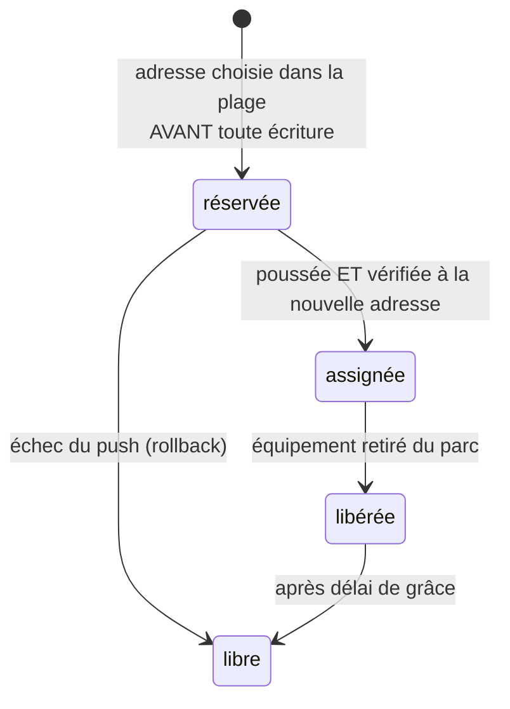
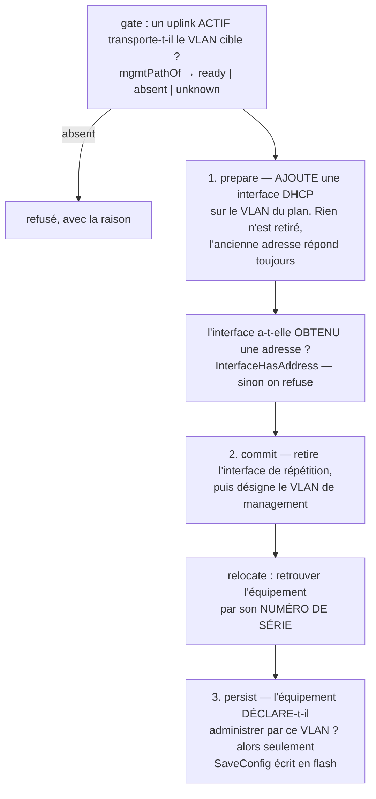
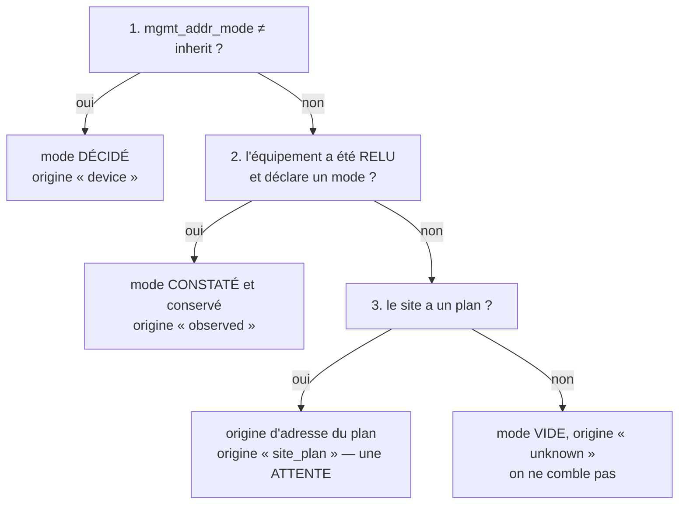

# Adressage de management

Comment un équipement adopté est **joignable pour l'administration** : garder ce qu'il a, ou entrer dans le plan d'adressage du site. C'est la décision la plus dangereuse du produit — se tromper coupe l'accès à l'équipement qu'on voulait administrer ([[Réconciliation]]).

## 1. Deux modes, une décision par équipement

| Mode | Ce que meshcraft fait | Quand |
|---|---|---|
| **1 — Conserver** (`keep`) | Ne touche à **rien** : VLAN de management, adresse, passerelle et routes restent ceux de l'équipement. meshcraft se contente de les **observer** et de s'y connecter. | parc existant qu'on ne veut pas renuméroter, équipement hors plan, cas particulier |
| **2 — Plan du site** (`site_plan`) | Applique le **plan de management du site** : VLAN de management, adresse (allouée ou DHCP), passerelle par défaut. | mise en cohérence d'un parc, équipement neuf, tout déploiement normalisé |

Le mode vit **sur l'équipement**, pas sur le site : un site peut avoir un plan et quelques équipements en `keep`. Le changer plus tard est possible, mais c'est une opération **disruptive** (§5) : on ne renumérote pas un switch par accident.

> [!note] Décidé, non construit — le mode n'est pas encore une donnée
> `devices.mgmt_mode` n'existe pas. Tout équipement adopté est aujourd'hui dans un
> régime qui **ressemble** au mode 1 : meshcraft observe son adresse et ne la
> réécrit jamais de lui-même. La différence avec le mode 1 véritable est qu'il n'y
> a pas de **déclaration** — donc rien qui distingue « conserver, décidé » de
> « pas encore migré », et rien à quoi un futur `apply` puisse se référer pour
> s'abstenir.
>
> Ce que le code livre à la place, et qui est le geste dangereux de la paire : la
> **bascule vers le plan**, explicitement demandée équipement par équipement (§5).
> C'est l'ordre de livraison sain — on construit d'abord l'opération qui coupe
> l'accès, avec ses garde-fous, avant l'étiquette qui dit qu'on ne veut pas la
> faire.

> [!important] Ne pas confondre avec le MODE D'ADRESSAGE, qui est livré (§8)
> Le mode ci-dessus (`keep` / `site_plan`) répond à « cet équipement entre-t-il dans
> le plan du site ? », donc à une question de **VLAN et de sous-réseau**. Il n'existe
> pas encore.
>
> Une question voisine et **indépendante** existe, elle, en base depuis la migration
> `0027` : **comment cet équipement obtient-il son adresse** *dans* ce sous-réseau —
> DHCP ou adresse fixe, avec sa passerelle et ses DNS. Un équipement peut être dans
> le plan en statique, ou hors plan en DHCP : les quatre combinaisons ont un sens.
> Tout le §8 est consacré à cet axe, et c'est lui qui porte la règle « un équipement
> trouvé en adresse fixe dans le bon LAN de management y reste ».

> [!note] Ne pas confondre avec le choix « pousser / importer »
> L'adoption pose déjà une question : la configuration des ports et VLANs est-elle
> **poussée par la plateforme** ou **importée de l'équipement** ([[Discovery]]).
> C'est un axe **indépendant** : on peut parfaitement importer la configuration
> existante des ports *et* renuméroter le management, ou pousser une
> configuration complète *en conservant* l'adresse de management. Deux
> questions, deux réponses.

En mode `keep`, les champs correspondants de l'intent sont **absents** — au sens de la règle 3 du [[Modèle de données standard]], « absent = non géré ». C'est ce qui garantit qu'aucun `apply` ne réécrira l'adressage : ce n'est pas une intention marquée « ne pas faire », c'est une absence d'intention.

## 2. Le plan de management du site

Défini une fois par site, dans l'espace d'administration ([[Interface web]]), par un `site_admin` ([[RBAC]]) :

| Réglage | Détail |
|---|---|
| VLAN de management | l'identifiant, **et s'il est tagué ou natif/untagged**. VLAN 1 natif est un choix valide, et souvent le seul possible (§3). |
| Sous-réseau | IPv4 et/ou IPv6 du management (`10.10.0.0/24`, `2001:db8:1::/64`) |
| Passerelle par défaut | l'adresse de la route par défaut poussée aux équipements |
| DNS, NTP | facultatifs. **Enregistrés seulement** : aucun connecteur ne les pousse encore, et la cible reste de les porter avec le reste de l'intent ([[Modèle de données standard]]) |
| Origine de l'adresse | **DHCP externe** ou **meshcraft**. Enregistré et validé ; `meshcraft` est aujourd'hui **sans effet** faute d'allocateur (§2) |
| Plage utilisable | si meshcraft : la portion du sous-réseau qu'il s'autorise à distribuer (`10.10.0.50` → `10.10.0.199`). Validée à la saisie, jamais encore consommée |

### DHCP externe ou meshcraft : ce que ça veut dire exactement

> [!important] meshcraft n'est pas un serveur DHCP
> - **DHCP externe** : meshcraft configure l'interface de management de
>   l'équipement en client DHCP et **n'alloue rien**. L'adresse obtenue est
>   observée, pas décidée. Une réservation stable côté DHCP reste recommandée —
>   sinon l'adresse peut changer sous nos pieds, et c'est au réseau du client de
>   le garantir, pas à nous de le supposer.
> - **meshcraft** : il joue le rôle d'**IPAM** — il choisit une adresse libre
>   dans la plage, la réserve dans sa base, et la pousse en **configuration
>   statique** sur l'équipement. Aucun paquet DHCP n'est émis : rien à écouter,
>   rien à faire tourner sur le [[Proxy]], et pas de service critique de plus
>   sur le site du client.
>
> Le mot « géré par meshcraft » désigne donc l'allocation, pas la distribution.

### Allocation : réserver avant de pousser, libérer le plus tard possible

> [!warning] Décidé, non construit — la table existe, l'allocateur non
> Tout ce paragraphe décrit une **cible**. `mgmt_addresses` est créée (migration
> `0009`) et `store.MgmtPoolUsage` sait **compter** ce qu'elle contient, mais
> aucun code n'y **insère** quoi que ce soit : il n'existe ni réservation, ni
> passage en `assigned`, ni libération différée, ni détection de dérive. La seule
> bascule de management livrée (§5) passe par le **DHCP** du réseau cible, jamais
> par une adresse choisie par meshcraft.
>
> Le dire est ce qui évite de chercher un allocateur défaillant : il n'y en a pas
> encore. Le garder est ce qui évite de le réinventer autrement le jour où
> l'origine `meshcraft` du plan cessera d'être un réglage sans effet.

Même logique que les générations de secrets ([[Identité de service et rotation]]) : entre la décision et l'état réel des équipements, il y a du temps, et il faut que la base ne mente jamais.



- **Réserver d'abord.** Une adresse est écrite en base avant d'être poussée : deux adoptions simultanées ne peuvent pas choisir la même. Une contrainte d'unicité `(site, adresse)` le garantit au niveau de la base, pas seulement dans le code.
- **Ne jamais allouer une adresse déjà vue.** La [[Discovery]] observe des adresses en usage : celles-là sont exclues de la plage, même si la base les croit libres. Le réseau a toujours raison contre l'inventaire.
- **Libération différée.** L'adresse d'un équipement supprimé n'est pas immédiatement recyclable : un équipement éteint peut revenir avec son ancienne configuration. Délai de grâce, comme pour les générations de secrets.
- **Plage épuisée** : erreur explicite avec le décompte (« 0 adresse libre sur 150, 150 assignées »), jamais un échec silencieux ni un débordement hors plage.
- **Dérive** : un équipement qui répond à une autre adresse que celle allouée produit un événement (`mgmt.address_drift`), et l'état observé est corrigé — la base apprend de la réalité.

## 3. Tous les équipements ne savent pas faire un VLAN de management

C'est le cas dur, et il est fréquent en bas de gamme : certains équipements n'admettent leur interface de management que sur le **VLAN 1**, ou uniquement en **untagged**. Pousser un VLAN de management tagué sur un tel équipement le rend injoignable — exactement ce que la règle *ne jamais se couper la main* interdit.

C'est donc une **capability du modèle**, déclarée par le connecteur ([[Connecteurs]]) et portée par le catalogue de modèles. Telle qu'elle existe dans `internal/driver/driver.go` :

```go
type MgmtCapabilities struct {
    VlanIDs   VlanSupport // "any" | "default_only" | "" (inconnu)
    VlanRange [2]int      // bornes admises pour le VLAN de management
    TaggedOK  bool        // le management fonctionne sur un VLAN tagué
    Static    bool        // adresse statique admise
    DHCP      bool        // client DHCP admis
    DHCPFallback string   // adresse de repli si le DHCP ne répond pas
    Notes     []string    // contraintes d'ORDRE et pièges du constructeur
}
```

Deux champs n'étaient pas prévus et se sont imposés au premier relevé réel.
`DHCPFallback` parce qu'un équipement qui « n'a pas d'adresse » en a une quand
même — le 1930 retombe sur `192.168.1.1` — et croire le contraire fait chercher
un équipement muet là où il répond. `Notes` parce que l'essentiel de ce qui
distingue un `apply` qui marche d'un équipement perdu n'est pas une case à cocher
mais un **ordre d'opérations** : *un VLAN sans port membre ne peut pas devenir
VLAN de management*, *SNMP n'est autorisé que sur le VLAN de management*. Réduire
ça à des booléens aurait obligé à inventer une capability par piège.

> [!warning] Déclarée, pas encore consultée
> `MgmtCapabilities` est **remplie** par le connecteur `instanton` et lisible par
> l'API du catalogue. Aucun chemin d'écriture ne l'**interroge** aujourd'hui :
> les trois contrôles du bas de cette section sont **décidés, non construits**. Ce
> qui garde réellement la main est un contrôle d'une autre nature, livré et
> vérifié — le chemin du VLAN de management (§5).

> [!warning] Une capability inconnue est supposée ABSENTE
> Pour tout ce qui peut couper l'accès, l'inconnu se traite comme un refus. Un
> modèle dont on ne sait pas s'il accepte un VLAN de management tagué est traité
> comme ne l'acceptant pas : au pire on demande une confirmation inutile, au
> mieux on évite de briquer un équipement. L'inverse — supposer la capacité
> présente — se paie en déplacement sur site.

### Conséquence : l'adoption est bloquée, avec la raison

Si le plan du site exige un VLAN de management que l'équipement ne sait pas porter, **l'adoption en mode 2 est refusée** avec un message qui dit précisément quoi :

> « Ce modèle n'admet le management que sur le VLAN 1 non tagué. Le plan du site
> « Atelier Lyon » exige le VLAN 10 tagué. Adopter en mode 2 rendrait
> l'équipement injoignable. »

Et trois portes de sortie, présentées avec le refus :

1. **Adopter en mode 1** (conserver l'adressage existant) — l'équipement est administrable, simplement hors plan. Il apparaît dès lors comme **non conforme au plan** dans l'UI, avec la raison, plutôt que d'être oublié.
2. **Changer le plan du site** pour un management natif/VLAN 1, si le parc du site le justifie.
3. **Renoncer** à cet équipement dans ce site.

> [!important] Le blocage porte sur le mode 2, pas sur l'adoption en général
> Refuser toute adoption laisserait un équipement acheté et branché
> définitivement hors du produit — un mur, pas un garde-fou. Le mode 1 reste
> donc ouvert, mais il faut un geste explicite et l'écart est **affiché** : un
> équipement hors plan doit être visible comme tel, pas noyé dans la masse.
> Une option de site, `site_mgmt_plan.strict_plan` (par défaut **activée**),
> permet d'interdire même ce contournement quand la politique du client l'exige.
> La colonne existe, l'écran la propose et l'API l'enregistre — mais **aucun code
> ne la lit** : c'est aujourd'hui un réglage sans effet, et il le restera jusqu'à
> ce que l'adoption ait des gates de capability à durcir.

> [!note] Premier cas réel : l'Instant On 1930 n'est PAS le cas limité
> On s'attend à ce qu'un switch d'entrée de gamme soit coincé sur le VLAN 1. Le
> 1930 accepte en fait n'importe quel VLAN de management entre 1 et 4092
> ([[Connecteurs]]). La leçon n'est pas « c'était une inquiétude infondée » mais
> « la capability se **relève**, elle ne se déduit pas de la gamme de prix ». En
> revanche il impose une contrainte d'ordre que le plan doit respecter : un VLAN
> sans port membre ne peut pas être désigné VLAN de management.

Le contrôle devra être appliqué à **trois endroits**, parce qu'un seul finit toujours par être contourné : à l'adoption (l'UI refuse avant d'agir), à la compilation de l'intent (validation contre les capabilities, règle 5 du [[Modèle de données standard]]), et au plan/apply (dernière ligne de défense). **Aucun des trois n'existe** — la cible reste celle-là, et la redondance en est le point, pas un excès de zèle.

## 4. Quelle porte d'entrée choisit quel mode

> [!note] Décidé, non construit
> Aucune porte d'entrée ne pose de question de mode aujourd'hui : il n'y a pas de
> mode à poser (§1). Ce tableau est la **cible**, et il vaut d'être gardé pour une
> raison précise — le défaut correct dépend de la porte, et c'est le genre de
> nuance qu'on n'a pas l'idée de rétablir une fois qu'un défaut unique a été
> codé partout.

Les trois portes de la [[Discovery]] n'ont pas le même contexte, donc pas le même défaut :

| Porte d'entrée | Mode proposé | Pourquoi |
|---|---|---|
| **Ajout manuel par IP** | **choix explicite** entre 1 et 2, défaut *conserver* | on a tapé l'adresse actuelle : c'est un cas particulier, l'opérateur sait ce qu'il fait |
| Découverte automatique | plan du site (mode 2) | la découverte sert à normaliser un parc ; l'écart au plan est justement ce qu'on veut réduire |
| Port série (équipement neuf) | plan du site (mode 2), **forcé** | il n'y a rien à conserver : l'équipement n'a pas encore d'adresse joignable |
| Modèle du catalogue (pré-provisionné) | plan du site (mode 2), **forcé** | l'équipement n'existe pas encore physiquement |

Dans tous les cas où le mode 2 s'appliquera, la vérification de capability du §3 devra précéder l'adoption.

## 5. Basculer un équipement dans le plan : l'opération la plus risquée

Changer le VLAN de management **et** l'adresse, c'est scier la branche sur laquelle on est assis : la session en cours meurt au milieu de l'opération, et l'équipement réapparaît — ou non — ailleurs. C'est **livré**, sur `instanton`, et découpé en **trois gestes séparés** (`internal/api/recon_handlers.go`) parce que le filet de sécurité tient précisément à cette séparation.



Ce que la [[Réconciliation]] garantit ici, en plus de ses règles habituelles :

- **Le gate est le CHEMIN du VLAN, pas la joignabilité d'un proxy.** `mgmtPathOf` cherche un port qui porte **à la fois** un lien actif et le VLAN cible — en natif ou en tagué selon ce que le plan demande. Les deux comptent : *« le VLAN est bien sur le switch »* n'a jamais voulu dire *« il en sort »*. Trois issues, et l'indéterminé en est une vraie : un équipement jamais relu rend `unknown`, ce qui **n'interdit pas** — répondre `absent` transformerait une ignorance en interdiction sur un parc largement pas encore relu, et répondre `ready` ferait exactement le dégât visé. Seul `absent` bloque, parce que lui est une certitude, et qu'elle coûte un déplacement sur site.
- **Le filet est le NON-ÉCRIT en flash**, et non une sauvegarde. Tant que `persist` n'a pas eu lieu, une coupure d'alimentation ramène l'équipement à son adressage d'avant : c'est ce qui autorise à tenter la manœuvre sur du matériel en service. Corollaire dit à l'écran : ce filet devient un **piège** dès que la bascule est constatée bonne, puisque meshcraft connaît alors la nouvelle adresse et qu'une coupure ferait revenir l'équipement à l'ancienne sans que personne ne l'apprenne. D'où le troisième geste, séparé.
- **L'interface de répétition est le cœur du procédé.** `prepare` **ajoute** une interface IPv4 en client DHCP sur le VLAN cible sans rien retirer : l'équipement garde son adresse actuelle, reste donc joignable, et **prouve** qu'un serveur DHCP répond dans le réseau visé. C'est ce qui transforme la bascule d'un pari en une vérification. Elle doit ensuite disparaître, parce que l'équipement refuse de désigner comme VLAN de management un VLAN portant déjà une configuration IP — c'est **lui** qui va y réinstaller l'adresse, et c'est le seul instant réellement délicat de la manœuvre.
- **Un code de retour favorable ne prouve rien** : après chaque écriture, la section est **relue**. C'est la leçon générale de cette interface ([[Connecteurs]]) et elle est appliquée ici littéralement.
- **Le management ne se touche jamais par le chemin des ports.** Ce n'est donc pas « en dernier dans l'ordre du plan » : c'est **hors** du chemin de pose des ports, et la bascule est un geste explicitement demandé. `instanton.ApplyPorts` porte le garde-fou, et il est posé **au port et non au VLAN** : un port qui est *à la fois* membre non tagué d'un VLAN de management *et* porteur d'un lien ne voit jamais son VLAN natif changer. Trois précisions, dont chacune a une raison :
	- **deux** VLANs comptent comme de management, celui du plan **et** celui que l'équipement déclare. Ils diffèrent tant qu'un équipement n'a pas été migré — constaté sur un 1930 : plan à 99, équipement à 1. Ne protéger que le premier laisserait réécrire celui qui porte la session ;
	- la condition de **lien** est ce qui rend le garde-fou utilisable. Sorti d'usine, les 48 ports sont non tagués dans le VLAN 1, qui est aussi celui de l'administration : sans elle, aucun port ne serait jamais modifiable et « adopter » ne voudrait rien dire. Un port sans câble ne peut porter aucune session ;
	- **ajouter** des VLANs tagués à un port protégé reste permis : ça ne touche pas au trafic non tagué, donc pas à la session. Et si **aucun** VLAN de management n'est connu — ni du plan, ni de l'équipement — l'écriture est **refusée** entièrement plutôt que tentée sans garantie. Un `force` explicite lève le garde-fou ; il n'est jamais activé par la pose automatique.
- **Vérification à la NOUVELLE adresse, sur le numéro de série.** `internal/relocate` balaye le sous-réseau cible *et* accepte en parallèle une adresse saisie par l'opérateur — qui la connaît souvent avant la fin du balayage. Le premier des deux qui **identifie la bonne série** gagne ; une adresse est refusée si la série diffère, parce qu'un bail DHCP recyclé peut désigner un autre équipement et que pointer meshcraft vers le mauvais matériel serait pire que de ne rien trouver. Puis `persist` exige que l'équipement **déclare lui-même** administrer par le VLAN du plan : sauver une bascule non vérifiée graverait une erreur.

> [!warning] Décidé, non construit — ce que la bascule ne répare pas encore
> D'abord une limite de périmètre : la bascule livrée est **DHCP seulement**.
> `AddManagementInterface` pose un client DHCP, et rien n'écrit d'adresse statique
> sur le VLAN cible. Un plan d'origine `meshcraft` ne change donc rien à la
> manœuvre — c'est le §2 qui manque, pas cette section. Conséquence à connaître :
> le succès de la bascule dépend d'un serveur DHCP présent dans le réseau de
> management, et c'est précisément ce que `prepare` va **vérifier** avant que quoi
> que ce soit d'irréversible n'arrive.
>
> Ensuite, trois conséquences légitimes ne sont **pas** tirées aujourd'hui, et il
> vaut mieux les lire ici que les découvrir sur un parc :
>
> - **la destination de traps n'est pas invalidée.** Un changement de sous-réseau
>   de management change le chemin retour, donc périme `trap_dest_addr` et la
>   preuve `trap_seen_at` qui l'accompagne (migration `0023`). Seul
>   `store.SetDeviceProxy` — un changement de **collecteur** — oublie ces
>   colonnes ; `SetDeviceMgmtIP`, lui, n'écrit que `mgmt_ip`. Une prétention
>   conservée après un changement de chemin est exactement le genre de mensonge
>   que `0023` existe pour supprimer, et la bascule de management est le second
>   chemin par lequel il revient ;
> - **aucun collecteur n'est recalculé** — l'élection est elle-même décidée et non
>   construite ([[Monitoring]], § *Choix du point de collecte*), et le
>   rattachement `devices.proxy_id` reste une **déclaration** que la bascule ne
>   touche pas ;
> - **pas de marquage `disruptive` ni de fenêtre de maintenance.** Ni l'un ni
>   l'autre n'existe dans le code ; ce que l'écran donne à la place est la
>   séparation en trois gestes et le rappel, à chaque étape, que rien n'est encore
>   écrit en flash. C'est moins ambitieux et strictement plus honnête.
>
> Et une précision qui n'est pas un détail : `device_paths` est **nommé partout
> dans le vault mais n'est pas une table**. L'ensemble des proxys qui joignent un
> équipement n'est nulle part persisté aujourd'hui — il n'y a donc rien à
> invalider après une bascule, et rien sur quoi asseoir un recouvrement.

## 6. Modèle de données

Ce qui est **en base** (migration `0009`) :

```sql
-- Plan de management du site : une ligne par site.
--
-- Toutes les adresses sont en `text`, et non en `cidr`/`inet`. Ce n'est pas une
-- négligence : ces champs sont saisis dans un formulaire, et un type PostgreSQL
-- strict transformerait une faute de frappe en erreur de base illisible là où le
-- contrôleur sait dire « la passerelle 10.0.0.1 n'appartient pas au sous-réseau
-- 10.10.0.0/24 ». La validation vit dans `validateMgmtPlan`, en un seul endroit,
-- et elle est plus bavarde qu'une contrainte.
site_mgmt_plan(site_id pk fk sites,
               vlan_id int not null default 1,  -- 1 = défaut ; voir untagged
               untagged bool not null default true,   -- management sur VLAN natif
               subnet_v4 text, gateway_v4 text,
               subnet_v6 text, gateway_v6 text,
               dns text[], ntp text[],
               source text,                     -- dhcp_external | meshcraft
               pool_start text, pool_end text,
               strict_plan bool default true,   -- refuser le contournement mode 1
               updated_by fk users, updated_at)

-- IPAM : adresses de management allouées par meshcraft. L'unicité est portée
-- par la BASE, pas par le code : deux adoptions concurrentes ne peuvent pas
-- choisir la même adresse. La table existe ; rien n'y écrit encore (§2).
mgmt_addresses(site_id fk, address text, device_id fk null,
               state text,                      -- reserved|assigned|released
               allocated_at, released_at null,
               primary key (site_id, address))
```

Le **mode d'adressage** par équipement, lui, est en base (migration `0027`, §8) :

```sql
-- Comment CET équipement obtient son adresse, indépendamment du VLAN.
--
-- `inherit` est le défaut et veut dire « meshcraft n'impose rien » : la règle 3 du
-- modèle de données standard, « absent = non géré ». Un équipement en statique reste
-- donc en statique sans que personne ait eu à le déclarer, et tout le parc existant
-- part dans cet état — la migration est à sémantique constante.
devices(… , mgmt_addr_mode  text not null default 'inherit',  -- inherit|dhcp|static
            mgmt_static_ip  text not null default '',         -- avec préfixe
            mgmt_static_gw  text not null default '',
            mgmt_static_dns text[] not null default '{}',
            mgmt_addr_by    uuid references users(id),        -- qui a décidé
            mgmt_addr_at    timestamptz,                      -- et quand
            -- Ce que l'ÉQUIPEMENT déclare porter, lu par le connecteur.
            -- NULL = jamais relu, et c'est une information.
            mgmt_addr_observed    jsonb,
            mgmt_addr_observed_at timestamptz)
```

Ce qui reste une **cible** : le mode d'appartenance au plan.

```sql
-- Décidé, non construit. `devices.mgmt_mode` (keep | site_plan) n'existe pas :
-- tout équipement est aujourd'hui traité comme s'il pouvait entrer dans le plan,
-- et c'est la bascule elle-même qui est un geste explicite. À ne pas confondre
-- avec `mgmt_addr_mode` ci-dessus, qui est un autre axe (§8).
devices(… , mgmt_mode text)                     -- keep | site_plan
```

> [!important] Pas de `mgmt_conforms` en base, et c'est une décision
> Une version antérieure de cette note prévoyait `devices.mgmt_conforms` et
> `mgmt_exception`. Les deux sont **abandonnés**, et le §12 dit pourquoi : le plan
> du site change à tout moment, et un booléen figé mentirait dès la première
> modification. La conformité est **calculée à la lecture** (`conformityWith`,
> `internal/api/conformity.go`) et enrichit chaque équipement rendu par l'API.
> Garder les deux colonnes en cible aurait été garder la contradiction.

L'adresse effective reste dans `devices.mgmt_ip` — **observée**, comme aujourd'hui. `mgmt_addresses` dira ce que meshcraft a *décidé* ; `mgmt_ip` dit ce qu'il *constate*. Quand les deux divergeront, c'est la dérive du §2, et c'est le constat qui gagnera.

## 7. Ce que l'UI doit montrer

- **Réglages du site → Management** — *livré* (`web/src/pages/MgmtPlan.tsx`) : le plan (VLAN, sous-réseaux, passerelle, origine de l'adresse, plage), avec l'**occupation de la plage** en clair (« 37 adresses assignées, 2 réservées, 111 libres sur 150 »). Les trois nombres se calculent déjà — `MgmtPoolUsage` + `PoolSize` — mais valent tous zéro tant que rien n'alloue : une plage qui se remplit doit se voir **avant** d'être pleine, et l'écran est prêt pour ça.
- **La bascule** — *livré* (`web/src/pages/MgmtMigrate.tsx`) : les trois gestes du §5, chacun avec son verdict et son avertissement « non sauvé en flash », et le blocage quand le chemin du VLAN est `absent`.
- **Sur la fiche équipement** — *livré* : la conformité au plan, ce que le plan exige, et la raison de l'écart en clair.
- **Sur la fiche équipement, sous l'identité** — *livré* (`web/src/pages/MgmtAddressing.tsx`) : le **mode d'adressage** de cet équipement et les **trois champs** adresse / passerelle / DNS, avec le choix *hériter / DHCP / adresse fixe* (§8). L'emplacement n'est pas indifférent : l'adresse est déjà là, et « par quel moyen l'a-t-il obtenue ? » se pose au moment où on la lit.
- **Sur les cartes de l'inventaire** — *livré* : « IP fixe » ou « DHCP » sur la ligne de lieu, en deux mots, plus un `!` au survol quand l'intention et l'équipement divergent. « Quels équipements de ce parc sont en adresse fixe ? » se demande devant l'inventaire, pas devant une fiche à la fois.
- **À l'adoption** — *cible* : le mode choisi, l'adresse qui sera allouée (avant de valider, pas après), et le refus du §3 avec ses trois portes de sortie.
- **Vue de site** — *cible* : combien d'équipements hors plan, et pourquoi. Un parc à 80 % conforme doit se voir ; un écart silencieux est un écart qui grandit.

> [!note] La liste des exclusions observées n'existe pas encore
> Elle supposerait que la [[Discovery]] alimente une liste d'adresses en usage
> pour ce sous-réseau, et que l'allocateur la consulte. Les deux appartiennent au
> §2. Ce qui existe déjà et vaut d'être noté : le **pré-vol de joignabilité**
> (`POST /api/discovery/reach-check`, `internal/driver/reach.go`), qui sait dire
> si un proxy atteint un réseau — un `refused` y est une **bonne nouvelle**, il
> prouve que le paquet est arrivé. Il est proposé sur l'écran de bascule, mais
> comme **outil de diagnostic** à déclencher, jamais comme gate. Il est de plus
> réservé au `global-admin` là où la bascule elle-même est ouverte au
> `site_admin` : un site-admin voit donc le bouton et reçoit un 403. C'est un
> écart de droits à fermer, dans un sens ou dans l'autre.

Événements au [[Journal d'événements]] — ce qui est **émis** aujourd'hui, et ce qui suivra :

| Événement | État |
|---|---|
| `mgmt.plan_changed` | **livré** — `handleUpdateMgmtPlan`, avec le plan résumé en clair |
| `mgmt.migration_prepared` | **livré**, en *avertissement* : l'interface est posée et **rien n'est sauvé en flash** |
| `mgmt.migrated` | **livré**, en *avertissement*, avec l'adresse obtenue sur le VLAN cible |
| `mgmt.migration_persisted` | **livré** — la bascule survivra à un redémarrage |
| `device.relocate_started`, `device.relocated` | **livré** — avec **qui** a trouvé, le balayage ou l'opérateur. L'écran doit pouvoir le dire, ne serait-ce que pour savoir si le balayage sert à quelque chose |
| `mgmt.address_allocated`, `mgmt.address_released`, `mgmt.address_drift` | **décidés, non construits** — ils appartiennent à l'allocateur du §2 |
| `mgmt.plan_violation`, `mgmt.exception_granted` | **décidés, non construits** — ils appartiennent aux gates de capability du §3 |

Les trois événements de bascule sont en **avertissement** et non en information, et l'ordre de sévérité n'est pas cosmétique : entre `prepare` et `persist`, l'équipement porte une configuration qu'une coupure de courant annulerait. Un journal qui classerait ça comme une notice laisserait un état transitoire passer pour un état acquis.


## 8. Le mode d'adressage par équipement : DHCP ou adresse fixe

Le §2 décide de l'origine des adresses pour tout un **site**. Ce paragraphe décide pour **un équipement**, et les deux ne se remplacent pas : un réseau de management a bien un régime dominant, mais il y a toujours des équipements qui n'y sont pas.

### 8.1 Le relevé qui l'a rendu nécessaire

Sur l'installation de référence, **les deux CSS326 et le CRS326** portent une adresse **statique**, dans le **bon** sous-réseau de management, sur un site dont le plan dit « DHCP externe ». Les trois faits sont dans les captures des connecteurs, pas dans un souvenir :

| Équipement | Plateforme | Ce que la capture dit | Où |
|---|---|---|---|
| CSS326-24G-2S+ | SwOS 2.17 | `iptp:0x01` — « static » | `swos/testdata/sys.b`, `backup.swb` |
| CRS326-24G-2S+ | RouterOS 7.21 | `"dynamic":"false"` sur `192.0.2.54/24` | `routeros/testdata/ip_address.json` |

Ces équipements sont **conformes** au plan : leur adresse est dans le sous-réseau, ils répondent, la §12 les affiche en vert. Et pourtant meshcraft ne savait ni dire par quel moyen ils l'avaient obtenue, ni afficher les trois champs d'une configuration statique, ni enregistrer la décision de les y laisser. Un équipement en bail et un équipement en adresse fixe se présentaient **identiquement** — alors que ce qui se passe le jour où le serveur DHCP change n'a rien de commun entre les deux.

### 8.2 « Conserver la statique » n'est pas un cas particulier, c'est le défaut

Trois valeurs, dans `devices.mgmt_addr_mode` :

| Valeur | Ce que meshcraft en fait |
|---|---|
| **`inherit`** *(défaut)* | **N'impose RIEN.** L'équipement garde ce qu'il porte. C'est la règle 3 du [[Modèle de données standard]], « absent = non géré », appliquée à l'adressage. |
| **`dhcp`** | L'exploitant veut cet équipement en client DHCP. |
| **`static`** | L'exploitant veut une adresse fixe, et les trois champs qui l'accompagnent font foi. |

Le défaut fait le travail : un équipement adopté dans le bon LAN de management mais en adresse fixe **reste** en adresse fixe, sans geste de personne. Conséquence de forme qui rend la migration sans risque — tout le parc existant part en `inherit`, donc rien ne change de comportement, et aucune ligne n'est réécrite.

### 8.3 Le mode EFFECTIF se résout à la lecture, en trois temps

`api.effectiveAddrMode`, et **l'ordre est la fonctionnalité** :



Trois décisions à ne pas inverser :

- **une décision explicite ne se laisse pas contredire par un constat.** C'est ce qui permet de basculer un équipement statique en DHCP : l'intention diverge alors de l'observé, et cette divergence est précisément ce qu'on veut **voir** (§8.5) ;
- **le constat passe AVANT le plan du site.** L'inverse traiterait les trois équipements du §8.1 comme des écarts à corriger, ce qui est le contraire du service rendu ;
- **quand aucun des trois ne répond, le mode reste VIDE.** « meshcraft ne sait pas comment cet équipement a obtenu son adresse » est exact et se répare par une relecture. « DHCP, probablement » ne se répare pas — il se propage.

L'origine est **rendue à l'écran** en même temps que le mode, et ce n'est pas décoratif : c'est elle qui distingue « statique, décidé » de « statique, constaté et conservé » — la distinction que le §1 réclame depuis le début et que `devices.mgmt_mode` n'a jamais su faire.

### 8.4 Lire le mode sur l'équipement : `driver.MgmtAddrReader`

Interface **facultative** et en **lecture seule** du contrat ([[Connecteurs]]), avec `driver.MgmtAddrState` pour ce qu'elle rend (mode, adresse, passerelle, DNS, interface, notes). Rangée hors de `driver.State` pour deux raisons de nature différente : l'adressage ne se lit pas sur les mêmes pages que les ports — donc une lecture peut réussir quand l'autre échoue — et ce qui entre dans `devices.observed` est comparé à l'intention et **déclenche des poses**, ce que le management ne doit jamais faire par le chemin des ports (§5).

| Connecteur | Implémentée ? | Sur quoi |
|---|---|---|
| **SwOS** | **oui** | `/sys.b` : `iptp` (0 « DHCP with fallback », 1 « static », 2 « DHCP only »), `cip` (adresse **en cours**), `ip` (adresse configurée) |
| **RouterOS** | **oui** | `/ip/address` et son champ **`dynamic`** — une adresse créée par le client DHCP le porte à `true`. Plus `/ip/route` et `/ip/dns` pour la passerelle et les résolveurs |
| **Instant On** | **oui** | `IPv4InterfaceList.owner` : **2** = DHCP, **1** = static (relevé lab `sw-labo-1930`) ; `3` = link-local usine. Passerelle lue dans `IPv4RouteList`. |

Trois précisions du connecteur SwOS méritent d'être ici, parce qu'elles se paient à l'exploitation :

- **l'adresse rendue est `cip`, celle en cours, et non `ip`.** En DHCP, `ip` garde l'adresse de repli : l'afficher ferait recopier dans un navigateur une adresse à laquelle l'équipement ne répond pas ;
- **un `iptp` inconnu ne se traduit pas en « statique ».** Un firmware qui rendrait une quatrième valeur produit un mode **vide** et une note ;
- **« DHCP with fallback » est du DHCP, et le repli est dit en note.** Cet équipement a une adresse *même quand aucun serveur ne répond* — d'où un CSS qu'on croit muet et qui répond ailleurs.

### 8.5 La dérive : « ce que je veux » contre « ce qu'il porte »

`api.addrDriftOf` ne se calcule **que** sur une intention explicite **et** un observé relevé. Un `inherit` ne peut pas dériver — il n'exige rien — et un équipement jamais relu ne peut pas être déclaré en écart : ce serait transformer une ignorance en reproche, sur un parc largement pas encore relu. C'est le même arbitrage que celui du chemin de VLAN (§5), et il vaut d'être tenu deux fois.

L'**adresse** compte autant que le mode, et c'est l'écart le plus fréquent : une intention statique dont l'adresse ne correspond pas à celle que l'équipement porte veut dire que la décision n'a jamais été posée, ou que quelqu'un est passé derrière. La comparaison ignore le **préfixe** — SwOS ne le porte pas (`/sys.b` a `ip`, sans masque) là où RouterOS rend `192.0.2.54/24` — sinon toute une gamme serait signalée en écart permanent pour une différence de notation.

### 8.6 Les capabilities sont enfin INTERROGÉES

Le §3 note depuis longtemps que `MgmtCapabilities` est « remplie mais jamais interrogée ». Elle l'est ici, sur les quatre champs qui décident de ce qu'un écran a le droit de proposer — et deux d'entre eux sont **nouveaux** :

```go
Static  bool // adresse fixe admise
DHCP    bool // client DHCP admis
Gateway bool // la plateforme porte-t-elle une PASSERELLE de management ?
DNS     bool // … et des RÉSOLVEURS ?
```

> [!warning] SwOS n'a NI passerelle NI résolveur, et c'est une ABSENCE ÉTABLIE
> Le jeu de champs **inscriptible** de `/sys.b` est énuméré par la sauvegarde de
> configuration de l'équipement lui-même (`testdata/backup.swb`), donc exhaustif :
>
> ```
> sys.b:{id, wdt, dsc, pdsc, ivl, alla, allm, avln, allp, mgmt, prio, cost,
>        frmc, poe, igmp, igmq, igfl, igve, ip, dtrp, ainf, iptp}
> ```
>
> Il y a `ip` et `iptp`. Il n'y a **aucun** champ de passerelle, **aucun** résolveur,
> dans aucun onglet — et l'interface web complète de la plateforme tient en un seul
> fichier qui définit tous ses champs. L'énumération **épuise** la question, comme
> elle l'a épuisée pour le destinataire de traps ([[Connecteurs]]).
>
> **Conséquence d'exploitation, et elle est majeure : un CSS326 n'est joignable QUE
> depuis son propre sous-réseau.** Il n'a personne à qui répondre hors de son lien,
> donc aucune route ne le rattrapera : c'est le [[Proxy]] collecteur qu'il faut poser
> dans le bon réseau, et ce n'est pas négociable côté routage.
>
> D'où le comportement de l'écran : un champ que la plateforme ne porte pas est
> **désactivé avec sa raison**, jamais affiché vide. Les deux se lisent pareil et
> mènent à des gestes opposés — « non configuré » se corrige, « la plateforme n'a pas
> ce réglage » se contourne autrement.

`validateDeviceAddressing` refuse donc **à la saisie** : un mode que la plateforme n'admet pas, une passerelle ou un DNS sur une plateforme qui n'en porte pas, une passerelle hors du sous-réseau de l'équipement (elle serait inatteignable), une passerelle égale à l'adresse de l'équipement, une adresse de réseau, un résolveur qui n'est pas une adresse IP.

**Le préfixe est complété, jamais deviné.** Un exploitant tape `192.0.2.36` : le préfixe est emprunté au sous-réseau du plan quand l'adresse y est contenue, et **exigé** sinon — pas de plan, ou adresse hors du sous-réseau. Supposer `/24` serait inventer un masque, et un masque faux rend un équipement muet aussi sûrement qu'une adresse fausse. Une adresse **hors** du sous-réseau reste acceptée : c'est l'équipement hors plan du §1, que la §12 signale déjà en orange ; refuser ici ferait un mur là où le produit veut un avertissement.

**Un connecteur inconnu n'interdit rien**, et c'est l'exception assumée à la règle « une capability inconnue est supposée absente ». Cette règle protège les **écritures** sur l'équipement ; pour l'intention d'adressage seule (enregistrement sans pose), refuser toute annotation sur un switch saisi à la main n'éviterait aucun dégât en rendant l'écran inutilisable. Les écritures, elles, passent par `ApplySameVLAN` / `MigrateVLAN` / `JumpVLAN`.

### 8.7 Poser l'adressage : apply, migrate, jump

> [!important] Trois chemins distincts, pilotés par les capabilities
> L'intention s'enregistre toujours (`PUT …/mgmt-addressing`). La **pose** sur
> l'équipement est un geste séparé, et le connecteur dit lequel est tenable :
>
> | Capability | Contrat | Plateformes |
> |---|---|---|
> | `ApplySameVLAN` | `driver.MgmtAddrWriter` — DHCP/statique sur le VLAN de management **actuel** | RouterOS, SwOS |
> | `MigrateVLAN` | `driver.MgmtMover` — préparer / constater / basculer (deux voies) | Instant On, RouterOS |
> | `JumpVLAN` | `driver.MgmtJumper` — saut à adresse unique + sauvegarde | SwOS |
>
> - **RouterOS** : apply same-VLAN et migrate dual-path via REST (`/ip/address`,
>   `/ip/dhcp-client`, bridge vlan + interface vlan). `OutOfBand` (série / MAC-winbox)
>   reste le filet si la session tombe.
> - **SwOS** : apply same-VLAN et jump réécrivent `/sys.b` après `GET /backup.swb`.
>   Pas de `MgmtMover` — une seule adresse, un seul `avln`. Confirmer le jump dans
>   l'UI (`confirmed=true`).
> - **Instant On** : migrate VLAN (DHCP) livré ; apply same-VLAN et lecture mode
>   via `IPv4InterfaceList.owner` (**2**=DHCP, **1**=static, relevé lab). DNS
>   write pas encore prouvé. Pas d'`OutOfBand` — ne pas sauver en flash tant que
>   la bascule n'est pas vérifiée.

Endpoints : `POST …/mgmt-addressing/apply`, `POST …/mgmt-migrate/{prepare,commit,persist}`,
`POST …/mgmt-addressing/jump`.

Deux conséquences plus petites, également non tirées : l'**IPAM** du §2 reste sans écrivain, donc un mode `static` ne réserve rien dans `mgmt_addresses` ; et la relecture d'adressage n'invalide pas la destination de traps, parce qu'elle ne change aucune adresse — elle constate.

### 8.8 Ce qui déclenche la lecture

`POST /api/devices/{id}/read-state` relit l'adressage **dans le même geste** que les VLAN et les ports : demander deux clics à l'exploitant pour relire un même équipement serait lui faire porter une frontière interne au code. L'échec de l'un n'emporte pas l'autre, et l'ordre le garantit — l'état des ports est enregistré **avant** que l'adressage ne soit tenté. Perdre les VLAN de tout un parc parce qu'une page d'adressage n'est pas lisible sur une gamme serait une régression ; le motif est rendu à l'écran (`mgmt_addr_note`) plutôt que tu.

## 11. Ce que l'implémentation a livré

`site_mgmt_plan` et `mgmt_addresses` (migration 0009), l'API
`GET`/`PUT /api/sites/{id}/mgmt-plan`, et l'écran **Configuration → Management**
du site. Lecture ouverte aux rôles du site, écriture au `site_admin`.

Un site sans plan ne renvoie pas d'erreur : il renvoie le **défaut prudent** —
VLAN 1 natif, DHCP externe, meshcraft ne touche à rien. L'UI dit explicitement
qu'aucun plan n'est encore défini, plutôt que d'afficher des valeurs qui
ressembleraient à une décision prise.

Les validations refusent **à la saisie** ce qui casserait au déploiement, quand
l'équipement est déjà à moitié reconfiguré :

- VLAN hors 1–4094 ;
- allocation par meshcraft sans sous-réseau ou sans plage ;
- plage hors du sous-réseau, ou fin avant début ;
- **passerelle hors du sous-réseau** — presque toujours une faute de frappe, et
  elle serait poussée sur tout un parc ;
- **passerelle DANS la plage d'allocation** — elle finirait attribuée à un
  équipement.

Puis la **bascule** elle-même (§5), sur `instanton` : trois endpoints
(`prepare` / `commit` / `persist`), le gate du chemin de VLAN, la recherche par
numéro de série, et l'écran qui les enchaîne.

### Décidé / livré / ouvert

| Question | État |
|---|---|
| Plan de management par site, lu et écrit | **livré** — `site_mgmt_plan` (`0009`), `GET`/`PUT /api/sites/{id}/mgmt-plan`, écran *Configuration → Management* |
| Défaut prudent en l'absence de plan | **livré** — VLAN 1 natif, DHCP externe, `Configured: false` dit explicitement qu'aucun plan n'est défini |
| Validation à la saisie (VLAN, sous-réseau, passerelle, plage) | **livré** — `validateMgmtPlan` |
| Conformité au plan, calculée jamais stockée | **livré** — `conformityWith`, enrichit chaque équipement rendu |
| Gate du chemin de VLAN avant toute écriture | **livré** — `mgmtPathOf` : lien actif **et** VLAN cible, `ready`/`absent`/`unknown` |
| Bascule en trois gestes, rien en flash avant le troisième | **livré** — `internal/api/recon_handlers.go`, connecteur `instanton` |
| Retrouver l'équipement à sa nouvelle adresse, sur sa série | **livré** — `internal/relocate`, balayage **et** saisie opérateur en parallèle |
| Pré-vol de joignabilité depuis un proxy | **livré** comme outil (`reach-check`), **pas** comme gate — et à un droit différent de la bascule |
| **Mode d'adressage par équipement** (`inherit` / `dhcp` / `static`) | **livré** — `devices.mgmt_addr_*` (`0027`), `PUT /api/devices/{id}/mgmt-addressing` (`site_admin`), et les trois champs sur la fiche (§8) |
| Adresse fixe trouvée en place et CONSERVÉE | **livré** — c'est le défaut `inherit` : le constat passe avant l'origine du plan de site (§8.3) |
| Lire le mode d'adressage sur l'équipement | **livré** sur SwOS (`iptp`), RouterOS (`dynamic`) et Instant On (`owner` 1/2) — `driver.MgmtAddrReader` (§8.4) |
| Dérive entre l'intention d'adressage et l'équipement | **livré** — calculée à la lecture, jamais stockée, et jamais sur un équipement non relu (§8.5) |
| **Poser** l'adressage sur l'équipement | **livré** sur RouterOS (apply + migrate), SwOS (apply + jump) et Instant On (apply + migrate DHCP) (§8.7) |
| Allocation d'adresses par meshcraft (IPAM) | **décidé, non construit** — table présente, aucun écrivain ; l'origine `meshcraft` du plan est un réglage sans effet |
| Gates de capability à l'adoption (× 3) | **décidé, non construit** — `MgmtCapabilities` est remplie et, depuis `0027`, **interrogée** sur l'adressage (§8.6) ; les gates de VLAN à l'adoption, eux, n'existent toujours pas |
| `strict_plan` | **décidé, non construit** — colonne enregistrée, jamais lue |
| Mode par équipement (`keep` / `site_plan`) | **décidé, non construit** — pas de colonne, pas de choix à l'adoption |
| Invalidation de la destination de traps après bascule | **ouvert** — conséquence légitime de `0023` non tirée (§5) |
| Marquage `disruptive`, fenêtre de maintenance | **décidé, non construit** |
| Bascule dual-path hors Instant On / RouterOS | **ouvert** — SwOS reste en jump ; Instant On apply same-VLAN attend la capture static |


## 12. Conformité : un écart n'est pas une panne

Joignabilité et conformité au plan sont **deux axes distincts**, et les confondre
serait une faute d'affichage. Un équipement peut répondre parfaitement au ping
tout en étant hors du plan : il n'est pas en panne, il est **à migrer**.

> [!important] Le mode d'adressage n'est PAS un troisième état de conformité
> Une adresse **fixe** dans le bon sous-réseau est **conforme**. Ce n'est pas un
> écart, c'est une **modalité** (§8) — et la faire entrer dans ce calcul afficherait
> un avertissement orange sur les trois MikroTik de l'installation de référence, qui
> n'ont rien à se reprocher. D'où deux champs distincts dans la réponse de l'API,
> `mgmt` et `mgmt_addressing`, et non un état fusionné.
>
> Ce qui **peut** mériter un signalement, sur cet autre axe, c'est la **dérive** du
> §8.5 : meshcraft veut du DHCP, l'équipement porte du statique. L'inventaire la
> marque d'un `!` au survol, la fiche l'affiche en avertissement, et aucune des deux
> ne la présente comme une panne — parce que c'en n'est pas une.

- rouge = ne répond plus (constaté par la surveillance ICMP, [[Monitoring]]) ;
- **orange = hors plan**, avec la raison en clair (« adresse 10.100.0.10 hors du
  sous-réseau de management du site 192.0.2.0/24 ») et un bouton
  **Migrer le management** ;
- la conformité est **calculée à la lecture**, jamais stockée : le plan du site
  peut changer à tout moment, et un booléen figé en base mentirait dès la
  première modification.

Ce qui n'est pas encore vérifiable est dit comme tel : le **VLAN** de management
demande une lecture de l'équipement, donc une session. Tant qu'elle n'existe pas,
l'écran affiche « VLAN non vérifié » plutôt que de prétendre à une conformité
qu'il n'a pas constatée.

Un troisième axe s'ajoute aux deux premiers, et il est celui qui décide si le
bouton **Migrer le management** est actif : le **chemin du VLAN** visé.
`Migratable` exige que l'équipement réponde *maintenant* **et** que le chemin ne
soit pas `absent` — mais un chemin `unknown` ne bloque pas. La nuance est le
cœur du garde-fou : *une ignorance ne doit pas devenir une interdiction, une
certitude doit rester une interdiction.* Un parc largement pas encore relu serait
sinon entièrement immigrable, ce qui reviendrait à n'avoir pas de bouton.

La migration s'ouvre donc sur ce gate, et non sur un pré-vol réseau : le
`reach-check` reste disponible à côté, comme diagnostic, avec sa propre leçon —
un port fermé y est une bonne nouvelle, `refused` prouve que le paquet est
arrivé, là où un `timeout` ne distingue pas « pas de route » de « filtré en
silence ».
