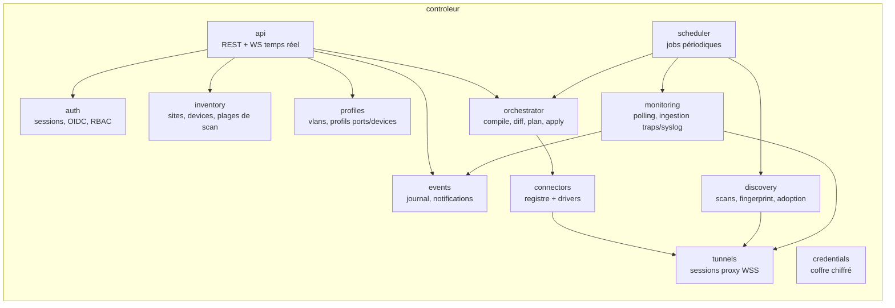

# Contrôleur

Serveur central, **monolithe modulaire en Go** (pas de microservices au départ — voir [[Points durs et risques]]). Un seul binaire qui sert l'API, le frontend (fichiers embarqués via `embed.FS`), les tunnels proxy et l'orchestration. Déployé en conteneur ou binaire nu, scalable verticalement d'abord.

## Modules internes (packages Go) — la CIBLE

> [!note] Le découpage ci-dessous est une cible, et les noms n'ont pas survécu
> Aucun des paquets `inventory`, `profiles`, `orchestrator`, `connectors`,
> `monitoring`, `events`, `credentials` ni `scheduler` n'existe sous ce nom. Ce
> n'est pas seulement un renommage : trois de ces cases sont **vides**, et deux
> autres ont atterri ailleurs que là où le schéma les place. La table de
> correspondance qui suit le diagramme dit lesquelles — la garder est ce qui
> permet de savoir, quand on extraira un paquet, de quelle case il vient.



```
cmd/controller/main.go
internal/
  api/          # handlers HTTP (chi ou echo), hub WebSocket UI
  auth/         # sessions, OIDC, RBAC middleware
  inventory/    # sites, devices, plages de scan, candidats, adoption
  profiles/     # vlans, profils de ports / d'équipements, résolution d'héritage
  orchestrator/ # compile → read → diff → plan → apply, file de jobs
  connectors/   # interface Driver + un package par plateforme
  tunnels/      # serveur WSS, multiplexage, ProxyHandle
  discovery/    # pipeline scan → fingerprint → adoption
  monitoring/   # polling SNMP, ingestion syslog/traps
  events/       # journal, dédup, notifications
  credentials/  # chiffrement enveloppe, essais ordonnés
  store/        # accès PostgreSQL (sqlc ou pgx), migrations
web/            # SPA React, embarquée dans le binaire (go:embed)
```

### Où c'est réellement, et ce qui est vide

| Case de la cible | Réalité | État |
|---|---|---|
| `api` | `internal/api` — **chi**, une quarantaine de fichiers de handlers | **livré** |
| `auth` | `internal/auth` (sessions, mots de passe) + `internal/secretbox` (chiffrement) | **livré** ; OIDC **ouvert** |
| `inventory` | dilué : `internal/store` pour la persistance, `internal/api/devices_handlers.go` / `sites_handlers.go` / `discovery_handlers.go` pour les gestes | **livré**, jamais extrait |
| `profiles` | `internal/portrules` (les règles des [[Profils de switchs]]) + `internal/siteconfig` (le format d'échange) ; les profils de port et d'équipement sont du `jsonb` manipulé dans `api` | **livré**, éclaté |
| `orchestrator` | **n'existe pas.** Le diff pur est `internal/recon` ; la pose est `internal/api/autoapply.go` ; l'appel au connecteur est direct depuis `api` | **partiel**, voir plus bas |
| `connectors` | `internal/driver` (le contrat) + `internal/driver/instanton` (le seul connecteur) | **livré** |
| `tunnels` | `internal/tunnel` — `Hub` et non `ProxyHandle`, voir plus bas | **livré** |
| `discovery` | `internal/discovery` | **livré** |
| `monitoring` | éclaté à dessein : `internal/snmppoll` (les OID et l'échantillonnage) tourne **dans le proxy** ; `internal/api/watch_handlers.go` décide des listes et des cadences ; `internal/tsdb` écrit les séries ; `internal/api/portevents.go` corrèle | **livré** pour SNMP et traps, **rien** pour le syslog |
| `events` | `internal/store/events.go` + `internal/api/events_handlers.go`. La corrélation de battement est **en mémoire** (`portevents.go`), jamais en base | **livré** |
| `credentials` | `internal/secretbox`, `internal/store/sitecreds.go`, `internal/pwgen`, `internal/tagging` (la portée par étiquette) | **livré** |
| `scheduler` | **case vide.** Il n'existe aucun ordonnanceur — voir la section dédiée | **ouvert** |
| `store` | `internal/store`, **pgx** et migrations SQL numérotées (pas de sqlc) | **livré** |
| `web/` | `web/` en React + TypeScript, embarquée par `//go:embed all:webdist` (`internal/api/spa.go`) | **livré** |

Ne pas avoir extrait `inventory` et `profiles` n'est pas de la dette par négligence : ce sont les deux domaines dont les frontières ont le plus bougé (les étiquettes, les domaines d'adressage, les profils de switch sont tous arrivés après). Figer un paquet autour d'un domaine qui change encore coûte un refactoring par changement. `orchestrator` et `scheduler`, eux, sont vides pour une autre raison — ce sont des décisions, prises ci-dessous.

### api
- REST **écrit à la main** avec `chi`. Il n'y a **ni contrat OpenAPI, ni `oapi-codegen`, ni client TypeScript généré** : les types du frontend sont maintenus à la main dans `web/src`. C'est une dette assumée, dont le prix se paie à chaque ajout de champ — et le bénéfice qu'on n'a pas eu, un client typé gratuit, est exactement ce qui manque quand un `omitempty` change de sens.
- Toutes les routes scopées par site via [[RBAC]] — **livré** (`requireSite`, rôles `viewer` / `operator` / `site_admin`).

> [!warning] Le temps réel est en SSE, pas en WebSocket
> La cible annonçait « un seul WebSocket `/ws/ui`, abonnement par site ». Ce qui est
> livré est **`GET /api/sites/{id}/stream` en Server-Sent Events**, un flux par site
> (`internal/api/live_handlers.go`), et l'écart est délibéré :
>
> - le flux est **strictement descendant**. Le client n'a rien à dire : quand il veut
>   quelque chose, il fait une requête REST, qui lui rend en plus un code d'erreur et
>   un corps typé. Payer une négociation bidirectionnelle pour ne jamais s'en servir
>   est de la complexité sans contrepartie ;
> - le navigateur **reconnecte seul**, au délai que le serveur dicte (champ `retry`).
>   En WebSocket cette boucle est du code applicatif — à écrire, à tester, à ne pas
>   rater ;
> - c'est du **HTTP ordinaire** : même cookie de session, même middleware, même
>   vérification de rôle que le reste de l'API. Un upgrade WebSocket sort du pipeline
>   HTTP et oblige à refaire ce contrôle à la main, ce qui est précisément le genre
>   d'endroit où un droit s'oublie ;
> - un proxy inverse d'entreprise laisse passer une réponse HTTP longue bien plus
>   souvent qu'un upgrade.
>
> Le WebSocket, lui, sert là où le sens remontant existe vraiment : le **tunnel des
> proxys** (`coder/websocket` + yamux). Ce qui **transite** dans le flux SSE est un
> « ce site a changé » et non l'état lui-même — l'écran redemande ce qu'il lui faut,
> ce qui évite d'avoir deux représentations du parc à tenir cohérentes.

### Le pipeline de configuration (ex-`orchestrator`)

Pipeline détaillé dans [[Réconciliation]], qui porte l'état de chaque étape. En résumé :

| Étape de la cible | Réalité | État |
|---|---|---|
| **compile** : profils/groupes + overrides → intent par device | `internal/portrules` produit une configuration de ports depuis les règles d'un profil de switch ; l'héritage complet décrit dans [[Profils et groupes]] n'est pas construit | **partiel** |
| **read** : le connecteur lit et normalise | `instanton.Admin.ReadState` → `devices.observed` | **livré** |
| **diff** : comparaison structurée | `internal/recon`, pur et testé | **livré** |
| **plan** : le connecteur ordonne les opérations | **inexistant comme objet.** L'ordre (créer les VLANs, puis écrire les ports, puis sauver) est **codé en dur dans `ApplyPorts`** | **décidé, non construit** |
| **apply** : dry-run, confirmation, rollback | pose directe avec garde-fous et relecture de vérification ; **ni dry-run, ni rollback** | **partiel** |

> [!warning] Il n'y a pas de file de jobs, et la validation humaine a été retirée
> Pas de table `jobs`, pas de pool de workers, pas de semaphore par site ni par
> proxy — `golang.org/x/sync` n'est même qu'une dépendance indirecte. Ce qui tient le
> rôle est plus petit et vit dans `internal/api/autoapply.go` : un **regroupement de
> 6 secondes** par équipement (configurer 48 ports déclenche 48 modifications ; sans
> regroupement, 48 poses concurrentes sur un équipement qui n'accepte que 5 sessions)
> et un **verrou par équipement** qui interdit deux poses simultanées.
>
> Et la validation explicite du §5 de [[Réconciliation]] a été **retirée
> volontairement** : *configurer quarante-huit ports dans l'interface EST
> l'approbation*. La demander deux fois, sur un produit dont la promesse est
> d'administrer le parc, laisse durablement un parc différent de ce que l'écran
> affiche. Ce que ça n'autorise pas pour autant : lever les garde-fous d'écriture, ni
> rejouer un échec en boucle — une tentative par changement, un événement si elle
> échoue, et l'équipement reste visiblement « en cours ».
>
> Ce que la file de jobs achèterait quand elle arrivera : la reprise après
> redémarrage du contrôleur (aujourd'hui une salve en attente est perdue) et le
> bornage de la charge sur un déploiement de parc entier. Ni l'un ni l'autre ne se
> simule avec un `time.AfterFunc`.

### tunnels (Tunnel Manager)
- Termine les connexions WSS entrantes des proxys, authentification d'enrollment ([[Sécurité du proxy]]) — **livré**.
- Heartbeat, détection de déconnexion, statut proxy dans l'UI — **livré** (`proxies.last_seen`, événements `proxy.connected` / `proxy.disconnected`).

L'interface uniforme visée était celle-ci :

```go
type ProxyHandle interface {
    DialTCP(ctx context.Context, host string, port int) (net.Conn, error) // SSH/Telnet/HTTP tunnelisés
    SNMP(ctx context.Context, op SnmpOp) (SnmpResult, error)              // exécuté côté proxy
    Scan(ctx context.Context, spec ScanSpec) (<-chan ScanHit, error)      // ARP/ICMP/ports
    Events() <-chan ProxyEvent                                            // syslog/traps/statut listeners
}
```

Ce type **n'existe pas**. La surface réelle est celle de `*tunnel.Hub`, adressée par identifiant de proxy plutôt que par poignée, et son jeu de méthodes dit une architecture différente — plus fidèle, d'ailleurs, à ce qu'on a appris :

| Méthode visée | Réalité | Pourquoi la forme a changé |
|---|---|---|
| `DialTCP` | `Hub.Dial(ctx, proxyID, host, port) (net.Conn, error)` | **livré**, et la propriété qui compte est intacte : c'est un `net.Conn`. Les connecteurs reçoivent un `driver.Dialer` (`internal/driver/webfetch.go`) et `nil` signifie « direct » |
| `SNMP(op)` | **rien de tel.** Le polling n'est pas un appel : c'est `Hub.PushWatch(proxyID, WatchConfig)`, une **consigne** que le proxy exécute en boucle | Un appel SNMP par cycle traverserait le WAN en UDP à chaque OID. Le contrôleur décide de la liste et des cadences, le proxy exécute |
| `Scan(spec)` | **rien de tel.** Le balayage de découverte tourne **sur le contrôleur** et tunnelise ses connexions TCP (`discovery.Scan` + `Hub.Dial`) ; le proxy, lui, fait un balayage **ICMP de surveillance** de ses plages, via la même `WatchConfig` | Deux besoins différents qu'un `Scan` unique confondait : identifier (TCP, bannières, HTTP, authentification — donc de l'intelligence de plateforme) et *constater qu'une adresse répond* (ICMP, aucune intelligence) |
| `Events()` | `Hub.AcceptEvents(proxyID, handler)` — canal montant de **transitions** | **livré**. Idem : on ne remonte pas un état, on remonte un changement |
| *(absent de la cible)* | `Hub.Ask(ctx, proxyID, AskRequest)` — question ponctuelle, lecture seule | Le motif qui manquait : certains faits ne sont connaissables **que** depuis le proxy (`snmp_walk`, `source_addr`) et aucun des deux canaux longue durée ne sait les demander |

Le **proxy interne** n'implémente pas cette surface : il n'en couvre que le dial, par un `Dialer` nul. Conséquence à ne pas perdre de vue, développée dans [[Vue d'ensemble]] : un équipement joignable seulement par le contrôleur est administrable mais **pas supervisé**.

### scheduler — la case est vide, et il faut le dire

Aucun ordonnanceur n'existe. Ce qui tourne périodiquement, et c'est tout :

| Tâche | Où | Cadence |
|---|---|---|
| Purge des sessions expirées, purge des candidats jamais adoptés depuis 30 j | goroutine de `cmd/controller/main.go` | 1 h |
| Clôture des battements de port calmés (une **fin** de battement se constate à l'absence d'événement : il faut une horloge) | `Server.sweepPortFlaps` | 30 s |
| Rotation de la clé d'instance | `cmd/controller/rekey.go` | à la demande |
| Surveillance ICMP, polling SNMP, balayage des plages | **dans le proxy**, sur consigne | 1 s / 5–30 s / 10 min |

Ce que la cible annonçait et qui **n'existe pas** : re-scan périodique de découverte, **relecture quotidienne du parc pour détecter la dérive** (la relecture est un geste manuel, `POST /api/devices/{id}/read-state`, ou une conséquence d'une pose), **sauvegarde des configurations** façon Oxidized ([[État de l'art]]), purge des événements. La détection de dérive est la plus coûteuse de ces absences : le mécanisme d'arbitrage est entièrement livré ([[Réconciliation]]) mais **personne ne déclenche la lecture qui l'alimente**.

## Points d'attention

- **Un net.Conn partout** : toute I/O équipement passe par un `driver.Dialer` — `Hub.Dial` pour un proxy distant, `nil` pour du direct. C'est LA frontière d'abstraction du système ; ne jamais la contourner. Le nom a changé (`ProxyHandle.DialTCP` → `driver.Dialer`), la règle non.
- **Timeouts et contextes** : chaque opération équipement porte un `context.Context` avec deadline — **livré**, y compris pour la pose automatique, qui se donne un contexte propre parce que la requête HTTP qui l'a déclenchée est terminée depuis longtemps.
- **Multi-instance plus tard** : les sessions proxy sont sticky par instance ; passage en N instances = routage des appels au `Hub` via un bus. À ne PAS construire au MVP — **et l'adressage par `proxyID` plutôt que par poignée le rend plutôt plus facile** : c'est déjà une clé qu'un bus saurait router.
- Les connecteurs s'exécutent dans le processus du contrôleur derrière des timeouts, mais **ni semaphore ni `recover()` dédiés** : le seul filet est `middleware.Recoverer`, qui ne couvre que le chemin HTTP — une panique dans la goroutine de pose automatique tuerait le contrôleur. C'est un des arguments de l'extraction des connecteurs en greffons hors-processus ([[Connecteurs]], § *Les connecteurs comme greffons*), volontairement reportée jusqu'à ce qu'un deuxième vendor existe.
