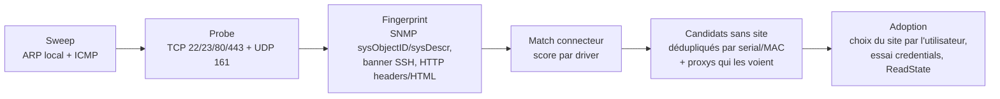

# Discovery — découverte automatique

L'utilisateur déclare des **plages à scanner** sur un [[Proxy]] (ou sur le proxy interne du contrôleur pour les réseaux directement joignables). Le pipeline découvre les équipements, les identifie, et les propose à l'**adoption** — le geste UniFi que l'on reprend.

> [!important] Un candidat n'appartient à personne
> Une plage de scan appartient au proxy qui sait l'atteindre, **pas à un site**.
> Un équipement peut donc être découvert **depuis n'importe quel proxy**, et ce
> qui sort de la découverte est un *candidat sans site*. Le site est choisi
> **à l'adoption**, par l'utilisateur — c'est le seul moment où un équipement
> acquiert un site. Le proxy découvreur n'est qu'un témoin : il ne devient pas
> propriétaire de l'équipement (cf. [[Proxy]], § *La joignabilité est un fait
> observé, pas un rattachement*).
>
> **Livré**, et la règle est tenue là où elle compte : le site ne se déduit jamais du
> proxy. Une nuance factuelle cependant, parce que « témoin » est un peu généreux
> aujourd'hui : faute de chemins d'accès, `proxyOf` retient le proxy du candidat
> d'origine comme **chemin par défaut** de toutes les opérations ultérieures sur
> l'équipement. Il ne le possède pas — aucun droit, aucun site n'en découle — mais il
> est de fait le seul chemin essayé (callout § *Adoption*).

## Pipeline — la CIBLE

1. **Sweep** — *cible : exécuté côté proxy*. En réalité le balayage tourne **sur le contrôleur** et tunnelise ses connexions TCP par le proxy choisi (`discovery.Scan` + `tunnel.Hub.Dial`) : il n'existe pas de RPC `scan`. La conséquence est visible — c'est du **TCP seulement** : ni ARP, ni ICMP, donc rien de ce qui filtre les six ports sondés. Le proxy, lui, balaye bien ses plages en **ICMP**, mais pour la *surveillance* et non pour la découverte : un `host.seen` ne crée aucun candidat (§ *Ce qui est implémenté aujourd'hui*).
2. **Probe** : ports caractéristiques — 22 (SSH), 23 (Telnet), 80/443 et 8080/8443 (web). **Livré.** Le 161/udp n'est **pas** sondé, faute de chemin SNMP dans la découverte, et l'**OUI de la MAC** n'est pas exploité : sans ARP, on n'a pas la MAC.
3. **Fingerprint** — par ordre de fiabilité voulu :
   - **SNMP** `sysObjectID` + `sysDescr` + `sysName` : le plus fiable, et **non construit**. Le contrat prévoit la place (`driver.Evidence.SysDescr` / `SysObjectID`) mais rien ne la remplit — la découverte n'ouvre aucune session SNMP. Ce n'est plus un problème de protocole depuis que la question `snmp_walk` existe ([[Protocole contrôleur-proxy]]) : c'est un lot de découverte à écrire, et il rendrait la reconnaissance certaine là où la regex sur un titre HTML reste un pari ;
   - **banner SSH** (`SSH-2.0-Cisco-1.25`…) et sortie de commande post-login si un identifiant fonctionne — **livré** ;
   - **HTTP** : en-tête `Server` et titre de page — **livré**. S'y ajoute désormais la **lecture d'une page authentifiée** quand un identifiant web passe (§ *Identifiants de découverte*) : c'est l'équipement qui parle de lui-même, derrière une authentification qu'il a lui-même exigée, et la confiance monte à `ConfDeviceSelfReport` — mais **seulement si la page apporte un fait nouveau**. Réussir à se connecter ne prouve pas qu'on a mieux identifié l'équipement, et une confiance qui monte sans fait nouveau est un mensonge tranquille. Le hash de favicon et les chemins caractéristiques restent une cible ; c'est souvent le seul indice des switchs web-only, et le connecteur `instanton` compense par un point d'enrichissement (§ *Ce que l'essai contre l'équipement réel a appris* de [[Connecteurs]]).
4. **Match** — **livré, mais pas par les connecteurs.** L'identification se fait sur une **table de motifs vivant dans la découverte** (`internal/discovery/fingerprint.go`) : une quinzaine de plateformes reconnues par expression régulière sur la bannière, le titre ou la sortie de commande, l'ordre du tableau tranchant les recouvrements (Instant On **avant** les entrées HPE/Aruba génériques, sinon `hpe-procurve` attraperait la gamme). Chaque entrée porte en plus les commandes de pagination, d'identification et d'export de configuration de sa plateforme. À défaut, `generic-ssh` / `generic-http` : l'équipement apparaît quand même, non identifié plutôt que rangé de force dans une gamme.

   Le connecteur intervient **après**, par un point d'enrichissement qui précise ce que la sonde générique ne sait pas voir — modèle exact, série, façade. C'est du savoir de plateforme, et il n'a rien à faire dans une sonde générique. Un enrichissement raté ne fait pas échouer la découverte ; il laisse une note explicite, parce qu'on doit pouvoir distinguer « le connecteur n'a rien à dire » de « le connecteur n'a pas pu parler à l'équipement ».

   > [!note] `Driver.Fingerprint` et `driver.Best` ne sont appelés par personne
   > La cible veut que chaque connecteur réponde « cet équipement est-il pour moi ? »
   > et que le registre retienne le meilleur score au-dessus d'un seuil. Les deux
   > existent au contrat (`internal/driver/driver.go`) et `instanton` implémente
   > `Fingerprint` — mais **aucun chemin de production ne les appelle** : le registre
   > n'est consulté que par `driver.Get(nom)`, pour lire des capabilities une fois le
   > nom du driver déjà connu.
   >
   > Ce n'est pas grave aujourd'hui, avec un seul connecteur : sa reconnaissance est
   > dans la table de la découverte, et elle marche. Ça le devient au deuxième — deux
   > tables de vérité pour la même question finiront par se contredire, et c'est celle
   > que l'exploitant ne voit pas qui gagnera. Le regroupement est facile (les motifs
   > sont déjà des données) et n'attend qu'une décision : la table déménage dans les
   > connecteurs, ou `Fingerprint` disparaît du contrat. Le laisser au contrat sans
   > l'appeler est le seul choix qui coûte les deux.

   La promesse « monitoring SNMP possible sans configuration » pour un équipement non identifié reste une **cible** : sans connecteur, il n'y a ni plancher de cadence ni identité SNMP à poser. Le repli existe pour la moitié cadence — `unknownFloorInterval`, 60 s, ni 5 s qui parierait sur le plan de contrôle d'un équipement qu'on ne connaît pas, ni rien du tout qui priverait de supervision les équipements les moins bien connus.
5. **Adoption** (action utilisateur ; une règle d'auto-adoption par plage devrait alors nommer le site cible explicitement — **non construite**) :
   - **choix du site** — c'est l'essence du geste : le candidat n'en avait pas. **Livré**, et le droit est vérifié sur *ce* site ;
   - nom et emplacement, proposés depuis le fingerprint et modifiables — **livré**. Le **groupe** n'est pas proposé à l'adoption ; ce qui l'est, c'est l'**étiquetage automatique** (`autoTagDevice`), qui joue le même rôle de rangement ;
   - **reprise de la façade physique** relevée par le connecteur : sans elle, l'adoption en mode « pousser » produisait un équipement **sans aucun port**, ce qui n'est pas « vierge » mais faux. **Livré** ;
   - choix entre configuration **poussée** et **import de la configuration lue** (dialectes `ios` / `comware`) — **livré** ;
   - **provisionnement de l'identité SNMP puis du destinataire de traps** — **livré** (`provisionSNMP`), et **automatique, pas proposé** : adopter un équipement, c'est le rendre administrable *et* observable. Laisser la supervision à un second geste manuel garantit un parc à moitié supervisé dont chaque oubli est invisible — un équipement muet se supervise quand même par polling, seulement trente secondes plus tard. Un échec ne fait jamais échouer l'adoption : il se journalise et se rejoue.

   Deux étapes de la cible **ne sont pas** faites à l'adoption, et il vaut mieux savoir où elles sont :

   - l'**essai ordonné des [[Credentials]] du site** est un geste séparé, `POST /api/devices/{id}/credentials/apply`. Ce que l'adoption utilise, ce sont les identifiants **standards de l'instance** essayés pendant la découverte ;
   - le **`ReadState` complet** est un geste séparé lui aussi, `POST /api/devices/{id}/read-state`. Un équipement fraîchement adopté a donc `observed_at` à nul — et [[Réconciliation]] le range en `unknown`, ce qui est la vérité.

> [!warning] Les « chemins d'accès observés » n'existent pas encore
> La cible veut que les proxys qui voient l'équipement soient enregistrés comme
> chemins d'accès, sans qu'aucun n'en devienne propriétaire. Ce qui existe est plus
> étroit : `discovery_sightings` recense bien les proxys qui ont vu un **candidat**,
> avec latence et date, et l'écran le montre — mais **rien n'en survit à
> l'adoption**. Il n'y a pas de table `device_paths`, et le chemin d'une opération
> sur un équipement adopté est choisi par `proxyOf` : le proxy du candidat d'origine,
> à défaut « Local ». Aucune comparaison de latence, aucune bascule sur échec.
>
> Le corollaire est celui qui compte pour l'exploitation : la promesse « un proxy qui
> tombe ne rend pas ses équipements inaccessibles s'ils sont joignables autrement »
> n'est pas tenue aujourd'hui. Et ce qui a été livré à la place va dans l'autre sens
> — `devices.proxy_id` **désigne** un collecteur de référence (migration `0022`,
> [[Proxy]]). Les deux ne se contredisent pas : l'un dit ce qu'on **peut** joindre,
> l'autre lequel des éligibles **doit** collecter. Mais seul le second est construit.

## Cas particuliers

- **Équipement joignable par plusieurs proxys** : ce n'est pas un conflit mais le cas normal, et c'est même souhaitable — l'équipement a plusieurs chemins d'accès. Les observations sont **fusionnées** en un seul candidat (clé : serial, à défaut MAC), qui liste les proxys qui l'ont vu avec leur latence. Rien à choisir pour l'utilisateur, sinon le site à l'adoption.
- **Même IP vue par deux proxys** : l'ambiguïté est réelle et ne se devine pas. `192.168.1.0/24` derrière deux proxys peut être deux réseaux étrangers l'un à l'autre (RFC 1918 se recoupe d'un site à l'autre) **ou** un seul réseau atteint par deux chemins, et rien de ce que meshcraft observe ne distingue les deux cas. La réponse est donc **déclarée** : le **domaine d'adressage** (table `address_domains`, migration 0020, décision dans `internal/netscope`) est l'espace dans lequel une adresse désigne une machine et une seule. Le repli de la clé de fusion est `(domaine, IP)`, jamais `(proxy, IP)`. Par défaut chaque proxy a son propre domaine — donc « réseaux distincts » — et le rapprochement est un geste explicite de l'opérateur. Le sujet a sa note : [[Domaines d'adressage]].
- **Un candidat qui ACQUIERT un numéro de série** (le connecteur l'a relevé au second passage) change de clé de fusion : la première observation, rangée sous `(domaine, ip)`, doit être **absorbée** — sinon le même équipement apparaît deux fois, une fois identifié et une fois anonyme. Constaté en test réel.
- **Conflits d'inventaire** : ré-identification par **numéro de série** → un remplacement de switch à IP identique est détecté comme *nouvel* équipement, pas comme le même. **Livré**, mais la source du numéro de série n'est pas celle annoncée : ni `entPhysical` (pas de SNMP dans la découverte) ni `show version` en général, mais ce que le **connecteur** sait relever — sur un Instant On, le champ caché `rlPhdUnitGenParamSerialNum` de la page de connexion, lisible **sans authentification** ([[Connecteurs]]). Un équipement dont aucun connecteur ne sait tirer de série retombe sur la clé `(domaine, IP)`, ce qui est justement le cas que le point précédent traite.
- **Re-scan périodique** : **non construit**, faute de scheduler ([[Contrôleur]], § *scheduler*). Un balayage est un geste (`POST /api/discovery/prefixes/{id}/scan`). Deux corrections de détail qui évitent de chercher ce qui n'existe pas : l'événement s'appelle `discovery.scanned` et non `device.discovered` — ce dernier **n'est jamais écrit** ([[Journal d'événements]]) ; et le passage en `unreachable` vient de la **surveillance ICMP du proxy** après 3 pertes consécutives, pas d'échecs de polling. Ce qui est purgé automatiquement, ce sont les **candidats** jamais adoptés depuis 30 jours — jamais un équipement du parc.
- **LLDP comme source de discovery** — *cible, et la moitié qui manquait est livrée*. La **collecte** existe depuis le 29/07/2026 ([[Voisinage LLDP]]) : les voisins sont relevés en SNMP par le proxy, rangés dans `lldp_neighbors`, et un voisin dont le châssis n'est dans aucun équipement du parc remonte **explicitement** comme tel — avec son châssis, son nom système et son `sysDescr`. Sur le parc de référence, trois équipements sont dans ce cas (un RB5009UG, un CRS305, un S3900). Ce qui reste *cible* est le **geste** : rien ne fabrique de candidat de découverte à partir d'un voisin, et [[Weathermap]] le liste sans le tracer ni proposer de l'adopter. Le lien est donc désormais **visible sans être actionnable** — un pas de plus qu'avant, où il était invisible. `link.created` / `link.deleted` restent des liaisons **saisies** ([[Journal d'événements]]), et le voisinage ne produit toujours aucun événement.
- **Équipement incapable de porter le VLAN de management du site** (bas de gamme limité au VLAN 1, ou à l'untagged) : l'adoption dans le plan du site devrait être **refusée**, avec la raison et les portes de sortie — conserver l'adressage existant en assumant l'écart, ou changer le plan du site ([[Adressage de management]]). Pousser ce VLAN rendrait l'équipement injoignable. **Décidé, non construit** : le drapeau `site_mgmt_plan.strict_plan` existe en base et dans `model.MgmtPlan`, mais **aucun code ne le lit** — l'adoption ne compare rien aux `Mgmt` capabilities du connecteur. Le garde-fou qui existe vraiment est ailleurs et arrive **plus tard** : `mgmtPathOf` refuse la *bascule* de management vers un VLAN qu'aucun uplink actif ne transporte (`internal/api/conformity.go`). Autrement dit on empêche aujourd'hui de perdre un équipement, pas de l'adopter dans un plan qu'il ne sait pas porter — et la seconde protection est celle qui éviterait la première situation.
- **IPv6** : un `/64` ne se balaye pas (2⁶⁴ adresses). La découverte v6 passera par la table de voisinage du segment local (Neighbor Discovery, `ff02::1`), LLDP/SNMP et l'ajout manuel par adresse — **cible**, aucun de ces chemins n'existe, et la surveillance ICMP elle-même est en v4 seulement. Ce qui est **livré** est la moitié qui décide : un préfixe v6 large est **déclarable** (c'est la vérité de l'adressage du site) mais son **énumération** est refusée avec sa raison (`discovery.Enumerable`, plancher `/112`) ; un `/120` de management se balaye très bien. La nuance par rapport à la rédaction précédente compte : le refus est au **balayage**, pas à la saisie — *déclarer* une plage et *savoir la parcourir* sont deux questions, et la stratégie de découverte se choisit au moment du balayage. Détails dans [[Déploiement Docker et IPv6]].

## Trois portes d'entrée, un seul pipeline

L'interface expose la découverte par une section dédiée ([[Interface web]]), mais tout aboutit au même fingerprint et à la même file de candidats :

1. **Balayage automatique** des plages déclarées sur un proxy.
2. **Ajout manuel par IP** : même sonde, sur une seule adresse, avec le choix de l'identifiant — tous ceux de l'instance par priorité, **un seul** d'entre eux (`credential_id`), ou un identifiant ponctuel non enregistré — et la possibilité de forcer le type d'équipement.
3. **Ajout par port série** : le navigateur ouvre le port série (Web Serial API, Chromium + HTTPS) et le contrôleur ne reçoit que le texte capturé. C'est la porte des équipements neufs ou réinitialisés, qui n'ont pas encore d'IP joignable.

> [!warning] Cette porte n'existe pas sur tous les équipements
> Certaines gammes n'ont **aucun port série** — c'est le cas des Aruba Instant On
> 1930 ([[Connecteurs]]). Pour elles, l'ajout par console est impossible et le
> seul recours en cas de perte d'accès est le bouton reset. Le connecteur le
> déclare (`SerialPort: false`), et l'UI doit cesser de proposer une porte qui
> n'existe pas plutôt que de laisser l'opérateur chercher un connecteur qu'il
> n'aura jamais.

## Identifiants de découverte

Ce sont les couples utilisateur/mot de passe essayés sur un équipement **que
meshcraft ne gère pas encore**. Ils appartiennent à l'**instance** et non à un
site — la découverte précède le choix du site — et se règlent dans la
configuration globale, `/config/identifiants` (global-admin). Ils ont longtemps
vécu dans le menu « Ajouter un équipement » d'un site : personne ne les y
cherchait, et l'exploitant ressaisissait son mot de passe à chaque sonde. Ne pas
les confondre avec les [[Credentials]] **posés** sur les équipements d'un site,
qui sont un autre sujet et un autre écran.

Ils sont essayés **par ordre de priorité**, et le genre déclaré dit sur quel
transport :

| Genre | Essayé | Par quel moyen |
|---|---|---|
| `any` | **oui** | SSH puis interface web. Le même couple ouvre souvent les deux — le faire saisir deux fois n'aurait pas de sens |
| `ssh` | **oui** | session SSH (algorithmes anciens acceptés), puis commande d'identification de la plateforme |
| `http` | **oui** | en-tête `Authorization` sur l'interface web, en **lecture seule**, dans le schéma que l'équipement annonce dans son `WWW-Authenticate` (`driver.AuthAuto`) — Basic ou Digest |
| `telnet` | **non** | rien. Voir ci-dessous : l'absence est déclarée, pas laissée au silence |

Le genre vide est celui de l'identifiant **ponctuel** saisi à l'ajout par IP : il
vaut pour tous les transports essayés. Celui qui tape un mot de passe pour « ce
switch-là » n'a pas à deviner par où meshcraft va entrer — et c'était bien le
défaut : forcé à `ssh`, ce couple n'était jamais présenté à une gamme web-only.

### Les trois issues d'un essai web

Elles sont trois et non deux, parce qu'elles n'appellent pas le même geste :

1. **Authentification acceptée** (`web_auth: ok`) — l'identifiant retenu est nommé
   dans le résultat de sonde (`credential_name`), et la page lue sert à
   l'identification.
2. **Identifiants refusés** (`refused`) — l'équipement a **redemandé** à
   s'authentifier après avoir vu nos identifiants. C'est là, et seulement là, qu'il
   y a un mot de passe à corriger.
3. **Cette interface n'authentifie pas au niveau HTTP** (`no-http-auth`) — aucune
   page essayée ne répond 401 : **aucun identifiant n'a été présenté à personne**.
   C'est le cas des UI à **formulaire de connexion**, l'Aruba Instant On en tête :
   200 à l'anonyme, session dans un cookie après le POST d'un formulaire dont il
   faut connaître l'URL et les champs. Rien de cela ne se devine depuis une sonde
   générique — c'est le travail d'un [[Connecteurs|connecteur]]. Faire passer cette
   limite pour un refus enverrait chercher un mauvais mot de passe pendant des
   heures.

S'y ajoute `error` : essai non abouti (lien coupé, TLS refusé, schéma
d'authentification que `driver.WebSession` ne sait pas présenter). Ni un refus, ni
une absence.

> [!note] La racine ne suffit pas, et c'est vérifié
> SwOS **et** RouterOS servent leur page d'accueil en 200 à un anonyme, et
> n'exigent l'authentification que sur leurs pages de **données** (`/sys.b` en
> Digest, `/rest/system/resource` en Basic). S'en tenir à `/` aurait donc conclu
> « cette interface n'authentifie pas » sur les deux équipements que ce lot
> débloque. La sonde porte donc une petite table `driver → chemins qui
> authentifient` (`internal/discovery/probe.go`), avec la même faiblesse que la
> table de motifs de `fingerprint.go` : c'est du savoir de plateforme rangé dans
> une sonde générique, et sa place définitive est dans le connecteur. En attendant,
> l'avoir là est la différence entre un identifiant essayé et un identifiant
> décoratif. Pour un équipement non reconnu, on n'essaie **que** la racine :
> deviner des chemins, ce serait balayer l'équipement à l'aveugle.

> [!warning] Le genre `telnet` n'est pas essayé, et l'écran le dit
> meshcraft n'embarque pas de client telnet. S'authentifier en telnet est un
> dialogue d'invites à l'aveugle où un refus ne se distingue pas d'une invite
> lente : on ne saurait donc pas **compter** les échecs, et la protection contre le
> verrouillage de compte (§ *Garde-fous*) ne tiendrait plus. Un identifiant telnet
> reste enregistrable — l'écran le marque « non essayé », et la sonde le signale
> dans ses **remarques** dès qu'elle rencontre un équipement dont le port 23 est
> ouvert. La règle est celle du projet : l'absence se déclare.

> [!important] Un secret devenu illisible
> Un identifiant dont le secret ne se déchiffre plus avec la clé d'instance
> courante est **écarté en silence** par la découverte — et elle a raison de ne pas
> échouer entièrement pour un identifiant sur cinq. Le résultat est pourtant une
> ligne qui existe en base, s'affiche comme les autres, secret « enregistré »
> compris, et n'est **jamais** essayée. L'écran des identifiants de découverte est
> le seul endroit où ça puisse se voir : il marque ces lignes « illisible — clé
> changée ». L'empreinte de clé (migration `0024`) rend le cas rare, pas
> impossible : elle empêche de démarrer avec une autre clé, elle ne répare pas les
> lignes scellées avant qu'elle n'existe.

## Ce qui est implémenté aujourd'hui

Pour ne pas confondre la cible et l'état réel :

| Étape | État |
|---|---|
| Sweep TCP (22/23/80/443/8080/8443), latence, transports | **livré** — parallélisme adapté à la taille de la plage (24 / 96 / 192) |
| Balayage **par un proxy distant** | **livré** — tunnel WSS + yamux ([[Protocole contrôleur-proxy]]). La restriction « proxy Local uniquement » de la rédaction précédente n'a plus lieu d'être ; il en reste un commentaire périmé dans `handleRunScan`, qui annonce un `501` que le code ne renvoie plus |
| Bannière SSH, en-tête + titre HTTP/HTTPS | **livré** |
| Session SSH avec les identifiants de découverte, sortie de la commande de version | **livré** (algorithmes anciens acceptés : sans eux une partie du parc réel est injoignable) ; arrêt après **2 échecs sur un hôte**, pour ne pas déclencher les verrouillages AAA |
| **Essai des identifiants sur l'interface web** (Basic / Digest, lecture seule) | **livré** — `driver.WebSession` + `SetAuth(AuthAuto, …)`, après SSH et seulement si SSH n'a rien ouvert. Trois issues distinctes, dont « cette interface n'authentifie pas au niveau HTTP » (§ *Identifiants de découverte*) |
| Essai des identifiants en **telnet** | **non fait, et déclaré comme tel** — pas de client telnet ; l'écran le marque « non essayé » et la sonde le signale sur un équipement dont le 23 est ouvert |
| Choix d'un identifiant **enregistré** pour une sonde ponctuelle | **livré** — `credential_id` sur `POST /api/discovery/probe` : un mot de passe déjà confié à l'instance ne se ressaisit pas |
| Match de driver + confiance + source de l'indice | **livré** — table de motifs dans `internal/discovery/fingerprint.go`, et **non** par `Driver.Fingerprint`, qui n'est appelé par personne (callout de l'étape 4) |
| Enrichissement par le connecteur après identification (modèle exact, série, façade) | **livré** — la sonde générique reste ignorante des particularités constructeur ([[Connecteurs]]) |
| Lecture et **import** de la configuration (VLANs, ports, façade) | **livré**, dialectes `ios` et `comware` |
| Domaine d'adressage comme repli de la clé de fusion | **livré** — table `address_domains`, migration `0020`, `internal/netscope` ([[Domaines d'adressage]]) |
| Ajout manuel par IP, ajout par port série, sonde ponctuelle | **livré** — `POST /api/discovery/probe`, `/serial`, `/parse-config` |
| Procédures de réinitialisation cherchables | **livré** — `GET /api/discovery/reset-procedures` |
| Prise en main d'un équipement pas encore adopté (« Configure Locally ») | **livré** pour la famille Instant On — `POST /api/discovery/onboard`, global-admin, et c'est une **écriture** : voir les garde-fous |
| **Écriture de configuration par connecteur** | **livré** sur `instanton` — création de VLANs, appartenance VLAN des ports, identité SNMP, destinataire de traps, compte d'administration, bascule du VLAN de management. Ce que ce connecteur ne pose **pas** : PoE et spanning-tree (`WritableExtras` est vide, et documenté comme tel) |
| Sweep **ARP** | **à faire** — et c'est la plus coûteuse des absences de cette liste : un équipement qui filtre ICMP *et* n'ouvre aucun des six ports sondés est aujourd'hui invisible |
| Sweep **ICMP** dans le pipeline de découverte | **à faire.** Le proxy balaye pourtant ses plages en ICMP toutes les 10 min et remonte `host.seen` / `sweep.done` — mais le contrôleur les **journalise sans créer de candidat** : répondre au ping ne dit rien de ce qu'est un équipement, et le balayage d'identification reste un geste explicite. Ce qui manque n'est donc pas la mesure, c'est de la brancher sur la file de candidats |
| Fingerprint **SNMP** (`sysObjectID`, `sysDescr`) | **à faire** — plus de verrou de protocole depuis la question `snmp_walk` |
| Re-scan périodique, découverte IPv6 | **à faire** ([[Roadmap]]) |
| LLDP comme source | **collecte livrée** ([[Voisinage LLDP]]), **adoption d'un voisin fantôme à faire** |

## Réinitialisation d'un équipement

La procédure de retour usine est une connaissance de plateforme : elle appartient donc au **driver**, comme la commande qui lit la configuration. Chaque driver déclare deux chemins — par la CLI quand l'accès administrateur est conservé, par le matériel quand il est perdu — ce qui est réellement effacé, et les pièges connus. L'interface les rend cherchables par constructeur, gamme ou référence. Les procédures dont le geste varie d'un modèle à l'autre sont marquées comme à confirmer sur la fiche produit : une procédure de reset erronée coûte au mieux du temps, au pire l'accès à l'équipement.

## Garde-fous

- **Débit du balayage borné, mais pas réglable.** Le parallélisme est **dérivé de la taille de la plage** — 24 connexions sur un `/24`, 96 au-delà de 1 024 adresses, 192 au-delà de 8 192 (`discovery.ConcurrencyFor`) — et un budget de temps borne le tout (12 min sur les très grandes plages). Rester poli sur un petit réseau, aller vite sur un grand, sans jamais ressembler à une attaque. Le réglage **par plage** annoncé n'existe pas : c'est une cible, et son intérêt est le lien lent, que la taille du préfixe ne prédit pas.
- **Essais d'identifiants avec verrouillage prudent** — **livré** : `maxAuthFailures = 2`, mais la borne porte sur l'**hôte** et non sur le compte. On s'arrête après deux échecs sur une adresse, même s'il reste des identifiants à essayer, et la borne vaut **aussi sur le chemin web** — la politique AAA d'un équipement compte les échecs toutes origines confondues, et le 401 anonyme qui sert à détecter l'authentification, lui, n'est présenté par personne et ne compte pour rien. C'est plus prudent que la règle annoncée, et pour la bonne raison : ce qu'on protège, c'est le compte de l'équipe réseau sur *cet* équipement, dont la politique AAA compte les échecs toutes origines confondues.
- **Aucune écriture sur l'équipement pendant le balayage.** La sonde ne fait que lire — bannières, en-têtes, une commande de version. Une **exception**, et il faut la nommer plutôt que la laisser démentir la règle : la **prise en main** (`POST /api/discovery/onboard`) écrit sur un équipement pas encore adopté, parce que certaines gammes ne sont pas administrables avant d'avoir été sorties de l'attente de leur portail constructeur. C'est un geste explicite, réservé au global-admin, avec les droits du proxy emprunté, et le connecteur **vérifie l'état avant puis relit après** — pas un effet de bord du balayage.
