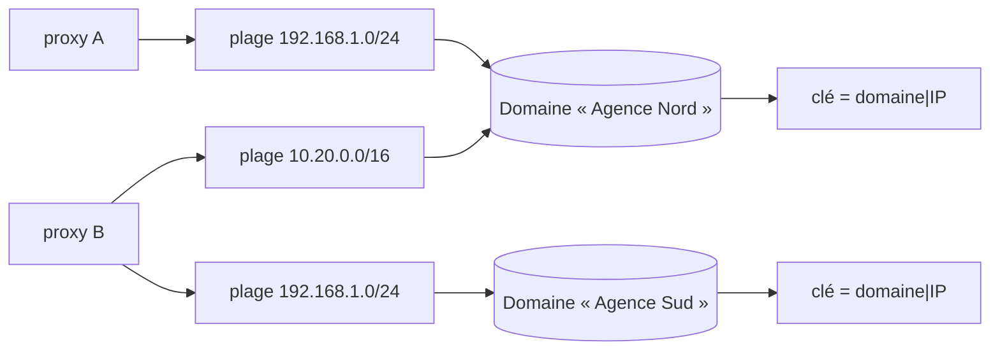

# Domaines d'adressage

Une phrase pose le problème : **`192.168.1.10` n'identifie personne.** L'espace
RFC 1918 se recoupe, et meshcraft administre par nature des réseaux qui ne se
connaissent pas. Deux [[Proxy|proxys]] qui déclarent la même plage peuvent
regarder deux réseaux totalement étrangers l'un à l'autre — ou un seul réseau,
atteint par deux chemins.

Le **domaine d'adressage** est la réponse : l'espace à l'intérieur duquel une
adresse désigne une machine et une seule.

> [!important] Un domaine est DÉCLARÉ, jamais déduit
> Rien de ce que meshcraft observe ne permet de trancher. Deux proxys posés dans
> deux agences en `192.168.1.0/24` voient exactement la même chose que deux
> proxys posés dans une seule agence : mêmes adresses, mêmes empreintes, souvent
> la même passerelle `.1`. La déduction est donc impossible, pas seulement
> difficile.

## Pourquoi le défaut est « réseaux distincts »

Parce que **l'erreur n'est pas symétrique**.

| Erreur | Conséquence | Rattrapage |
|---|---|---|
| Séparer à tort deux vues d'un même réseau | un doublon dans la file d'adoption | un clic |
| Fusionner à tort deux réseaux distincts | deux équipements fondus en une seule fiche | **aucun** |

Une déduction se trompe parfois. Comme le coût des deux erreurs est sans commune
mesure, on exige une déclaration et on retombe toujours du côté prudent.

## Ce que ça répare

Deux défauts bien réels, de gravité très différente.

**La découverte ne pouvait pas fusionner.** La clé d'identité d'un candidat est
`numéro de série → adresse MAC → adresse`. Les deux premiers sont des identités
mondiales ; le troisième était replié sur le couple `(proxy, IP)`. C'était la
moitié prudente de la réponse — deux réseaux distincts restaient distincts — mais
l'autre moitié manquait : deux proxys posés sur **un même** réseau produisaient
deux candidats pour un seul équipement muet, et rien ne pouvait plus jamais les
réunir. Adoption en double à la clé.

**La surveillance attribuait un état au mauvais équipement.** C'est le défaut
grave, et il n'avait aucun garde-fou. `DevicesWatchedBy` renvoie à tout proxy
*global* l'ensemble du parc, et le proxy indexe sa table d'états **par adresse**
(`cmd/proxy/monitor.go`). Deux sites en `192.168.1.0/24` et le proxy reçoit deux
cibles à la même adresse : la seconde écrase la première en silence. L'un des
deux n'est plus jamais surveillé ; l'autre reçoit l'état de la machine qui répond
réellement sur *ce* réseau-là. Un voyant vert sur un switch éteint — pire que pas
de voyant du tout.

> [!note] Le rattachement de la migration `0022` ne remplace pas le domaine
> Un équipement peut désormais désigner son **collecteur de référence**
> (`devices.proxy_id`, [[Monitoring]] § *Choix du point de collecte*), et on
> pourrait croire que ça règle le conflit d'adresse. Non, et il faut voir pourquoi
> les deux mécanismes cohabitent :
>
> - le rattachement restreint les cibles **SNMP** — là où l'unicité est nécessaire
>   parce qu'il faut *une* adresse à écrire dans l'équipement ;
> - il ne restreint **pas** l'ICMP, délibérément : deux pings ne coûtent rien et
>   donnent une meilleure vérité de joignabilité, alors qu'un collecteur unique
>   perd toute bascule si son proxy tombe.
>
> Or c'est précisément la surveillance ICMP qui indexe **par adresse**. Le domaine
> reste donc le seul garde-fou de l'écrasement décrit ci-dessus, et le régime
> `null` — celui de tout le parc au sortir de `0022` — n'est pas concerné par le
> rattachement du tout. L'arbitrage de `SelectWatchTargets` s'applique aux deux
> listes, en amont : il décide **qui existe** à une adresse, avant que le
> rattachement ne décide **qui interroge**.

## Le modèle

Le domaine est porté par la **plage de scan**, pas par le proxy. La granularité
n'est pas un détail : un même client peut avoir un VLAN serveurs mutualisé que
deux proxys atteignent tous les deux, *et* deux LAN bureautiques distincts qui
réutilisent le même plan d'adressage. Un rattachement par proxy ne sait pas
exprimer cette situation, qui est pourtant la situation courante.

Chaque proxy possède en plus un **domaine propre**, celui de tout ce qu'il
observe hors de ses plages déclarées : la sonde manuelle d'une adresse
quelconque, un candidat arrivé par la console série. Sans ce repli, ces
observations n'auraient aucun domaine et retomberaient dans un espace commun où
toutes les adresses privées se confondraient.

La plage la **plus spécifique** l'emporte, comme dans une table de routage :
déclarer `10.0.0.0/16` puis en détacher `10.0.5.0/24` vers un autre domaine
exprime une exception, et une exception doit primer sur la règle générale.

> [!note] Une plage désactivée garde son domaine
> `enabled` ne concerne que le **balayage**. Une plage désactivée reste la
> description d'un réseau réel et continue de répondre à la question « dans quel
> espace vit cette adresse ? ». Sans cela, désactiver un scan ferait basculer les
> candidats déjà connus vers le domaine par défaut du proxy, changerait leur clé
> de fusion, et les dédoublerait au passage suivant.

## L'arbitrage de la surveillance

Quand plusieurs équipements se disputent une adresse pour un même proxy, celui
qui l'emporte est **celui dont le domaine est déclaré sur ce proxy** : le proxy a
une plage dans ce réseau, il est donc légitime pour y répondre.

Si aucun ne l'est, ou si plusieurs le sont, on n'invente pas : **tous** sont
écartés, avec leur motif. Ne rien dire vaut mieux que dire faux — un équipement
non surveillé se voit à l'écran, un état faux ne se voit pas.

Cette exclusion est rendue **visible**, et c'est indispensable : un voyant qui
disparaît sans explication passe pour une panne de meshcraft. Elle apparaît en
bandeau sur la fiche de l'équipement (`devices.watch_excluded`, renseigné à la
lecture), et un événement `watch.excluded` est émis — mais uniquement à la
**transition**, quand plus aucun proxy ne prend l'équipement en charge. La
configuration de surveillance étant recalculée à chaque connexion de proxy,
journaliser à chaque passage noierait le journal ([[Journal d'événements]]).

Deux détails de `internal/api/watchexcl.go` qui font toute la justesse du signal :

- « nouveau » se juge **à l'échelle du parc**, pas du proxy. Un équipement qu'un
  proxy écarte peut être parfaitement surveillé par un autre, et l'annoncer comme
  exclu serait un faux positif — c'est le fonctionnement normal d'un parc à
  plusieurs proxys, pas un incident ;
- un proxy qui se **déconnecte** est oublié. Ses motifs de rejet ne valent plus
  rien puisqu'il ne surveille plus personne, et les garder ferait afficher un
  « non surveillé » sans rapport avec la réalité.

> [!note] L'état d'exclusion vit en mémoire, jamais en base
> Un redémarrage du contrôleur le perd et rejoue une fois les événements à la
> reconnexion des proxys. C'est acceptable, et même utile : le problème, lui, est
> toujours là. Le persister supposerait de décider quand une exclusion périme, ce
> qu'un recalcul à chaque connexion tranche déjà gratuitement.

## Droits

La lecture des domaines est ouverte (`GET /api/discovery/domains`) : il faut
pouvoir en choisir un en déclarant une plage. Leur **création**, leur
modification et leur suppression sont réservées au global-admin
(`auth.RequireGlobalAdmin`), parce que rapprocher les découvertes de plusieurs
proxys engage des sites qu'un seul site-admin n'administre pas. Un site-admin ne
peut pas non plus rattacher sa plage au domaine d'un proxy qu'il n'administre pas
(`checkDomainChoice`, refus en 403) : il dirigerait ses découvertes dans l'espace
d'identité d'un voisin (même escalade que celle fermée par la migration `0007`,
par un autre chemin — cf. [[RBAC]]).

Déclarer le domaine d'un **équipement** est en revanche réservé au `site_admin`
et non à l'opérateur (`PUT /api/devices/{id}/address-domain`) : le domaine décide
quel proxy est légitime pour surveiller cette adresse, donc se tromper **coupe une
supervision**. Ce n'est pas du même ordre qu'étiqueter une prise. La chaîne vide
est acceptée et retire la déclaration — un domaine faux est pire que pas de
domaine, il faut pouvoir revenir en arrière.

La suppression d'un domaine encore porteur de plages est refusée par la base
(`on delete restrict` sur `scan_prefixes`) plutôt que par le code : supprimer
changerait en silence l'identité de tous les candidats qu'il porte, et on préfère
laisser l'opérateur déplacer ses plages d'abord.

## Reprise de l'existant

La migration `0020_domaines_adressage.sql` est à **sémantique constante** :
chaque proxy reçoit son propre domaine, donc `(domaine, IP)` vaut exactement
l'ancien `(proxy, IP)`. Rien ne fusionne tout seul. Regrouper deux proxys dans un
même domaine reste un geste explicite de l'opérateur.

## Limites connues

**Le rapprochement n'est pas rétroactif.** Fusionner deux domaines ne refond pas
les candidats déjà en file : les reclasser en masse pourrait violer la contrainte
d'unicité de la clé de fusion. Les observations suivantes fusionnent
normalement, et le doublon orphelin s'efface de lui-même par
`PurgeStaleDiscovered`.

**Un équipement saisi à la main n'a pas de domaine.** Il n'est issu d'aucune
plage, donc rien ne dit dans quel réseau il vit. Il reste surveillé tant qu'il
est seul sur son adresse, et perd l'arbitrage face à un équipement dont le
domaine est déclaré. Sa fiche permet de le déclarer à la main
(`PUT /api/devices/{id}/address-domain`).

## Où c'est implémenté

| Rôle | Emplacement |
|---|---|
| Décisions pures (domaine d'une adresse, clé d'identité, tri des cibles) | `internal/netscope/` |
| Schéma et reprise | `internal/store/migrations/0020_domaines_adressage.sql` |
| Persistance et clé de fusion | `internal/store/discovery_store.go` |
| Choix des cibles de surveillance | `internal/api/watch_handlers.go` |
| Visibilité des exclusions | `internal/api/watchexcl.go` |
| Saisie des plages et des domaines | `web/src/pages/add/ScanPrefixes.tsx` |

### Décidé / livré / ouvert

Cette note décrit un mécanisme **entièrement livré**, ce qui est assez rare pour
être dit — mais elle a des bords, et ce sont eux qui coûtent.

| Question | État |
|---|---|
| Domaine déclaré, jamais déduit ; défaut « réseaux distincts » | **livré** — `netscope.DomainOf`, domaine propre par proxy |
| Plage la plus spécifique gagne, comme une table de routage | **livré** — comparaison sur `Prefix.Bits()`, une plage saisie comme adresse seule valant `/32` ou `/128` |
| Une plage désactivée garde son domaine | **livré** — `Enabled` ne concerne que le balayage |
| Clé de fusion `(domaine, IP)` en repli de série puis MAC | **livré** — `netscope.IdentityKey`, index unique `discovered_key_idx` |
| Arbitrage de surveillance, tous écartés si l'ambiguïté persiste | **livré** — `netscope.SelectWatchTargets` |
| Visibilité de l'exclusion : bandeau + événement à la transition | **livré** — `internal/api/watchexcl.go` |
| Reprise à sémantique constante | **livré** — migration `0020`, un domaine par proxy existant |
| Rapprochement **rétroactif** de deux domaines | **ouvert** — refondre les candidats en file pourrait violer l'unicité de la clé ; le doublon orphelin s'efface par `PurgeStaleDiscovered` (30 jours) |
| Domaine d'un équipement saisi à la main | **livré comme geste**, `null` par défaut — et un `null` **perd** l'arbitrage face à un domaine déclaré |
| Déduction assistée (« ces deux proxys voient-ils le même réseau ? ») | **écarté**, pas reporté — voir le premier callout : la déduction est impossible, pas seulement difficile |

Voir aussi : [[Discovery]], [[Proxy]], [[Monitoring unifié et pipelines]].
