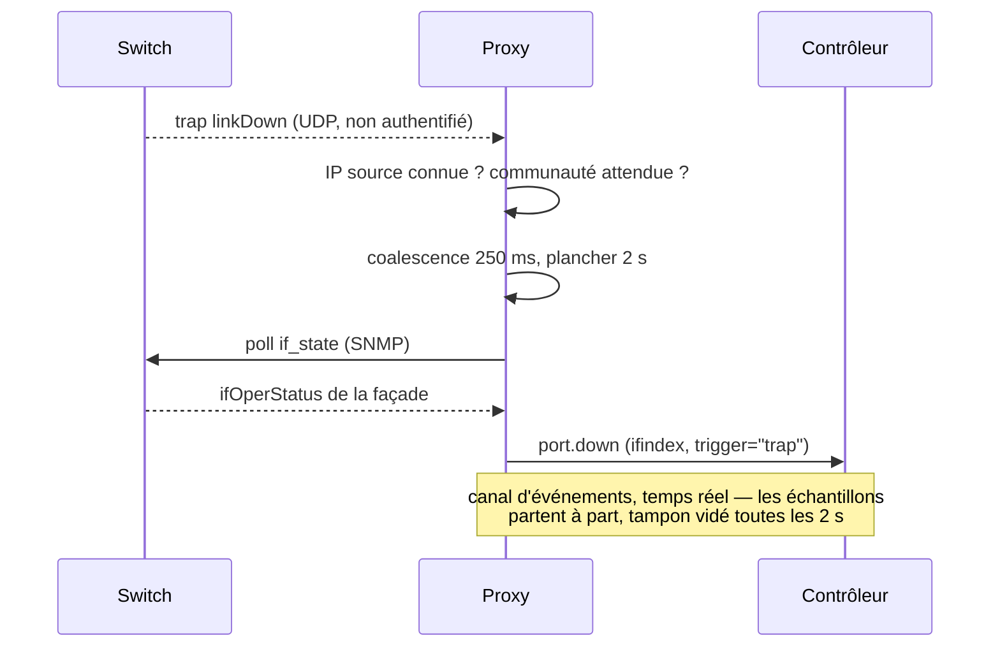
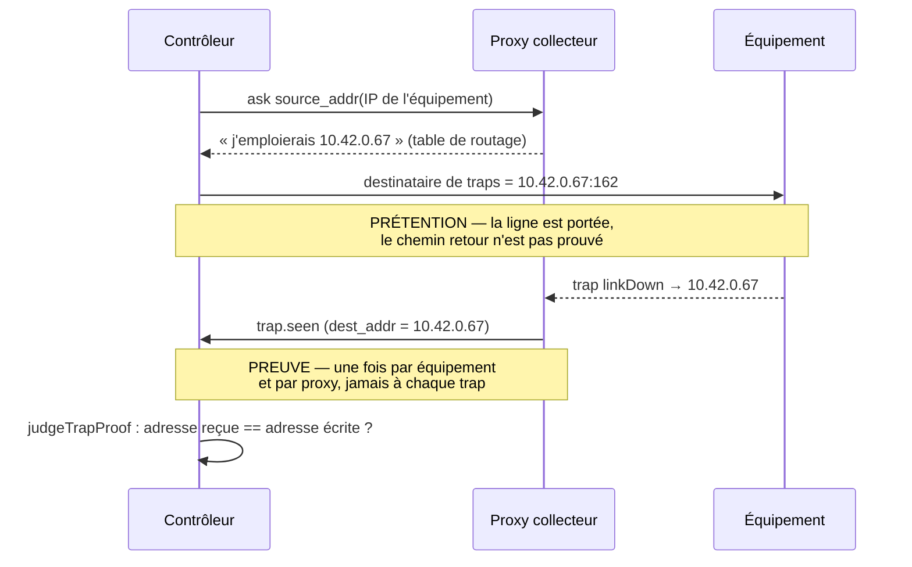
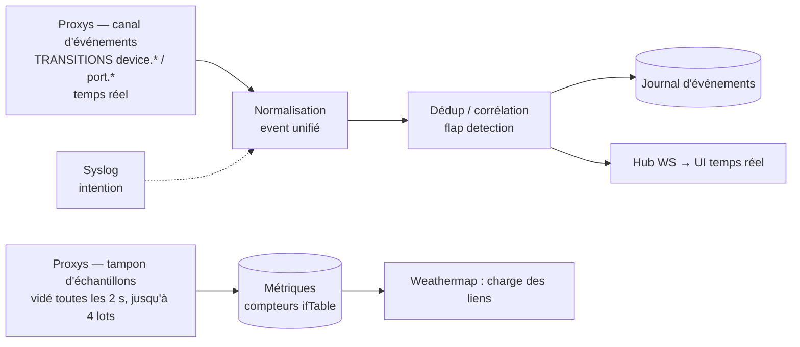

# Monitoring — SNMP, traps, syslog, polling

Meshcraft **déploie lui-même** la configuration de monitoring sur les équipements (via l'intent, section `services.snmp` / `services.syslog` du [[Modèle de données standard]]), puis collecte par trois canaux complémentaires.

## Choix du point de collecte

Un équipement **peut** désigner son collecteur : `devices.proxy_id`, nullable ([[Proxy]], § *Le collecteur de référence : un rattachement DÉCLARÉ* — migration `0022_rattachement_proxy`). Ce qui l'entoure n'a pas changé : le contrôleur tient toujours l'**ensemble des proxys qui joignent** un équipement (`device_paths`), qui reste un fait *observé*. Un rattachement ne dit donc pas ce qu'un proxy **peut** joindre — il dit lequel des proxys éligibles **doit** collecter. Deux questions se ressemblent alors, et n'ont pas du tout la même réponse :

- **recevoir** un trap : la question ne se pose pas. Le datagramme est déjà arrivé chez un proxy, qui reconnaît l'IP source dans sa propre liste de surveillance et résout `device_id` **localement** (§2). Aucun choix de collecteur n'intervient en réception ;
- **écrire dans l'équipement** l'adresse vers laquelle il doit émettre — et, du même coup, décider qui l'interroge en SNMP : là il faut une IP concrète, et l'ensemble des chemins ne suffit pas.

Il y a deux façons d'obtenir cette adresse unique, et tout l'enjeu de cette section est de ne pas les confondre : l'une est **livrée**, l'autre reste **décidée, non construite**.

### La déclaration : l'opérateur désigne, meshcraft obéit — *livré*

`devices.proxy_id` est le **collecteur de référence** : le proxy qui interroge cet équipement en SNMP, et celui dont l'adresse sera écrite dans l'équipement comme destination de ses traps. Trois propriétés en font le sens, et [[Proxy]] les développe :

- `null` est un **régime**, pas un réglage oublié : collecte par couverture, tout proxy éligible est collecteur. C'est le comportement d'avant `0022`, donc l'état de tout le parc existant — la migration est à sémantique constante ;
- le rattachement ne donne **aucune couverture**. La couverture de sites reste la seule porte d'entrée parce que c'est une frontière de *confidentialité* ; rattacher un équipement à un proxy qui ne couvre pas son site ne déplace pas la collecte, **il l'arrête**. C'est pourquoi l'écriture d'un rattachement non couvrant est refusée, et non enregistrée « pour voir » ;
- il ne restreint **pas** la surveillance ICMP. *Le déterminisme là où l'unicité est nécessaire (SNMP, traps), la redondance là où elle est gratuite (ICMP)* : deux pings ne coûtent rien et donnent une meilleure vérité de joignabilité.

Pourquoi la déclaration **d'abord** ? Parce qu'elle fournit l'adresse unique qui manquait sans rien décider automatiquement. Un collecteur élu changerait tout seul — un proxy qui se connecte, quelques millisecondes de latence gagnées ailleurs — et la destination de traps déjà écrite dans les équipements deviendrait **fausse sans que personne ne touche à rien**. Le symptôme serait un parc qui cesse d'être réactif pour une cause inscrite nulle part ; le geste explicite, lui, est journalisable.

### Le DÉFAUT à l'adoption : meshcraft propose, une fois, et n'y revient jamais — *livré*

`null` restait le défaut de **tout** équipement adopté, et ce défaut avait un coût qu'on
a fini par payer sur du matériel : sans collecteur nommé, meshcraft ne peut pas demander
**par quelle adresse** un équipement est joint, donc il borne son agent SNMP au seul
sous-réseau du plan du site — et un proxy qui atteint le réseau de management par
**routage** n'est pas dedans.

> [!bug] Communauté conforme, agent actif, walk MUET — relevé du 29 juillet 2026
> Sur le CRS326-24G-2S+ du parc, `snmp-apply` répondait « communauté déjà conforme :
> sources 10.99.0.0/16, lecture seule, agent actif », et le walk expirait. Le journal de
> l'équipement a donné la réponse : le proxy l'interroge depuis **10.42.0.67**, hors de
> `10.99.0.0/16`. Un agent qui refuse une source **se tait**, il ne proteste pas — et le
> silence ne distingue pas « pas d'agent » de « mauvaise source ».
>
> Le CSS326 voisin, lui, répondait : SwOS n'a aucun champ de borne de source. Deux
> plateformes du même châssis, un seul proxy, et une seule des deux joignable — le pire
> des signaux à interpréter, puisqu'il accuse le connecteur.

L'adoption choisit donc désormais un collecteur, et c'est le **seul** moment où la
question a une réponse *mesurée* : le candidat porte ses relevés (`Sightings`) — quel
proxy l'a vu, à quelle adresse, avec quelle latence. Une heure plus tard il ne reste
qu'une liste de proxys qui couvrent un site, et « lequel peut le joindre ? » redevient une
hypothèse.

| Condition | Pourquoi elle ne suffit pas seule |
|---|---|
| **couvrir le site** | un rattachement ne donne aucune couverture : écrire un proxy non couvrant *arrête* la collecte au lieu de la déplacer |
| **avoir vu l'équipement** | le site est choisi à l'adoption : rien ne garantit que les proxys de ce site voient l'équipement, ni que celui qui l'a vu couvre ce site |

L'arbitrage entre plusieurs candidats est la **latence relevée**, puis la date de dernière
vue, puis l'identifiant — ce dernier critère n'étant pas décoratif : sans lui, deux proxys
à égalité donneraient un collecteur différent à chaque adoption, et le même parc adopté
deux fois ne se comparerait plus. Un proxy **révoqué** est écarté : il reste dans la liste
de couverture et n'interroge plus rien.

**Rien n'est choisi** quand aucun proxy ne remplit les deux conditions, et c'est un
résultat, pas un échec : le régime par couverture reprend, l'adoption réussit, et elle le
**dit** dans ses avertissements. Deviner serait pire — un collecteur qui ne joint pas
l'équipement est une collecte morte que l'écran présenterait comme configurée.

> [!note] Ce n'est PAS l'élection du paragraphe suivant, et la différence est tout
> L'objection écrite ci-dessus contre l'élection tient toujours : « un collecteur élu
> changerait tout seul, et la destination de traps déjà écrite dans les équipements
> deviendrait fausse sans que personne ne touche à rien ». Ce défaut-ci ne change **jamais
> tout seul** : il est posé une fois, à l'entrée de l'équipement dans le parc, écrit dans
> `devices.proxy_id` comme s'il avait été saisi, et plus rien ne le recalcule. L'opérateur
> le change quand il veut ; aucune reconnexion de proxy ne le déplace.
>
> Ce que l'adoption fournit est donc une **valeur de départ mesurée** là où il n'y avait
> qu'un `null`, pas une politique dynamique.

Et les bornes de source cumulent désormais les **deux** réponses, parce qu'elles répondent
à deux questions différentes : le **sous-réseau du plan** (déclaration stable, qui survit
à un redéploiement de proxy) *plus* l'**adresse du collecteur en /32** (le proxy
d'aujourd'hui, routé ou non). Le /32 est **omis quand le sous-réseau le contient déjà** :
`addresses` se compare en chaîne pour décider s'il y a quelque chose à écrire, et un /32
redondant ferait réécrire la communauté de tout un parc conforme à chaque passage.

### L'élection : dériver le collecteur des chemins observés — *décidée, non construite*

L'autre réponse dérive le point de collecte au lieu de le saisir, et seulement au moment de l'écriture :

1. parmi les proxys qui joignent l'équipement, le contrôleur retient le **collecteur préféré** — chemin valide le plus rapide, à préférence stable (on ne change pas de cible pour quelques millisecondes, sous peine de redéployer la conf des équipements sans raison) ;
2. si la plateforme accepte plusieurs récepteurs, un **collecteur secondaire** est déclaré : la télémétrie survit à la perte d'un proxy sans aucun redéploiement. Combien de récepteurs une plateforme accepte est une **capability, pas une généralité** — et elle ne se suppose pas : le relevé du 1930 ([[Connecteurs]], « Destinataires de traps SNMP ») montre que le plafond n'est appliqué qu'au moment de l'ajout, donc indéterminable en lecture seule. Tant qu'il n'a pas été éprouvé jusqu'au refus, la capability reste à `false` et il n'y a **pas** de collecteur secondaire : annoncer une redondance non vérifiée coûte la panne à l'instant précis où l'on comptait dessus ;
3. quand l'ensemble des chemins change durablement (proxy retiré, nouveau proxy plus proche), les cibles trap/syslog sont recalculées et redéployées automatiquement — c'est un diff de conf comme un autre ([[Réconciliation]]).

> [!warning] Le collecteur secondaire du point 2 demandera un TROISIÈME état, sinon ses traps tombent
> Découverte de fin de chantier, vérifiée dans le code, et elle porte sur une
> fonctionnalité **non construite** : ce n'est donc pas un défaut à corriger, c'est
> une **contrainte que la redondance devra satisfaire**, et il vaut mieux la lire ici
> que la découvrir au moment de la bascule.
>
> La chaîne, de bout en bout. Un proxy ne traite un trap que si son IP source figure
> dans **sa** liste de surveillance SNMP (`classifyTrap`, appelée par `onTrap`,
> `cmd/proxy/trap.go` — § *Identité par IP source* ci-dessous). Cette liste est
> exactement le `snmp[]` que le contrôleur lui pousse : `snmpCandidates`
> (`internal/api/watch_handlers.go`) → `cfg.SNMP` → `SetWatches` → `c.watches`. Or
> `snmpCandidates` écarte désormais tout équipement dont ce proxy n'est **pas** le
> collecteur (`Collector` faux → compté comme *délégué*). Conséquence mécanique :
> **un proxy qui n'est pas le collecteur d'un équipement jette ses traps**, verdict
> « source non surveillée », en `Debug` et dans un compteur.
>
> Aujourd'hui c'est cohérent et **souhaitable** — seuls les traps du collecteur
> comptent, puisque lui seul ferait le poll de confirmation. Mais le point 2 ci-dessus
> promet qu'un collecteur secondaire fait « survivre la télémétrie à la perte d'un
> proxy sans aucun redéploiement ». En l'état, non : un équipement qui émettrait vers
> deux proxys verrait ses traps **silencieusement jetés par le second**, et le seul
> symptôme serait un parc qui cesse d'être réactif — la panne « à l'instant précis où
> l'on comptait dessus », pour la même capability et par un autre chemin.
>
> Ce qu'il faudra donc livrer **avec** la redondance : que le contrôleur envoie
> l'équipement dans le `snmp[]` du proxy secondaire **sans** en faire un collecteur.
> C'est un **troisième état**, entre « collecteur » et « délégué » — recevoir sans
> interroger — là où `snmpCandidates` n'en connaît que deux, `Collector` vrai ou faux.
>
> Le régime `null` n'est pas concerné, et c'est ce qui a permis de ne pas voir la
> contrainte plus tôt : `Store.DevicesWatchedBy` y projette `Collector` **vrai pour
> tout proxy couvrant**, donc plusieurs proxys reçoivent bien les traps du même
> équipement — c'est le doublon que la fin de cette section traite. La contrainte ne
> mord que sur les équipements **rattachés**, et l'élection rattache par construction.

> [!warning] L'élection est décidée, pas construite — la déclaration ne la remplace pas
> Rien des trois points ci-dessus n'existe dans le code : ni « collecteur
> préféré », ni secondaire, ni recalcul, et la table `device_collectors` du
> [[Schéma base de données]] n'est pas créée. Ce n'est pas un oubli, c'est l'ordre
> de livraison (§7 de [[Monitoring unifié et pipelines]]) : on apprend à **lire**
> avant d'**écrire** sur le parc. Une page qui présenterait l'élection comme
> acquise ferait chercher un bug dans du code qui n'a jamais été écrit.
>
> Et la déclaration n'en est pas une version déguisée : elle en livre la **brique
> qui manquait** — l'adresse unique — sans le recalcul automatique, donc sans son
> risque. Le jour où l'élection existera, elle ne pourra que **proposer** un
> rattachement, jamais l'imposer.

| Question | État |
|---|---|
| Éligibilité d'un équipement à un proxy = sa couverture de sites | **livré** — `Store.DevicesWatchedBy` la déduit de `proxies.global` **ou** de `proxy_sites` |
| Rattachement déclaré à un collecteur de référence | **livré** — `devices.proxy_id` (migration `0022`), projeté en `Collector` par `Store.DevicesWatchedBy` |
| Cibles SNMP restreintes au collecteur, cibles ICMP laissées à tous les couvrants | **livré** — `snmpCandidates` dans `internal/api/watch_handlers.go` |
| Écriture d'un rattachement : refus d'un proxy non couvrant, changement journalisé | **livré** — `PUT /api/devices/{id}/collector`, `judgeCollector`, événement `device.collector` en avertissement |
| Contrat de protocole du canal de traps (`trap_listen`, `port.up`/`port.down`, `trigger`) | **livré** — `internal/tunnel/control.go` |
| Prérequis de déploiement (mode host, `NET_BIND_SERVICE`) | **livré** — `internal/distrib` |
| Réception du trap par le proxy et attribution par IP source | **livré** — `cmd/proxy/trap.go` |
| Transitions de port diffées sur `ifOperStatus`, corrélation de battement | **livré** — `cmd/proxy/trap.go`, `internal/api/portevents.go` |
| Élection d'un collecteur préféré / secondaire, recalcul quand les chemins changent | **décidé, non construit** — et le secondaire a un prérequis connu : un troisième état « reçoit sans interroger » dans `snmpCandidates`, sans quoi ses traps sont jetés (callout ci-dessus) |
| Pousse de l'IP de destination dans l'équipement | **livré** — `internal/api/trapdest.go` : au provisionnement et par `POST /api/devices/{id}/trap-apply`. L'adresse se **demande** au collecteur (`source_addr`), elle ne se déduit pas des interfaces qu'il déclare, et le geste **refuse** faute de collecteur déclaré, de plan v2c, de communauté au coffre ou de capability `Traps` — chaque refus portant son geste de réparation |
| Vérification que le chemin retour fonctionne vraiment | **livré** — `trap.seen` + confrontation de l'adresse de destination du datagramme à celle écrite (§ *Le premier trap reçu est une PREUVE*) |

Ce qu'il faut en retenir **là où rien n'est déclaré** — le régime par défaut, et celui de tout le parc au sortir de la migration : `null` laissant **plusieurs proxys éligibles au même équipement** — et il y a plusieurs proxys d'instance en base, chacun couvrant tous les sites — deux proxys qui pollent le même parc ou reçoivent le même `linkDown` émettront **la même transition, deux fois**. Le rattachement **empêche** ce doublon là où il est posé ; il ne dispense pas de le traiter. Le contrôleur doit donc toujours **dédoublonner** sur `(device_id, ifindex, type)` dans une fenêtre courte, sans quoi chaque battement de port compterait double dans le [[Journal d'événements]] et dans la détection de flap.

Le **polling SNMP**, lui, obéit au rattachement : les cibles `snmp[]` poussées à un proxy sont les lignes dont il est le collecteur, la liste de ping restant entière. La contrepartie est assumée et il vaut mieux la lire ici que la découvrir : un collecteur unique n'a **aucune bascule automatique**. Si le proxy rattaché tombe, l'équipement cesse d'être interrogé alors qu'il continue d'être pingué par les autres couvrants — son voyant reste vert et son statut reste juste, seule la collecte s'arrête ([[Proxy]], § *Le piège*). C'est le prix du déterminisme, et c'est ce qui justifie qu'un changement de collecteur soit un **avertissement** au journal. Pour un équipement joignable directement par le contrôleur, le proxy interne joue ce rôle et la cible est l'IP du contrôleur.

## Statut des équipements : le proxy pingue, le contrôleur écoute

Le statut `up` / `unreachable` ne vient pas du polling SNMP mais d'une
surveillance ICMP **exécutée par le [[Proxy]]** :

- le contrôleur envoie à chaque proxy la liste des équipements des sites qu'il
  couvre et les plages qui lui sont déclarées ;
- le proxy pingue à **1 Hz**, en une seule socket brute pour tout le parc — cent
  équipements coûtent cent paquets par seconde, pas cent sockets ;
- il ne remonte que les **transitions**, avec anti-rebond : trois pertes
  consécutives avant de déclarer injoignable, une réponse pour rétablir. Sans
  cet amortissement, un paquet perdu ferait clignoter tout le parc dans le
  [[Journal d'événements]].

Faire pinger le contrôleur à travers le tunnel livrerait la même information au
prix d'un aller-retour WAN par seconde et par équipement. Et ICMP ne se
tunnelise pas : ce n'est pas un flux TCP, il n'y a rien à relayer — d'où le
canal d'événements du [[Protocole contrôleur-proxy]].

> [!note] Un équipement muet au ping n'est pas forcément mort
> Beaucoup d'équipements réseau filtrent ICMP. Le ping donne un statut à bas
> coût, pas une vérité : c'est le polling SNMP et les sessions réussies qui
> confirment. Un équipement qui ne répond pas au ping mais accepte une session
> est vivant, et l'UI doit dire lequel des deux signaux parle.

> [!warning] Une transition perdue l'était pour TOUJOURS — constaté
> Un canal qui ne transmet que des différences fait de chaque perte une divergence
> **permanente**. C'est la leçon de ce défaut, et elle dépasse le ping.
>
> **Le constat.** `lab-css326` (CSS326-24G-2S+, 10.99.0.36), adopté le 28/07, est
> resté `unknown` **dix-neuf heures** alors qu'il répondait au ping sans faute. Il
> était bien dans la consigne poussée au proxy (« surveillance transmise,
> équipements : 12 »), et `lab-crs326`, adopté dans la même session, avait bien reçu
> son `device.recovered` à 20:47:40 — lui, jamais. Aucune ligne de joignabilité pour
> cet équipement avant le 29/07 à 14:18:50, et ce qui a fini par écrire son statut
> n'est pas la surveillance : c'est un **redémarrage manuel** de l'équipement, qui a
> produit `device.unreachable` puis `device.recovered` en quatre secondes.
>
> **Ce qui n'est PAS prouvé** : lequel des trois mécanismes a avalé l'événement.
> Aucun n'a été observé en train de perdre quoi que ce soit ; les trois existent dans
> le code, et 89 `proxy.disconnected` en base disent que les occasions ne manquaient
> pas. `emit` jette quand sa file de 256 entrées est pleine ; `SendEvents` sortait
> l'événement de la file **avant** de l'écrire, donc le perdait si le tunnel tombait
> pendant l'écriture ; et `SetConfig` conserve l'état mémoire des cibles déjà
> connues, si bien qu'une reconnexion ne réannonçait **rien**.
>
> **Pourquoi c'est le pire des silences** : l'état sain, celui qui dure, était le
> seul que personne ne confirmait jamais. Un équipement en panne finit par produire
> une bascule ; un équipement qui va bien n'en produit plus, et son statut restait
> donc faux indéfiniment. Un canal de transitions a besoin d'un **point de reprise**.
>
> **Livré** : le proxy réannonce l'état courant de chaque cible à l'ouverture du flux
> d'événements, donc à chaque reconnexion (`Monitor.Snapshot`, événements marqués
> `Resync` — cf. [[Protocole contrôleur-proxy]]). Trois points ont demandé de
> l'attention, et chacun aurait produit un défaut de son côté :
>
> - **l'ORDRE**. Le reliquat de la file part d'abord, le cliché ensuite, le direct
>   après. Les événements qui dorment dans la file sont plus VIEUX que le cliché :
>   livrés après lui, ils écraseraient l'état courant par une transition périmée, et
>   un équipement retombé puis revenu pendant la coupure finirait affiché injoignable
>   alors qu'il répond. Un test verrouille cet ordre — il échoue bien si on l'inverse ;
> - **ne pas journaliser une redite**. Une réannonce écrit le statut mais ne
>   journalise que si la valeur a CHANGÉ, sinon la réannonce devient le bruit qu'elle
>   devait éviter : c'est exactement ce qu'on lisait avant, neuf `device.unreachable`
>   par redémarrage de proxy sur le parc de démonstration. La détection de changement
>   est dans la même requête que l'écriture, faute de quoi deux événements concurrents
>   journaliseraient deux fois la même bascule ;
> - **le compte de pertes a quitté `status_note`**. Il CROÎT tant que l'équipement est
>   muet, donc une note qui le porte rend chaque cliché « différent » et la
>   déduplication ne mord jamais. Il vit désormais dans le message du journal, où il
>   est informatif ; la note décrit un état stable. Migration de données `0026` pour
>   les lignes déjà écrites — sans elle, la première réannonce aurait annoncé une
>   fausse bascule et daté « depuis 0 min » des équipements tombés depuis trois jours.
>
> **Le trou n'est pas entièrement fermé, et c'est nommé plutôt que masqué** : au
> redémarrage du CONTRÔLEUR, la portée retenue par proxy est vide et le premier paquet
> d'événements est refusé le temps du premier calcul de surveillance (cf.
> [[Sécurité du proxy]], § *portée*). Le cliché voyage précisément dans ce paquet et
> passe la même barrière : il y est donc **refusé**. Ce qui est observé au déploiement
> de ce lot est le refus d'un fait de ce premier paquet (« aucune consigne poussée »,
> autorité `collecte_snmp`) ; que le cliché subisse le même sort en est **déduit** — le
> proxy déployé n'en émet pas encore. Sans conséquence sur la correction
> (le statut vit en base et survit au redémarrage du contrôleur), mais un événement
> perdu **pendant** une coupure qui s'achève par un redémarrage du contrôleur reste
> perdu. La réparation serait de réannoncer aussi à la **première consigne reçue**
> après une (re)connexion, moment où la portée est garantie peuplée. **Non construit.**

> [!note] `status_at` dit depuis QUAND, pas « à quel point c'est frais »
> `status` seul confondait deux situations qui n'appellent pas la même réaction : un
> équipement **jamais observé** — adopté il y a cinq minutes, pas encore pingué — et
> un équipement dont un constat a bien été établi mais n'est jamais arrivé. D'où
> `status_at` (migration `0025`) : **NULL = jamais observé**, et l'écran le dit en
> toutes lettres plutôt que d'afficher `INCONNU` sans précision — un opérateur qui lit
> ça cherche une panne là où il n'y a qu'une attente.
>
> Ce que la date apporte : « injoignable **depuis 2 h** » au lieu d'« injoignable ».
> Le même mot couvrait un redémarrage en cours et un équipement que personne n'a vu
> tomber depuis trois jours. Lue par la table de supervision, le résumé de fiche et
> l'inventaire (en infobulle, cette liste étant dense).
>
> **Ce que ce n'est PAS : une mesure de fraîcheur.** Le proxy ne remonte que des
> transitions, donc un équipement en ligne depuis trois mois porte une date vieille de
> trois mois **sans que rien ne soit en retard**. Lire cette colonne comme une
> fraîcheur ferait alerter sur le parc le plus sain. Une vraie fraîcheur demande un
> **battement périodique** du proxy — un ajout au protocole, pas une lecture de cette
> colonne. **Non construit.**

> [!warning] Un statut s'OBSERVE, il ne s'édite pas — chemin fermé
> `status` et `status_note` étaient acceptés en entrée de l'API et écrits tels quels.
> N'importe quel enregistrement de fiche republiait donc la joignabilité avec la valeur
> que le client avait lue en ouvrant son écran, et le plan du site renvoie
> explicitement `status` dans son `PUT` : **déplacer une icône suffisait** à réécrire un
> constat périmé, voire à ramener en `unknown` un équipement que la surveillance venait
> de déclarer en ligne. Le commentaire de `SetDeviceStatus` promettait « un constat,
> jamais une déduction » ; un formulaire pouvait le contredire.
>
> À distinguer du défaut ci-dessus : celui-ci est un chemin trouvé **en lisant le
> code**, pas un incident constaté en exploitation. Rien ne prouve qu'il ait jamais
> écrasé un statut — et rien ne prouve le contraire, un écrasement ne laissant aucune
> trace.
>
> **Livré** : les deux champs ont quitté l'entrée de l'API, `UpdateDevice`,
> `CreateDevice` et l'import de configuration de site. Un fichier importé qui déclarait
> `status: ok` injectait une observation que rien n'avait établie ; le champ reste dans
> le format pour l'**export**, où il décrit fidèlement ce qu'on observait alors. Les
> champs sont **retirés** de la structure d'entrée plutôt qu'ignorés en silence : le
> décodeur n'interdit pas les champs inconnus, donc un client qui les envoie encore
> n'est pas cassé, et la structure dit désormais la vérité sur ce qui est modifiable.

## Les trois canaux

### 1. Polling SNMP (l'état de référence)
Exécuté par le proxy, sur la liste et aux cadences que le contrôleur lui pousse (`snmp[]` de la `WatchConfig` — une question par poll ferait traverser le WAN à chaque cycle). Seuls les résultats agrégés remontent : le walk massif ne traverse jamais le WAN en UDP.

Le diagnostic ponctuel, lui, passe par une **question** au proxy, et non par un RPC générique : le jeu est fermé à deux questions en lecture seule ([[Protocole contrôleur-proxy]], § *Les questions ponctuelles*). C'est ce qui permet de découvrir les OID qu'un équipement sert réellement — les capteurs optiques d'un SFP, par exemple — au lieu de les deviner dans une MIB constructeur.

| Donnée | OIDs | Cadence appliquée | Prévu à la conception |
|---|---|---|---|
| État des ports (up/down, vitesse, duplex) | ifTable / ifXTable (`ifOperStatus`, `ifHighSpeed`) | **30 s** | 30–60 s |
| Compteurs de trafic | `ifHCInOctets` / `ifHCOutOctets`, erreurs, discards | **5 s** | 60 s |
| Santé | `sysUpTime`, `hrProcessorLoad`, `hrStorage`, `mtxrHealth` | **5 min**, *seulement là où un canal `snmp` la déclare* | 5 min |
| Diagnostic optique des SFP | `mtxrOpticalTable` | **60 s**, aux mêmes conditions | *pas prévu ici — voir [[Télémétrie MikroTik]]* |
| Tables réseau | LLDP-MIB (topologie → [[Weathermap]]) | **collectée** depuis le 29/07/2026, à **60 s** — voir [[Voisinage LLDP]] | 5–15 min |
| Tables réseau | BRIDGE-MIB / Q-BRIDGE (MACs par port) | *non collectées* | 5–15 min |
| Inventaire | entPhysical (serial) | *non collecté* | 15 min |

Le cycle connaît désormais **quatre** métriques (`internal/snmppoll`) — `if_state`, `if_counters`, et les deux jeux de capteurs `health` et `optical_power` livrés avec [[Télémétrie MikroTik]]. Les cadences voulues sont `wantedStateInterval = 30 s`, `wantedCountersInterval = 5 s`, `wantedHealthInterval = 5 min` et `wantedOpticalInterval = 60 s` (`internal/api/watch_handlers.go`). **L'inversion par rapport à la conception est délibérée** sur les deux premières lignes — l'état des ports ralentit parce que la réactivité vient du canal de traps, le trafic accélère parce qu'un compteur sert à tracer une *courbe* et qu'une saturation de deux minutes ne se devine pas sur deux points. Le raisonnement complet, le débit que cela impose au proxy et le nombre d'équipements qu'un proxy évacue sont en §1.2 et §2.4 de [[Monitoring unifié et pipelines]]. Ce que les deux nouveaux jeux ajoutent à ce débit est **inférieur à 1,3 %** ; ce qu'ils coûtent est sur l'équipement, et c'est chiffré en §3.2 de [[Télémétrie MikroTik]].

> [!important] Les capteurs ne s'allument QUE là où le connecteur les déclare — et c'est un renversement
> `if_state` et `if_counters` tiennent entièrement dans MIB-II : tout agent SNMP les sert, donc les demander à un équipement dont on ne connaît pas le connecteur est toujours un pari gagnant. C'est ce qui justifie le plancher de repli de 60 s pour eux.
>
> `health` et `optical_power` sont l'inverse. **Il n'existe aucune MIB normalisée pour la santé d'un commutateur** — `ENTITY-SENSOR-MIB` existe mais MikroTik ne l'implémente pas — donc le socle est **propriétaire** (MIKROTIK-MIB). Les demander à un équipement d'une autre marque ne rendrait que des « no such object » : seize requêtes par cycle pour rien, sur tout le parc, indéfiniment. Une cadence de **zéro** vaut donc « ne pas collecter », et c'est le régime **normal** de tout équipement dont le connecteur ne déclare pas de canal `snmp` pour ces métriques — pas un cas dégradé.
>
> Corollaire à connaître avant de chercher une courbe absente : l'écran d'un équipement lit `Monitoring.Unavailable` pour dire s'il y a quelque chose à attendre, et le silence au journal est **voulu** — une ligne par équipement et par recalcul de surveillance dirait à chaque connexion de proxy que les vingt switchs d'un site n'ont pas de capteurs optiques, ce qui est vrai, connu, et qui ne changera pas.

> [!warning] Le canal déclaré ne CHOISIT pas le transport — il borne la cadence, et les confondre était un défaut
> Le collecteur périodique s'exécute sur le proxy et ne parle **que SNMP**. Or le contrôleur résolvait la cadence avec `MonitoringCapabilities.Best(metric)`, qui rend le canal le plus rapide **tous genres confondus** : sur un connecteur déclarant un canal `web` à 5 s et un canal `snmp` à 60 s — le cas de RouterOS — le proxy se retrouvait à walker en SNMP douze fois plus vite que ce que le connecteur autorisait pour SNMP. Le plancher d'un canal était opposé à un **autre** canal.
>
> **Livré** : `MonitoringCapabilities.BestOfKind(kind, metric)`, et la planification d'un poll SNMP lit désormais le plancher SNMP et lui seul. Le raisonnement complet, y compris pourquoi le plancher SNMP de RouterOS était haut *exprès* et pourquoi il a pu redescendre, est en §3 de [[Télémétrie MikroTik]].

> [!note] La cadence est CHOISIE, le plancher la BORNE
> Ce sont deux notions, et les avoir confondues était le défaut corrigé : le
> `MinInterval` d'un connecteur dit « jamais plus souvent que », pas « toutes
> les ». La politique choisit donc le rythme, le plancher l'empêche seulement de
> descendre trop bas — et quand la cadence voulue passe sous le plancher, la
> substitution est **journalisée en avertissement** avec l'équipement, la métrique,
> la cadence demandée, celle retenue et l'origine du plancher. Un opérateur qui
> demande 5 s et obtient 30 s ne doit pas l'apprendre en comparant des graphes.
> Plancher retenu quand le connecteur est inconnu : **60 s**
> (`unknownFloorInterval`) — ni 5 s, qui parierait sur le plan de contrôle d'un
> équipement qu'on ne connaît pas, ni rien du tout, qui priverait de supervision
> les équipements les moins bien connus.

**La version SNMP est résolue par équipement, pas choisie** : v3 authPriv quand la plateforme le supporte ([[Connecteurs]] : capability `SNMPv3` avec ses algorithmes réels), sinon communauté v2c dédiée **en lecture seule**. Une politique qui exige v3 ne durcit pas les vieux équipements, elle les prive de SNMP — ils sont alors listés explicitement comme non supervisés, avec la raison. Ces accès font partie de l'**identité de service** que meshcraft installe et fait tourner lui-même : politique définie globalement et surchargeable par site, secret généré **par équipement**, rotation par générations ([[Identité de service et rotation]]).

### 2. Traps SNMP (la réactivité, et rien d'autre)

Reçus par le listener 162/udp du proxy ([[Proxy]], rôle 3), activé par le contrôleur — `trap_listen` / `trap_port` de la `WatchConfig` ([[Protocole contrôleur-proxy]]) : comme le reste de la surveillance, ça se décide au contrôleur et ça s'éteint sur tout un parc sans redéployer un binaire.

**Aucun catalogue de traps constructeur n'est décodé, et c'est délibéré.** Seuls `linkUp` et `linkDown` sont reconnus, et seulement pour **libeller** la rafale au diagnostic. Décoder les traps propriétaires serait du travail à refaire à chaque gamme pour une information qu'on relit de toute façon dans `ifTable` la milliseconde suivante — c'est le corollaire direct du principe ci-dessous : si le contenu du trap n'établit rien, le décoder n'apporte rien. Un trap non reconnu déclenche le même poll qu'un `linkDown` ; c'est le poll qui dira ce qui a changé.

L'écoute n'est demandée qu'aux proxys pour qui elle sert : le contrôleur active `trap_listen` quand **au moins une cible SNMP retenue** de ce proxy appartient à une plateforme dont le connecteur déclare `Traps` ([[Connecteurs]]). Deux raisons, et la seconde est de sécurité : un trap concernant un équipement que ce proxy n'interroge pas n'avance aucun poll, et ouvrir 162/udp sur un réseau de management pour n'y jamais rien recevoir est une surface d'attaque offerte sans contrepartie.

#### Un trap ne porte jamais la vérité, seulement l'urgence

Un trap v2c est un datagramme UDP **non authentifié** : falsifiable, perdable, réordonnable. En faire une source d'état donnerait à quiconque se trouve sur le chemin le pouvoir d'**éteindre un port à l'écran** — un déni de service à un paquet, sans toucher au réseau. **Aucun état n'est donc écrit depuis le contenu d'un trap.** Le trap ne fait qu'**avancer** le poll `if_state` qui aurait eu lieu de toute façon.

C'est la propriété qui compte, et elle est structurelle : **on n'ajoute aucun chemin de vérité au système**, on accélère un chemin existant. Il n'y a donc rien à arbitrer entre deux sources qui se contrediraient, et le mode dégradé est gratuit.

| | sans traps | avec traps |
|---|---|---|
| Source de l'état d'un port | poll `if_state` | poll `if_state` (le même) |
| Justesse | inchangée | **inchangée** |
| Latence de détection | la cadence de polling | **~1 s** |

> [!note] Un canal de traps en panne ne dégrade pas la justesse
> Équipement mal configuré, trap perdu, listener non démarré, proxy en cours de
> redémarrage : on retombe sur la cadence de polling. C'est un canal
> **d'accélération**, jamais un canal dont dépend l'exactitude — d'où le fait qu'on
> puisse l'éteindre sans rien casser.

Reste à dire ce que le gain vaut **aujourd'hui**, parce que le chiffre a bougé. La cadence appliquée à l'état des ports est de **30 s** (`wantedStateInterval`, §1) : le chemin rapide fait donc passer la détection d'environ 30 s à environ 1 s. Il y eut un temps où le contrôleur envoyait au proxy le *plancher* du connecteur comme cadence — 5 s sur un Instant On 1930 — et où le gain observable n'était donc que de 5 s à 1 s ; ce n'est plus le cas, la cadence est choisie et le plancher ne fait que la borner (§1.2 de [[Monitoring unifié et pipelines]]).

> [!warning] Le facteur trente est aussi une dépendance : à 30 s, la réactivité des ports DÉPEND des traps
> C'est l'autre face de l'arbitrage, et c'est la partie qu'il ne faut pas perdre en
> retenant le chiffre. Avant ce lot, un port tombé apparaissait en 5 s **sans
> traps** ; il met désormais jusqu'à 30 s. Or le canal rapide n'existe que si les
> équipements ont reçu l'ordre d'émettre. La pousse du destinataire **est désormais
> construite** (§ *Choix du point de collecte*), mais elle exige un **collecteur
> déclaré** : sans rattachement, il n'y a pas une adresse à écrire mais plusieurs, et
> la pose refuse plutôt que d'en graver une au hasard. Sur un parc qui sort de la
> migration — `devices.proxy_id` à `null` partout — le listener du proxy ne reçoit donc
> encore que ce que des équipements configurés **à la main** veulent bien lui envoyer,
> et la latence effective de détection d'un port tombé y est de 30 s, point.
>
> Ce qui rend l'arbitrage tenable est qu'il est **réversible** — la cadence voulue
> est une constante de politique, pas une propriété du protocole. Ce qui le rend
> honnête est le champ `trigger` des événements de port : sans lui, un parc muet et
> un parc réactif produisent exactement les mêmes événements à trente secondes
> près, ce que personne ne remarque sur un écran.

#### Le poll de confirmation s'exécute sur le proxy

Le trap arrive chez le proxy ; c'est le **proxy** qui interroge immédiatement `if_state`, pas le contrôleur. Un aller-retour vers le contrôleur pour lui demander « poll-moi ça » coûterait exactement la latence WAN qu'on cherche à supprimer — et le proxy détient déjà tout ce qu'il faut : l'IP, la communauté et la borne d'index de la `SNMPWatch` que le contrôleur lui a poussée. C'est la même répartition que l'ICMP : **le proxy est l'exécuteur local**, le contrôleur décide de la liste et des cadences.

#### Les transitions sont calculées par le proxy, à chaque poll

Le proxy compare l'`ifOperStatus` relevé à celui qu'il avait, **quel que soit le déclencheur du poll**, et n'émet que les changements. Il le fait sur les échantillons **déjà en main** : la table a été lue une fois, la relire pour en tirer une seconde conclusion doublerait le coût sur l'équipement et ouvrirait la porte à deux lectures divergentes du même instant.

Deux conséquences, à lire dans cet ordre :

- **les événements de port marchent sans traps**, à la cadence de polling. Le trap ne les crée pas, il les avance ;
- ils partent sur le **canal d'événements**, qui est temps réel, alors que les échantillons de métriques attendent dans le tampon vidé toutes les 2 s — jusqu'à 4 lots par réveil (`flushEvery` / `maxFlushBurst`, `cmd/proxy/snmp.go`). C'est là que se gagne la réactivité perçue : la pastille d'un port ne dépend pas du rythme d'ingestion des séries.

Le diff porte sur un **état booléen**, pas sur la valeur d'`ifOperStatus` : `up` est la valeur 1 et elle seule, tout le reste est « ne passe pas de trafic ». `lowerLayerDown(7)` est donc un port down — le classer ailleurs obligerait l'écran à inventer un troisième état pour dire la même chose — et un port qui oscillerait entre `down(2)` et `lowerLayerDown(7)` ne produit **aucun** événement, puisque c'est la même information dite autrement. La valeur brute est portée dans le détail quand elle sort de l'ordinaire : on n'affirme pas qu'un port est en service quand l'équipement ne l'affirme pas.

Trois silences, et chacun évite d'inventer un fait :

| Situation | Événement | Pourquoi |
|---|---|---|
| Port vu pour la **première** fois | aucun | on ne sait pas de quoi ce serait la transition — comme le premier ping, qui ne produit ni `device.up` ni `device.down` |
| Port **disparu** de la table | aucun | un membre de pile retiré ou une façade rétrécie est une décision d'exploitation, pas une panne |
| Poll rendu **sans** `ifOperStatus` | aucun, et l'observation précédente est **conservée** | c'est une lecture partielle ; l'écraser ferait de la lecture suivante une « première observation », donc un silence sur la vraie transition |

#### Identité par IP source, contre la liste de surveillance

Seuls sont traités les traps dont l'IP source correspond à une `SNMPWatch` connue de ce proxy, avec la communauté attendue. C'est un **filtre anti-usurpation gratuit** — on ne réfléchit pas à ce que raconte un paquet venu d'une adresse qu'on ne supervise pas — et surtout : le proxy résout `device_id` lui-même. La question « quel collecteur pour cet équipement ? » **ne se pose pas en réception** : le proxy n'interroge pas le contrôleur, il regarde sa propre liste. Elle se pose ailleurs — pour désigner qui interroge en SNMP, et pour écrire la destination dans l'équipement (§ *Choix du point de collecte*).

Le rattachement a en revanche une conséquence à ce niveau, et elle est cohérente : la liste de surveillance d'un proxy ne contient que les équipements dont il est le collecteur, donc le trap d'un équipement **délégué** à un autre proxy y arrive comme une source non surveillée, et il est ignoré. C'est le bon comportement — le poll de confirmation, ce proxy ne le ferait pas de toute façon — et c'est aussi la raison pour laquelle le destinataire écrit dans l'équipement doit être **le** collecteur et pas n'importe quel proxy couvrant. C'est en revanche ce qui interdira, tel quel, le collecteur secondaire de l'élection : voir le callout du § *Choix du point de collecte*, qui dit quel état il manque.

Trois précisions qui font tenir le filtre :

- une communauté **vide** dans la `SNMPWatch` signifie `public`, pas « n'importe laquelle » — c'est exactement le repli du poll, et deux règles différentes pour la même watch finiraient par accepter les traps d'un équipement qu'on n'arrive même pas à interroger ;
- les traps **v3** arrivent sans communauté et sont donc **rejetés**. « On accepte quand on ne sait pas vérifier » serait le contraire d'un filtre ; la v3 viendra avec l'identité de service ;
- le filtre est **faible et on l'assume** : une IP source s'usurpe. C'est précisément pour ça que rien du contenu n'est écrit — au pire, un attaquant obtient un walk `if_state` anticipé, dont le résultat vient de l'équipement et non de lui. Ce que le filtre protège, ce n'est pas la justesse (déjà garantie par le poll), c'est le **coût** : il empêche un tiers de faire poller le parc à volonté.

Les trois verdicts — accepté, source non surveillée, communauté inattendue — sont **comptés** et rapportés périodiquement. Rien n'y monte en avertissement : sur un réseau de production, recevoir les traps d'équipements qu'on ne supervise pas est l'ordinaire. Mais un canal qui rejette tout et un canal muet se ressemblent beaucoup trop dans un journal pour qu'on renonce à les distinguer.

#### Le premier trap reçu est une PREUVE, et elle a une portée exacte

Tout ce qui précède décrit un canal qui **reçoit**. Reste la question qu'on ne peut
pas se poser depuis le contrôleur : l'équipement émet-il vraiment, et **vers nous** ?
Écrire une destination de traps dedans est une **prétention** — meshcraft y inscrit
l'adresse que le proxy collecteur dit employer pour joindre l'équipement, en pariant
que le chemin fonctionne dans l'autre sens. Un pare-feu, une route asymétrique, une
ACL sur le VLAN de management suffisent à ce qu'il émette dans le vide, et l'accusé de
réception de la pose ne dit rien de tout ça.

D'où **deux états distincts**, et les confondre est le seul contresens coûteux du
mécanisme : *l'adresse est écrite* (`devices.trap_dest_addr`, la date venant de
`now()`) et *le chemin retour est établi* (`devices.trap_seen_at`, migration `0023`).
Le second ne s'obtient que d'un fait extérieur : un trap **accepté**, remonté par le
proxy en `trap.seen` ([[Protocole contrôleur-proxy]], § *Ce que le proxy remonte*).
Une fiche qui les confondrait laisserait croire à une supervision réactive qui
n'existe pas.

**Ce que le trap prouve, exactement.** Le filtre du § précédent ne regarde que l'**IP
source**, et la socket écoute l'adresse joker : « un trap est arrivé ici » n'est donc
pas « l'adresse que j'ai écrite reçoit les traps de cet équipement ». Un équipement
configuré vers un autre collecteur joignable sur la même machine fabriquerait une
fausse preuve. Ce qui referme l'écart est l'**adresse de destination du datagramme**,
lue au noyau par le proxy et confrontée par le contrôleur — seul détenteur de la
prétention — à ce qu'il a écrit. Les quatre issues, le refus du proxy de combler un
« je ne sais pas », et le faux négatif assumé d'un proxy derrière une traduction
d'adresse sont détaillés dans [[Protocole contrôleur-proxy]] ; ce qui compte ici est
la conséquence d'exploitation :

| Ce que l'exploitant voit | Ce que ça veut dire |
|---|---|
| aucune destination enregistrée | rien n'a été posé — état de tout équipement sans collecteur déclaré, et c'est **silencieux** au journal du parc parce qu'attendu |
| adresse écrite, jamais confirmée | la ligne est dans l'équipement et **rien n'est encore arrivé en retour**. La supervision reste juste, seulement pas réactive : c'est là qu'on cherche un pare-feu |
| chemin retour établi | un trap a traversé, et l'adresse posée est celle qui l'a reçu |
| chemin établi, **attribution non vérifiée** | les traps atteignent le collecteur — la réactivité est acquise — mais ce proxy n'a pas su dire à laquelle de ses adresses ils étaient destinés (binaire plus ancien, ou noyau qui refuse PKTINFO) |

> [!note] La confirmation ne s'écrit qu'une fois, et la borne n'est pas côté proxy
> Le proxy n'émet `trap.seen` qu'une fois par équipement, mais il **réarme** son
> compteur dès que l'équipement quitte puis retrouve sa liste de surveillance — donc à
> chaque reconnexion de tunnel. Compter sur sa parcimonie ferait écrire « chemin retour
> établi » **pour tout le parc à la fois** au redémarrage d'un proxy. La borne est donc
> prise par la base, dans le `where` de l'`update` : deux traps simultanés venant de
> deux proxys ne peuvent pas produire deux lignes.
>
> Et une confirmation **porte sur un chemin** : reposer exactement la même adresse la
> conserve, changer d'adresse ou de collecteur l'efface. Sans ça, meshcraft afficherait
> comme vérifiée une destination que rien n'a jamais validée.

> [!warning] Une date venue d'un proxy ne s'ordonne pas avec les nôtres
> Le premier essai sur matériel a livré un enseignement qui dépasse les traps, et il
> est développé dans [[Protocole contrôleur-proxy]] (callout *`Event.TS` est un fait de
> diagnostic*) : la preuve était datée par le **proxy**, la pose par le **contrôleur**,
> et l'écart de **onze secondes** faisait apparaître la preuve *avant* ce qu'elle
> prouve. Le même défaut affectait la corrélation de battement, dont les seuils
> valaient donc le seuil écrit **plus** la dérive d'une machine qu'on ne contrôle pas —
> « trois minutes de calme » en valaient 2 min 49 s sur cette installation, et autre
> chose sur le site voisin.
>
> Ce qu'il faut retenir pour la suite : **le contrôleur date lui-même ce qu'il
> compare**, et le paramètre d'horodatage a été *retiré* des fonctions concernées plutôt
> que documenté. La dérive, elle, est journalisée — et c'est la seule mesure de l'heure
> des proxys que possède le produit.

#### Amortissement par équipement

Un 48 ports qui redémarre émet une centaine de traps en quelques millisecondes. Deux garde-fous, tenus **par équipement** :

| Garde-fou | Valeur | Ce qu'il évite |
|---|---|---|
| Fenêtre de coalescence | 250 ms | une rafale de traps → **un** poll. `ifTable` est lue en entier de toute façon : un port ou cinquante coûtent pareil |
| Plancher entre deux polls déclenchés par trap | 2 s | un port qui bat en boucle → un walk par battement |

Sans eux, le chemin rapide devient un **amplificateur braqué sur l'équipement déjà en difficulté** — et sur cette gamme, cinq sessions suffisent à le saturer. La règle *un équipement qu'on supervise trop est un équipement qu'on abîme* ([[Monitoring unifié et pipelines]] §1) **vaut aussi pour le chemin rapide** : ce n'est pas parce qu'un événement est urgent qu'on a le droit d'interroger sans limite.

Deux détails qui décident du comportement réel :

- le plancher **retarde**, il ne jette pas. Un trap arrivé juste après un poll signale peut-être un état que ce poll n'avait pas encore vu ; l'abandonner perdrait une transition vraie jusqu'au cycle ordinaire suivant. Un port qui bat produit donc au pire un walk toutes les deux secondes, ce qui est exactement le comportement voulu ;
- un poll avancé par un trap **repousse la cadence ordinaire** d'autant. Sans ça, le cycle régulier relirait la même table dans la seconde : deux walks pour une seule information, sur l'équipement qui est justement en train d'avoir un problème.

#### L'anti-flap est au contrôleur, pas au proxy

Le proxy émet des **faits bruts** : ce port est passé down, à cet horodatage. Le contrôleur **corrèle** et agrège en `port.flapping` avec compteur. Proxy = fait, contrôleur = corrélation, et la raison est opérationnelle : la fenêtre d'agrégation devient réglable **sans redéployer un binaire de proxy dans chaque réseau client**. Mettre l'anti-flap dans le proxy reviendrait à figer une politique produit dans des machines qu'on ne maîtrise pas.

#### Prérequis de déploiement : le bind de 162/udp

Le terrain est déjà prêt : le `docker-compose` généré par le contrôleur (`internal/distrib`) déclare le proxy en `network_mode: host` avec `NET_BIND_SERVICE`, précisément commenté « syslog 514/udp, traps 162/udp ». Le mode host n'est pas un confort : **en bridge, l'IP source d'un trap serait celle de la passerelle Docker**, donc inutilisable pour attribuer le message à un équipement — le filtre par IP source ci-dessus n'existerait plus.

> [!warning] Un bind qui échoue se dit, il ne se tait pas
> Port 162 déjà pris par un autre collecteur, `CAP_NET_BIND_SERVICE` absente, mode
> bridge : le proxy **perd la réactivité, pas la supervision** — le polling
> continue, les transitions de port continuent. La règle est de le dire **une fois
> et fort**, puis de continuer sans : l'échec est journalisé en erreur au premier
> refus, avec la cause probable nommée, et les tentatives suivantes (une par
> minute, le port peut se libérer) restent silencieuses. Réémettre l'erreur chaque
> minute noierait le journal sans rien apprendre.
>
> Le pire résultat serait de **faire semblant d'écouter** : un exploitant croirait
> voir ses ports tomber en une seconde alors qu'il les voit tomber en trente. C'est
> pourquoi la mise en écoute attend la confirmation du bind avant de se déclarer
> active, au lieu de supposer qu'une socket lancée est une socket liée.
>
> Un parc où personne n'envoie ses traps et un parc dont le listener n'a jamais
> démarré doivent enfin rester discernables : c'est le rôle du champ `trigger` des
> événements de port et du bilan périodique de réception.

### 3. Syslog (le contexte) — *intention, non livrée*

> [!note] Rien de cette section n'est construit
> Le listener syslog est prévu, pas livré, et n'est pas dans le même lot que les
> traps. Ce qui suit est une intention de conception.

Listener 514/udp du proxy. Parsing RFC 3164/5424 + patterns par connecteur (`%LINK-3-UPDOWN`, login failures, erreurs PoE, flaps STP…). Deux usages : alimenter le [[Journal d'événements]] (messages ≥ severity configurable) et conserver le brut (rétention courte, recherche plein texte) pour le diagnostic.

La même règle que pour les traps s'appliquera : un syslog est du texte non authentifié, il **contextualise** un état, il ne l'établit pas.

## Traitement côté contrôleur

Les deux chemins qui partent des proxys n'ont ni la même urgence ni le même transport : les **transitions** passent par le canal d'événements du tunnel et arrivent en temps réel ; les **échantillons** attendent le vidage du tampon. Un port qui tombe n'attend donc pas la métrique qui le dira.

- **Normalisation** : une transition remontée par un proxy, un delta de polling et (demain) une ligne syslog produisent le même objet événement (`device, port?, type, severity, ts, payload`) — le journal ne connaît pas la source. Le **trap n'entre pas ici** : il n'a produit aucun objet, il a seulement avancé un poll (§2).
- **Deux bruits, deux filtres, dans cet ordre** : le **doublon** inter-proxys est écarté d'abord, le **battement** ensuite. L'inverse serait un contresens — un écho ne doit jamais alimenter un compteur de battement, sinon le seuil est atteint deux fois plus vite selon le nombre de proxys éligibles.
- **Corrélation en mémoire, jamais en base.** C'est une fenêtre de quelques minutes ; un contrôleur qui redémarre et repart d'un état vierge est le comportement **correct** : il réapprendra qu'un port bat, en journalisant entre-temps des transitions vraies. Persister cet état coûterait une écriture par battement au moment précis où le parc va mal. La structure est bornée en nombre de clés, pour qu'un proxy remontant des `ifIndex` aberrants ne puisse pas faire enfler la mémoire du contrôleur.
- **Observabilité du chemin rapide** : le champ `trigger` (`"poll"` / `"trap"`) est journalisé dans le journal **applicatif**, avec le proxy émetteur, à chaque transition. Il n'apparaît **pas** dans le [[Journal d'événements]] : « trap » est du vocabulaire de protocole, pas une information de parc. L'exploitant veut savoir que son port est tombé, pas par quel mécanisme on l'a appris — celui qui diagnostique meshcraft, si. Sans cette ligne, un parc dont aucun équipement n'émet ses traps serait indiscernable d'un parc réactif : les mêmes événements, trente secondes plus tard, et personne ne remarquerait jamais que 162/udp ne sert à rien.
- **Un port qui tombe n'est pas un équipement qui tombe** : la notification temps réel emploie la catégorie « lien », pas « équipement ». Annoncer un changement d'équipement ferait relire aux clients les pastilles de tout le parc pour un événement qui ne les touche pas — et brouillerait le diagnostic que ces catégories existent pour rendre lisible.
- **Nommer le port dans le journal** : le nom de façade est ce que l'exploitant a devant les yeux ; à défaut on écrit le libellé SNMP **et** l'index. Le libellé seul mentirait — il collisionne — et l'index seul serait illisible.
- **Métriques** : la question est tranchée, c'est **VictoriaMetrics** et non Postgres partitionné — voir [[Monitoring unifié et pipelines]] §3, qui décide aussi des cadences par canal et de ce qui s'exécute côté proxy. Rétention 90 j.
- **Statut device** : `up` / `degraded` / `unreachable` calculé par le polling (+ heartbeat du proxy lui-même : un proxy down ≠ 50 switchs down — l'UI l'affiche comme telle).

### Le critère de doublon

Une transition est un doublon si elle vise **le même état que la précédente retenue sur cette clé** `(device_id, ifindex)`, à moins de deux minutes d'écart. Le mot qui porte tout est *précédente* : on ne compare pas à « un état vu récemment » mais au **dernier état retenu**.

C'est ce qui sauve les allers-retours légitimes. Un `down`, un `up`, puis un `down` en dix secondes a un `up` intercalé : chaque `down` est comparé à un `up`, rien n'est jeté. À l'inverse, **deux transitions consécutives vers le même état sont impossibles d'un seul observateur** — un proxy ne remonte que des changements par rapport à son propre état, il alterne donc forcément. Deux fois le même état d'affilée signifie deux observateurs, jamais deux événements.

Le doublon est **inerte** : il ne compte pas dans le battement, et il ne repousse ni l'horizon de calme ni celui de purge. C'est un écho — il ne prouve aucune activité que la transition d'origine n'ait déjà prouvée.

### Anti-flap : les paramètres, et pourquoi ceux-là

| Paramètre | Valeur | Raison |
|---|---|---|
| Seuil de battement | 5 transitions | aucun geste humain n'en produit autant sur le même port : débrancher un poste en fait 1, refaire une jarretière 2 ou 3. À 5, ce n'est plus quelqu'un qui manipule un câble, c'est un câble qui lâche |
| Fenêtre de comptage | 5 min | une dizaine de cycles de polling. Plus court, le seuil deviendrait inatteignable **sans traps** : la détection ne marcherait que sur les parcs déjà réactifs, c'est-à-dire ceux qui en ont le moins besoin |
| Calme avant clôture | 3 min | au moins trois cycles au plus lent. Avec un silence plus court que la cadence de poll, un port qui bat **plus lentement** qu'on ne l'observe serait déclaré calme puis battant en alternance : le détecteur d'oscillation se mettrait à osciller, produisant exactement le bruit qu'il existe pour supprimer |
| Fenêtre de dédoublonnage | 2 min | deux cycles au plus lent, volontairement généreux — le critère ci-dessus interdit déjà d'avaler un aller-retour réel |

Une **fin** de battement ne peut pas être décidée par un événement entrant : par définition, elle se constate à l'**absence** d'événement. Il faut donc une horloge, et elle ne démarre qu'au premier événement de port reçu.

### Les sévérités ne suivent pas l'intuition

| Événement | Sévérité | Pourquoi |
|---|---|---|
| `port.up` / `port.down` | **info** | un port d'accès qui tombe parce qu'un utilisateur débranche son poste en partant est l'événement le plus banal d'un réseau : des centaines par jour sur deux mille prises. Le graver en avertissement apprendrait à l'exploitant à ne plus regarder la couleur — et le jour du vrai incident, ce serait la six-centième ligne d'avertissement de la journée |
| `port.flapping` | **avertissement** | personne ne débranche cinq fois le même câble en cinq minutes. C'est un défaut physique : jarretière mal sertie, transceiver en fin de vie, désaccord de duplex, boucle STP. C'est ce qu'on veut voir, et ce que les transitions individuelles noyaient |
| `port.flap_cleared`, stabilisé **en service** | notice | c'est réparé — une bonne nouvelle |
| `port.flap_cleared`, stabilisé **hors service** | **avertissement** | le port ne bat plus parce que le lien est mort pour de bon. Le problème est toujours là |

C'est le renversement qui donne son intérêt au lot : ce n'est pas la transition qui est intéressante, c'est sa **répétition**.

## Alerting (v1, simple)
Règles par site : device unreachable > N min, port critique down, drift détecté, proxy déconnecté → notification (email/webhook). Pas de moteur d'alerting complexe au départ ; le [[Journal d'événements]] est la source unique.
