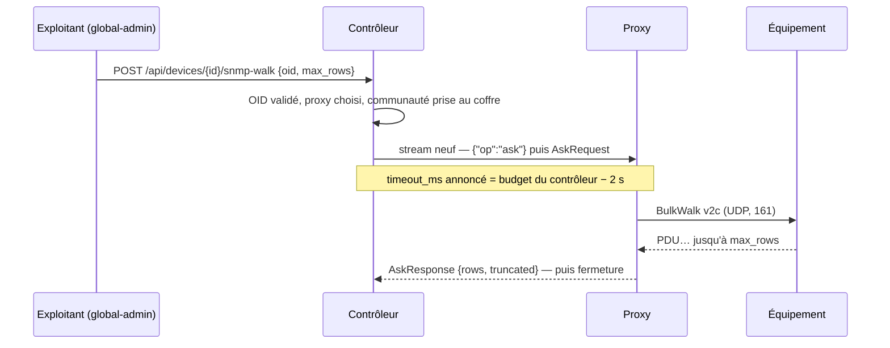

# Protocole contrôleur ↔ proxy

Un seul lien : **WebSocket sur TLS (WSS, port 443)**, initié par le [[Proxy]], maintenu en permanence. Y passent le contrôle, les streams TCP, la surveillance (configuration descendante, événements montants) et les **questions ponctuelles** du contrôleur au proxy. Traverse NAT/firewall sans configuration entrante.

Deux choses n'y passent pas, assumées et documentées plus bas : les **lots d'échantillons de métriques**, qui partent par l'API HTTP du contrôleur, et le **heartbeat**, qui doit précisément survivre à un tunnel coupé.

## Multiplexage

Messages WebSocket **binaires**, préfixés d'un en-tête compact :

```
+--------+-----------+------------------+
| type   | channel   | payload          |
| 1 byte | 4 bytes   | 0..64 KiB        |
+--------+-----------+------------------+
```

| type | Sens | Rôle |
|---|---|---|
| `CTRL` | ↔ | messages de contrôle JSON (ouverture/fermeture de canal, RPC, heartbeat) |
| `DATA` | ↔ | octets bruts d'un canal (stream TCP, corps de réponse RPC volumineux) |
| `EOF` / `RST` | ↔ | fin propre / abort d'un canal |
| `WINDOW` | ↔ | crédit de flow-control (fenêtre par canal, style HTTP/2) |

- Un **canal** = un stream TCP tunnelisé, un RPC en cours, ou le flux télémétrie (canal 0 réservé au contrôle, canal 1 à la télémétrie).
- **Flow control par canal** obligatoire : sans fenêtres, un `walk` SNMP massif ou un gros transfert de firmware affamerait les sessions SSH interactives sur le même WebSocket.
- Implémentation : s'inspirer de **yamux** (hashicorp) — on peut même utiliser yamux tel quel par-dessus un adaptateur `net.Conn` sur le WebSocket, plutôt que de réécrire le framing. Décision : **yamux sur WS** au MVP, framing maison seulement si un besoin le justifie.

> [!note] Ce qui est livré (phase 0bis) et comment les canaux s'y traduisent
> `internal/tunnel` implémente **yamux sur WebSocket**. Avec yamux, la traduction
> naturelle du canal n'est pas un numéro dans un en-tête maison mais **un stream
> par connexion**, précédé d'un préambule JSON d'une ligne :
>
> ```
> contrôleur → proxy : {"op":"dial","host":"10.100.0.10","port":4443}\n
> proxy → contrôleur : {"op":"dial_ok"}\n   ou   {"op":"dial_err","err":"…"}\n
> puis                 octets bruts, dans les deux sens
> ```
>
> Le canal 0 n'a pas besoin d'être réinventé pour le ping/pong : le **keepalive
> de yamux** le fait (20 s), aux ordres de grandeur prévus ici. Le contrôleur est
> le **client** yamux (c'est lui qui ouvre les streams), le proxy le **serveur**.
> Authentification par en-têtes `X-Meshcraft-Proxy-Id` / `-Secret` **avant**
> l'upgrade, avec le même couple que le heartbeat.
>
> Le heartbeat HTTP reste en place à côté du tunnel : il porte les ordres de
> migration et fonctionne même là où le WebSocket est bloqué. Un mécanisme qui
> dépendrait du tunnel pour réparer le tunnel serait sans valeur.
>
> Ce que le proxy rend est un `net.Conn` ordinaire : la sonde, le client HTTP et
> demain les drivers ne savent pas d'où part la connexion. C'est la règle
> « un seul chemin de code » ([[Vue d'ensemble]]).
>
> Garde-fou local : `MESHCRAFT_DIAL_ALLOW` (liste de CIDR) borne les destinations
> que le proxy accepte de joindre — configuré **sur la machine du proxy**, donc
> hors de portée du contrôleur, comme le prévoit [[Sécurité du proxy]]. Une
> allowlist illisible ne dégrade pas en « tout ouvert » : le proxy refuse alors
> tout dial et le journalise.

### Les trois motifs d'échange

Tout ce qui traverse le tunnel se ramène à **trois motifs**, et un stream n'en
porte jamais deux : son préambule dit lequel, une fois pour toutes.

| Motif | Qui ouvre | Durée de vie | Ce que le stream rend | Contrat |
|---|---|---|---|---|
| `dial` | le contrôleur | le temps de la connexion | un **flux d'octets** TCP, dans les deux sens | `DialRequest` / `DialReply` |
| `watch` | le contrôleur | permanent, un par session | **rien** — c'est une consigne, réécrite en entier à chaque changement | `WatchConfig` |
| `events` | le **proxy** | permanent, un par session | des **transitions**, poussées quand elles se produisent | `Event` |
| `ask` | le contrôleur | le temps d'un aller-retour | **une réponse**, puis le stream se ferme | `AskRequest` / `AskResponse` |

Quatre lignes pour trois motifs : `watch` et `events` sont les deux moitiés du
**canal longue durée**, ouvert en deux exemplaires parce qu'un stream ne porte
qu'un préambule, donc qu'un seul sens de demande. Le troisième motif, `ask`, est
la **question ponctuelle** — pourquoi il a fallu l'ajouter, et ce qu'il rend
possible, plus bas.

## Messages de contrôle (canal 0, JSON)

```json
// contrôleur → proxy : ouvrir un tunnel TCP
{"op": "dial", "ch": 42, "host": "10.1.2.3", "port": 22, "timeout_ms": 5000}
// proxy → contrôleur
{"op": "dial_ok", "ch": 42}            // puis DATA/WINDOW sur le canal 42
{"op": "dial_err", "ch": 42, "err": "connection refused"}

// RPC exécuté côté proxy (SNMP, scan…)
{"op": "rpc", "ch": 43, "method": "snmp.walk",
 "params": {"host": "10.1.2.3", "version": "2c", "community_ref": "s3cr3t", "oid": "1.3.6.1.2.1.2.2"}}
{"op": "rpc_result", "ch": 43, "done": true, "result": [...]}   // streaming possible: done=false

// proxy → contrôleur : télémétrie brute (canal 1) — conception, cf. note ci-dessous
{"op": "syslog", "src": "10.1.2.3", "ts": "2026-07-26T10:00:00Z", "facility": 23, "severity": 4, "msg": "..."}
{"op": "trap", "src": "10.1.2.3", "ts": "...", "oid": "1.3.6.1.6.3.1.1.5.3", "varbinds": [...]}

// vie du lien
{"op": "hello", "proxy_id": "px_...", "version": "1.4.0", "ifaces": [{"ip": "10.1.0.9/24"}]}
{"op": "ping", "seq": 812}  /  {"op": "pong", "seq": 812}
```

> [!warning] Le trap brut ne traverse pas le WAN
> La ligne `{"op":"trap"}` ci-dessus est la conception d'origine : remonter le
> datagramme tel quel au contrôleur. Ce n'est **pas** ce qui a été retenu. Un trap
> v2c est de l'UDP non authentifié ; le remonter en ferait, à l'arrivée, une source
> d'état — et donc un second chemin de vérité qu'il faudrait arbitrer contre le
> polling. Le trap **reste local au proxy**, où il ne sert qu'à avancer un poll ; ce
> qui traverse le lien est la transition dérivée de ce poll, sur le canal
> d'événements ci-dessous. Voir [[Monitoring]] §2.
>
> Une nuance ajoutée depuis, et elle ne rouvre rien : ce qui traverse aussi est le
> **fait** qu'un trap ait été accepté (`trap.seen`, une fois par équipement et par
> proxy), avec l'adresse locale qu'il visait. Pas son contenu, pas ses varbinds, rien
> dont un état puisse être déduit — seulement de quoi vérifier une adresse que le
> contrôleur avait écrite en pariant.
>
> Le `{"op":"syslog"}`, lui, reste une intention : le listener 514/udp n'est pas
> livré.

> [!warning] Le `rpc` générique n'existe pas — ce qui a été livré est `ask`
> Les lignes `{"op":"rpc","method":"snmp.walk"}` / `{"op":"rpc_result"}` ci-dessus
> sont la conception d'origine : un appel de méthode nommée, à paramètres libres,
> avec streaming de résultat. **Aucun code ne les implémente.** Ce qui a été livré
> à leur place est plus étroit et le reste par choix : un **jeu fermé de
> questions**, une réponse par stream, pas de streaming, pas d'écriture (§ *Les
> questions ponctuelles*).
>
> Deux conséquences à ne pas perdre. Le **scan** n'a jamais été un RPC : le proxy
> balaye les `prefixes[]` de sa `WatchConfig` de lui-même, et remonte des
> `host.seen`. Et le `snmp.set` de cet exemple **n'existera pas** : la question
> d'écriture n'est pas au contrat et n'y sera pas, parce que la configuration passe
> par les connecteurs, qui ont leurs garde-fous (plan, dry-run, relecture de
> vérification — [[Réconciliation]]).

## Surveillance : deux canaux longue durée

Aux streams éphémères de `dial` s'ajoutent **deux streams permanents**, un par
sens, ouverts à l'établissement du tunnel et maintenus tant qu'il vit. Même
préambule JSON d'une ligne, puis une suite de lignes JSON — pas de framing
supplémentaire à inventer :

```
contrôleur → proxy : {"op":"watch"}    puis des WatchConfig
proxy → contrôleur : {"op":"events"}   puis des Event
```

Le contrat est porté par `internal/tunnel/control.go`, qui en est la référence. Ce
sont les deux moitiés du **deuxième** motif d'échange ; le troisième — la question
ponctuelle — a sa section plus bas, et il n'est pas un canal de surveillance : rien
de ce qui est régulier n'y passe.

### Ce que le contrôleur demande (`WatchConfig`)

Une `WatchConfig` **remplace intégralement la précédente**. Envoyer des deltas
supposerait que les deux côtés partagent un état — donc qu'ils puissent diverger,
et qu'il faille un jour les resynchroniser. Un remplacement complet à chaque
changement rend la question impossible.

| Champ | Rôle |
|---|---|
| `targets[]` | équipements à surveiller (ICMP), avec leur `device_id` côté contrôleur — **toutes** les cibles retenues, rattachées ou non |
| `prefixes[]` | plages locales à balayer |
| `ping_interval_ms`, `down_after`, `sweep_interval_s` | cadence et anti-rebond |
| `snmp[]` | cibles SNMP : IP, communauté v2c, cadences `if_state` / `if_counters` **en secondes**, borne `max_ifindex` |
| `trap_listen`, `trap_port` | ce proxy doit-il écouter les traps, et sur quel port (0 = 162) |

`trap_listen` ne vaut `true` que si au moins une cible de `snmp[]` appartient à une
plateforme dont le connecteur déclare savoir pousser des traps : un trap venant
d'un équipement que ce proxy n'interroge pas n'avancerait aucun poll, et ouvrir
162/udp pour ne jamais rien recevoir est une surface d'attaque sans contrepartie.
Le port est renseigné **explicitement** même quand il vaut 162 : ce que le proxy va
ouvrir doit se lire dans ce qu'on lui a envoyé, pas dans la valeur par défaut de la
version de binaire qu'il tourne.

Deux choix se lisent dans ce tableau. D'abord **le contrôleur décide, le proxy
exécute** : les cadences que porte `snmp[]` sont **choisies** par une politique
d'exploitation puis bornées par le bas par le plancher du connecteur — deux
notions distinctes, cf. [[Monitoring unifié et pipelines]] §1.2 — et laisser un
proxy décider d'accélérer disperserait dans le parc une règle qui protège les
équipements. Le proxy reçoit donc un nombre de secondes, jamais un plancher à
interpréter : ce qu'il va faire se lit dans ce qu'on lui a envoyé. Ensuite
`trap_listen` est un **interrupteur du contrôleur**, pas une option de fichier de
configuration locale : on éteint le canal sur tout un parc sans redéployer un
binaire dans chaque réseau client. Un proxy qui n'écoute pas n'est pas dégradé —
il perd la réactivité, pas l'information.

Ce que ce canal supprime, c'est un dialogue. Le poll de confirmation qui suit un
trap **n'est pas un RPC** : le proxy ne demande pas au contrôleur la permission
d'interroger un équipement qu'il surveille déjà. Un aller-retour WAN à cet endroit
coûterait précisément la latence que le trap sert à supprimer, et le proxy détient
déjà l'IP, la communauté et la borne d'index dans la `SNMPWatch` qu'on vient de
lui pousser. Ce qui est **ponctuel et demandé** — un walk de diagnostic — passe par
le troisième motif, `ask`, décrit plus bas ; ce n'est ni ce canal ni un RPC
générique.

### Ce que le proxy remonte (`Event`)

Des **transitions**, jamais un état courant répété. Cent équipements surveillés à
1 Hz ne produisent aucun message tant que rien ne change.

**Avec un point de reprise, et il a été ajouté après coup.** Ne transmettre que des
différences fait de chaque perte une divergence permanente : un équipement est resté
`unknown` dix-neuf heures alors qu'il répondait, sa seule transition ayant disparu
(le constat et ses trois causes possibles sont dans [[Monitoring]], § *Statut des
équipements*). À l'ouverture du flux, le proxy réannonce donc l'état courant de
chaque cible, en événements `device.up` / `device.down` portant **`resync: true`**.

Ce drapeau n'est pas décoratif : il dit au contrôleur d'écrire le statut **sans**
journaliser un fait qui vient de se produire. La date d'une bascule manquée n'est pas
connaissable — ce qui l'est, c'est que le contrôleur l'avait ratée. Sans lui, chaque
reconnexion raconterait des pannes qui n'ont pas eu lieu. L'ordre d'émission est
imposé : **reliquat de la file, puis cliché, puis direct** — les événements accumulés
pendant la coupure sont plus vieux que le cliché, et les livrer après lui écraserait
l'état courant par une transition périmée.

| Type | Ce qu'il constate |
|---|---|
| `device.up` / `device.down` | joignabilité ICMP, après anti-rebond — ou un **constat réannoncé** à l'ouverture du flux, s'il porte `resync` |
| `host.seen` | une adresse a répondu dans une plage balayée |
| `sweep.done` | fin d'un balayage, avec sa couverture |
| `port.up` / `port.down` | transition d'un port de la façade, dérivée d'`ifOperStatus` |
| `trap.seen` | un trap de cet équipement vient d'être **accepté** par ce proxy, pour la première fois — le seul événement de **preuve** du contrat, avec son champ `dest_addr` |

Les événements de port portent `ifindex`, `port_name` et `trigger` :

- **`ifindex` identifie, `port_name` illustre.** `ifDescr` collisionne — sur un
  Instant On 1930, l'interface du VLAN 42 s'appelle « 42 », comme le port physique
  42. Corréler par le nom attribuerait une transition au mauvais port, ce qui est
  pire qu'un trou : c'est crédible et faux ;
- **`trigger`** vaut `"poll"` pour le cycle ordinaire et `"trap"` pour un poll
  avancé par un trap. Le champ ne dit pas d'où vient la vérité — elle vient
  toujours du poll — il dit ce qui a économisé l'attente ;
- **`detail`** ne porte que du diagnostic, et il mélange sciemment deux natures
  qu'il faut savoir distinguer à la lecture : la valeur d'`ifOperStatus` quand elle
  sort de `up`/`down` décrit **ce port** et vient du poll ; le libellé du trap
  (`linkDown`…) qualifie la **rafale** qui a réveillé le proxy, pas le port. Le
  second est un indice, jamais une donnée.

> [!important] Un `port.down` n'est jamais la lecture d'un trap
> Le proxy calcule ses transitions en comparant deux polls `if_state`, quel qu'ait
> été le déclencheur du second. Aucun état n'est écrit depuis le contenu d'un
> datagramme non authentifié ([[Monitoring]] §2). Corollaire côté contrôleur : un
> `port.down` est traité **de la même façon** qu'il porte `trigger:"poll"` ou
> `trigger:"trap"` — la seule différence est l'heure à laquelle il est arrivé.

> [!warning] La même transition peut arriver deux fois
> L'éligibilité d'un équipement à un proxy vient de sa **couverture de sites**
> ([[Proxy]]), et un proxy d'instance couvre tout : tant qu'aucun collecteur n'est
> déclaré — `devices.proxy_id` à `null`, l'état de tout le parc existant — plusieurs
> proxys pollent légitimement le même équipement et remonteront la même transition.
> Le protocole ne l'empêche pas et n'a pas à l'empêcher : la déduplication est au
> contrôleur, sur `(device_id, ifindex, type)` dans une fenêtre courte.
>
> Ce qui a changé est en amont, pas ici : le **rattachement** ([[Proxy]], § *Le
> collecteur de référence*) restreint `snmp[]` au seul collecteur de référence, donc
> **empêche** le doublon là où il est déclaré au lieu de le laisser se produire pour
> le rattraper après. Il ne rend pas la déduplication inutile — elle reste le
> comportement du régime `null`. Et il se décide **au contrôleur**, qui pousse la
> liste, pas dans le protocole : un protocole qui tenterait d'élire lui-même un
> émetteur unique rendrait la perte d'un proxy détectable avant d'être réparable.

#### `trap.seen` : la seule chose qui vérifie une prétention

Les quatre autres événements **constatent** ; celui-ci **prouve**. Il existe parce
qu'écrire une destination de traps dans un équipement est une prétention
**invérifiable autrement**. Le contrôleur y inscrit une adresse — celle que le proxy
collecteur dit employer pour joindre l'équipement, obtenue par `source_addr` — en
pariant que le chemin fonctionne **dans l'autre sens**. Rien ne le garantit : un
pare-feu, une route asymétrique, une ACL sur le VLAN de management, et l'équipement
émet dans le vide. Le `statusCode 0` de la pose ne dit rien de tout ça — il dit que
l'équipement a **retenu la ligne**, pas que ses datagrammes arrivent.

Un trap reçu, lui, ne se discute pas : il a traversé. D'où un événement dont le seul
contenu utile est le fait d'exister.

- **émis une fois par équipement et par proxy**, jamais à chaque trap (`firstSeen`,
  `cmd/proxy/trap.go`) : une preuve ne change plus une fois acquise, et un parc
  bavard ferait du canal d'événements un générateur de journal. Il se **réarme**
  quand l'équipement quitte puis retrouve la liste de surveillance — donc à chaque
  reconnexion de tunnel et à chaque changement du parc — parce qu'un équipement qui
  revient revient d'un monde où un pare-feu a pu changer. Corollaire côté
  contrôleur : la parcimonie de l'émetteur ne suffit pas — sans borne, un redémarrage
  de proxy annoncerait « chemin retour établi » pour tout le parc à la fois. Elle est
  prise **en base**, dans le `where` de l'`update` (`store.ConfirmTrapPath`), ce qui la
  rend insensible à deux traps simultanés venus de deux proxys ;
- **émis entre le filtre d'identité et l'amortissement**, et l'ordre est le sens :
  ce qui prouve le chemin est qu'un trap soit **arrivé et reconnu**, pas qu'il ait
  obtenu un poll. Un trap absorbé par la fenêtre de coalescence a traversé le même
  pare-feu que celui qui l'a ouverte. En revanche jamais **avant** le filtre : un
  tiers sur le chemin fabriquerait la preuve d'un équipement qui n'a rien émis.

##### `dest_addr` : la preuve ne vaut que si elle est ATTRIBUABLE

C'est le champ qui a demandé un correctif de fond, et la raison se lit en une phrase :
le filtre du proxy ne regarde que l'**IP source**, et sa socket écoute l'**adresse
joker**. « Un trap est arrivé ici » n'est donc pas « l'adresse que j'ai écrite reçoit
les traps de cet équipement » — un équipement qui émettrait vers un autre collecteur
joignable sur la même machine produisait une preuve sans le moindre rapport avec notre
prétention.

Le proxy rapporte donc l'adresse **locale visée par le datagramme**, lue au noyau
(`ipv6.FlagDst` sur une socket AF_INET6, `ipv4.FlagDst` à défaut), et c'est le
contrôleur — seul détenteur de la prétention — qui la confronte à ce qu'il a écrit.
Deux propriétés à ne pas perdre :

- **le proxy ne comble pas un « je ne sais pas »**. Champ vide quand le noyau refuse
  PKTINFO, jamais l'adresse qu'il croit employer pour joindre l'équipement : ce serait
  comparer la prétention **à elle-même**, et rendre la vérification tautologique. Un
  proxy annonce d'ailleurs à son bind s'il sait attribuer (`destination_lisible`), et
  le dit **en avertissement** quand il ne sait pas — le taire laisserait croire à une
  vérification qui n'a pas lieu ;
- **la comparaison est une ÉGALITÉ**, et c'est le contrôleur qui la fait
  (`judgeTrapProof`, `internal/api/trapdest.go`). L'adresse est démappée des deux
  côtés : une socket double pile rend « ::ffff:10.42.0.67 » là où le contrôleur a
  écrit « 10.42.0.67 », et comparer les textes ferait échouer l'attribution selon
  l'humeur de la pile réseau de l'hôte.

**Quatre issues**, pas deux, parce que « pas de réponse » et « autre adresse » ne se
traitent pas pareil :

| Issue | Ce que le trap établit | Ce qu'on en fait |
|---|---|---|
| **confirme** — bon proxy, adresse **égale** à celle écrite | notre prétention, au sens fort | confirmation enregistrée, `trap.path_confirmed` en notice : *l'adresse écrite était une hypothèse sur le routage retour ; elle est vérifiée* |
| **non attribuée** — bon proxy, adresse **inconnue** (`dest_addr` vide) | « les traps de cet équipement atteignent ce proxy », et rien de plus | confirmation **enregistrée quand même**, avec une phrase plus faible qui nomme ce qui n'est pas vérifié |
| **autre adresse** — bon proxy, **autre** de ses adresses | le canal fonctionne, mais pas par où meshcraft l'a écrit | **rien enregistré**, un avertissement au journal applicatif |
| **étrangère** — proxy qui n'est pas celui de la destination, ou aucune destination enregistrée | un chemin existe pour ce proxy-là | remarqué en info, jamais enregistré |

> [!note] La deuxième issue est un choix d'exploitation, pas une tolérance
> Refuser d'enregistrer une preuve non attribuée aurait l'air plus rigoureux et
> coûterait plus cher : un parc entier de proxys **non mis à jour** — ou tournant sur
> un noyau qui refuse PKTINFO — resterait affiché « jamais confirmé » alors que sa
> supervision est bel et bien réactive. On chercherait des pare-feu qui n'existent
> pas. Le fait acquis s'enregistre donc, et c'est le **vocabulaire** qui porte la
> nuance (`trapConfirmedMessage`) : les traps *atteignent* le collecteur, ce qui n'est
> pas *l'adresse écrite les reçoit*.
>
> La troisième, elle, refuse — et c'est le cas que toute cette vérification existe
> pour attraper : l'équipement porte un destinataire que meshcraft n'a pas posé (une
> ligne restée d'un collecteur précédent, un second logiciel de supervision), il émet
> vers lui, et l'adresse que nous avons écrite n'est peut-être joignable par personne.
> Y écrire « chemin vérifié » serait affirmer d'un chemin que rien n'a emprunté.

> [!warning] Le faux négatif est ASSUMÉ, et le journal nomme ses deux causes
> Un proxy derrière une **traduction d'adresse** reçoit ses traps sur une adresse
> locale que le contrôleur n'a jamais écrite : ses preuves tombent en « autre adresse »
> et ne seront donc jamais enregistrées, alors que sa supervision est réactive. C'est
> le prix de l'égalité stricte, et il est payé sciemment — l'inverse (accepter toute
> adresse) supprimerait la seule vérification du lot.
>
> Ce qui rend le prix acceptable est que l'avertissement porte **les deux** causes
> possibles — « soit l'équipement porte un destinataire que meshcraft n'a pas posé,
> soit ce proxy reçoit ses traps par traduction d'adresse » — parce qu'elles se
> réparent à l'**opposé** l'une de l'autre : un destinataire de trop se retire, une
> traduction d'adresse s'assume. Un message qui n'en nommerait qu'une enverrait
> démonter la mauvaise moitié de l'installation.

##### Ce que le premier essai sur matériel a établi

Le chemin complet a été validé sur un équipement réel — c'est ce qui fait la
différence entre un contrat plausible et un contrat éprouvé :

| Fait relevé | Ce qu'il démontre |
|---|---|
| Instant On 1930 en `10.99.200.101`, derrière un proxy déporté | le cas ordinaire, pas un banc de test en boucle locale |
| `source_addr` rend `10.42.0.67` — adresse **routée** : aucun des sous-réseaux du proxy ne contient l'équipement | l'algorithme évident (chercher l'adresse du bon sous-réseau) n'aurait rendu **rien du tout** — cf. § *`source_addr`* |
| la pose réussit, puis un trap arrive **sur cette adresse même** | l'hypothèse de routage retour est vérifiée, et l'issue « confirme » n'est pas théorique |
| les transitions de port qui suivent portent `trigger: "trap"` | le chemin rapide sert réellement, et le champ `trigger` est ce qui permet de le constater |

> [!warning] `Event.TS` est un fait de DIAGNOSTIC, jamais une date qui s'ordonne
> Découvert au même essai, et la leçon dépasse largement les traps. La preuve était
> d'abord enregistrée avec l'horodatage posé par le **proxy**, alors que la date de la
> pose vient de `now()` en base, donc du **contrôleur**. Les deux colonnes
> cohabitaient dans la même ligne et invitaient à une comparaison dénuée de sens :
> l'écart mesuré était de **onze secondes**, le proxy en retard, ce qui faisait
> apparaître la preuve **avant** ce qu'elle prouve. Pas une violation de causalité —
> un mélange d'horloges.
>
> La règle qui en sort : **le contrôleur est la seule horloge qui puisse ordonner ses
> propres prétentions.** Une date fournie par un proxy dit ce que le *proxy* croit ;
> c'est une information sur l'état du parc, jamais une valeur qui se compare à ce que
> le contrôleur a écrit. Le même défaut existait dans la corrélation de battement, qui
> comparait un `ev.TS` de proxy aux `time.Now()` de son balayage : ses seuils valaient
> donc le seuil **écrit** plus la dérive d'une machine qu'on ne contrôle pas
> ([[Monitoring]], § *Anti-flap*).
>
> Le geste de correction est ce qu'il faut retenir : le paramètre d'horodatage a été
> **retiré** des fonctions concernées, pas documenté. Tant qu'il n'existe pas, personne
> ne peut y faire entrer la date d'un tiers — un commentaire, lui, se contourne sans le
> savoir.
>
> `Event.TS` garde exactement un usage : la **dérive elle-même**, journalisée en
> avertissement, avec des seuils **asymétriques** (`trapClockNote`) — 5 s de retard,
> 1 s d'avance. Un retard se confond avec un transport lent : l'événement peut avoir
> attendu dans la file du proxy, puis dans un WAN coupé. Une date dans l'avenir n'a
> aucune explication innocente, aucun transport ne fait remonter le temps. Et cette
> mesure a une valeur propre : rien d'autre dans meshcraft ne surveille l'heure des
> proxys, dont un sans NTP dérive en minutes.

| Question | État |
|---|---|
| `trap.seen` au contrat, émis une fois par équipement et par proxy, réarmé au retrait | **livré** — `internal/tunnel/control.go`, `cmd/proxy/trap.go` (`firstSeen`, `forget`) |
| `dest_addr` lu au noyau (PKTINFO), vide quand le noyau refuse, jamais comblé | **livré** — socket maison plutôt que `gosnmp.TrapListener`, qui ne rend que la source |
| Confrontation à l'adresse écrite, quatre issues, borne en base | **livré** — `judgeTrapProof`, `store.ConfirmTrapPath` |
| Dérive d'horloge journalisée, horodatage de proxy hors de toute comparaison | **livré** — `trapClockNote`, et le paramètre retiré des signatures |
| Preuve d'un proxy derrière une traduction d'adresse | **faux négatif assumé** — les deux causes sont nommées au journal, aucune n'est devinée |
| Preuve d'un trap **v3** | **hors sujet par construction** : sans communauté, `classifyTrap` le rejette avant tout le reste ([[Identité de service et rotation]]) |

### Valeurs par défaut de la surveillance

(Les bornes des questions ponctuelles sont dans la section suivante.)

| Constante | Valeur | Pourquoi |
|---|---|---|
| `DefaultPingInterval` | 1 s | |
| `DefaultDownAfter` | 3 pertes | un paquet perdu ne doit pas faire clignoter le parc |
| `DefaultSweepInterval` | 10 min | |
| `DefaultTrapPort` | 162 | le port réglementaire (RFC 3411) |
| `TrapCoalesce` | 250 ms | un 48 ports qui redémarre émet une rafale de traps → **un** poll |
| `TrapMinPollGap` | 2 s | plancher entre deux polls déclenchés par trap sur un même équipement |

## Les questions ponctuelles (`ask`) : le troisième motif

`dial` porte le trafic, `watch` la consigne, `events` l'alerte. Il manquait la
**question** : un fait que le contrôleur ignore, que le proxy est le seul à pouvoir
établir, et dont la réponse tient en une ligne. Le contrat est
`internal/tunnel/control.go` (`OpAsk`), qui en est la référence ; `Hub.Ask`
(`internal/tunnel/hub.go`) en tient la moitié contrôleur, `cmd/proxy/rpc.go` la
moitié proxy.

```
contrôleur → proxy : {"op":"ask"}\n   puis une AskRequest\n
proxy → contrôleur : une AskResponse\n   puis le stream se ferme
```

### Pourquoi aucun des trois autres streams ne pouvait le faire

La conclusion — ajouter un motif au protocole — est la plus coûteuse des options
possibles, donc le raisonnement se lit ici plutôt que de se redécouvrir :

- **`watch` va dans le bon sens, mais il ne rend rien.** C'est une *consigne* : le
  contrôleur dit quoi surveiller, le proxy applique. Y glisser une interrogation
  demanderait une réponse, donc un appariement, donc un état partagé — exactement
  ce que le remplacement intégral de la `WatchConfig` existe pour éviter ;
- **`dial` rend un flux TCP.** Or SNMP est de l'**UDP** : il n'y a rien à relayer,
  aucun octet à faire circuler de bout en bout. Et « quelle adresse source
  emploierais-tu pour joindre cette IP ? » n'est pas une connexion à ouvrir — c'est
  une lecture de la table de routage du proxy, qu'aucun `dial` n'exprime ;
- **le canal d'événements va dans l'autre sens.** Le proxy y pousse ce qu'il a
  constaté ; le contrôleur n'y demande rien.

Ce qui reste est la vraie raison, et elle est structurelle : **certains faits ne
sont connaissables que depuis le proxy.** Pas « plus faciles à obtenir de là » —
connaissables *uniquement* de là. Un contrôleur qui les déduirait de son inventaire
produirait une réponse crédible et fausse (§ *`source_addr`*).

### Ponctuel et sans état, délibérément

Une question, une réponse, le stream se ferme. Rien à apparier, rien à nettoyer si
le contrôleur disparaît au milieu, rien à resynchroniser après une coupure : un
stream mort est une question perdue, et une question perdue se repose.

> [!note] Pourquoi pas un troisième canal permanent
> Un canal longue durée de plus aurait demandé une **corrélation requête/réponse**
> — des identifiants de requête, une table des questions en vol, un délai de
> nettoyage, et la gestion des réponses qui arrivent après que l'appelant a
> renoncé. C'est le prix normal d'un canal *bavard*. Ces questions se posent
> **quelques fois par jour, à la main** : payer une machinerie d'appariement pour
> ce débit aurait été un mauvais échange, et un stream par question rend le même
> service pour le coût d'une ouverture yamux.
>
> Le corollaire assumé : `ask` n'est pas un chemin de collecte. La supervision
> continue reste dans `watch` / `events`, où elle ne coûte rien par mesure.



### Les deux questions du contrat

| Question | Ce qu'elle demande | Ce qu'elle rend | Ce qu'elle débloque |
|---|---|---|---|
| `snmp_walk` | walke `oid` sur `ip`, en v2c | des `AskRow` `{oid, type, value}` + `truncated` | **découvrir** les OID qu'un équipement sert réellement, au lieu de les deviner dans une MIB constructeur |
| `source_addr` | quelle adresse locale emploierais-tu pour joindre `ip` ? | une adresse, sans masque, sans port, sans zone | disposer d'une **adresse concrète** à écrire dans un équipement, plutôt qu'une adresse déduite |

#### `snmp_walk` : l'équipement sait dire ce qu'il expose

Une MIB constructeur dit ce qu'une *gamme* est censée servir ; un walk dit ce que
**cet** équipement, avec **ce** firmware, sert vraiment. La différence est celle
entre écrire un collecteur sur une hypothèse et l'écrire sur un relevé — le même
partage que la brique `web-probe` a introduit pour les connecteurs web
([[Connecteurs]]). C'est ce qui rend abordables les capteurs qu'aucune MIB standard
ne normalise vraiment : puissance optique d'un SFP, températures, PoE par port.

Trois détails du contrat rendent la réponse exploitable, et ils sont là pour éviter
des diagnostics faux :

- **la valeur est du TEXTE, le type est à côté.** Un `Counter64` ne passe pas dans
  un float JSON sans perte, et c'est précisément sur les compteurs qu'on
  interroge : `ifHCInOctets` d'un lien chargé dépasse 2^53 en quelques mois, et un
  arrondi ne se voit pas — on lirait un débit faux sans jamais savoir pourquoi ;
- **le type est nommé comme une MIB le nomme** (`Counter64`, `Gauge32`,
  `TimeTicks`…), y compris les trois réponses de SNMPv2 qui ne sont pas des valeurs :
  `NoSuchObject`, `NoSuchInstance`, `EndOfMibView`. Les rendre telles quelles **est**
  le diagnostic — c'est exactement ce qu'on cherchait à savoir ;
- **un `OctetString` n'est pas du texte.** Dès que les octets ne forment pas un
  texte imprimable, la valeur est rendue en hexadécimal préfixé `0x`. Sans ça,
  `json.Marshal` remplace silencieusement tout octet non-UTF-8 par U+FFFD : une
  adresse MAC arriverait transformée, sans que rien ne signale la substitution.

> [!note] Le walk de diagnostic parle comme le poll, exprès
> La session SNMP d'une question **hérite** des conventions du poll ordinaire —
> elle ne les recopie pas : `snmppoll.Dial` est la seule porte d'entrée d'une
> session SNMP dans tout le produit. **v2c**, timeout 2 s, un seul réessai, port 161
> par défaut, communauté vide valant `snmppoll.DefaultCommunity`.
>
> L'enjeu n'est pas cosmétique. Un walk manuel qui réussirait avec des paramètres
> plus larges que le collecteur ferait conclure que la supervision « perd » des OID
> que l'équipement expose — alors que c'est la question qui aurait triché. Et
> l'inverse est pire : ces conventions ont existé en **trois exemplaires** (le poll,
> le walk, le filtre des traps), et une divergence d'un seul côté ne produit aucune
> erreur, seulement deux clients qui décrivent le même équipement différemment.
> C'est pourquoi une seule constante porte le repli de communauté, et qu'un test la
> vérifie **sur le fil** — en comptant les datagrammes et en chronométrant le
> délai, parce qu'un timeout ne s'observe pas autrement qu'en l'attendant.

#### `source_addr` : la question qui paraît inutile et ne l'est pas

C'est le point à comprendre, parce que l'algorithme évident semble suffire : prendre
les adresses que le proxy déclare (`proxies.ifaces`, remontées dans le `hello`) et
retenir celle du sous-réseau de l'équipement. **C'est faux dès que le proxy atteint
l'équipement par routage** plutôt que par un lien direct.

Relevé sur l'installation réelle : le proxy expose `10.42.0.67/24` et
`172.17.0.1/16`, l'équipement de labo est en `10.99.200.101`. Aucune
correspondance — et pourtant le proxy l'atteint. L'algorithme évident ne rend donc
**rien du tout**, et un opérateur en conclurait que le proxy ne voit pas
l'équipement.

Seul le noyau du proxy sait, parce que seul lui a la table de routage. La réponse
est l'adresse qu'il **emploierait**, obtenue en « connectant » une socket UDP vers
la cible : aucun paquet n'est émis, le noyau résout la route pour choisir l'adresse
source, et `LocalAddr` la dit. Absence de route ⇒ une `Err` explicite, jamais une
adresse vide : une réponse vide passerait pour un succès.

Cette adresse est ce qu'on écrit dans un équipement pour qu'il émette vers le bon
endroit. Le lot qui l'écrit — la pose du destinataire de traps — vit ailleurs ; ce
protocole n'en porte que la **question**. Elle a désormais un **appelant** :
`internal/api/trapdest.go` la pose au collecteur de référence juste avant d'écrire la
ligne dans l'équipement. Ce n'est toujours **pas** une route d'API : « par quelle
adresse ce proxy joint-il cet équipement ? » reste une donnée interne dont le produit
se sert, et la preuve que la réponse était juste remonte par `trap.seen` (§ *Ce que le
proxy remonte*).

> [!warning] Lecture seule par construction, et définitivement
> Il n'existe **aucune** question d'écriture au contrat, et il n'en existera pas.
> Ce n'est pas une précaution de première livraison qu'on relèvera plus tard : la
> configuration passe par les connecteurs, qui portent le plan, le dry-run et la
> relecture de vérification ([[Réconciliation]], [[Connecteurs]]). Un `ask`
> d'écriture serait un second chemin de modification du parc, sans plan, sans
> trace de diff et sans relecture — c'est-à-dire exactement ce que la
> [[Réconciliation]] existe pour interdire. Rien n'est préparé « pour plus tard »
> côté proxy : ouvrir l'écriture demanderait de refaire ce raisonnement d'abord.
>
> À noter, parce que ça surprend : l'allowlist locale `MESHCRAFT_DIAL_ALLOW` ne
> s'applique **pas** au walk. Elle borne le relai TCP, seul chemin par lequel du
> trafic arbitraire circule ; une lecture SNMP part comme un poll ordinaire ou un
> balayage de plage, qui ne la consultent pas non plus. Deux règles différentes pour
> joindre le même équipement finiraient par autoriser sa supervision tout en
> refusant son diagnostic.

### Les bornes, et ce que chacune empêche

| Borne | Valeur | Où elle s'applique | Ce qu'elle empêche |
|---|---|---|---|
| `DefaultAskRows` | 500 lignes | contrôleur et proxy | ce qu'on rend quand la question ne borne rien |
| `MaxAskRows` | 5000 lignes | **des deux côtés** : `ClampAskRows` (hub), la route d'API, et `askMaxRows` côté proxy | un walk sous `1.3.6.1` rend des dizaines de milliers de lignes ; la mémoire qui les tient est celle d'un proxy qui tourne sur une VM minimale ou un Raspberry Pi |
| `DefaultAskWait` | 15 s | `ClampAskWait`, **la même fonction** pour les deux côtés — deux implémentations, une par côté du tunnel, auraient fini par diverger | ce qu'on accorde quand la question ne dit rien : de quoi walker une `ifTable` de 48 ports, sans immobiliser une requête HTTP |
| `MaxAskWait` | 60 s | idem | qu'une requête HTTP se fasse retenir dix minutes par un proxy en difficulté, même si celui qui la pose le demande |
| `maxAskResponse` | 8 Mio | contrôleur, lecture bornée | qu'une ligne de plusieurs centaines de mégaoctets fasse tomber le **contrôleur**, donc tout le parc, pour un diagnostic posé sur un seul équipement |
| `askMargin` | 2 s | contrôleur, retranchées du budget annoncé | que les deux côtés expirent au même instant (voir ci-dessous) |
| `askMinBudget` | 1 s | contrôleur | une question à budget nul, qui n'est pas une question |
| `preambleWait` | 15 s, recalé sur l'attente accordée + 5 s pour l'écriture | proxy | qu'un pair qui ouvre un stream sans jamais dire ce qu'il veut immobilise une goroutine — et que la deadline du préambule tue le stream *avant* l'écriture d'une réponse longue |
| `maxOIDArcs` / arc max | 128 arcs, 2^32−1 par arc | contrôleur, `normalizeOID` | un champ de saisie qui a débordé, ou un identifiant d'interface collé au bout d'un OID (RFC 3416 / RFC 2578 §7.1.3) |

Quatre de ces bornes méritent leur phrase, parce que leur absence ne se serait pas
vue tout de suite :

- **le plafond de lignes est appliqué des DEUX côtés**, et vérifié *sur la réponse*
  et pas seulement demandé dans la question. Un plafond qu'un seul côté vérifie
  n'en est pas un : le proxy peut être **plus ancien** que le contrôleur, et une
  borne appliquée uniquement là-bas se relèverait en déployant un vieux binaire.
  La route d'API la ravale une troisième fois pour pouvoir rendre à l'appelant la
  borne **réellement retenue** — sans quoi `truncated` n'est pas interprétable ;
- **le drapeau de troncature n'est pas un confort.** Sans lui, une réponse coupée
  passerait pour une table complète, et on conclurait qu'un équipement n'a pas les
  OID qu'on cherchait — l'exact contresens de la question posée. Sa sémantique est
  stricte : la ligne *de trop* n'est pas gardée, elle sert seulement à établir qu'il
  en restait. `truncated` dit donc « il y avait plus », jamais « peut-être », et un
  walk qui tombe pile sur la borne n'est pas signalé tronqué. Il ne parle **que** de
  `MaxRows` : un walk coupé par un timeout se dit dans `Err`, avec sa cause ;
- **la lecture est bornée côté contrôleur** parce que la réponse vient d'un binaire
  déployé chez un client, pas nécessairement de la même version. C'est le défaut que
  le projet a corrigé ailleurs (le plafond de corps des lots de métriques), et 8 Mio
  est du même ordre de grandeur : de quoi tenir 5000 lignes à ~1,6 Kio — une valeur
  SNMP est du texte que l'équipement choisit, un `sysDescr` fait des centaines
  d'octets ;
- **la marge de budget est ce qui préserve le diagnostic.** Le contrôleur annonce au
  proxy une attente plus courte de 2 s que la sienne, pour que le proxy **rende la
  main avant** que l'échéance ne tombe. Sans cette marge, les deux expireraient au
  même instant : le « je n'ai pas obtenu de réponse de l'équipement » du proxy — la
  phrase qui dit réellement ce qui s'est passé — arriverait après qu'on a cessé
  d'écouter, et l'échec se présenterait comme un silence du proxy. On aurait échangé
  un diagnostic contre un mystère pour 2 s de budget.

### Les échecs sont séparés, parce que les gestes diffèrent

Cinq issues, cinq réponses HTTP distinctes : quatre sentinelles et un type d'erreur,
tous publics dans `internal/tunnel`. Le tri se fait sur eux et **jamais sur le
texte** des messages — un tri sur des chaînes ne survit pas à la première
reformulation. Les confondre dans un unique 502 « la question a échoué » enverrait
regarder l'équipement quand il faut rallumer un proxy, ou l'inverse.

| Issue | Sentinelle | HTTP | Le geste qu'elle appelle |
|---|---|---|---|
| aucun tunnel avec ce proxy | `ErrNoTunnel` | 503 | rallumer le proxy, ou son lien — rien n'est cassé |
| le proxy a répondu « je n'ai pas pu » | `AskRemoteError` (avec son `Detail`) | 502 | lire le diagnostic : il vient de la machine qui a essayé |
| rien n'est arrivé dans le délai | `ErrAskTimeout` | 504 | regarder l'équipement : muet sur 161/udp, ou communauté différente de celle du coffre — un agent qui refuse une communauté **se tait**, il ne proteste pas |
| stream fermé sans une ligne | `ErrAskClosed` | 502 | **monter le proxy de version** |
| réponse illisible (JSON cassé, ligne interminable) | `ErrAskUnreadable` | 502 | rien sur le parc : défaut de protocole entre deux binaires |

Un proxy qui a *répondu* avec des lignes **et** une erreur voit ses lignes remonter
quand même : sur un équipement qui répond puis se tait, « voilà les 40 premières
lignes et voilà pourquoi ça s'est arrêté » vaut mieux que rien.

> [!important] Un proxy trop ancien ferme le stream sans un mot — et on le dit
> Un proxy qui ne connaît pas `ask` ferme le stream qu'il ne sait pas servir : pas
> de réponse, pas d'erreur, pas de log. C'est indiscernable d'une panne **sauf** si
> on distingue « fermé sans une ligne » (`ErrAskClosed`) de « rien n'est arrivé à
> temps » (`ErrAskTimeout`) — d'où deux sentinelles là où une aurait suffi à faire
> échouer l'appel. Le message rendu est explicite : *ce proxy ne sait probablement
> pas encore répondre aux questions ponctuelles, montez-le de version*.
>
> **C'est le cas normal sur une installation dont le proxy n'a pas été
> redéployé** : le mécanisme est livré côté contrôleur *et* côté proxy, mais un
> binaire déjà en marche ignore la question. Trois symptômes se ressemblent et n'ont
> pas la même cause : proxy trop ancien (fermeture), proxy à jour sans répondeur
> câblé (`Err` : « ce proxy ne répond à aucune question »), question inconnue de ce
> proxy (`Err` : « question inconnue de ce proxy : "…" (proxy plus ancien que le
> contrôleur ?) »). Les deux derniers **parlent**, et c'est délibéré : un silence ne
> se répare pas, une phrase se lit.

### La route de diagnostic

`POST /api/devices/{id}/snmp-walk` est la moitié contrôleur de `snmp_walk`, et la
seule question exposée en HTTP.

- **`global-admin`, en plus du `site_admin` sur le site de l'équipement, et sans
  écran.** Elle suit exactement le précédent de `POST /api/devices/{id}/web-probe`
  ([[Connecteurs]]) : même rôle — mettre au point un collecteur sur un équipement
  réel — même niveau de droit, même absence d'interface. L'exposer plus bas serait
  une escalade : la primitive fait **émettre du trafic depuis l'intérieur du réseau
  d'un client**, vers un OID et un port choisis dans la requête (l'adresse, elle,
  est celle de management de l'équipement — jamais une adresse libre). C'est un
  `POST` et non un `GET` parce que la question porte un corps (OID, bornes) ;
- **le secret est passé par opération.** La communauté v2c est prise **au coffre**
  du site et jamais dans la requête ; le proxy reçoit une adresse et une communauté,
  pour la durée d'une question — ni le coffre, ni un identifiant de parc. Même règle
  que les connecteurs ([[Credentials]], [[Identité SNMP]]). Elle ne sort jamais dans
  un journal, pas même en debug, ni dans le texte d'une erreur ;
- **un équipement en v3 est refusé avec sa raison.** Le walk est v2c, comme le
  collecteur : il n'existe aucune communauté à présenter, et interroger quand même
  ne rendrait qu'un délai d'attente — c'est-à-dire un diagnostic qui accuse
  l'équipement d'être muet alors qu'il a raison de se taire. La question v3 viendra
  avec [[Identité de service et rotation]]. Trois autres refus lisibles précèdent
  toute émission : OID non numérique ou mal formé, aucun plan SNMP connu, aucune
  communauté au coffre pour ce site ;
- **le proxy interrogé est celui qui collecte**, choisi côté contrôleur avec le même
  prédicat de couverture que la collecte : un équipement rattaché est interrogé par
  **son** collecteur de référence, un équipement non rattaché par un proxy couvrant
  ([[Proxy]]). Pas de substitution quand le collecteur déclaré ne couvre plus le
  site : on **refuse**, parce qu'un walk répondu depuis un autre point du réseau est
  la réponse à une autre question — et il masquerait le vrai problème, l'équipement
  n'étant plus collecté par personne ;
- **la question laisse une trace.** Un événement `device.snmp_walk` (`info`, rien
  n'a changé sur l'équipement) est écrit au [[Journal d'événements]] avec l'OID, le
  proxy et le nombre de valeurs : une interrogation manuelle d'un équipement de
  production doit garder le nom de qui l'a posée.

`source_addr` n'est **pas** exposée : « par quelle adresse ce proxy joint-il cet
équipement ? » n'est pas un diagnostic pour un exploitant, c'est une donnée interne
dont le produit se sert.

### Décidé / livré / ouvert

| Question | État |
|---|---|
| Le motif `ask` : préambule, une question, une réponse, fermeture | **livré** (`internal/tunnel`, `cmd/proxy/rpc.go`) |
| `snmp_walk` et sa route de diagnostic `global-admin` | **livré** (`internal/api/ask_handlers.go`) |
| `source_addr` | **livré** côté contrat, côté proxy **et côté appelant** : la pose du destinataire de traps la consomme (`internal/api/trapdest.go`). Toujours pas exposée en HTTP, et ça ne changera pas |
| Lecture seule (aucune question d'écriture) | **décidé, définitif** — la configuration reste aux connecteurs |
| Question SNMPv3 | **ouvert**, subordonné à [[Identité de service et rotation]] |
| Réponse en plusieurs fragments (walk au-delà de 5000 lignes) | **non prévu** : la borne existe pour ne pas avoir à streamer |
| Exposition de `snmp_walk` dans l'UI | **non fait**, et pas demandé : outil de mise au point, pas d'écran |

## Ce qui ne passe pas par le tunnel

**Quatre** choses **empruntent délibérément un autre chemin, ou aucun** :

1. le **heartbeat HTTP**, maintenu à côté du tunnel — il porte les ordres de
   migration et fonctionne là où le WebSocket est bloqué ([[Versionnage et mise à
   jour du proxy]]). Un mécanisme qui dépendrait du tunnel pour réparer le tunnel
   serait sans valeur ;
2. les **traps bruts**, qui restent locaux au proxy et n'y servent qu'à avancer un
   poll — et, une fois par équipement, à prouver le chemin retour sans que rien de
   leur contenu ne voyage (callout ci-dessus, [[Monitoring]] §2) ;
3. les **échantillons de métriques**, détaillés ci-dessous ;
4. les **clichés de voisinage LLDP** (`POST /api/proxy/lldp`), ajoutés le 29/07/2026.

Rien d'autre : le contrôle, les streams TCP, la surveillance et les questions
ponctuelles passent tous par le tunnel, et il n'existe aucun autre chemin
d'écriture vers un équipement que les connecteurs, qui dialent **à travers** ce
même lien.

> [!note] Le voisinage LLDP : pourquoi un QUATRIÈME chemin, et pourquoi aucun des trois motifs
> C'est la seule addition de ce genre depuis les métriques, et le raisonnement doit se lire
> ici pour ne pas se redécouvrir — les trois motifs du tunnel avaient tous l'air de convenir :
>
> - **`watch` / `events`** ne portent que des **transitions**, jamais un état courant répété
>   (§ *Ce que le proxy remonte*). Un cliché de table entière toutes les soixante secondes
>   violerait cet invariant, et la file de 256 entrées du canal est dimensionnée pour des
>   bascules rares. Fabriquer des `neighbor.new` / `neighbor.gone` rendrait chaque perte
>   d'événement **définitive** — exactement le défaut que `resync` a coûté cher à réparer ;
> - **`ask`** est explicitement *« pas un chemin de collecte »* (§ *Ponctuel et sans état*).
>   Il est à l'initiative du contrôleur, à la main, quelques fois par jour ;
> - **`dial`** rend un flux TCP, et SNMP est de l'UDP.
>
> Reste le motif des métriques : du volume périodique, poussé par HTTP, authentifié par le
> couple `(proxy_id, secret)`, et soumis au même **contrôle de portée** — l'autorité de
> COLLECTE, puisqu'un cliché sort du polling. Ce qui l'en distingue est qu'il **n'y a pas de
> tampon** : un point de mesure perdu l'est pour toujours, un cliché de voisinage perdu est
> réémis une minute plus tard, **plus frais** que celui qu'on aurait rejoué. Bufferiser
> aurait coûté de la mémoire pour repousser une information périmée. Voir
> [[Voisinage LLDP]] §2.
>
> Un autre écart, assumé : le refus de portée est un **403 franc** là où
> `/api/proxy/metrics` répond 200 en jetant les échantillons hors portée. Là-bas un lot mêle
> plusieurs équipements et refuser le tout ferait perdre les mesures légitimes puis rejouer
> le même lot indéfiniment ; ici une requête = **un** équipement, il n'y a rien de légitime
> à sauver, et le proxy n'a aucun tampon à débloquer.

Les échantillons, donc : le proxy les met en
tampon et les pousse par l'API HTTP du contrôleur (`POST /api/proxy/metrics`,
authentifié par le couple `proxy_id` / secret), par lots, **toutes les 2 s** et
jusqu'à **4 lots** par réveil (`flushEvery`, `maxFlushBurst`, `maxPerFlush` = 3000
échantillons — `cmd/proxy/snmp.go`). C'est ce qui explique l'asymétrie de latence
que l'UI donne à voir : une transition de port arrive **immédiatement** par le
canal d'événements, la série temporelle du même port attend le vidage du tampon.
Faire l'inverse — les transitions dans le tampon — rendrait le temps réel
dépendant du rythme d'ingestion des métriques.

C'est la **fréquence** qui porte le débit, pas la taille du lot : 4 × 3000 toutes
les 2 s font 6000 échantillons par seconde, et la rafale est aussi ce qui permet à
un tampon en retard — retour de coupure de tunnel — de se rattraper au lieu de
courir derrière la collecte pour toujours. Le calcul complet, ce qu'il implique en
nombre d'équipements par proxy et ce qui se passe au débordement sont en §2.4 de
[[Monitoring unifié et pipelines]].

## Règles de robustesse

- **Heartbeat applicatif** (ping/pong JSON toutes les 20 s, timeout 60 s) en plus du ping WebSocket : détecte les demi-connexions NAT.
- **Reconnexion** : backoff exponentiel avec jitter (1 s → 60 s max). À la reconnexion, tous les canaux sont morts : le contrôleur marque les jobs en cours `interrupted` et les rejoue selon leur politique ([[Réconciliation]] — jamais de rejeu aveugle d'un apply).
- **Rejeu télémétrie** : le proxy bufferise ce qu'il ne peut pas pousser et le rejoue avec son horodatage d'origine ([[Proxy]]). Deux précisions que la conception d'origine ne faisait pas :
  - les échantillons sont bufferisés **en mémoire**, pas sur disque (`internal/metricbuf`, livraison au moins une fois par `Take`/`Ack`/`Nack`). Un point perdu est ré-échantillonné cinq secondes plus tard, contrairement à un changement de configuration qui ne revient jamais tout seul — écrire chaque échantillon sur disque coûterait plus que ce que ça sauve. Le tampon survit à une coupure de **tunnel**, pas à un redémarrage du processus, et le dire vaut mieux que laisser croire à une durabilité qui n'existe pas ;
  - **un trap ne se rejoue pas.** Il n'est pas une donnée : c'est un déclencheur local, dont la seule valeur est d'être traité *tout de suite*. Le rejouer à la reconnexion demanderait un poll pour un état que le proxy a déjà relevé depuis, et remonterait une transition périmée comme si elle venait d'arriver.
- **Versionnage** : champ `version` dans `hello` (horodatage de build UTC) **et** champ `protocol` entier — le premier dit *quand*, le second sert à refuser ou dégrader proprement les proxys trop anciens. Le `hello` porte aussi `os`/`arch` et le rapport de mise à jour ([[Versionnage et mise à jour du proxy]]). Le protocole n'ajoute que des champs (jamais de changement de sémantique d'un `op` existant). L'arrivée d'`ask` est le premier cas concret d'un `op` qu'un proxy déployé ne connaît pas : la dégradation ne se lit pas dans le `hello` mais dans l'échec de la question, qui **nomme** la cause au lieu de ressembler à une panne (§ *Les questions ponctuelles*). Un nouveau motif d'échange se déploie donc sans coordination — le contrôleur peut le poser avant que le parc de proxys ne soit à jour, ce qui est la seule façon réaliste de mettre à jour des binaires installés chez des clients.
- **Limites** : taille max de message 64 KiB (fragmentation au-dessus), nombre max de canaux simultanés par proxy (configurable, défaut 256).

## Sécurité

Voir [[Sécurité du proxy]] : enrollment par token à usage unique, identité durable par clé, authentification à chaque connexion, TLS vérifié côté proxy (pinning optionnel). Les credentials d'équipements ne transitent **jamais** hors du tunnel TLS et ne sont **jamais persistés côté proxy** : la communauté v2c voyage dans la `SNMPWatch` de la surveillance et dans l'`AskRequest` d'une question ponctuelle — **par opération**, pour la durée de l'opération — et le proxy ne reçoit ni le coffre ni un identifiant de parc. Corollaire tenu dans le code du proxy : un secret d'opération ne sort dans aucun journal, pas même en debug, ni dans le texte d'une erreur — le champ `err` d'une réponse remonte jusqu'à l'écran d'un exploitant.
