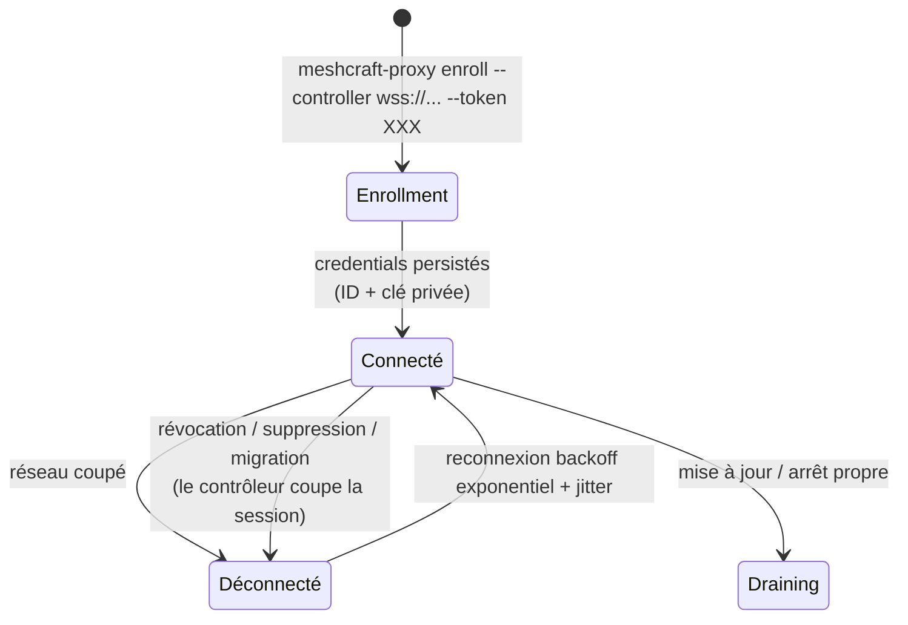

# Proxy

Agent installé par l'utilisateur dans un réseau distant. **Binaire Go statique unique** (amd64/arm64, paquet deb/rpm + image Docker) : aucune dépendance, footprint minimal, tourne sur une VM, un Raspberry Pi ou un conteneur.

## Rôles

1. **Passerelle transport** : ouvrir des connexions TCP vers les équipements (SSH 22, Telnet 23, HTTP/S 80/443…) et les relayer au contrôleur sous forme de streams multiplexés ([[Protocole contrôleur-proxy]]). Le proxy ne comprend pas SSH : il copie des octets.
2. **Exécuteur local UDP/scan** : ce qui ne se tunnelise pas en TCP est exécuté sur place. Le pilotage n'est PAS un RPC générique — c'est une consigne poussée (`snmp[]` de la `WatchConfig`) plus un jeu **fermé de deux questions** en lecture seule ([[Protocole contrôleur-proxy]], § *Les questions ponctuelles*) :
   - polling SNMP de masse (gosnmp) : le walk part du proxy, seuls les résultats remontent ;
   - un **walk d'OID arbitraire**, en lecture, pour la mise au point d'un connecteur ;
   - l'**adresse source** que le noyau du proxy emploierait pour joindre un équipement — la seule façon de savoir où un équipement doit envoyer ses traps quand le proxy l'atteint par routage ;
   - scans de [[Discovery]] : ARP (rafale sur le segment local), ICMP sweep, probes TCP ciblés, lecture des tables LLDP via SNMP.

   > [!warning] Il n'y a pas de `snmp.set`, et il n'y en aura pas
   > Une version antérieure de cette page listait `set` parmi les opérations du
   > proxy. Rien de tel n'existe, et ce n'est pas un retard de livraison : **aucune
   > question d'écriture n'entrera dans ce contrat**. Toute écriture passe par un
   > [[Connecteurs|connecteur]], qui porte les garde-fous — plan, dry-run, relecture
   > de vérification, [[Réconciliation|rollback]]. Un chemin d'écriture qui les
   > contournerait ne serait pas un raccourci, ce serait la suppression du seul
   > mécanisme qui empêche de se couper la main.
3. **Récepteur de télémétrie** : écoute syslog (514/udp) et SNMP traps (162/udp). Les équipements du site sont configurés par meshcraft pour pointer vers l'IP du proxy ([[Monitoring]]). Les messages sont horodatés, tagués de l'IP source, et poussés au contrôleur.
4. **[[Accès web pass-through]]** : relais des sessions HTTP de l'utilisateur vers l'UI web d'un équipement.

## Cycle de vie

- **Enrollment** : un `site_admin` (pour ses sites) ou un `global-admin` (pour toute l'instance) génère dans l'UI un token à usage unique **porteur de la couverture** du futur proxy. Le proxy l'échange contre une identité durable — un identifiant et un **secret partagé**, pas une paire de clés : le contrôleur n'en garde que l'empreinte, mais le proxy détient le secret en clair dans son état local et le rejoue à chaque requête. La paire de clés reste une cible, avec ce qu'elle changerait ; détails et conséquences dans [[Sécurité du proxy]].
- **Connexion sortante uniquement** : WSS 443 vers le contrôleur — traverse NAT et firewalls sans règle entrante.
- **Mode dégradé** : si le tunnel tombe, le proxy continue d'écouter syslog/traps et bufferise sur disque (ring buffer borné, ex. 50 Mo) ; rejeu à la reconnexion. Les équipements ne perdent pas leur historique d'événements pendant une coupure WAN.
  Le tampon des **échantillons de métriques** est un objet distinct, **en mémoire** et borné en nombre de points : sa profondeur, la durée de coupure qu'il absorbe et son coût mémoire au pire sont chiffrés dans [[Monitoring unifié et pipelines]] §2.4, avec le débit que la remontée évacue.
- **Mise à jour** : auto-update opt-in tiré depuis le contrôleur, ou paquets système. Version, protocole et déroulé complet dans [[Versionnage et mise à jour du proxy]].

  > [!warning] Le binaire n'est PAS signé — l'intégrité est vérifiée, l'origine non
  > Cette page a longtemps annoncé un « binaire signé, vérification de signature
  > avant exec ». C'est faux, et la nuance est celle qui compte en sécurité. Ce qui
  > existe est une empreinte **SHA-256** comparée avant `exec` : elle prouve que le
  > téléchargement n'a pas été corrompu **en route**, pas qu'il vient de nous.
  >
  > L'empreinte arrive par le même canal que le binaire. Qui contrôle ce canal
  > contrôle les deux, et le proxy exécute alors ce qu'on lui donne, avec les droits
  > d'un agent installé au cœur du réseau d'un client. Une signature — clé publique
  > embarquée dans le proxy, vérifiée hors du canal de distribution — est ce qui
  > manque, et [[Sécurité du proxy]] la porte en cible.
  >
  > Le dire ainsi n'est pas un détail de vocabulaire : « signé » laisse croire à une
  > ancre de confiance, et quelqu'un pourrait s'appuyer dessus pour ouvrir le
  > registre de distribution à un réseau moins sûr.

## La couverture de sites : la frontière de droits du proxy

Un proxy n'appartient à aucun équipement, mais il n'est pas pour autant hors de toute portée : il porte une **couverture de sites**, et cette couverture est ce qui décide **qui peut le voir et l'administrer**, et **pour quels sites il peut servir de chemin d'accès**.

> [!important] Deux notions à ne pas confondre
> - **Proxy d'instance** (`global`) : utilisable par tous les sites, administré
>   par les seuls `global-admin`. C'est le proxy qu'une DSI centrale déploie
>   pour tout le monde.
> - **Proxy restreint** : limité aux sites de sa couverture. C'est ce qu'obtient
>   un administrateur de site qui déploie son propre point de présence.
>
> Une couverture **vide** ne signifie pas « partout » mais « **nulle part** ».
> Sans cette règle, un site-admin retirant son site du dernier proxy le
> promouvrait en proxy d'instance : une escalade de privilèges déguisée en
> nettoyage.

Ce que la couverture décide, et ce qu'elle ne décide pas :

| Question | Réponse |
|---|---|
| Qui voit ce proxy ? | quiconque a un rôle sur un site couvert — et tout le monde pour un proxy d'instance |
| Qui ajoute/retire un site de sa couverture ? | le `site_admin` de **ce** site, et de celui-là seulement |
| Qui le renomme, le révoque, le supprime, le migre ? | le `site_admin` de **tous** les sites couverts, ou un `global-admin` |
| Qui le promeut en proxy d'instance ? | un `global-admin` seul |
| Pour quels sites peut-il servir de chemin ? | les sites couverts |
| Quel proxy collecte un équipement en SNMP ? | la couverture le rend **éligible** ; le rattachement (`devices.proxy_id`) **désigne** parmi les éligibles, et ne peut jamais élargir la couverture (voir plus bas) |
| De quels équipements accepte-t-on ses **faits** ? | ceux que le contrôleur lui a **poussés** — la couverture pour la joignabilité, le rattachement pour les ports et les traps ([[Sécurité du proxy]], § *Moindre privilège* — le contrôle de portée) |
| Ce qu'il **peut** joindre ? | **rien à voir** : c'est observé (`device_paths`), pas décrété |
| Le site d'un équipement qu'il découvre ? | **rien à voir** : choisi à l'adoption, par un humain habilité |

Les deux dernières lignes sont le cœur du modèle : la couverture est une règle **d'exploitation**, pas une théorie sur la topologie. La joignabilité reste un **fait observé** ; la couverture dit seulement ce qu'on **s'autorise** à en faire.

### Le cycle de vie qui en découle

- Un `site_admin` **déploie son propre proxy** : le token d'enrollment qu'il génère porte, par défaut, tous les sites qu'il administre — ajustables à la génération. Il n'a rien à demander à personne pour couvrir son propre parc.
- Un `global-admin` déploie par défaut un **proxy d'instance**, ou choisit une couverture s'il veut le cloisonner d'emblée.
- La couverture voulue est **figée à l'émission du token**, pas relue à l'enrollment : les droits de l'émetteur peuvent avoir changé entre les deux, et c'est l'intention du moment qui doit valoir.
- Un `site_admin` peut **sortir son site** d'un proxy partagé, et **le remettre** ensuite : il voit toujours le proxy tant qu'un de ses autres sites le couvre. En revanche, retirer le **dernier** site couvert est refusé — le proxy deviendrait invisible, donc inadministrable sans passer par un `global-admin`.
- Un `global-admin` **promeut** un proxy restreint en proxy d'instance, ou l'inverse, en redéfinissant sa couverture entière.
- **Déclarer une plage de scan** sur un proxy exige les droits sur le proxy lui-même — tous ses sites. Sinon, sur un proxy couvrant A et B, l'administrateur du seul site A ferait scanner le réseau de B.
- Les événements du cycle de vie d'un proxy (`proxy.enrolled`, `proxy.upgraded`, `proxy.revoked`…) sont des événements **d'instance**, sans `site_id` : ils ont leur propre journal ([[Journal d'événements]]). Un changement de couverture, lui, est journalisé **sur le site concerné** — c'est une décision qui appartient à ce site.
- **Révoquer, supprimer ou migrer un proxy coupe sa session en cours** — pas seulement sa prochaine authentification ([[Sécurité du proxy]]). Les messages de `proxy.revoked`, `proxy.deleted` et `proxy.migrated` disent si la coupure a réellement eu lieu, et un événement d'instance de plus existe pour les coupures que **personne n'a demandées** : `proxy.tunnel_cut`, en **avertissement**, émis par la revalidation périodique quand la base désavoue un tunnel établi (proxy révoqué ailleurs, ligne supprimée directement, révocation prononcée pendant un redémarrage du contrôleur). C'est le seul événement de proxy sans acteur humain, et c'est justement son information : un proxy qui tombe sans que personne n'ait cliqué.

### La joignabilité est un fait observé, pas un rattachement

- Une **plage à scanner** est déclarée sur un proxy — celui qui sait l'atteindre (le proxy interne du contrôleur étant un proxy comme les autres, cf. [[Vue d'ensemble]]). Une plage n'a pas de site : elle n'en connaît pas encore.
- **Un équipement n'appartient à aucun proxy.** Le contrôleur tient, pour chaque équipement, l'**ensemble des proxys qui le joignent** (`device_paths` : dernier succès, latence, transports vérifiés). C'est une donnée *observée*, jamais saisie.
- À chaque opération (configuration, `ReadState`, polling), le contrôleur **choisit un chemin** dans cet ensemble — le plus rapide encore valide — et **bascule** sur un autre en cas d'échec. Un proxy qui tombe ne rend donc pas ses équipements inaccessibles s'ils sont joignables autrement, ce qui va dans le sens de la règle *ne jamais se couper la main* ([[Réconciliation]]).
- Le **site** d'un équipement vient de l'**adoption** ([[Discovery]]), décidé par l'utilisateur. Il n'est jamais déduit du proxy découvreur.
- Le proxy annonce ses interfaces/IP locales au contrôleur (IPv4 **et** IPv6) : l'UI peut suggérer les plages à scanner.

Tout ce qui précède reste vrai, et le rattachement décrit ci-dessous ne le
contredit pas : il ne dit pas ce qu'un proxy **peut** joindre — ça reste observé —
il dit lequel des proxys éligibles **doit** collecter.

## Le collecteur de référence : un rattachement DÉCLARÉ

Un équipement **peut** désigner son collecteur : `devices.proxy_id`, nullable,
`on delete set null` ([[Schéma base de données]], migration `0022`). C'est le proxy
qui l'interroge en SNMP, et celui dont l'adresse sera écrite dans l'équipement
comme destination de ses traps.

Le besoin ne vient pas d'une envie de rangement, il vient d'un mur. Sans
rattachement, l'éligibilité se **déduit** d'un couple (couverture de sites, drapeau
`global`) : avec deux proxys d'instance en base — le cas ordinaire dès qu'un
« Local » cohabite avec un proxy déporté — le **même** équipement est surveillé par
les deux. Ce n'est pas un défaut en soi pour du ping : deux pings valent mieux
qu'un. Ça devient un mur dès qu'il faut écrire quelque chose **dans** l'équipement,
parce qu'un destinataire de traps est **une** adresse IP et que « plusieurs proxys
éligibles » ne se traduit pas en une adresse. Et pour le SNMP, deux proxys qui
interrogent le même switch remontent **deux fois** chaque transition de port : la
corrélation ne peut alors que les dédoublonner *après* coup, jamais les empêcher
([[Monitoring]], § *Le critère de doublon*).

> [!important] C'est une DÉCLARATION, pas une élection
> Élire le collecteur — le premier proxy connecté, celui de latence la plus
> faible — le ferait **changer tout seul**, et la destination de traps écrite dans
> les équipements deviendrait fausse sans que personne ne touche à rien. Un parc
> entier cesserait d'être réactif à cause d'une milliseconde de latence gagnée
> ailleurs. L'opérateur désigne, meshcraft obéit.
>
> Le vault décrit ailleurs une **élection** de « collecteur préféré » (avec
> secondaire et recalcul quand les chemins changent) : [[Monitoring]], § *Choix du
> point de collecte*. Elle est **décidée, non construite**. La déclaration ne la
> remplace pas, elle en livre la brique qui manquait — l'adresse unique — sans le
> recalcul automatique, donc sans son risque. Si l'élection arrive un jour, elle ne
> pourra que **proposer** un rattachement.

### L'arbitrage : déterminisme d'un côté, redondance de l'autre

Le rattachement ne restreint **pas** tout, et la ligne de partage tient en une
phrase : *le déterminisme là où l'unicité est nécessaire, la redondance là où elle
est gratuite*.

| Canal | Régime | Pourquoi |
|---|---|---|
| **SNMP** et destination de traps | le seul proxy rattaché | une adresse de destinataire est unique ; deux collectes doublent chaque transition de port |
| **ICMP** (statut `up` / `unreachable`) | tous les proxys couvrants, comme avant | deux pings ne coûtent rien et donnent une meilleure vérité de joignabilité ; restreindre le ping ferait perdre tout basculement le jour où ce proxy tombe |

Conséquence de forme : la liste que le contrôleur envoie à un proxy n'est **pas**
filtrée sur le rattachement, elle le **projette** ligne par ligne. Les cibles ICMP
prennent toute la liste, les cibles SNMP seulement les lignes dont ce proxy est le
collecteur. Filtrer les lignes aurait été le piège du lot : la même liste alimente
les deux canaux, et restreindre les lignes aurait restreint le ping avec.

> [!important] Ces deux régimes sont aussi les deux granularités de ce qu'on ACCEPTE d'un proxy
> La même paire d'ensembles sert de **frontière d'écriture** : le contrôleur n'accepte
> un fait sur un équipement que s'il a demandé à **ce** proxy de le surveiller, à la
> granularité qu'exige le fait — les cibles ICMP autorisent `device.up` /
> `device.down`, les cibles SNMP autorisent les transitions de port, `trap.seen` et la
> télémétrie de ports. Un proxy qui remonterait une transition de port pour un
> équipement qu'il **pingue** mais dont il n'est **pas le collecteur** est donc refusé,
> même si sa couverture est irréprochable : il ne l'interroge pas, il ne peut rien
> savoir de ses ports. Détails, verdicts et fenêtre résiduelle dans
> [[Sécurité du proxy]].
>
> C'est ce qui donne à la projection ligne par ligne décrite ci-dessus une seconde
> raison d'exister : la consigne poussée est **la** source de vérité de ce qu'on
> acceptera ensuite, et non une règle réécrite ailleurs qui finirait par en dire autre
> chose.

Les équipements ainsi **délégués** à un autre collecteur sont **comptés** dans le
bilan de surveillance de ce proxy, pas énumérés : quelqu'un l'a demandé, c'est un
fait d'exploitation normal, et une ligne par équipement rattaché à chaque connexion
de proxy noierait le journal pour une information que la fiche équipement porte
déjà en clair.

> [!note] `null` est un régime, pas un réglage oublié
> `null` = collecte **par couverture**, exactement le comportement d'avant la
> migration `0022` : tout proxy éligible est collecteur. C'est l'état de tout le
> parc existant, et la migration est donc **à sémantique constante** — aucune
> surveillance ne change tant que personne n'a déclaré quoi que ce soit. Inventer
> un rattachement à la migration aurait été une supposition : rien en base ne dit
> quel proxy *doit* collecter un équipement que deux proxys atteignent également
> bien.
>
> Même raison pour `on delete set null` : supprimer un proxy ne doit jamais
> supprimer des équipements — un `cascade` effacerait une partie de l'inventaire au
> retrait d'un boîtier. Le repli correct est le retour au régime par couverture.

### Le piège : le rattachement ne donne AUCUNE couverture

> [!warning] Un rattachement non couvrant ne déplace pas la collecte, il l'ARRÊTE
> La couverture de sites reste la **seule** porte d'entrée, et c'est une frontière
> de **confidentialité**, pas une commodité : un rattachement qui l'élargirait
> divulguerait le nom et l'adresse d'un équipement du site A à un proxy qui ne
> couvre que le site B, par un geste qui n'a rien à voir avec les droits.
>
> Conséquence assumée : rattacher un équipement à un proxy qui ne couvre pas son
> site ne le fait **pas** collecter par ce proxy — **ça le fait collecter par
> personne**. Ni celui-là, qui ne le voit pas ; ni ceux qui couvrent le site, qui
> ne sont pas désignés. Plus d'interrogation SNMP, plus de destinataire pour ses
> traps.
>
> Et le symptôme est traître : l'équipement **continue d'être pingué**, puisque
> l'ICMP reste par couverture. Son voyant reste donc **vert** et son état reste
> juste — seule la collecte s'est arrêtée. C'est exactement le genre de panne qu'on
> ne trouve pas en regardant un écran de parc.

Trois dispositifs le couvrent, et aucun ne remplace les autres :

1. **l'écran ne propose que des proxys couvrants** — la liste servie à la fiche
   équipement est celle des proxys qui couvrent le site ;
2. **l'API refuse les autres**, en 422, avec un message qui nomme la
   *conséquence* et pas la règle : « le rattachement ne donne aucune couverture,
   l'équipement ne serait plus collecté par personne ». Une UI n'est pas un
   contrôle d'accès, et cette route est appelable directement. Un « rattachement
   refusé » sec enverrait l'exploitant chercher un droit manquant sur son compte
   alors que ce qui manque est la couverture du proxy ;
3. **la fiche équipement porte un bandeau** quand le rattachement *courant* n'est
   plus couvrant. Le refus à l'écriture n'y suffit pas : une couverture peut être
   **rétrécie après coup**, ailleurs dans le produit, et invalider un rattachement
   déjà écrit. Le bandeau est lisible dès le rôle `viewer` — ce sont ceux qui
   regardent l'écran toute la journée qui remarqueront qu'un équipement ne remonte
   plus rien.

Le troisième n'est pas un pis-aller, c'est le seul endroit d'où le cas se voit. Le
calcul de surveillance part d'un **proxy** : vu du proxy rattaché, un équipement
non couvert n'est même pas éligible ; vu de tout autre proxy, il ressemble trait
pour trait à un équipement légitimement délégué. Les séparer demanderait de
réinterroger la couverture de chaque site à chaque calcul, pour un verdict qui ne
changerait rien à ce que ce proxy doit faire — dans les deux cas, il ne collecte
pas. La fiche équipement, elle, raisonne sur un **équipement** : c'est de là, et de
là seulement, que la question a une réponse. Le détecter côté serveur voudrait dire
partir du parc, c'est-à-dire faire un audit, pas un calcul de surveillance.

Écrire un rattachement est réservé au `site_admin`, et pour une raison plus forte
que pour ses voisins de la fiche équipement : un domaine d'adressage faux dégrade un
arbitrage, un **collecteur faux arrête la collecte**. Ce n'est pas du même ordre
qu'étiqueter une prise.

Un changement de collecteur est journalisé en **avertissement** dans le
[[Journal d'événements]] (`device.collector`), avec l'ancien et le nouveau
collecteur **nommés en clair** — « aucun (collecte par couverture) » quand il n'y en
a pas. Sans cette trace, le geste serait indiagnosticable trois mois plus tard : le
symptôme (« ce switch ne remonte plus ses ports ») n'a aucun rapport visible avec un
menu déroulant coché un mardi, et un UUID de proxy supprimé depuis ne se relit plus.
La surveillance est repoussée aux **deux** proxys concernés, l'ancien compris —
sans quoi il continuerait d'interroger l'équipement jusqu'à sa prochaine
reconnexion, c'est-à-dire précisément le doublon que le rattachement existe pour
empêcher.

## Implémentation

| Sujet | Choix |
|---|---|
| Langage | Go ≥ 1.22 |
| WS client | `nhooyr.io/websocket` + couche de multiplexage maison (voir [[Protocole contrôleur-proxy]]) |
| SNMP | `gosnmp` |
| Scan ARP | raw socket / `AF_PACKET` (CAP_NET_RAW) avec repli ICMP+table ARP si privilège absent |
| Syslog/Traps | listeners UDP natifs ; ports < 1024 via `CAP_NET_BIND_SERVICE` |
| Config locale | **pas de `proxy.yaml`** : un état JSON écrit par le proxy lui-même (URL du contrôleur, identifiant, secret **en clair**), plus deux variables d'environnement — `MESHCRAFT_DIAL_ALLOW` pour borner les destinations TCP, ouverte par défaut. Tout le reste est piloté par le contrôleur |
| Logs | stdout JSON (journald/docker) |

Le proxy est **sans état métier** : il ne stocke ni credentials d'équipements ni configurations. Tout secret réseau reste sur le contrôleur ([[Credentials]]) et transite chiffré dans le tunnel au moment de l'usage — et même alors, seuls les octets TCP chiffrés (SSH/TLS) le traversent pour les protocoles sécurisés.
