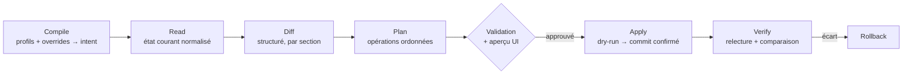

# Réconciliation — du désiré à l'appliqué

Le pipeline central de l'orchestrateur ([[Contrôleur]]) : transformer l'intent en configuration réellement appliquée, **sans jamais perdre la main sur l'équipement**.

## Pipeline — la CIBLE



| Étape | État | Où |
|---|---|---|
| **Compile** | **partiel** — les règles de [[Profils de switchs]] produisent une configuration de ports ; l'héritage complet de [[Profils et groupes]] n'est pas construit | `internal/portrules` |
| **Read** | **livré** | `instanton.Admin.ReadState` → `devices.observed` |
| **Diff** | **livré**, pur et testé | `internal/recon` |
| **Plan** comme objet | **décidé, non construit** — l'ordre des opérations est codé en dur dans l'écriture | *(rien)* |
| **Validation + aperçu** | **retiré volontairement**, pas oublié — voir le callout ci-dessous | *(rien)* |
| **Apply** | **livré**, sans dry-run ni commit confirmé | `instanton.Admin.ApplyPorts`, `internal/api/autoapply.go` |
| **Verify** | **livré** — rien n'est tenu pour appliqué sur la foi d'un code de retour | même chemin, relecture + `recon.DiffPorts` |
| **Rollback** | **décidé, non construit** | *(rien)* |

> [!warning] La validation humaine a été RETIRÉE, et c'est une décision d'exploitation
> Le schéma place une approbation entre le plan et la pose. La pose est en réalité
> **automatique** : `internal/api/autoapply.go`, déclenchée par toute modification
> d'intention, après un regroupement de 6 secondes. La raison est simple —
> *configurer quarante-huit ports dans l'interface EST l'approbation*. La demander
> une seconde fois, sur un produit dont la promesse est d'administrer le parc,
> revient à poser deux fois la même question et laisse un parc durablement différent
> de ce que l'écran affiche.
>
> Ce que ça n'autorise pas pour autant, et c'est ce qui rend l'arbitrage tenable :
> les garde-fous d'écriture restent **entiers** (§ *Apply*) ; un échec n'est **jamais
> rejoué en boucle** — une tentative par changement, un événement si elle échoue, et
> l'équipement reste visiblement « en cours », reposable à la main ; et une seule
> pose à la fois par équipement.
>
> Le regroupement n'est pas un confort : configurer un port déclenche une
> modification par port, et sans lui, changer quarante-huit ports lancerait
> quarante-huit poses concurrentes sur un équipement qui n'accepte que **cinq
> sessions**.

### 1. Compile
Résolution de l'héritage ([[Profils et groupes]]) : défauts du site → profil d'équipement → overrides device → profils de ports → overrides port. Produit l'intent `desired` complet ([[Modèle de données standard]]). Déterministe et pur : compilable à tout moment pour l'aperçu UI.

**Partiel.** Ce qui est livré est la moitié qui produit : `internal/portrules` évalue les règles d'un profil de switch et rend, port par port, la configuration retenue **avec la règle qui l'a gagnée** — et l'aperçu existe (`POST /api/devices/{id}/switch-profile/preview`), ce qui tient la promesse « compilable à tout moment ». La chaîne d'héritage complète, elle, n'est pas construite : il n'y a pas de composition site → profil d'équipement → overrides.

Ce qui **n'est pas** fait et que la rédaction précédente annonçait : la **validation contre les capabilities** du connecteur. Elle a été remplacée par un arbitrage différent, décrit en § *Trois façons de ne pas poser* — on n'écarte pas une intention à la compilation, on la pose si on sait, et on **dit** ce qui est resté à quai.

### 2. Read
Le connecteur relit l'équipement (CLI parsée ou API) → intent `observed`. Toujours relire juste avant d'appliquer — jamais de diff contre un état en cache. **Livré**, et la règle est tenue jusque dans `ApplyPorts`, qui commence par un `ReadState`.

`ReadState` n'est cependant **pas** au contrat `driver.Driver`, qui ne porte que `Info`, `Capabilities`, `Fingerprint` et `ResetProcedure` : c'est une API concrète du connecteur, appelée directement par `internal/api`. L'extraction du contrat de lecture/écriture est **volontairement reportée** jusqu'à ce qu'un deuxième vendor existe — figer un contrat sur les hypothèses du premier, c'est les figer toutes ([[Connecteurs]], § *Chemin depuis l'existant*).

### 3. Diff
Comparaison structurée champ à champ, en respectant la règle « absent = non géré » : meshcraft ne touche pas aux réglages hors modèle. Sortie : liste de changements typés (`port.GE4.pvid: 20 → 30`), affichée telle quelle sur la fiche de l'équipement. **Livré** — mais elle s'y lit **après** la pose et non avant approbation, puisqu'il n'y a pas d'approbation : c'est le bandeau des écarts restants, pas un aperçu.

La règle « absent = non géré » ne joue que dans **un** sens, et c'est ce qui la rend utilisable : un port que meshcraft ne gère pas est ignoré, mais un port qu'il gère et que l'équipement ne porte plus est un écart bien réel (`présence : port inconnu de l'équipement`).

### 4. Plan — *décidé, non construit*

Le driver ordonne les opérations selon les contraintes de la plateforme : créer les VLANs avant de les affecter, modifier le PVID avant de retirer l'ancien VLAN, **toucher au VLAN de management en dernier**. Le plan matérialise aussi la stratégie de sécurité (voir ci-dessous). Pour les plateformes CLI, le plan serait une liste de blocs de commandes ; pour les API REST, une liste d'appels ; pour le webform, une séquence de POST.

> [!note] L'ordre existe, l'objet non — et c'est ce qui manque
> Rien de ce que décrit cette étape n'est faux sur le **fond** : l'ordre est bien
> respecté, et il est même exactement celui annoncé — créer les VLANs manquants, puis
> écrire les ports un par un, puis sauver en flash (`instanton.ApplyPorts`). La
> contrainte constructeur qui l'impose est documentée : affecter un port à un VLAN
> inexistant est refusé par l'équipement, et l'ordre inverse laisserait la moitié du
> plan appliquée.
>
> Ce qui n'existe pas est le **plan comme objet** : rien qui se calcule, s'affiche,
> se relise ou se rejoue. L'ordre est du code, pas de la donnée. Ce que ça interdit,
> concrètement : l'aperçu avant approbation, le dry-run, la reprise d'une pose
> interrompue à l'étape où elle s'est arrêtée, et le rollback minuté — tous les
> quatre supposent de pouvoir tenir la liste des opérations en main.
>
> C'est aussi la raison pour laquelle l'extraction du contrat des connecteurs attend
> un deuxième vendor : `Plan()` est la méthode dont la signature dépend le plus de la
> plateforme, et la déduire d'un seul webform serait la déduire de rien.

### 5. Apply — ne jamais se couper la main

Le risque n° 1 : pousser une conf qui coupe l'accès au switch (changement de VLAN mgmt, d'IP, de trunk d'uplink). Stratégies par ordre de préférence, à choisir selon `Capabilities.Commit` (`driver.CommitStyle`) :

| Plateforme sait faire | `CommitStyle` | Stratégie | État |
|---|---|---|---|
| commit confirmed (Junos, AOS-CX checkpoint) | `commit_confirmed` | commit avec timer ; meshcraft confirme après vérification de joignabilité | **cible** — aucune plateforme livrée |
| archive/rollback (IOS `archive`, `configure replace`) | `archive_rollback` | snapshot avant apply, rollback minuté armé, désarmé après vérif | **cible** — aucune plateforme livrée |
| **appliquer puis sauver** (Instant On) | `apply_then_save` | le changement prend effet tout de suite mais ne survit pas à un redémarrage tant qu'il n'est pas sauvé : **un rollback gratuit**, à condition d'appliquer, vérifier, *puis* sauver | **livré pour la bascule de management** (§ ci-dessous), **arbitré autrement pour la pose de ports** : `ApplyPorts` sauve en flash lui-même, avant que l'appelant relise. L'argument est explicite et n'est pas mauvais — *un apply qu'un reboot annule est pire qu'un apply refusé, parce qu'il a été constaté comme réussi*. Mais il ferme le filet : une pose qui coupe l'accès est gravée avant qu'on ait pu s'en apercevoir |
| rien (web-only, vieux CLI) | `immediate` | **rollback applicatif** : sauvegarde de la conf avant ; après apply, test de joignabilité ; si perte > timeout, restauration | **cible** — et il n'y a pas de sauvegarde de conf brute à restaurer (`BackupConfig` n'existe pas) |

> [!warning] `Commit` est déclaré, personne ne le lit
> La capability est renseignée avec son argument constructeur — sur un Instant On,
> « *Changes take effect immediately but are not retained across a switch reset
> unless you click Save Configuration* » donne `apply_then_save`. Mais **aucun code
> ne branche de stratégie dessus** : `ApplyPorts` fait toujours la même chose. La
> déclaration a donc la valeur d'un savoir enregistré, pas d'un comportement — et
> c'est exactement le genre de champ dont il faut dire qu'il dort, sinon on croit
> qu'un arbitrage a lieu.
>
> Le plus frustrant est que la stratégie la plus sûre du tableau est celle de la
> plateforme livrée, et qu'elle est **gratuite** : ne pas sauver en flash laisse une
> coupure d'alimentation tout ramener en arrière. La bascule de management s'en sert
> pleinement (trois gestes séparés, § plus bas) ; la pose de ports, non.

État des garde-fous annoncés comme systématiques :

| Garde-fou | État |
|---|---|
| **Sérialisation par équipement** : un seul apply à la fois | **livré** — verrou par équipement dans `autoApplier` |
| Concurrence bornée **par site et par proxy** | **décidé, non construit** — pas de semaphore ; sans lui, un déploiement de parc entier n'a pas de plafond |
| **Garde-fou au PORT** : un port portant l'administration en non tagué et un lien **actif** ne voit jamais son VLAN natif réécrit | **livré** — et c'est le garde-fou qui a réellement été construit, à la place de ceux ci-dessous. Détails en § *Apply : écrire sans se couper la main* |
| **Watchdog de joignabilité** : après tout changement touchant management/uplinks, re-test de l'accès (TCP + login) avant de marquer la pose réussie | **partiel.** Il n'y en a **aucun** sur la pose de ports : la relecture qui suit prouve que la configuration est là, pas que l'équipement reste joignable demain — c'est la même session qui a écrit et qui relit. En revanche la **bascule de management** en a un, et un vrai (§ ci-dessous). La brique de pré-vol existe par ailleurs et n'est pas branchée sur l'apply : `driver.CheckReach`, dont l'astuce est qu'un **port fermé est une bonne nouvelle** — un `connection refused` prouve que le paquet est arrivé, là qu'un timeout ne distingue pas « pas de route » de « filtré en silence » |
| **Changements risqués signalés** : diff `disruptive` dans l'aperçu, confirmation explicite exigée | **remplacé.** Sans aperçu, il n'y a pas où le signaler. Le mécanisme livré fait l'inverse et vaut mieux : la pose **épargne** le port dangereux, l'écrit dans `last_apply.skipped` avec la raison, et l'écran pose la question — **forcer** ou **renoncer** — en connaissance de cause. Un avertissement qu'on peut cliquer sans lire ne protège personne ; un port non modifié, si. Voir le callout ci-dessous : la question doit être posée **là où le geste est déclenché**, pas seulement sur la fiche |
| **Bascule d'adressage de management** : pré-vol, management en dernier, watchdog à la nouvelle adresse | **livré, en trois gestes séparés** — et c'est le seul endroit du produit où la stratégie `apply_then_save` est exploitée. `prepare` ajoute une interface DHCP sur le VLAN cible **sans rien retirer ni sauver** : l'équipement garde son adresse, donc reste joignable, et acquiert la nouvelle — la bascule devient **vérifiable** au lieu d'être un pari. `commit` **refuse** si cette interface n'a pas obtenu d'adresse. `persist` **refuse** si l'équipement ne déclare pas lui-même administrer par le VLAN du plan, et il ne l'a dit qu'à l'adresse à laquelle meshcraft vient de le joindre : sauver une bascule non vérifiée graverait une erreur. Le **pré-vol** existe aussi, mais il ne vérifie pas ce qui était annoncé — `mgmtPathOf` cherche un port avec un **lien actif** qui transporte déjà le VLAN cible, et non qu'un proxy joigne le sous-réseau. C'est le bon critère, et il est plus dur : « le VLAN est bien sur le switch » n'a jamais voulu dire « il en sort ». Détails dans [[Adressage de management]] |

### 6. Verify & drift

Relecture post-apply : `observed == desired` sur le périmètre modifié, sinon la pose reste datée comme incomplète, avec le détail. **Livré** (§ *Attribution* plus bas). Un écart imputable à l'équipement crée un événement `config.drift` dans le [[Journal d'événements]] ; l'UI propose « réappliquer » ou « absorber ». **Livré.**

> [!warning] Personne ne déclenche la relecture périodique
> C'est le trou le plus coûteux de cette page, parce que tout ce qui l'entoure est
> construit. La détection de dérive suppose une relecture du parc ; il n'existe
> **aucun ordonnanceur** ([[Contrôleur]], § *scheduler*). Une relecture arrive par
> deux chemins seulement : le bouton (`POST /api/devices/{id}/read-state`) et la fin
> d'une pose.
>
> Conséquence exacte : une dérive **existe** dès qu'un exploitant relit, et jamais
> avant. Un switch modifié à la main reste `in_sync` à l'écran aussi longtemps que
> personne ne clique — et l'événement `config.drift` n'est émis qu'au moment de cette
> relecture, donc **daté du jour où on l'a vue**, pas du jour où elle a eu lieu. Le
> mécanisme d'attribution par horodatages, lui, est prêt à s'en servir : c'est
> réellement une tâche de fond qui manque, pas une décision.

## Jobs — *décidé, non construit*, mais le transcript est là

Il n'y a **pas** de table `jobs` : ni révision d'intent, ni plan, ni durée persistés, et rien à reprendre après un redémarrage du contrôleur (une salve en attente de regroupement est perdue).

Ce qui a été livré à la place tient la partie la plus utile de la promesse, et il ne faut pas la sous-estimer : les tables **`pipelines` / `pipeline_steps`** (migration `0016`) conservent, pour chaque opération sur le parc, l'équipement, l'auteur, le résultat et **le transcript intégral** de la session du connecteur — étape par étape, avec le détail de chacune. C'est bien l'outil de debug n° 1 des connecteurs et la piste d'audit annoncés. Le transcript existait déjà, mais n'était rendu que dans la réponse HTTP d'une requête : il disparaissait dès la page fermée. Le rattacher à un pipeline le rend consultable **après coup**, c'est-à-dire au moment précis où on en a besoin.

Trois états d'étape, et le troisième est celui qui a demandé le plus de soin : `done`, `failed`, et `skipped` — ni réussite ni échec, une **décision**. Ranger un garde-fou dans l'un des deux autres le rendait invisible, ce qui est exactement ce qui le faisait passer pour un bug. Et une pose qui laisse des écarts est marquée **bloquée** et non en échec : les confondre ferait relancer une opération qui referait exactement la même chose.

Un échec n'est **jamais rejoué automatiquement**, comme voulu — mais par une règle plus simple que celle annoncée : une tentative par modification d'intention, point. Il n'y a pas de relecture d'état avant rejeu parce qu'il n'y a pas de rejeu.

## Livré : Read, Diff, Apply et l'arbitrage de la dérive (§2, §3, §5, §6)

Les étapes **Read**, **Diff**, **Apply** et **Verify** sont en place sur le
connecteur Instant On, ainsi que tout l'arbitrage de la dérive. Ce qui reste hors
périmètre : le **Plan** comme objet, l'aperçu des opérations avant approbation
(retiré volontairement, callout du § *Pipeline*), le **rollback** minuté, la
**sauvegarde de conf brute**, la **file de jobs**, et la **relecture périodique**
qui alimenterait la détection de dérive. Le **transcript**, lui, est bien
archivé — c'est la seule pièce du §*Jobs* qui existe.

### Read

`Admin.ReadState` (connecteur Instant On) relit l'équipement avec deux sections,
sans rien modifier : `wcd?{VLANList}` et `wcd?{VLANInterfaceMembershipTable}`.

Il n'existe **pas** de section « PVID par port » sur cette gamme : son interface
le calcule elle-même à partir de l'appartenance non taguée. meshcraft fait pareil
— le PVID d'un port est le VLAN dont il est membre non tagué. Les agrégats
(`TRK…`) sont ignorés tant que les LAG ne sont pas modélisés : mieux vaut un état
incomplet et honnête qu'un état complet et faux.

L'état lu vit dans `devices.observed`, **à côté** de `devices.ports` qui porte
l'intention. Les confondre reviendrait à ne jamais pouvoir dire laquelle des deux
est en retard.

### Diff

`internal/recon`, pur et testé. Deux règles qui évitent le voyant qui hurle à
tort :

- la **télémétrie n'est pas une intention**. Débit, lien et PoE ne sont pas
  comparés — sinon tout le parc clignoterait en permanence ;
- un trunk `all` n'est pas comparable à une énumération, l'équipement énumérant
  toujours. L'écart n'est signalé que si l'équipement ne porte AUCUN VLAN tagué.

### Attribution : bleu ou orange

C'est la question qui décide de tout, et elle se tranche sur les horodatages
(`observed_at`, `desired_changed_at`, `applied_at`) plutôt qu'à la devinette :

| Situation | État | Rendu |
|---|---|---|
| jamais relu | `unknown` | rien, et on le dit |
| aucun écart | `in_sync` | rien |
| jamais posé par meshcraft | `pending` | pastilles **bleues** en fondu |
| intention modifiée depuis la dernière pose | `pending` | pastilles **bleues** |
| pose déjà passée, écarts subsistants | `pending` + `apply_stalled` | pastilles **bleues** + bandeau |
| écart sans modification d'intention | `drift` | pastilles **orange** + bandeau |

> [!warning] Le bleu recouvrait deux situations opposées
> « Pas encore posé » et « posé, mais incomplet » s'affichaient à l'identique, et
> la seconde ne se résout **jamais** toute seule : meshcraft ne repose qu'après
> une modification de l'intention, et il n'y en aura pas. Un switch resté à
> moitié configuré était donc indiscernable d'un switch en cours de
> configuration, et n'affichait rien.
>
> `apply_stalled` les sépare en comparant l'horodatage de la dernière pose à
> celui de la dernière modification. Si la pose est passée **après** la
> modification et qu'il reste des écarts, personne ne les résorbera : le bandeau
> « Configuration pas entièrement appliquée » propose de reposer ou d'absorber.
>
> Le cas était produit en masse par les trunks `all`, écartés en silence par la
> pose (voir plus bas).

> [!important] On ne dérive pas de ce qu'on n'a jamais posé
> Un équipement fraîchement adopté diffère forcément de l'intention, sans que
> personne n'y ait touché. Le compter comme une dérive ferait hurler l'alerte sur
> tout parc neuf — et le premier réflexe serait de la couper.

Seule la **dérive** sort un bandeau : elle est le seul cas qui demande un
arbitrage humain. Les deux issues sont symétriques, parce que qui a raison de
meshcraft ou du switch est une question d'exploitation, pas d'outillage :

- **absorber** (`POST /api/devices/{id}/config/import`) — livré. Les libellés de
  ports sont conservés (l'équipement ne les connaît pas), et les VLANs manquants
  du site sont **créés**, faute de quoi l'intent importé référencerait des VLANs
  inconnus ;
- **réappliquer** (`POST /api/devices/{id}/config/apply`) — livré, voir ci-dessous.

Une relecture n'écrit **jamais** l'intention. Sans cette règle, une dérive
s'absorberait toute seule au premier rafraîchissement et personne ne la verrait.

Événements : `config.drift`, `config.absorbed`.

### Apply : écrire sans se couper la main

Trois choses apprises de l'équipement, chacune au prix d'un refus explicite de sa
part — ce qui vaut mieux qu'un succès silencieux :

1. **On écrit par INTERFACE, pas par VLAN.** La première version écrivait
   `VLANInterfaceMembershipTable` : l'équipement répondait `statusCode 0` sans
   rien changer. L'échec n'a été vu que parce que l'apply RELIT et compare. La
   bonne section est `VLANInterfaceISList`, et elle correspond d'ailleurs au
   modèle par port de meshcraft.
2. **Un VLAN se crée par `set`, pas par `add`.** Le répartiteur cherche une
   fonction `<action>_<Section>` et répond « function name not found :
   add_VLANList ».
3. **L'équipement attend un DELTA, pas un état complet.** `set` ajoute des VLANs
   tagués, `delete` en retire, et le VLAN natif ne se renvoie que s'il change.
   Lui renvoyer la liste entière donne « wrong Vlans List have specified ».

Le garde-fou est au **port**, pas au VLAN : un port actuellement membre non tagué
d'un VLAN de management ne voit jamais son VLAN natif réécrit. C'est par lui que
passe très probablement la session en cours. Lui **ajouter** des VLANs tagués
reste permis — cela ne touche pas au trafic non tagué.

Sont considérés comme VLANs de management celui du plan du site **et** celui que
l'équipement déclare (`ManagementInterfaceGlobalSetting`). Ils diffèrent tant
qu'un équipement n'a pas été migré : constaté sur un 1930, plan à 99 et
équipement à 1. Ne protéger que le premier aurait épargné un VLAN inutilisé tout
en réécrivant celui qui portait la session.

Rien n'est tenu pour appliqué sur la foi d'un code de retour : l'équipement est
relu, comparé, et c'est seulement alors que la pose est datée (`applied_at`).
C'est cette date qui fera attribuer les écarts SUIVANTS à l'équipement plutôt
qu'à meshcraft.

Événements : `config.applied`, `config.apply_failed`, `config.forced`.

> [!bug] Un refus posé sur un écran que personne ne regarde n'est pas un refus — relevé du 30 juillet 2026
> Le bandeau des ports épargnés ne vivait que sur la **fiche de l'équipement**. Or une
> intention de port s'écrit depuis **trois** endroits : la fiche, la page **Ports**, et
> l'**aperçu d'un profil de switch**. Dans les deux derniers cas, la chaîne était :
>
> ```
> l'exploitant écrit une intention  →  la pose automatique part une seconde plus tard
>                                   →  le garde-fou épargne le port
>                                   →  le refus atterrit sur un écran qu'il ne regarde pas
> ```
>
> Il repartait donc convaincu que son changement était passé. C'est le même défaut que
> celui des motifs d'indisponibilité qui ne quittaient pas le code du connecteur : un
> savoir qui n'arrive pas à l'endroit où la question se pose n'existe pas.
>
> Le bandeau est désormais sur les **trois** écrans, et il pose **deux** issues au lieu
> d'une — parce qu'un refus ne laisse que deux sorties et que meshcraft ne peut pas
> choisir :
>
> | Issue | Ce que ça fait | Pourquoi elle ne suffit pas seule |
> |---|---|---|
> | **Forcer** | repose avec `force`, garde-fou levé | l'exploitant peut ne PAS connaître sa topologie ; c'est un second temps, avec confirmation |
> | **Renoncer** | absorbe la configuration de l'équipement (`config/import`), qui efface aussi `last_apply` | sans elle, la pose ne se rejouant jamais seule, le bandeau restait affiché indéfiniment et le seul geste offert était le risqué — **un écran qui n'offre que le geste risqué pousse à le prendre** |
>
> Détail d'ergonomie qui compte : le bouton de retour d'une confirmation s'appelle
> « Revenir » et non « Annuler ». Sur ce bandeau, « annuler » désigne l'abandon du
> **changement** — deux sens pour un mot, sur deux boutons voisins dont l'un est
> irréversible.

#### Trois façons de ne pas poser, et il faut les distinguer

Une pose peut laisser du travail de côté pour trois raisons qui n'appellent pas
du tout la même réaction. Les confondre, c'est soit proposer un bouton qui ne
sert à rien, soit laisser croire qu'une configuration est en place alors qu'elle
n'est nulle part.

| Cause | Champ | Ce que l'exploitant peut faire |
|---|---|---|
| Garde-fou de sécurité | `last_apply.skipped` | **forcer**, en connaissance de cause |
| Hors capacités du connecteur | `last_apply.unsupported` | rien — c'est à implémenter |
| Échec de la pose | `last_apply.error` | **rejouer**, ou abandonner l'intention |

Chacune a son bandeau, et le ton suit : avertissement pour le garde-fou et pour
l'échec, **information** pour la limite de plateforme — un bandeau orange appelle
une action, et il n'y en a aucune à prendre.

Les capacités sont déclarées **dans le paquet qui écrit**
(`internal/driver/instanton/capabilities.go`), et non dans la couche API : le
jour où une section devient posable, la déclaration et le code qui la pose
changent au même endroit. Une capacité déclarée loin de l'écriture finit par
annoncer autre chose que ce qui se passe.

> [!note] L'équipement reste « à jour » malgré une intention non posable
> Le PoE d'un port est enregistré par meshcraft et aucun connecteur ne l'écrit
> encore. Ce n'est pas une raison pour marquer l'équipement en retard
> indéfiniment : tout ce qui est supporté est posé, l'équipement est daté comme
> tel, et le bandeau dit ce qui est resté à quai. Ce qui n'était pas acceptable,
> c'était le silence.

#### Le trunk « all » est un plancher, pas une liste

`tagged: "all"` n'existe pas sur un équipement : son interface veut une
énumération. La pose écartait donc ces ports — en silence, sans même les compter
parmi les ports épargnés. Un trunk configuré dans l'interface n'arrivait jamais
sur le switch et rien ne le disait.

« all » est désormais résolu en **la liste des VLANs du site**, par la même
fonction pour la pose et pour le diff (`recon.Resolve`) : si les deux divergeaient,
la pose écrirait une liste que le diff signalerait aussitôt comme un écart, à vie.

Mais c'est un **plancher**, pas un ensemble exact. « all » est un joker, pas une
énumération que l'exploitant a saisie : en faire un ensemble exact autoriserait la
pose à **retirer** d'un trunk tout VLAN tagué que le site ne déclare pas — sur un
uplink, une coupure, et le garde-fou ne couvre que le VLAN natif. Une liste
explicite, elle, est bien une énumération : le retrait y est légitime.

Un site sans VLAN déclaré laisse « all » non résolu : la liste vide ne veut pas
dire « aucun VLAN tagué », elle veut dire qu'on ne sait pas encore.
