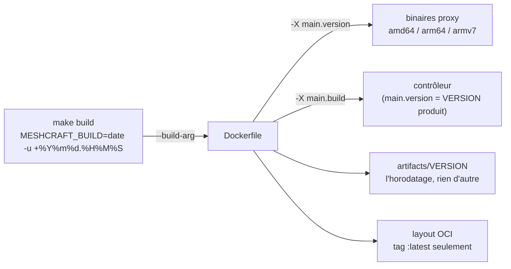
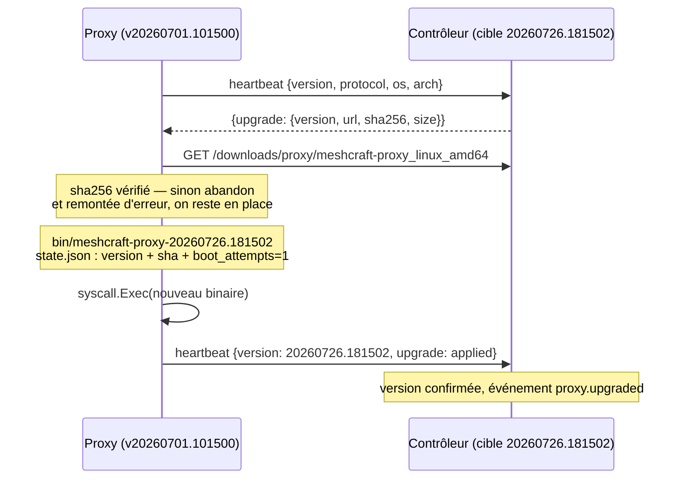

# Versionnage et mise à jour du proxy

Le [[Proxy]] est déployé chez le client, souvent sans accès administrateur pour nous, et son cycle de vie doit rester **piloté par le contrôleur** — comme la migration d'instance (voir [[Proxy]]) : aucune intervention sur la machine du proxy, jamais.

Cette note fixe deux choses : **comment une version de proxy est nommée** et **comment un proxy déjà déployé passe à une version plus récente**.

## 1. Le numéro de version : `AAAAMMJJ.HHMMSS` UTC

Une version de proxy est un **horodatage de build UTC** : `20260726.181502`.

| Propriété | Pourquoi elle compte |
|---|---|
| Monotone | Un build postérieur est toujours « supérieur » : pas de branche, pas de retour arrière accidentel. |
| Largeur fixe (8 + 1 + 6) | La comparaison **lexicographique est la comparaison chronologique** : `IsNewer(a, b)` est un `a > b` sur chaîne, sans parseur semver. |
| UTC obligatoire | `date -u`. Sinon deux builds sur des machines de fuseaux différents cassent la monotonie, et l'heure d'été la casse deux fois par an. |
| Lisible | Un opérateur voit d'un coup d'œil l'âge d'un proxy dans l'UI, sans table de correspondance. |

> [!warning] Un horodatage ne dit rien sur la compatibilité
> [[Protocole contrôleur-proxy]] prévoit que « le contrôleur refuse ou dégrade
> proprement les proxys trop anciens ». Un build stamp ne permet pas de décider
> ça : il dit *quand*, pas *quoi*. On porte donc **deux valeurs distinctes** :
>
> - `version` (`20260726.181502`) — sert à décider **quoi mettre à jour**. Livré et
>   utilisé : c'est ce que `upgradeOffer` compare ;
> - `protocol` (entier, `1` aujourd'hui — `cmd/proxy/main.go`) — servira à décider
>   **quoi refuser**, incrémenté seulement sur rupture de sémantique du protocole.
>   Il est **remonté et stocké** (`proxies.protocol`) mais **aucun refus ne s'y
>   appuie encore** : la colonne est prête, la politique reste à écrire. La garder
>   séparée dès maintenant est ce qui évitera d'improviser une comparaison de dates
>   le jour où il faudra refuser quelque chose.

Le fichier `VERSION` à la racine reste la **version produit** (`0.1.0`), utilisée pour nommer les releases et la documentation. Elle n'intervient pas dans la décision de mise à jour.

### Où la version est fabriquée

Un seul stamp par build, calculé une fois et propagé partout :



- Le stamp est **passé en `--build-arg`**, jamais calculé dans un `RUN` : un `date` dans une couche Docker rendrait le build non reproductible et dépendant du cache. Une seule valeur par `make build`, propagée aux trois architectures **et** au contrôleur.
- **Le build ÉCHOUE sans lui.** L'`ARG` n'a plus de défaut et le Dockerfile refuse tout ce qui n'est pas `AAAAMMJJ.HHMMSS`. Un `docker compose build` lancé sans passer par `make build` s'arrête avec la phrase qui nomme le geste, au lieu de produire une image dont le proxy serait injoignable (voir le callout ci-dessous).
- L'injection est **croisée**, et ce n'est pas une coquetterie : sur le proxy, `main.version` porte l'horodatage et `main.product` la version produit ; sur le contrôleur, l'inverse — `main.version` porte `0.1.0` et `main.build` l'horodatage. Chaque binaire annonce en premier ce sur quoi on l'interroge : *quelle génération de proxy es-tu ?* contre *quelle release de meshcraft es-tu ?*
- La **source de vérité pour le contrôleur** est ce qu'il sert réellement. À l'implémentation, `manifest.json` s'est révélé inutile : le contrôleur écrit `artifacts/VERSION` (l'horodatage) et **hache les binaires à la demande**, avec un cache par `(nom, mtime)` — hacher ce qu'on sert est strictement plus honnête qu'un manifeste posé à côté, qui peut mentir. `TargetVersion()` relit `VERSION` au plus une fois par seconde, sinon le heartbeat de tout un parc se transformerait en rafale de `stat()`.
- Une version cible **vide** ne propose rien. C'est le cas d'un build local sans répertoire d'artefacts, et le défaut est le bon : mieux vaut ne rien proposer que proposer l'inconnu.

> [!bug] Le mot « dev » a bloqué un proxy DÉFINITIVEMENT, et rien ne le disait — relevé du 29 juillet 2026
> `IsNewer` était un `candidate > current` nu, et son commentaire affirmait qu'une
> version d'un autre format « n'est jamais plus récente — elle est simplement
> différente, ce qui suffit à décider ». C'est l'inverse qui est vrai, parce qu'en ASCII
> **les chiffres se trient avant les lettres** :
>
> ```
> « 20260729.213000 » > « dev »   →   FAUX
> ```
>
> Un proxy stampé `dev` est donc plus récent que tout build passé, présent et futur. Le
> contrôleur ne lui propose plus rien, l'interface l'affiche **`up_to_date`** — le mot
> qu'on veut lire — et il le reste pour toujours. `proxy-lab` était dans cet état, et
> un `docker compose pull` n'y changeait rien : le registre intégré servait le même build,
> `dev` étant aussi le **défaut de l'`ARG`** du Dockerfile. La seule réparation possible
> était sur la machine du proxy, ce que cette page interdit en première ligne.
>
> **Trois corrections, et il faut les trois** — chacune seule laisse une porte ouverte :
>
> | Où | Ce qui change | Pourquoi ça ne suffit pas seul |
> |---|---|---|
> | `Dockerfile` | `ARG MESHCRAFT_BUILD` sans défaut, et le build **échoue** si ce n'est pas un horodatage | ne répare pas les proxys déjà livrés avec un mauvais stamp |
> | `distrib.IsNewer` | une **courante** qui n'est pas un horodatage est à REMPLACER sans comparaison ; une **candidate** qui n'en est pas un n'est jamais proposée | ne dit pas ce qui a produit un tel binaire |
> | `cmd/proxy/main.go` | le défaut de compilation est `hors-build`, pas `dev` | un mot honnête, mais toujours un `go run` non empaqueté |
>
> Ce que ça implique et qu'il faut assumer : un proxy compilé à la main se verra proposer
> le build empaqueté du contrôleur. Le refuser demande `auto_upgrade = false` ou un
> épinglage — une décision explicite, pas un effet de bord d'une comparaison de chaînes.
>
> `internal/distrib` n'avait **aucun test** ; la fonction qui décide de tout le cycle de
> mise à jour en a un maintenant, et il échoue sur l'ancien corps.

> [!warning] Décidé, non construit — l'épinglage par image n'est pas possible aujourd'hui
> Deux moitiés manquent, et elles se tiennent :
>
> - **`mkoci` n'écrit qu'un seul tag**, `latest` (annotation
>   `org.opencontainers.image.ref.name`). Il ne reçoit pas la version en
>   paramètre. Et `distrib.ImageRef` concatène `:latest` en dur : le compose
>   généré ne peut donc **pas** épingler une version d'image ;
> - **le registre intégré ne sait pas 404 sur un tag inconnu.** `manifestByRef`
>   rend l'index pour **n'importe quelle** référence qui n'est pas un digest. Un
>   `docker pull …/proxy:20260101.000000` réussirait donc en servant l'image
>   courante — un pin absent passerait pour un succès, ce qui est pire qu'une
>   erreur.
>
> Il faut donc livrer les deux ensemble, dans cet ordre : le 404 d'abord, sinon le
> tag de version « marche » avant d'exister. Et il faut noter que **rien de tout
> ça n'est nécessaire à l'auto-upgrade** : `pin_version` (§4) épingle déjà une
> version par proxy, et le proxy remplace son **binaire**, pas son conteneur (§2).
> L'épinglage par image ne sert que le déploiement initial et le chemin sans
> auto-upgrade.

> [!important] Le registre doit rendre son index adressable par digest
> Celle-là, en revanche, est **livrée** et vérifiée par un test de non-régression.
> Un client `docker` résout le tag, lit le digest dans `Docker-Content-Digest`,
> **puis redemande le manifeste par ce digest**. `mkoci` écrit donc l'index
> **aussi comme blob**, et `manifestByRef` garde un repli qui rattrape les layouts
> produits avant ce correctif. Détail qui a coûté : le `Content-Length` doit être
> explicite, y compris en `HEAD` — le client docker l'exige. Voir
> [[Déploiement Docker et IPv6]] pour le symptôme exact.

## 2. Mécanisme : binaire tiré du contrôleur, vérifié, puis `exec`

**Décision : le proxy remplace son binaire, pas son conteneur.** Il télécharge le binaire de son architecture depuis le contrôleur, vérifie son SHA-256, le persiste dans son volume d'état et fait un `syscall.Exec` — le processus est remplacé sur place, l'image Docker n'est pas touchée.

Alternatives écartées :

| Approche | Pourquoi non |
|---|---|
| Recréation du conteneur via `/var/run/docker.sock` | Monter le socket Docker = **root de fait sur l'hôte du client**, pour un gain cosmétique (le tag de l'image). Contraire au moindre privilège de [[Sécurité du proxy]], et impossible à défendre en avant-vente. |
| Sidecar type watchtower | Dépendance tierce installée chez le client, socket Docker malgré tout, et le contrôleur **perd la maîtrise** : pas de rollout progressif, pas d'épinglage par proxy, aucune remontée d'échec. |

L'approche retenue a un autre mérite : elle est **identique hors Docker** (paquet deb/rpm, unit systemd), et c'est déjà ce que [[Proxy]] annonce — « auto-update opt-in tiré depuis le contrôleur, binaire vérifié avant exec ».

### Le cycle complet



Le nouveau processus **annonce lui-même sa version** (celle injectée dans son binaire au build) : le contrôleur cesse alors de proposer la mise à jour. La boucle est auto-vérifiante — aucune écriture d'état côté contrôleur n'est nécessaire pour « savoir » que ça a marché.

### Volume d'état

```
/var/lib/meshcraft/
├── state.json
└── bin/                                  (0750)
    └── meshcraft-proxy-20260726.181502   (0750)
```

Le binaire est écrit sous un nom temporaire **à côté** de sa cible, puis renommé :
il n'existe jamais de fichier à moitié écrit portant un nom exécutable. La taille
annoncée est vérifiée en plus du SHA-256 — un transfert tronqué qui donnerait par
malheur la bonne empreinte n'existe pas, mais l'écart de taille est le diagnostic
le plus lisible quand le téléchargement casse.

`state.json` gagne un bloc `binary` :

```json
{
  "controller": "https://ctrl.example.com",
  "proxy_id": "…", "secret": "…",
  "binary": {
    "version": "20260726.181502",
    "sha256": "…",
    "boot_attempts": 1,
    "confirmed": false
  }
}
```

C'est cet enregistrement — pas la simple présence d'un fichier — qui autorise l'exécution : un binaire déposé dans le volume par un tiers n'a ni entrée ni SHA attendu, et ne sera jamais exécuté.

### Amorçage au démarrage (le cas du `docker restart`)

L'entrypoint de l'image est figé (`/usr/local/bin/meshcraft-proxy`, [[Proxy]]) : après un redémarrage du conteneur, c'est **le binaire de l'image** — donc l'ancienne version — qui reprend la main. Tout démarrage commence donc par un amorçage :

```
si state.binary.version existe et ≠ version compilée dans ce binaire :
    ├─ SHA-256 du fichier conforme à l'enregistrement ?  sinon → purge + binaire de l'image
    ├─ boot_attempts < 2 ?                               sinon → binaire de l'image, upgrade_state=failed
    └─ boot_attempts++ puis syscall.Exec(bin/meshcraft-proxy-<version>)
sinon :
    on est déjà le bon binaire → on continue
premier heartbeat réussi : confirmed=true, boot_attempts=0
```

Trois propriétés en découlent :

- **Pas de boucle d'exec** : après le `exec`, la version compilée du processus égale la version enregistrée, la condition devient fausse. Une variable d'environnement `MESHCRAFT_UPGRADED_FROM` sert de garde-fou secondaire au cas où un binaire annoncerait une version incohérente avec son enregistrement.
- **Pas de crash-loop** : un binaire qui meurt avant son premier heartbeat consomme ses deux tentatives (`restart: unless-stopped` relance le conteneur), puis le proxy **retombe sur le binaire de l'image** et remonte l'échec. Le rollback est automatique et ne demande aucune main sur le site.
- **Le rollback volontaire est le même chemin** : le contrôleur peut proposer une version *antérieure* (épinglage). L'amorçage compare donc à `≠`, pas à « plus récent » : c'est la décision du contrôleur qui fait foi, pas la chronologie. Quand la version visée est celle de l'image, l'enregistrement est simplement purgé et l'entrypoint reprend son rôle.

## 3. Extensions du protocole

Compatibles en ajout de champs uniquement, conformément à [[Protocole contrôleur-proxy]]. Le heartbeat HTTP de la phase 0 les porte aujourd'hui ; ils migreront tels quels dans le `hello` du canal 0 quand le tunnel WSS arrivera.

**Proxy → contrôleur** (`POST /api/proxy/heartbeat`) :

```json
{
  "proxy_id": "…", "secret": "…",
  "version": "20260701.101500",
  "protocol": 1,
  "os": "linux", "arch": "amd64",
  "ifaces": [{"ip": "10.1.0.9/24"}],
  "upgrade": {"state": "failed", "version": "20260726.181502",
              "error": "sha256 attendu … obtenu …"}
}
```

`os`/`arch` viennent de `runtime.GOOS`/`runtime.GOARCH` : c'est le proxy qui sait sur quoi il tourne, le contrôleur n'a pas à le deviner. Le bloc `upgrade` est un **rapport** (`downloading` | `applied` | `failed`) et n'est présent que s'il y a quelque chose à dire.

**Contrôleur → proxy**, à côté de l'ordre `migrate` existant :

```json
{"status": "ok",
 "upgrade": {"version": "20260726.181502",
             "url": "https://ctrl.example.com/downloads/proxy/meshcraft-proxy_linux_amd64",
             "sha256": "…", "size": 15728640}}
```

L'ordre de **migration prime** sur la mise à jour : changer d'instance puis se mettre à jour depuis la nouvelle, jamais l'inverse — la version cible appartient à l'instance qui héberge le proxy.

## 4. Pilotage : qui décide, et à quel rythme

La mise à jour est une décision d'exploitation, pas un effet de bord du build. Colonnes ajoutées à `proxies` ([[Schéma base de données]]) :

| Colonne | Rôle |
|---|---|
| `auto_upgrade` (bool, défaut vrai) | Le proxy suit la cible de l'instance. À faux, il ne bouge que sur demande explicite. |
| `pin_version` (text) | Version exacte visée pour ce proxy — épinglage ou retour arrière. Prime sur la cible. |
| `upgrade_state`, `upgrade_version`, `upgrade_error` | Dernier rapport du proxy, affiché tel quel dans l'UI. |
| `upgrade_started_at`, `upgraded_at` | Détection des mises à jour en vol et des blocages. |

Règles de décision, côté contrôleur :

- Le proxy **interne** (`internal = true`, le proxy « Local » de l'instance) n'est jamais concerné : c'est le processus contrôleur lui-même, il suit son image.
- La mise à jour est une action sur le proxy lui-même : elle relève donc du `site_admin` de **tous** ses sites couverts, ou du `global-admin` ([[RBAC]]). Un proxy partagé entre deux sites ne se met pas à jour sur décision d'un seul.
- Un proxy révoqué ou porteur d'un ordre de migration ne reçoit rien.
- **Déploiement progressif** : au plus *N* mises à jour en vol pour l'instance — `maxUpgradesInFlight = 1`. Une mise à jour est « en vol » quand `upgrade_state` vaut `offered` ou `downloading` **et** que `upgrade_started_at` a moins de quinze minutes. Cette borne temporelle est ce qui empêche le créneau de rester bloqué par un proxy qui ne répondra jamais. Le rythme n'est **pas** cadencé par site : un proxy n'a pas de site ([[Proxy]]). Un proxy déjà en vol sur cette version continue — c'est un rappel de l'offre, pas un nouveau candidat — et un « mettre à jour maintenant » explicite passe outre le compteur, puisque l'opérateur a demandé.
- Un `upgrade_state = failed` sur la version cible **suspend** les propositions pour ce proxy jusqu'à un geste humain : inutile de rejouer en boucle un binaire qui ne démarre pas.
- Sans épinglage ni demande explicite, on ne **descend jamais** en version : une cible plus ancienne que ce qui tourne signale un contrôleur en retard, pas une décision. Avec épinglage, c'est l'inverse — la décision de l'opérateur fait foi contre la chronologie.
- Un proxy qui n'annonce **pas** de version n'est pas comparable : on attend qu'il se présente plutôt que de lui pousser un binaire à l'aveugle.

> [!warning] Décidé, non construit — le garde-fou par recouvrement observé
> Une version antérieure de cette note annonçait mieux que ce qui existe : *« deux
> proxys qui sont chemins d'accès (`device_paths`) d'un même équipement ne sont
> jamais mis à jour en même temps »*. Ce n'est **pas** ce que fait le code, et ça ne
> peut pas l'être aujourd'hui : `device_paths` **n'est pas une table**. L'ensemble
> des proxys qui joignent un équipement n'est nulle part persisté — il n'y a donc
> aucun recouvrement à consulter.
>
> Ce qui protège réellement est plus grossier et suffit à l'échelle actuelle : un
> **seul** proxy d'instance en vol à la fois, quel que soit ce qu'il couvre. Le
> plafond global est plus conservateur qu'un plafond par recouvrement — il sérialise
> même des proxys qui n'ont aucun équipement en commun — donc il ne peut pas
> laisser passer ce que l'autre aurait bloqué. Ce qu'il coûte est du **temps** sur
> un grand parc, et c'est le bon sens du compromis : on paie en lenteur, pas en
> risque.
>
> La cible reste le recouvrement, parce que c'est la version « mise à jour » de la
> règle *ne jamais se couper la main* ([[Réconciliation]]) — mais elle a un
> prérequis nommé, et il vaut mieux le lire ici : **persister les chemins d'accès
> observés.** Tant qu'ils n'existent pas, tout garde-fou plus fin serait une
> fiction.

Chaque transition alimente le [[Journal d'événements]] :

| Événement | Quand |
|---|---|
| `proxy.upgrade_offered` | **première** offre pour cette version seulement — journaliser à chaque heartbeat n'apprendrait rien |
| `proxy.upgraded` | le proxy **annonce** la version visée : la seule preuve qui vaille |
| `proxy.upgrade_failed` | rapport `failed` du proxy, avec son message d'erreur tel quel |
| `proxy.upgrade_stalled` | offre restée sans réponse quinze minutes — « ce proxy est probablement trop ancien pour se mettre à jour seul » |
| `proxy.upgrade_policy` | changement d'`auto_upgrade`, d'épinglage, ou demande immédiate |

Il n'y a **pas** de `proxy.upgrade_rolled_back`, et l'absence est délibérée plutôt qu'un oubli : le rollback automatique de l'amorçage se **rapporte comme un échec**. C'est ce qui est arrivé — un binaire n'a pas démarré — et le nommer autrement le sortirait du même filtre que l'exploitant surveille, pour une nuance de cause qui est déjà dans le message.

> [!note] Une seule horloge, et elle est respectée ici
> Tous les horodatages de mise à jour — `upgrade_started_at`, `upgraded_at`,
> `last_seen` — viennent d'un `now()` **PostgreSQL**, donc de l'horloge du
> contrôleur. Le heartbeat ne porte **aucune date** : le bloc `upgrade` du proxy
> est un état et un message d'erreur, jamais un instant. C'est la règle générale du
> vault ([[Journal d'événements]], § *Une seule horloge*), et elle n'est pas
> théorique : onze secondes de dérive ont été mesurées sur un proxy réel sans NTP,
> assez pour faire apparaître une preuve **avant** ce qu'elle prouve. Si le rapport
> d'upgrade portait un jour une date, elle devrait être un fait de **diagnostic** —
> mesurer la dérive — jamais une date qui s'ordonne avec celles du contrôleur.

Côté UI ([[Interface web]], page Proxy) : version affichée avec un badge *à jour* / *mise à jour disponible* / *en cours* / *échec* / *bloqué*, un bouton **Mettre à jour maintenant** par proxy (`upgrade_requested`, consommé à l'émission de l'offre — il contourne `auto_upgrade` sans le modifier), et l'erreur de la dernière tentative en clair.

## 5. Sécurité

Voir [[Sécurité du proxy]] pour le cadre général ; ce qui est spécifique à la mise à jour :

- **Intégrité** : SHA-256 obligatoire, fourni par le contrôleur dans le descripteur et vérifié avant tout `exec`. Un binaire non conforme est supprimé, jamais exécuté, et l'échec est remonté.
- **Transport** : téléchargement sur le même canal TLS que le heartbeat, vers l'URL du contrôleur portée par l'état local — pas une URL arbitraire venue du réseau. Le proxy **refuse un descripteur dont l'URL n'est pas sur son contrôleur courant**.
- **Signature** : **décidée, non construite.** Une signature ed25519 détachée servie à côté de l'artefact, clé publique embarquée dans le binaire. Le SHA-256 sur TLS protège du transfert corrompu et d'un intermédiaire réseau, pas d'un contrôleur compromis — la signature ferme ce trou. C'est l'engagement pris dans [[Sécurité du proxy]] (« binaire signé, vérification avant remplacement »). Correction d'une affirmation fausse de cette note : le descripteur **ne prévoit pas** le champ — `distrib.Upgrade` porte `version`, `url`, `sha256`, `size` et rien d'autre. L'ajouter sera un ajout de champ, donc compatible ([[Protocole contrôleur-proxy]]), mais il reste entièrement à faire des deux côtés.
- **Pas de socket Docker, pas de privilège nouveau** : la mise à jour n'ajoute aucune capability aux deux existantes (`NET_RAW`, `NET_BIND_SERVICE`).
- Un contrôleur compromis pouvait déjà `dial` n'importe où depuis le proxy : la mise à jour n'élargit pas le pire cas, elle le rend persistant. Raison de plus pour la signature, dont la clé de signature ne vit pas sur le contrôleur.

## 6. Hors périmètre

- **Mise à jour du contrôleur** : `docker compose pull && up -d` sur l'instance, avec les migrations appliquées au démarrage ([[Contrôleur]]). Rien d'automatique : c'est l'opérateur de l'instance qui décide.
- **Vidange (draining)** : un proxy avec des sessions tunnelisées actives devra les laisser se terminer avant l'`exec`, ou les couper proprement (`RST` sur les canaux). À traiter avec le tunnel WSS, l'état `Draining` du cycle de vie de [[Proxy]].
- **Reprise de téléchargement** : un binaire d'une quinzaine de mégaoctets sur un lien WAN médiocre se retélécharge, il ne se reprend pas. À revoir si le terrain le contredit.


## 11. Ce que l'implémentation a appris

Trois défauts n'existaient que dans le code, et seuls des essais contre un vrai
proxy les ont fait apparaître. Ils sont notés ici parce qu'ils sont réutilisables
ailleurs, pas parce qu'ils sont anecdotiques.

- **Un proxy trop ancien pour comprendre l'offre bloquait tout le déploiement.**
  Il restait en `offered`, ne répondait jamais, et son horodatage était rafraîchi
  à chaque heartbeat — il occupait donc l'unique créneau de déploiement
  progressif indéfiniment, empêchant *les autres* proxys de se mettre à jour. Une
  offre répétée ne rafraîchit plus l'horodatage, et une offre sans réponse au
  bout de 15 minutes passe en **`stalled`** avec la raison en clair (« ce proxy
  est probablement trop ancien pour se mettre à jour seul »). Un état d'attente
  doit toujours pouvoir expirer, sinon c'est un blocage déguisé.

- **Le binaire à télécharger était derrière la session utilisateur.** Un proxy
  n'a pas de session : chaque tentative prenait un `HTTP 401`. `/downloads/proxy/`
  est donc **anonyme**, ce qui est cohérent — le registre OCI servait déjà
  exactement les mêmes octets à `docker pull` sans authentification. Une
  protection incohérente ne protège pas, elle casse.

- **Le rapport d'échec était écrasé par une nouvelle offre dans le même
  heartbeat.** L'état était lu avant d'enregistrer le rapport, si bien qu'un
  échec repartait aussitôt en offre identique : le proxy rejouait sans fin un
  binaire qui ne marchait pas, exactement ce que le §4 interdit. Le rapport est
  maintenant pris en compte, et l'état relu, **avant** toute décision.

Ce qui a été vérifié de bout en bout contre un proxy réel, à une version
antérieure : offre, téléchargement, vérification SHA-256, `syscall.Exec`,
confirmation au premier heartbeat ; puis, après `docker restart`, la bascule
automatique sur le binaire du volume ; puis, binaire volontairement corrompu, le
refus d'exécuter, la purge, le retour au binaire de l'image et la remontée de
l'échec — avec suspension effective des offres suivantes.

### Le mécanisme tourne sur une installation réelle

Deux auto-upgrades enchaînés le **28 juillet 2026** sur un déploiement client, du
build `20260728.003906` jusqu'à `20260728.125146`, sans intervention sur la
machine du proxy. C'est le point qui compte : ce n'est plus un chemin éprouvé en
laboratoire, c'est le chemin **normal** par lequel ce proxy prend ses versions.
Deux conséquences pratiques :

- l'auto-upgrade est désormais le mode de livraison par défaut, et le compromis du
  §4 — un seul proxy en vol — est mesuré contre un parc réel plutôt que supposé ;
- l'inverse est vrai aussi : chaque `make build` produit une version *plus récente*,
  donc une offre. Un contrôleur reconstruit fréquemment déclenche autant de cycles
  de mise à jour, et c'est `auto_upgrade` à faux ou `pin_version` qui l'arrête —
  pas la retenue du build.

### Décidé / livré / ouvert

| Question | État |
|---|---|
| Version = horodatage de build UTC, comparaison lexicographique | **livré** — `distrib.IsNewer`, un `>` sur chaîne |
| `protocol` séparé de `version` pour décider ce qu'on refuse | **livré comme donnée** (`proxies.protocol`) — aucun refus ne s'appuie encore dessus |
| Stamp unique par build, propagé au proxy et au contrôleur | **livré** — `--build-arg MESHCRAFT_BUILD` |
| `artifacts/VERSION` + hachage à la demande des binaires servis | **livré** — `manifest.json` abandonné |
| Descripteur d'offre dans la réponse au heartbeat | **livré** — `distrib.UpgradeFor`, `nil` si rien pour cette plateforme |
| Téléchargement anonyme, SHA-256 et taille vérifiés, URL bornée au contrôleur | **livré** — `cmd/proxy/upgrade.go` |
| `syscall.Exec`, enregistrement dans `state.json` **avant** l'exec | **livré** |
| Amorçage au démarrage, deux tentatives, repli sur le binaire de l'image | **livré**, et vérifié binaire corrompu à l'appui |
| Rollback volontaire par `pin_version`, y compris vers une version antérieure | **livré** — l'amorçage compare à `≠`, pas à « plus récent » |
| Déploiement progressif à un proxy en vol, offre expirant en `stalled` | **livré** |
| Deux auto-upgrades sur matériel client | **livré et constaté** — 28/07/2026 |
| Garde-fou par recouvrement observé (`device_paths`) | **décidé, non construit** — prérequis : persister les chemins d'accès (§4) |
| Signature ed25519 de l'artefact | **décidé, non construit** — le champ n'existe pas encore dans le descripteur (§5) |
| Tag d'image `:<version>` et 404 du registre sur tag inconnu | **décidé, non construit** — à livrer ensemble, le 404 d'abord (§1) |
| Vidange des sessions tunnelisées avant l'`exec` | **décidé, non construit** — attend l'état `Draining` du tunnel WSS (§6) |
| Reprise de téléchargement interrompu | **écarté** — quinze mégaoctets se retéléchargent ; à revoir si le terrain le contredit |
