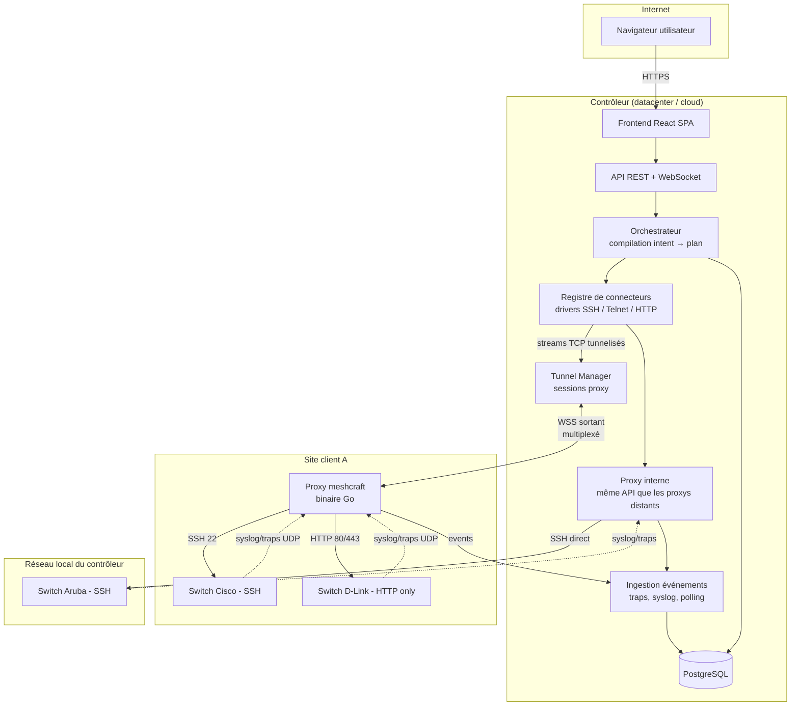

# Vue d'ensemble

## Schéma global — la CIBLE

> [!note] Ce schéma est la cible, pas l'état
> Il décrit l'architecture décidée, et il faut le garder tel quel : c'est lui qui
> dit *où* chaque brique à venir devra se brancher. Trois arêtes n'existent
> cependant pas dans le code, et les lire comme acquises fait chercher un bug
> dans du vide — la liste exacte est juste après, avec ce qui est livré.

| Arête du schéma | État |
|---|---|
| `U → FE → API`, `API → DB` | **livré** |
| `TM ↔ PA` (WSS sortant multiplexé) | **livré** — yamux sur WebSocket, `internal/tunnel` |
| `CONN → TM` puis `PA → SW2` en HTTP | **livré** — c'est le chemin du seul connecteur existant |
| `PA → SW1` en SSH 22 | **livré pour la découverte seulement** — bannière et session d'identification (`internal/discovery`). Aucun *connecteur* CLI n'existe, et rien ne parle Telnet |
| `SW → PA` en **traps** UDP, `PA → ING` | **livré** — 162/udp, `cmd/proxy/trap.go` ([[Monitoring]] §2) |
| `SW → PA` en **syslog** UDP | **décidé, non construit** — aucun listener 514/udp. Seul le terrain est posé (`network_mode: host`, `NET_BIND_SERVICE` par `internal/distrib`) |
| `CONN → IPX → SW3` (proxy interne) | **livré à moitié** : le dial direct, oui ; l'UDP local (SNMP, ICMP, traps), non — voir le callout plus bas |
| `ORCH` comme module distinct | **inexistant sous ce nom** — le cycle read/diff/apply vit dans `internal/api` + `internal/recon` ([[Contrôleur]]) |

## Composants

| Composant | Rôle | Techno ([[Stack technique]]) |
|---|---|---|
| [[Contrôleur]] | API, orchestration, compilation d'intent, UI | Go (binaire unique, frontend embarqué via `go:embed`) — **livré** |
| [[Proxy]] | Point de présence dans un réseau distant : tunnels TCP, balayage, ICMP, SNMP, réception des traps | Go (binaire statique) — **livré** ; le syslog reste à faire |
| [[Connecteurs]] | Traduction modèle standard ↔ plateforme constructeur | Go. **Un seul connecteur livré**, `instanton`, en `net/http` + XML maison. Ni scrapligo ni resty ne sont au `go.mod` — ils viendront avec le premier connecteur CLI ou REST |
| Frontend | SPA multi-sites, [[Rendu des ports]], [[Weathermap]] | React + TypeScript, responsive. **Pas encore une PWA** : ni manifeste, ni service worker — donc ni installation, ni hors-ligne |
| Base | Configuration, inventaire, événements | PostgreSQL. **Pas de partitionnement** des événements (table simple, migration `0003`) |
| Métriques | Séries temporelles de trafic et d'état | **VictoriaMetrics**, et non Postgres — décision tranchée en §3 de [[Monitoring unifié et pipelines]] |

## Décision structurante : où s'exécute quoi

Le proxy est volontairement **bête** : il ne connaît aucun constructeur. Toute l'intelligence (drivers, parsing, diff) reste sur le contrôleur. Le partage se lit en **trois motifs d'échange**, et non en un seul « RPC » — la distinction n'est pas cosmétique, elle dit qui garde la main sur quoi :

- **TCP tunnelisé** (`dial`) : le driver tourne sur le contrôleur, le flux TCP brut transite par le tunnel WebSocket ([[Protocole contrôleur-proxy]]). Un driver n'a donc jamais deux implémentations « local / distant ». **Livré.**
- **Consigne de surveillance** (`watch`) : le contrôleur **pousse une liste et des cadences**, le proxy exécute en boucle et ne remonte que des **transitions** (`events`). C'est par là que passent l'ICMP à 1 Hz, le polling SNMP, le balayage continu des plages et l'écoute des traps. Ce n'est pas un appel de procédure : rien ne se demande à la volée, tout est décidé au contrôleur puis exécuté localement — c'est ce qui permet d'éteindre un canal sur tout un parc sans redéployer un binaire. **Livré.**
- **Question ponctuelle** (`ask`) : une question, une réponse, le stream se ferme. Le jeu est **fermé à deux questions, en lecture seule** — `snmp_walk` et `source_addr` (`internal/tunnel/control.go`). **Livré.** Il n'existe **pas** de SNMP `set` par ce chemin, et il n'en existera pas : l'écriture passe par les connecteurs, qui ont leurs garde-fous.

Ce qui **n'est pas** dans ce partage, malgré le schéma : le balayage **ARP**, et l'écoute **syslog**.

> [!warning] Le « proxy interne » n'est pas un proxy, c'est l'absence de tunnel
> La cible est un proxy interne qui **implémente la même interface in-process**, pour
> qu'il n'existe qu'un seul chemin de code. La réalité est plus modeste, et il vaut
> mieux le savoir avant de compter dessus : le proxy « Local »
> (`store.LocalProxyID`, ligne posée par la migration `0005`) est une **ligne en
> base** sur laquelle on déclare les plages directement joignables, et le seul
> comportement qu'il porte est un `Dialer` **nul** — c'est-à-dire une connexion TCP
> directe (`internal/driver/webfetch.go`).
>
> La moitié qui manque est celle qui ne se tunnelise pas. Le proxy « Local » n'ayant
> aucun tunnel, il ne reçoit **aucune** `WatchConfig` : pas de ping ICMP, pas de
> polling SNMP, pas de listener de traps. Un équipement dont le seul chemin serait
> « Local » est donc **administrable mais pas supervisé** — son voyant reste
> `unknown` faute de quiconque pour le pinguer.
>
> Ce que ça coûte de le corriger est faible (le code du proxy est déjà factorisé en
> `Monitor` et en collecteur SNMP), et ce que ça coûte de l'ignorer est une
> supervision qui marche en démonstration derrière un proxy déporté et pas chez
> quelqu'un qui n'en a déployé aucun.

### Le rattachement à un proxy existe désormais, le choix de chemin non

Deux affirmations se sont inversées depuis la première rédaction, et elles ne sont pas symétriques :

| Affirmation | Verdict |
|---|---|
| « Un équipement n'est rattaché à aucun proxy » | **faux depuis la migration `0022`** : `devices.proxy_id` désigne son **collecteur de référence** — le proxy qui l'interroge en SNMP et dont l'adresse est écrite dans l'équipement comme destinataire de ses traps ([[Proxy]], § *Le collecteur de référence*). `null` reste un **régime** — collecte par couverture — et non un réglage oublié |
| « Le contrôleur tient l'ensemble des proxys qui le joignent et choisit un chemin à chaque opération » | **décidé, non construit.** Il n'existe pas de table `device_paths` : le seul recensement de « qui a vu quoi » est `discovery_sightings`, qui porte sur les **candidats** et ne survit pas à l'adoption. Le chemin d'une opération est choisi par `proxyOf` (`internal/api`) : le proxy du candidat d'origine, à défaut « Local ». Pas de latence comparée, pas de bascule sur échec |

L'ordre de livraison est délibéré et vaut d'être lu comme tel : on a livré la **désignation** avant la **dérivation**. Une élection automatique de collecteur changerait de cible toute seule, et la destination de traps déjà gravée dans les équipements deviendrait fausse sans que personne ne touche à rien ([[Monitoring]], § *Choix du point de collecte*). Le geste explicite, lui, est journalisable.

## Flux principaux

1. **Discovery** : l'utilisateur déclare une plage à scanner sur un proxy → balayage → fingerprint → l'équipement apparaît « à adopter », **sans site** ([[Discovery]]). Livré, y compris à travers un proxy distant. Le balayage est **piloté par le contrôleur** qui tunnelise ses connexions TCP, pas exécuté par le proxy — nuance détaillée dans [[Discovery]].
2. **Adoption** : l'utilisateur **choisit le site** → l'équipement rejoint le site choisi, avec sa façade physique relevée → étiquetage automatique → provisionnement de l'identité SNMP et du destinataire de traps. Livré. Ce que l'adoption ne fait **pas** encore : essayer les [[Credentials]] du site (c'est un geste séparé, `POST /api/devices/{id}/credentials/apply`), relire l'état courant (`POST /api/devices/{id}/read-state`), et mémoriser les proxys qui voient l'équipement comme chemins d'accès.
3. **Configuration** : profils + overrides compilés en configuration de ports → diff avec l'état observé → pose, avec garde-fous et relecture de vérification ([[Réconciliation]]). Livré, **sans étape de plan ni validation intermédiaire** : configurer dans l'interface *est* l'approbation, et la pose suit automatiquement après regroupement.
4. **Monitoring** : meshcraft déploie lui-même l'identité SNMP puis le destinataire de traps de l'équipement, vers l'adresse de son collecteur **déclaré** (et non dérivée de ses chemins d'accès) → traps et polling remontent par le tunnel → [[Journal d'événements]] + états de ports en quasi temps réel pour l'UI. Livré. Le **syslog** n'a rien : ni listener, ni configuration poussée — on ne configure pas un parc pour qu'il émette vers un collecteur qui n'existe pas.
5. **Accès web** : pour les équipements sans SSH, pilotage par le connecteur HTTP — livré, et c'est même le cas du **seul** connecteur existant. L'[[Accès web pass-through]] pour l'accès manuel reste une cible ; ce qui existe est la sonde en lecture seule `POST /api/devices/{id}/web-probe`.
