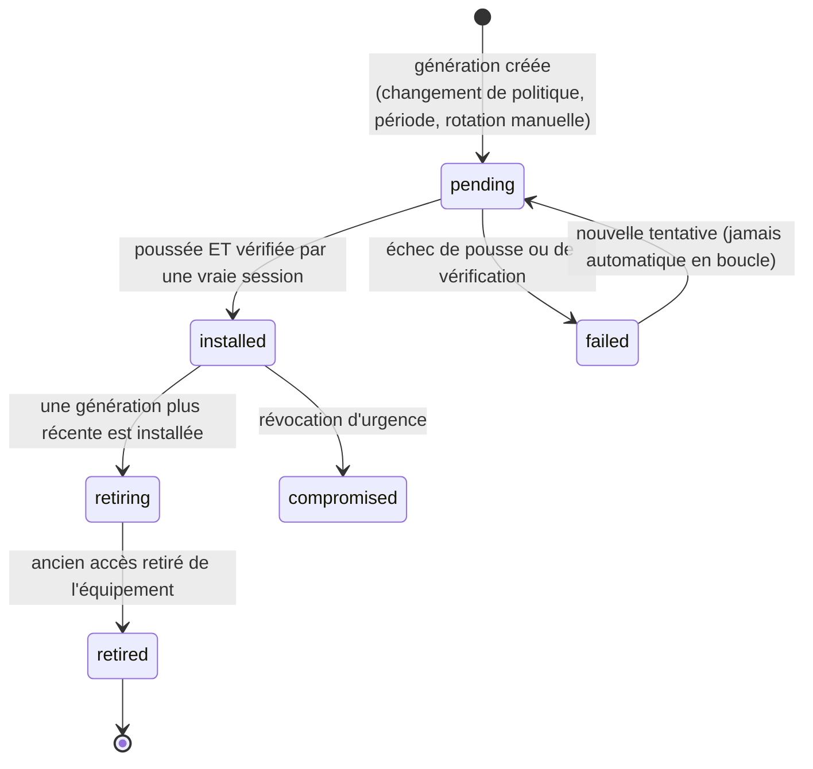

# Identité de service et rotation

Meshcraft ne se contente pas d'utiliser les identifiants qu'on lui donne : il **installe les siens** sur les équipements, et en assume le cycle de vie. C'est cette identité — compte d'administration, user SNMP, abonnement de télémétrie, cibles de collecte — que cette note décrit, ainsi que le mécanisme qui permet de la **changer sur un parc qui n'est jamais dans un état uniforme**.

## Comment lire cette note

Les §1 à §10 sont la **conception**, écrite avant de construire, et elle vaut toujours : c'est elle qui a produit les décisions qu'on ne reprend pas. Les §12 à §15 décrivent ce qui est **livré et vérifié**, et **corrigent** la conception sur deux points majeurs — la portée du secret (§12) et l'état réel des générations (§13).

| Question | État |
|---|---|
| Identité d'**administration** : pose, vérification par une vraie session, transcript | **livré** — `POST /api/devices/{id}/credentials/apply` (§15) |
| Identité **SNMP** : négociation, étiquette par couple d'algorithmes, pose, relecture | **livré** — voir [[Identité SNMP]] |
| **Générations** append-only, ordre d'essai fondé sur l'état observé | **livré** — migration `0011`, §13 |
| Un site naît avec son identifiant, sites anciens rattrapés au démarrage | **livré** — migration `0010`, §14 |
| Révélation d'une génération précise | **livré** — §13.6 |
| **Politique** d'instance surchargeable par site, champs verrouillables | **décidé, non construit** — aucune table `service_policy` |
| Rotation **automatique** (périodique) | **décidé, non construit** — la rotation est exclusivement manuelle et exige un secret fourni |
| **Déploiement** d'une génération sur le parc (pousser, vérifier, retirer, en masse) | **décidé, non construit** — créer une génération ne la pousse pas |
| Compte **CLI** de service (SSH), clé publique ed25519 | **décidé, non construit** — la seule pose passe par l'interface web de l'équipement |
| **Streaming telemetry** gNMI, certificats, échéances (§8) | **construit, sans autorité** — l'abonnement existe et s'authentifie par un identifiant de site de genre `gnmi` (un compte d'équipement, pas une communauté). Le transport sait faire TLS (`transport_tls` : `verify` / `skip-verify` / `plaintext`, migration 0039), mais RIEN n'émet encore de certificat : un site sans autorité tombe sur `skip-verify`, et `plaintext` reste possible et explicite |
| `external_aaa` | **décidé, non construit** |
| **Purge** avec délai de grâce, états `retired` / `compromised` | **décidé, non construit** — voir le callout du §13.2 |
| Vue de parc « répartition des générations », ce qui bloque une purge (§10) | **partiel** — le décompte par génération existe, le reste non |
| Événements `svc.*` | **renommés** — la famille réelle est `credential.*` (§10) |

## Trois familles d'identifiants, à ne pas confondre

| Famille | Qui la fournit | Rôle | Où |
|---|---|---|---|
| Identifiants du parc existant | l'utilisateur | entrer sur un équipement déjà en place | [[Credentials]] |
| Identifiants de découverte | l'utilisateur, au niveau instance | essayés à la découverte sur ce que meshcraft ne gère pas encore — SSH, et l'authentification HTTP des interfaces qui en demandent une | [[Discovery]] |
| **Identité de service** | **meshcraft les génère** | ce que meshcraft installe sur l'équipement puis utilise pour l'exploiter | cette note |

La troisième est d'une autre nature : meshcraft en est le **propriétaire**. Personne ne la saisit, personne ne la retient, et c'est meshcraft qui répond de sa présence sur chaque équipement.

## 1. Ce qui est poussé

| Composant | Contenu | Préférence | Capability ([[Connecteurs]]) | État |
|---|---|---|---|---|
| Compte d'administration | utilisateur (défaut `mcadmin`), mot de passe | — | `Admin.EffectiveUsername` | **livré** (§15) |
| SNMP | user v3 authPriv si la plateforme sait, sinon communauté v2c en **lecture seule** | résolu par capability, voir §2.1 | `SNMPVersions`, `SNMPv3{auth[], priv[]}` | **livré** ([[Identité SNMP]]) |
| Cibles de télémétrie | destination de traps **dérivée** du collecteur déclaré ([[Monitoring]]) | une cible | `Monitoring.Traps` | **livré pour les traps v2c** ; syslog non livré ; **deux** cibles non livrées |
| Compte CLI de service | utilisateur, clé publique ed25519, mot de passe de repli, niveau de privilège | clé publique | `LocalUsers`, `SSHPubkeyAuth` | **décidé, non construit** |
| Streaming telemetry | abonnement gNMI/gRPC : compte d'équipement passé en métadonnées gRPC ; dial-**in** (le proxy compose vers 6030) | dial-in | `GNMI` | **construit** — identifiant de genre `gnmi`, `internal/gnmipoll`, `cmd/proxy/gnmi.go`. Le certificat client reste à faire |
| Compte HTTP/API | compte local, uniquement pour les plateformes web-only ([[Accès web pass-through]]) | — | `HTTPLocalUsers` | **sans objet** — sur la gamme livrée, le compte d'administration *est* le compte web |

Ce que la plateforme ne sait pas faire n'est pas contourné : le plan porte la mention *non applicable* avec la raison, visible dans l'aperçu. Un réglage silencieusement ignoré serait pire qu'un réglage refusé. **Livré** au sens où chaque refus de pose (pas de collecteur déclaré, pas de plan v2c, pas de capability) porte son motif et son geste de réparation ([[Monitoring]], `trapdest`).

> [!note] Le « compte CLI de service » n'a pas de CLI où s'installer
> La première gamme supportée n'offre **ni SSH ni port série** : sa seule porte
> d'administration est son interface web ([[Connecteurs]]). Le compte de service
> existe donc bien — c'est le §15 — mais il est posé par formulaire HTTP, pas par
> une session SSH, et il n'y a **pas** de clé publique ed25519 à déposer.
>
> Ce n'est pas une régression sur la conception, c'est l'ordre du parc : la clé
> publique est le bon mode d'authentification et le restera, mais l'écrire avant
> qu'un connecteur sache la porter aurait produit du code jamais exercé — la leçon
> retenue du chemin SNMPv3, écrit et testé bien avant d'avoir un équipement qui
> l'accepte ([[Identité SNMP]]).

## 2. La politique est globale, surchargeable par site — les secrets sont par équipement

C'est la distinction qui structure tout le reste :

> [!important] Politique ≠ secret
> **La politique** dit *comment* meshcraft s'installe : nom du compte de service,
> mode d'authentification, algorithmes SNMP, mode de télémétrie, période de
> rotation, retrait ou non des défauts d'usine. Elle est définie **au niveau de
> l'instance** et **surchargeable par site**.
>
> **Le secret**, lui, est **généré par équipement**. Un mot de passe de service
> commun à 200 switchs signifie qu'un seul équipement compromis livre tout le
> parc. Comme aucun humain n'a jamais à le taper, rien ne justifie de le
> partager. Ce qui reste partagé est ce qui n'est pas secret (clé **publique**
> SSH, CA de télémétrie) ou ce qu'une contrainte d'exploitation impose
> explicitement (communauté unique attendue par un collecteur tiers).

> [!warning] Les deux moitiés de cet encadré ont été démenties par la suite
> La seconde moitié — « le secret est par équipement » — a été **renversée par
> l'exploitation** : le §12 tranche pour un secret **par site**, en assumant le
> coût. C'est le seul renversement de conception de cette note, et il est motivé.
>
> La première moitié — la politique — est **décidée et non construite** : il n'y a
> pas de table `service_policy`, donc ni surcharge de site, ni verrou, ni badge
> d'origine. Ce qui en tient lieu aujourd'hui est **en dur** : un plancher SNMP
> `sha256`/`aes128`, un nom de compte souhaité `mcadmin`, aucune période de
> rotation. L'encadré reste écrit parce que la distinction *politique / secret*
> est ce qui empêchera, le jour de la construction, de ranger les deux dans la
> même table — ce qui aurait fait d'un changement de politique une réécriture de
> secrets.

Résolution de la politique, avec la grammaire d'héritage déjà en place ([[Profils et groupes]]) : **valeur du site si définie, sinon valeur d'instance** — « absent = hérite ». L'UI affiche toujours l'origine (badge *hérité de l'instance* / *surchargé pour ce site*) et propose « revenir à l'héritage ». **Cible** : cette grammaire n'est aujourd'hui implémentée nulle part, pas même pour les profils dont elle s'inspire ([[Profils et groupes]]).

Deux garde-fous sur la surcharge, **cibles** eux aussi :

- Un `global-admin` peut **verrouiller** un champ : il devient un plancher que les sites ne peuvent pas abaisser. Un champ verrouillé s'affiche comme tel, il ne disparaît pas de l'UI du site.
- La surcharge de site relève du `site_admin`, la politique d'instance du `global-admin` ([[RBAC]]).

### 2.1 SNMP v2c ou v3 : une résolution, pas un choix

**La version SNMP n'est pas un réglage de politique : elle est déterminée par ce que la plateforme sait faire.** Aucune politique ne peut transformer un switch qui ignore v3 en switch qui le comprend, et un opérateur ne devrait pas avoir à savoir, équipement par équipement, ce que son parc supporte.

Ce principe est **livré**, et c'est `internal/snmpprov` qui le porte : un paquet **pur**, sans base ni réseau, qui prend les capabilities du connecteur et rend un plan. La politique n'exprime qu'une **exigence minimale**, et le mode effectif est **résolu par équipement** :

| `snmp.require` (politique) | Plateforme v3 conforme | Plateforme v3 faible (MD5/DES) | Plateforme v2c seulement |
|---|---|---|---|
| `best` (défaut) | v3 authPriv | v3 avec ce qu'elle a, **signalé non conforme** | communauté v2c RO |
| `v3` | v3 authPriv | v2c RO si `allow_weak_fallback`, sinon SNMP **non géré** | SNMP **non géré**, équipement listé |
| `off` | — | — | — |

La logique de ce tableau est écrite et testée ; ce qui manque est **l'endroit où l'exploitant choisirait `require`**, faute de table de politique. Le défaut `best` est donc le seul régime atteignable aujourd'hui.

Trois conséquences à assumer :

- **`v3` n'est pas un interrupteur, c'est un filtre.** Exiger v3 sur un parc mixte ne durcit pas les vieux équipements : il les prive de SNMP. Ils apparaissent dans une liste explicite (*« 7 équipements sans SNMP : plateforme sans v3 »*), avec le nombre et la raison. Le pire résultat serait un parc à moitié non supervisé sans que personne ne le voie. **`RequireV3` est implémenté comme un filtre** ; la liste explicite reste à afficher.
- **La capability n'est pas un booléen.** Une plateforme peut annoncer v3 en n'offrant que MD5/DES, ce qui ne vaut pas mieux que v2c. Le connecteur déclare donc les algorithmes réellement disponibles (`SNMPv3{auth: [...], priv: [...]}`) et la politique porte un plancher (`auth ≥ SHA-256`, `priv ≥ AES-128`). Ce qui ne l'atteint pas est déployé mais **marqué non conforme**, jamais présenté comme sûr. **Livré** : le plancher, le drapeau, et la note de non-conformité **inscrite dans le coffre** — pas seulement calculée à l'affichage.
- **La résolution est recalculée**, pas figée : une mise à jour de firmware qui ajoute v3 fait basculer l'équipement au cycle suivant — c'est un diff de configuration comme un autre ([[Réconciliation]]), donc une rotation ajouter → vérifier → retirer, pas une réécriture sauvage. **Partiel** : le provisionnement est bien rejoué quand les entrées d'un équipement changent (modèle, IP, groupe), et il est idempotent. Ce qui n'existe pas est la **bascule v2c → v3** elle-même, faute d'un connecteur qui déclare v3 — et faute de collecteur v3, voir le callout de tête de [[Identité SNMP]].

> [!note] v2c ne sert qu'à lire
> Quand le repli v2c s'applique, meshcraft ne déploie qu'une communauté **en
> lecture seule**, et jamais de communauté RW : l'écriture de configuration passe
> par le connecteur (CLI ou API), jamais par un `snmp set`. Une communauté RW sur
> un parc, c'est un mot de passe root en clair sur le réseau.
>
> **Livré, et garanti trois fois** : les constantes d'écriture n'existent pas dans
> le connecteur, l'entrée est codée en dur en lecture seule, et la relecture de
> vérification **refuse** une communauté revenue avec un autre mode. Il n'y a
> aucun `snmpset` dans le dépôt, ni côté contrôleur ni côté proxy.

Le même raisonnement s'applique aux autres composants : l'authentification SSH par clé publique se replie sur un mot de passe si la plateforme ne sait pas stocker de clé, et le streaming telemetry est simplement absent là où il n'existe pas. La politique dit ce qu'on veut, les capabilities disent ce qui est possible, et **l'écart est affiché** — c'est la règle 5 du [[Modèle de données standard]] (« les capabilities filtrent ») appliquée aux identifiants. L'écart *est* affiché, et mieux que prévu : la fiche d'un équipement dit aussi ce que sa plateforme **n'expose pas** en supervision, en distinguant l'absence **constatée** sur du matériel de l'absence **supposée** d'après une documentation.

Cas d'échappement à prévoir dès le départ : `external_aaa`. Chez un client qui a TACACS+ ou RADIUS, meshcraft **n'installe aucun compte local** et utilise le compte AAA fourni. Créer des comptes locaux sur un parc à AAA centralisée est une faute d'exploitation, pas une fonctionnalité. **Décidé, non construit** — et c'est un manque à connaître avant une mise en production chez un tel client, parce que le §15 crée bien un compte local, sans rien pour l'en dissuader.

## 3. Historisation : des générations, jamais un écrasement

Le problème que le modèle naïf ne voit pas : changer un mot de passe dans l'admin ne le change pas sur les équipements. Entre l'instant du changement et la fin du déploiement — qui peut durer des jours, un équipement éteint, un site coupé — **le parc porte plusieurs secrets à la fois**. Écraser le secret en base, c'est perdre l'accès à tout ce qui n'a pas encore été mis à jour.

D'où la règle : **on n'écrase jamais un secret, on ajoute une génération.** Les secrets sont une table *append-only*, et l'état réel de chaque équipement est une donnée **observée**, comme les chemins d'accès ([[Proxy]]). **Livré** — c'est le §13.

Le cycle de vie **visé** :



> [!warning] Deux états sur cinq sont vivants — et le nom du principal a changé
> Le schéma livré déclare `pending`, `active`, `retiring`, `retired`,
> `compromised`. Le diagramme ci-dessus dit `installed` là où la base dit
> **`active`** : c'est le même état, et il faut le savoir pour lire une ligne.
> `failed` n'existe pas du tout pour les générations.
>
> Ce que le code **écrit** réellement :
>
> | État | Écrit ? |
> |---|---|
> | `active` | **oui** — une génération naît `active` |
> | `retiring` | **oui** — l'ancienne y passe quand une nouvelle est créée |
> | `pending` | jamais écrit ; seulement lu comme condition de passage en `retiring` |
> | `retired` | **jamais écrit** — aucune route, aucune fonction |
> | `compromised` | **jamais écrit** — il n'existe pas de « déclarer compromis » |
>
> `retired_at` n'est donc jamais renseignée, et la révocation d'urgence du
> diagramme n'a pas de bouton. Ce n'est pas une incohérence du schéma : les cinq
> états ont été créés d'emblée parce qu'ajouter une valeur à un `check` sur une
> table append-only en production coûte plus qu'en prévoir une de trop. Mais lire
> le diagramme comme un état des lieux ferait chercher une transition qui n'existe
> pas.
>
> Le manque qui **mord** est `pending` : aujourd'hui une génération est `active`
> dès sa création, avant toute pousse. L'ordre d'essai le rattrape (§13.3, rang 3
> : « active non encore constatée »), mais le décompte « combien d'équipements
> portent quoi » compte comme active une génération qui n'est peut-être nulle part.

L'état est porté **par équipement et par composant** : le même parc peut être en génération 7 pour SSH et en génération 3 pour SNMP, ce qui est normal et doit être lisible dans l'UI. **Livré au niveau du composant** — l'identifiant `admin` et les identifiants SNMP ont chacun leurs générations — et l'état est bien constaté par équipement (`device_credential_state`).

## 4. Déployer une rotation, c'est une réconciliation

Aucun chemin spécial : une rotation entre dans le pipeline de la [[Réconciliation]] comme n'importe quel changement de configuration. Ce qui lui est propre, c'est **l'ordre des opérations** :

```
1. ajouter le nouvel accès          (le nouveau compte / user v3 / certificat)
2. vérifier par une VRAIE session   (nouvelle connexion SSH, get SNMP réel)
3. seulement alors, retirer l'ancien
```

Jamais l'inverse, jamais « modifier en place » quand la plateforme permet de coexister. C'est la règle *ne jamais se couper la main* appliquée aux identifiants : entre l'étape 1 et l'étape 3, l'équipement accepte les deux, donc aucune fenêtre d'inaccessibilité n'existe.

> [!important] Cet ordre est livré **par équipement**, pas **par parc**
> C'est la distinction qui décide de ce qu'un exploitant peut faire aujourd'hui.
>
> **Livré** : sur un équipement donné, `POST …/credentials/apply` fait exactement
> les trois étapes — et le cas du **renommage** de compte les fait au sens le plus
> strict, l'équipement n'ayant pas d'opération « renommer ». Le nouveau compte est
> créé, la configuration est **sauvée en flash** pour qu'une coupure de courant ne
> laisse pas l'équipement avec le seul ancien compte, une **nouvelle session** est
> ouverte sous le nouveau nom, et **c'est seulement alors** que l'ancien est
> supprimé. Un échec de suppression ne fait pas échouer le geste — le compte visé
> fonctionne, c'est l'essentiel — mais il est **dit** (`credential.stale_account`),
> parce qu'un compte résiduel est une porte ouverte dont personne ne saurait rien.

> [!warning] Sur RouterOS, l'ancien identifiant SURVIT au retrait — constaté
> Défaut ouvert, relevé sur un CRS326-24G-2S+ en RouterOS 7.21beta3 pendant la
> campagne de validation du connecteur.
>
> Après un renommage `admin` → `mcadmin`, meshcraft relit `/rest/user`, n'y trouve
> plus `admin`, et conclut « déjà absent — rien à faire ». La table dit vrai : elle
> ne porte qu'une ligne, nommée `mcadmin`. Mais **l'ancien couple continue
> d'ouvrir l'équipement**, huit minutes après le geste et sans redémarrage — et ce
> n'est pas un cache d'authentification qui expirerait, puisqu'un mauvais mot de
> passe, un compte inventé et `mcadmin` avec l'ancien secret sont tous trois
> refusés en 401. C'est bien cet ancien couple, et lui seul, qui répond.
>
> La conséquence est celle que `credential.stale_account` existe pour empêcher, par
> un chemin que l'avertissement ne couvre pas : **meshcraft croit un accès fermé
> alors qu'il est ouvert**, et l'événement ne se déclenche pas puisque, de son point
> de vue, il n'y a rien eu à supprimer.
>
> Ce que ça apprend dépasse la gamme : **la liste des comptes n'est pas une preuve
> qu'un identifiant ne fonctionne plus.** La seule preuve d'un retrait est du même
> ordre que la preuve d'un ajout — une tentative réelle. La parade est donc
> symétrique de l'étape 2 : après un renommage, ESSAYER l'ancien couple et émettre
> `credential.stale_account` s'il répond, au lieu de conclure d'après une lecture.
> Non construit.
>
> **Non construit** : le déploiement de la rotation **sur le parc**. Créer une
> génération ne la pousse nulle part. Il n'y a ni ordonnancement, ni progression,
> ni reprise — l'exploitant appelle `apply` équipement par équipement. C'est
> l'entrée dans le pipeline de [[Réconciliation]] qui manque, pas la séquence.

- **Vérifier** signifie ouvrir une session avec le nouveau secret à travers le [[Proxy]], pas constater qu'une commande est sortie sans erreur. Un `username` accepté par la CLI et refusé au login est un classique. **Livré**, et c'est le principe le plus systématiquement tenu de tout le lot : rien n'est enregistré sur la foi d'un code de retour.
- **Échec** : l'ancienne génération reste installée, la nouvelle est signalée, l'équipement apparaît dans l'UI. Deux tentatives au maximum par compte, comme à la découverte, pour ne pas déclencher les verrouillages AAA. **Livré pour les tentatives** (`triesPerAccount`, insensible à la casse) ; le marquage `failed` de la génération, non — il n'existe pas d'état pour lui. L'échec vit dans `device_credential_state.last_error` et dans l'événement `credential.apply_failed`.
- **Plateformes sans coexistence** (un unique secret `enable`, pas de second utilisateur) : l'ajout-puis-retrait est impossible. Le changement est marqué `disruptive`, exige une fenêtre de maintenance, une sauvegarde fraîche et le watchdog de joignabilité de la [[Réconciliation]]. On le dit au lieu de le masquer. **Décidé, non construit** — aucun marquage `disruptive` n'existe. À noter que le cas *inverse* est déjà traité proprement : quand le compte visé **est** celui par lequel on vient d'entrer, c'est un simple changement de mot de passe, sans coexistence à orchestrer.
- **Concurrence** : sérialisée par équipement (verrou existant), et jamais deux équipements qui se servent mutuellement de chemin d'accès en même temps. **Décidé, non construit** pour ce chemin.

> [!important] L'intent référence le credential, jamais la génération
> Dans le [[Modèle de données standard]], `services.snmp.v3.user_ref` vaut
> `cred://svc-snmp`, sans numéro de génération. La génération est résolue **au
> moment de l'apply**. Sinon chaque rotation créerait une révision d'intent pour
> tout le parc, et l'historique de configuration deviendrait illisible — on
> confondrait « la configuration a changé » et « le secret a tourné ».
>
> **Tenu** : rien dans le code ne fait remonter un numéro de génération dans une
> intention. La résolution se fait bien à l'usage, par l'ordre du §13.3.

## 5. Choisir le bon secret à l'usage

C'est ici que l'historisation paie. Pour ouvrir une session, meshcraft essaie dans cet ordre — **livré**, voir §13.3 pour la version exacte et le test qui la verrouille :

1. la génération que l'équipement est **connu** porter ;
2. les générations **en retrait** — l'équipement peut ne pas avoir encore été nettoyé ;
3. les générations **actives** non encore constatées — cas d'un job interrompu après la pousse mais avant la confirmation ([[Protocole contrôleur-proxy]] : un job coupé n'est jamais rejoué à l'aveugle, mais le secret a peut-être bel et bien été installé) ;
4. les identifiants d'origine fournis par l'utilisateur ([[Credentials]]) — le filet de sécurité qui rattrape un équipement restauré depuis une vieille sauvegarde.

Deux essais par compte, arrêt immédiat au-delà. **Quand une connexion réussit avec une génération inattendue, l'état observé est corrigé** — exactement comme un drift de configuration : la base apprend de la réalité, elle ne la décrète pas. **Livré** (§13.4).

Le §15 complète cette liste **aux deux bouts**, et l'implémentation ajoute un cinquième rang que la conception n'avait pas vu : les secrets que l'équipement porte au titre d'un **autre** identifiant (`PreviousInstalls`), avec le nom de compte qui va avec. C'est le rattrapage d'un ré-étiquetage : changer l'étiquette d'un équipement change l'identifiant que la portée lui désigne, sans rien changer sur l'équipement.

## 6. Rétention : ne jamais purger un secret encore en service

- Une génération n'est **jamais** purgée tant qu'un équipement connu la porte, ni tant qu'un équipement est `unreachable` depuis la rotation. Un switch éteint trois mois redémarre avec l'ancien secret : le jour où il revient, il doit être joignable.
- Purge possible quand toutes les générations plus récentes sont confirmées sur l'ensemble du parc, après un **délai de grâce** (défaut 90 jours). L'UI dit toujours ce qui bloque : *« 3 équipements encore en génération 4 »*.
- Une génération `compromised` est l'exception : retirée des équipements et purgée sans délai.
- La purge efface **la valeur, pas l'histoire** : qui a déclenché la rotation, quand, sur quel périmètre, avec quel résultat, reste dans le [[Journal d'événements]]. C'est l'historisation demandée par l'audit ; elle n'a jamais besoin des secrets eux-mêmes.

> [!note] Rien de ce paragraphe n'est construit, et c'est **le bon sens de l'erreur**
> Il n'existe aucune purge de secret, aucun délai de grâce, aucun état
> `compromised`. La conséquence est que le coffre **grossit sans jamais oublier** :
> toutes les générations de tous les identifiants restent, scellées.
>
> Ce n'est pas urgent — quelques dizaines d'octets par rotation — et c'est le
> défaut sûr : le risque que ce paragraphe adresse est de purger **trop tôt** un
> secret qu'un équipement éteint porte encore, ce qui fabrique une brique. Ne rien
> purger ne fabrique rien. La brique de calcul est d'ailleurs déjà écrite :
> `RetirableGenerations` sait dire quelles générations sont retirables et, sinon,
> la raison du blocage en clair — voir le callout du §13.2 sur son statut réel.

## 7. Ne pas enfermer le client dehors

Trois règles non négociables, qui découlent du fait que meshcraft détient désormais les accès :

1. **Meshcraft ne supprime jamais ce qu'il n'a pas créé.** Tout objet poussé est marqué comme géré par meshcraft ; les comptes, communautés et clés préexistants du client ne sont pas touchés, même quand la politique demande un durcissement. **Tenu pour SNMP** : le connecteur pose son **propre** groupe v3 (`meshcraft-ro`) au lieu de réutiliser un groupe d'usine, précisément parce que les groupes d'usine portent une vue d'écriture — réutiliser aurait donné à l'utilisateur v3 de meshcraft un droit qu'aucune ligne de code ne demandait.
2. **Le retrait des défauts d'usine** (`public`/`private`, compte admin d'usine) est opt-in, et refusé tant que l'accès de service n'a pas été vérifié sur cet équipement. Durcir avant d'avoir un accès prouvé, c'est fabriquer une brique.
3. **Accès de secours (break-glass).** Si meshcraft détient les seuls identifiants d'un parc, une panne de meshcraft rend ce parc inadministrable. Un export d'accès de secours doit donc exister : par équipement ou par site, réservé au `global-admin`, exigeant une ré-authentification, **tracé** dans le journal, et signalé aux autres administrateurs. C'est la seule exception à la règle « un secret ne sort jamais de l'API » ([[Credentials]]) — la nier ne la ferait pas disparaître, elle ferait juste sortir les secrets par un chemin non tracé.

> [!warning] La règle 2 est à moitié tenue, et l'autre moitié est plus subtile qu'un opt-in
> La **seconde** moitié est tenue au sens fort : rien n'est retiré avant qu'une
> **vraie session** ait prouvé le nouvel accès (§4, §15). C'est bien la garantie
> qui empêche de fabriquer une brique.
>
> La **première** — « opt-in » — ne l'est pas, et pas par oubli : sur cette gamme,
> l'équipement indexe ses comptes par leur nom et n'a pas d'opération de
> renommage. Demander un compte `mcadmin` sur un équipement qui n'a qu'`admin`
> signifie donc *mécaniquement* créer l'un et retirer l'autre — le retrait du
> compte d'usine est **impliqué par le choix du nom**, pas coché à part. Il n'y a
> pas de réglage pour dire « garde aussi `admin` ».
>
> Deux conséquences pratiques : un exploitant qui voulait conserver le compte
> d'usine doit demander le nom `admin` ; et si la suppression échoue, l'ancien
> compte **reste actif** et c'est un avertissement, pas un succès silencieux.
> Le comportement est défendable, mais il n'est pas celui que « opt-in » annonce.
>
> La règle 3, elle, n'existe pas sous cette forme : voir le dernier callout de
> [[Credentials]] — ce qui est livré est la révélation unitaire, tracée, au
> `site_admin`.

En dernier recours reste la procédure de retour usine décrite par le connecteur ([[Discovery]]) : du savoir, documenté, jamais exécuté à la place de l'opérateur. **Livré** — et l'écran distingue les procédures **constatées** sur du matériel de celles **supposées** d'après une documentation.

## 8. Le cas des certificats : la rotation devient une échéance — *décidée, non construite*

> [!note] Rien de cette section n'existe dans le code
> Il n'y a aucun certificat de télémétrie, aucun gNMI, aucune CA — la capability
> `GNMI` n'est renseignée par aucun connecteur, et la gamme livrée n'a pas
> d'équivalent. La section est conservée parce que le raisonnement qu'elle porte
> ne s'invente pas au moment de la bascule.

Un certificat de télémétrie a une date d'expiration : la rotation n'est plus une bonne pratique, c'est une **obligation datée**. Conséquences :

- renouvellement déclenché aux deux tiers de la durée de vie, jamais à l'expiration ;
- un équipement dont le certificat expirerait avant son prochain créneau de rotation remonte une alerte, pas un échec silencieux ;
- l'expiration de la **CA** est un événement de parc entier : elle se planifie, avec une CA de remplacement déployée en parallèle avant bascule — même schéma ajouter → vérifier → retirer, à l'échelle du parc ;
- la clé privée de la CA est protégée comme la clé maîtresse : hors base ([[Credentials]]).

La colonne `not_after` du §9 était prévue pour ça, et c'est la seule chose de cette section qui existe en base.

## 9. Modèle de données

Ce que la conception prévoyait :

```sql
-- Politique : une ligne d'instance, plus une par site qui surcharge.
service_policy(id pk, scope text, site_id fk nullable, kind text,
               spec jsonb, locked bool, updated_by fk users, updated_at)

-- Secrets APPEND-ONLY : une ligne par (équipement, composant, génération).
service_secrets(id pk, device_id fk, kind text, generation int,
                secret_enc bytea, state text,
                created_at, activated_at, retired_at, not_after timestamptz,
                unique(device_id, kind, generation))

-- État OBSERVÉ sur l'équipement, corrigé par ce que les sessions constatent.
device_service_state(device_id fk, kind text, installed_generation int,
                     installed_at, last_verified_at, last_error text,
                     primary key(device_id, kind))
```

> [!important] Aucune de ces trois tables n'existe — mais deux ont un équivalent
> `service_policy` n'a **pas** d'équivalent : la politique n'est pas construite.
>
> Les deux autres existent sous d'autres noms, et la différence n'est pas
> cosmétique : elle porte le renversement du §12.
>
> | Prévu | Réel | Ce qui change |
> |---|---|---|
> | `service_secrets(device_id, kind, generation)` | `credential_generations(credential_id, device_id, generation)` — migration `0011` | la génération pend d'un **identifiant**, pas d'un équipement. `device_id` existe mais reste vide : c'est l'option `per_device`, jamais exercée |
> | `device_service_state(device_id, kind, …)` | `device_credential_state(device_id, credential_id, installed_generation, installed_at, last_verified_at, last_error, installed_username)` — migrations `0011` + `0012` | l'état constate **quel identifiant** l'équipement porte, et sous **quel nom de compte** — colonne que la conception n'avait pas prévue et sans laquelle on envoie l'administrateur se connecter avec un compte inexistant |
>
> `activated_at` et `retired_at` existent ; `retired_at` n'est jamais renseignée
> (§13.2). `not_after` est prévue pour les certificats du §8.

Le chiffrement est celui du coffre ([[Credentials]]) : **AES-256-GCM**, une seule clé d'instance — l'enveloppe KEK → DEK n'est pas construite, et la clé n'est hors base que si `MESHCRAFT_SECRET_KEY` est définie.

## 10. Interface

Une section d'instance **Identité de service** (politique globale, verrous, périodes de rotation) et, sur chaque site, la même page avec l'origine de chaque valeur et le bouton « revenir à l'héritage ». Plus une vue de parc qui ne mente pas :

- répartition des générations (*42 équipements en génération 7, 3 en 6, 1 en échec*), cliquable pour filtrer ;
- ce qui bloque une purge, ce qui bloque un durcissement ;
- pour chaque équipement : génération installée, dernière vérification, dernière erreur ;
- rotation manuelle (immédiate ou dans la prochaine fenêtre), révocation d'urgence, export de secours.

**Ce qui est livré** : l'écran *Configuration → Identifiants*, avec la liste des identifiants, leur portée, la présence d'un secret, la date de rotation, le décompte d'équipements par génération, la révélation, la rotation manuelle et la bascule `per_device`. **Ce qui ne l'est pas** : la section d'instance et l'héritage (pas de politique), le filtrage par génération, ce qui bloque une purge (pas de purge), la révocation d'urgence et l'export de secours. Et « rotation dans la prochaine fenêtre » n'a pas de fenêtre : la rotation est immédiate et exige un nouveau secret **fourni** — il n'y a pas de tirage automatique à la rotation, contrairement à la création d'un site (§14).

> [!note] Les événements ne s'appellent pas `svc.*`
> La famille réelle est `credential.*`, et elle est plus fine que la liste prévue :
> `credential.generated`, `credential.updated`, `credential.rotated`,
> `credential.mode_changed`, `credential.deleted`, `credential.revealed`,
> `credential.installed`, `credential.apply_failed`,
> `credential.apply_unconfirmed`, `credential.stale_account`,
> `credential.scope_ambiguous`. Chercher `svc.*` dans le [[Journal d'événements]]
> ne rend rien.
>
> Deux manquent, et ce sont exactement ceux dont les fonctionnalités n'existent
> pas : `svc.retired` (rien ne passe en `retired`) et `svc.breakglass_exported`
> (il n'y a pas d'export). Le premier renommage à faire le jour de la purge est
> donc de rester dans `credential.*`, pas de créer une seconde famille.

## 12. Décision d'exploitation : le secret est par SITE, pas par équipement

Le §2 recommandait un secret **par équipement** : un seul équipement compromis
ne livre alors pas le parc. L'exploitation a tranché autrement, et la raison est
solide : un administrateur doit pouvoir se connecter à n'importe quel équipement
de son site sans consulter une liste de deux cents mots de passe. Le compromis
est **assumé** — il élargit le rayon d'une compromission à un site.

La nuance qui rend la chose praticable : les politiques de mot de passe diffèrent
d'un modèle à l'autre (longueur maximale, caractères interdits). Un site définit
donc un identifiant **par défaut**, plus autant d'identifiants **par groupe
d'équipements** ou **par étiquette** que nécessaire. Un équipement prend le plus
spécifique qui le vise, et à spécificité égale celui de plus haute priorité —
l'ambiguïté restante étant **signalée** plutôt que tranchée ([[Credentials]]).

Livré (migration 0010, `site_credentials`, écran *Configuration → Identifiants*) :

- la **liste ne renvoie jamais un secret**, seulement sa présence et sa date de
  rotation — on ne lit pas un mot de passe par mégarde en ouvrant une page. La
  requête ne sélectionne même pas le champ scellé ;
- la **révélation** est un appel distinct (`POST …/reveal`), réservé au
  `site_admin`, et **journalisée avec l'identité du demandeur**. Un accès en
  clair non tracé vaudrait moins que pas de coffre du tout. Voir un identifiant
  reste un droit d'`operator` : *voir* et *lire* ne sont pas la même permission ;
- un identifiant demandé par son UUID doit appartenir au site de l'URL, sinon un
  site-admin lirait les secrets d'un autre site en devinant un identifiant. La
  même vérification couvre la suppression, la rotation et le changement de mode ;
- l'écran affiche en clair que la clé de chiffrement vit **dans la base** tant
  que `MESHCRAFT_SECRET_KEY` n'est pas définie.

## 13. Générations : livré (migration 0011)

Le §12 laissait les générations en attente. Elles sont là, et elles décident du
comportement le plus délicat du produit : **entre deux rotations, le parc n'est
jamais dans un seul état**.

### 13.1 Un secret posé ouvre toujours une génération

Créer un identifiant, changer son mot de passe depuis l'écran d'édition, ou
cliquer « nouvelle génération » sont **le même acte** et passent par le même
code (`addGenerationTx`). Deux chemins distincts finiraient par diverger, et le
jour où ils divergent l'historique ment sur ce qui est réellement posé.

Détail qui découle du §12 et qu'il faut connaître : `AddGeneration` met **aussi**
à jour `site_credentials.secret_enc` et `rotated_at`. Le coffre porte donc
toujours la génération courante, sans quoi une révélation ordinaire rendrait
l'ancienne paire — l'inverse exact de ce que demande celui qui appuie sur le
bouton.

### 13.2 L'ancienne génération passe en `retiring`, jamais en `retired`

C'est le point qui rend la rotation sûre. Une génération en retrait **reste
valide** : tant qu'un équipement la porte, c'est le seul mot de passe qui ouvre
sa porte. Un switch éteint pendant la rotation reviendra avec l'ancien secret,
et meshcraft doit encore savoir entrer.

> [!warning] « Jamais en `retired` » est littéralement vrai : il n'y a pas de chemin
> Le passage en `retired` **ne peut pas** avoir lieu, faute de code qui l'écrive :
> aucune route, aucune fonction. `RetirableGenerations` **existe** et fait bien ce
> que ce paragraphe décrit — elle ne rend une génération que si **zéro équipement
> connu** la porte, et sinon la raison du blocage en clair (« 3 équipement(s)
> portent encore cette génération ») — mais **personne ne l'appelle**. C'est un
> calculateur sans consommateur.
>
> Conséquence bénigne et voulue : une génération en retrait le reste
> indéfiniment, et l'ordre d'essai continue de l'essayer. Un secret de plus dans
> la liste coûte une tentative ; l'oublier trop tôt coûte un équipement
> injoignable. Mais la phrase « le passage en `retired` n'est possible que
> lorsque… » décrivait une porte, alors qu'il n'y a pas encore de porte.
>
> Ce qu'il reste à brancher est étroit : une route qui appelle
> `RetirableGenerations`, écrit `retired` et `retired_at`, et rend la raison du
> refus telle quelle. C'est aussi le préalable de la purge du §6.

### 13.3 L'ordre d'essai, verrouillé par un test

`SecretsForCredential` renvoie les secrets **dans l'ordre**, et cet ordre n'est
pas intuitif :

1. la génération que l'équipement est **connu** porter (état constaté) ;
2. les générations **en retrait**, de la plus récente à la plus ancienne —
   un équipement pas encore mis à jour porte forcément une ancienne ;
3. les générations **actives** non encore constatées — un push interrompu après
   l'écriture mais avant la confirmation ;
4. puis rien : l'appelant complète avec les [[Credentials]] d'origine.

Les générations `retired` et `compromised` sont exclues — l'exclusion est écrite,
même si rien ne les produit encore (§13.2).

Essayer la plus récente d'abord échouerait sur tout le parc en retard. Ce
classement est verrouillé par `internal/store/generations_test.go`, qui rejoue la
clé de tri SQL en Go : un mauvais ordre ne se voit qu'au moment où un équipement
resté en arrière devient injoignable, c'est-à-dire trop tard.

Chaque secret rendu porte aussi la **raison** de sa position (« installée sur cet
équipement », « en retrait, plus récente »…), et c'est cette raison qui remonte
au transcript du §15 — ce qui permet de ne jamais y écrire le secret lui-même.

### 13.4 On apprend de la réalité, pas de l'intention

`NoteInstalledGeneration` enregistre la génération qui a **réellement**
fonctionné, y compris — et surtout — quand ce n'est pas celle attendue. La base
apprend de l'équipement exactement comme pour un drift de configuration
([[Réconciliation]]). C'est ce constat, et non l'intention, qui alimente le
décompte « combien d'équipements portent encore quoi ».

Son pendant, ajouté en cours de route : `NoteInstalledUsername`. Enregistrer la
génération sans le **nom de compte** sous lequel elle a fonctionné laissait la
moitié de l'information manquante — voir §14.

### 13.5 Option : un secret par équipement — *décidée, non exercée*

`site_credentials.per_device` bascule une portée en secret **distinct par
équipement**. Le §12 avait tranché pour le secret par site au nom du confort de
l'administrateur ; cette option rend l'arbitrage réversible **par site**, une
fois que l'accès direct passe par meshcraft plutôt que par la mémoire de
l'exploitant. Les générations sont alors indexées par `device_id`.

> [!warning] Le drapeau se coche mais ne fait rien
> La colonne existe, la route existe (`PUT …/credentials/{id}/mode`), l'ordre
> d'essai la lit, et l'écran l'affiche. Mais **aucun appelant ne crée jamais de
> génération avec un `device_id`** : les deux seuls chemins d'écriture passent une
> chaîne vide. Le basculer change donc l'étiquette à l'écran et le libellé de
> l'événement, et rien d'autre.
>
> Ce n'est pas inutile — la moitié *lecture* du mécanisme est en place, ce qui est
> la moitié risquée — mais un exploitant qui coche la case croit avoir cloisonné
> son parc alors qu'il partage toujours un secret par site. Tant que
> l'engendrement par équipement n'existe pas, la case devrait être désactivée à
> l'écran plutôt que trompeuse.

### 13.6 Révéler une génération précise

Quand un équipement est resté en arrière, c'est **son ancien** mot de passe
qu'il faut, pas le nouveau. `POST …/generations/{n}/reveal` le donne, avec la
même journalisation nominative que la révélation ordinaire, et la même
vérification que la génération appartient bien à un identifiant du site de l'URL.

## 14. Un site naît avec son identifiant

Un site sans identifiant est un site où meshcraft ne peut rien poser : chaque
équipement adopté resterait sur son mot de passe d'usine — c'est-à-dire souvent
AUCUN — en attendant que quelqu'un pense à en créer un. Le défaut sûr est donc
de le créer nous-mêmes.

À la création d'un site, meshcraft engendre :

- un mot de passe de **16 caractères alphanumériques** (majuscules, minuscules,
  chiffres), tiré au sort sans biais de modulo, avec au moins un caractère de
  chaque classe. L'alphabet est une contrainte d'EXPLOITATION, pas une coquetterie :
  les interfaces des switchs rejettent selon les modèles l'espace, le guillemet,
  l'esperluette, et certaines tronquent en silence. Un secret refusé par la moitié
  du parc ne protège rien (`internal/pwgen`, tests inclus) ;
- un nom d'utilisateur **`mcadmin`** — « idéalement », parce que beaucoup de
  gammes n'admettent aucun compte d'administration autre que `admin`.

Le nom réellement posable est tranché par le connecteur
(`Capabilities.Admin.EffectiveUsername`), et c'est le nom **réellement posé** qui
est enregistré par équipement (`device_credential_state.installed_username`,
migration 0012). Enregistrer le nom souhaité enverrait l'administrateur se
connecter avec un compte qui n'existe pas.

Les sites créés avant cet automatisme sont rattrapés au démarrage du contrôleur
(`BackfillSiteCredentials`), et le rattrapage est journalisé : l'exploitant doit
pouvoir retrouver QUAND un secret est apparu, pas seulement qu'il existe. Le
rattrapage est idempotent — il ne crée que s'il n'y a aucun identifiant `admin`
de portée site — et son échec **n'empêche pas le contrôleur de démarrer** : un
site sans identifiant est un manque, pas une panne, et refuser de démarrer
priverait l'exploitant de l'écran où il le corrigerait.

## 15. Poser l'identité sur un équipement

`POST /api/devices/{id}/credentials/apply` est l'aboutissement du mécanisme.
Droit requis : `site_admin` sur le site de l'équipement.

L'ordre d'entrée est celui du §13.3, complété aux deux bouts :

1. le **mot de passe fourni par l'opérateur** (`current_secret`), s'il y en a un —
   cas de la reprise en main d'un équipement configuré avant meshcraft, dont la
   base n'a aucune trace. Il n'est jamais stocké ;
2. les générations, dans l'ordre de `SecretsForCredential` ;
3. les secrets que l'équipement porte au titre d'un **autre** identifiant
   (`PreviousInstalls`), avec le nom de compte qui va avec — le rattrapage d'un
   ré-étiquetage, qui change l'identifiant désigné sans rien changer sur
   l'équipement ;
4. le **compte d'usine sans mot de passe**, EN DERNIER. Le placer en premier
   ferait échouer tout le parc déjà pris en main.

Les **noms de compte** sont eux aussi ordonnés, et pas dans l'ordre qu'on
croirait : le nom **constaté** d'abord (`installed_username`), puis le nom
souhaité, puis `admin`, sans doublon et insensiblement à la casse. Commencer par
le nom souhaité ferait échouer un équipement déjà renommé sur lequel on veut
seulement changer le mot de passe.

Deux essais au maximum par compte, pour ne pas déclencher un verrouillage — avec
un **créneau réservé d'avance** au compte d'usine, sinon un parc déjà repris en
main épuisait le budget et un équipement neuf devenait inadoptable.

Rien n'est enregistré sur la foi d'un code de retour : après l'écriture, une
**nouvelle session** est ouverte avec le nouveau secret. C'est elle qui prouve la
pose, et c'est seulement alors que `NoteInstalledGeneration` et
`NoteInstalledUsername` sont appelés. Un formulaire accepté mais sans effet
laisserait sinon la base convaincue d'un succès. Quand la pose n'est pas
confirmée, l'événement le dit (`credential.apply_unconfirmed`) au lieu de
compter un succès.

Le cas du **renommage** applique l'ordre du §4 au sens le plus strict — créer,
sauver en flash, prouver par une session, et seulement alors supprimer l'ancien
compte. Voir le callout du §4 pour ce que cela implique sur le retrait du compte
d'usine (§7, règle 2).

`dry_run` s'arrête après l'authentification : savoir qu'on sait entrer, sans rien
changer.

Chaque étape est consignée dans un **transcript** rendu à l'opérateur, et ce
transcript ne porte **jamais** de secret — seulement le nom de compte essayé et
la raison de sa position dans l'ordre. Le code retrouve d'ailleurs le secret
ayant fonctionné en **rejouant l'ordre des candidats**, précisément pour ne pas
avoir à le ranger dans le transcript. Sur une gamme sans SSH ni port série, où
une erreur se paie d'un déplacement, un échec muet est le pire des résultats.

Ce qui reste : le **déploiement** d'une génération sur les équipements, en masse.
Créer la génération ne la pousse pas — c'est le chemin d'écriture des connecteurs
([[Connecteurs]]), équipement par équipement, avec vérification, et c'est
aujourd'hui l'opérateur qui enchaîne les appels.
