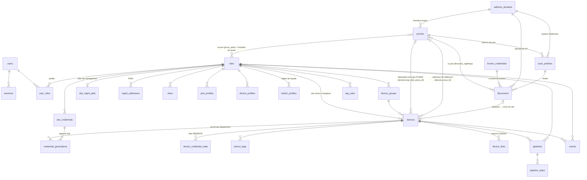

# Schéma base de données

**PostgreSQL** unique (config + inventaire + événements), accès via **`pgx`** avec des
requêtes SQL **écrites à la main** dans `internal/store/*.go`, migrations par un
**migrateur embarqué maison**. Les métriques ne sont pas dans Postgres
([[Monitoring unifié et pipelines]] §3). Choix de fond discuté dans [[Stack technique]].

> [!warning] Trois écarts d'outillage à ne pas propager
> [[Stack technique]] annonce encore « pgx + **sqlc**, migrations **goose** » et
> « PostgreSQL **16** ». Aucun des trois n'est vrai dans le dépôt, et la nuance change
> ce qu'on va chercher quand on veut ajouter une requête :
>
> - **pas de `sqlc`** : aucun générateur, aucun `queries.sql`. Le SQL vit dans les
>   fonctions de `internal/store/` et le `scan` est écrit à côté. Chercher un fichier
>   de requêtes à régénérer est une perte de temps ;
> - **pas de `goose`** : `Store.Migrate` (`internal/store/store.go`) lit
>   `migrations/*.sql` via `go:embed`, les trie par nom, et applique celles qui
>   manquent — **une transaction par fichier**, avec inscription dans
>   `schema_migrations`. Donc : pas de `-- +goose Up`, pas de section `Down`, et
>   **aucun rollback** ; une migration se corrige par une migration suivante ;
> - **PostgreSQL 17** (`postgres:17-alpine` dans le `docker-compose`).
>
> Cette page décrit l'état réel. La correction de [[Stack technique]] lui appartient.

> [!note] Comment lire cette page
> Le schéma porte à la fois ce qui est **construit** et ce qui a été **conçu puis mis
> en attente**. Les deux valent d'être écrits, mais les confondre coûte cher dans les
> deux sens : croire construit ce qui n'existe pas fait chercher un bug dans du code
> qui n'a jamais été écrit — ou écrire une requête sur une table absente ; effacer une
> cible parce qu'elle n'est pas construite ferait perdre la décision et son argument.
>
> Trois régimes, marqués partout :
>
> - **en base** — la table existe, on peut l'interroger aujourd'hui ;
> - **cible** — décidée, **non construite**. Aucune requête ne doit s'y appuyer ; ce
>   qui tient le rôle aujourd'hui est nommé à chaque fois ;
> - **abandonné** — une autre décision l'a remplacée, et laquelle.
>
> Les tables du régime **cible** sont regroupées en fin de page, jamais mêlées au SQL
> réel, et **absentes du diagramme** ci-dessous.

## Ce qu'on peut interroger aujourd'hui

**31 tables en base**, `schema_migrations` comprise. Le tableau sert de garde-fou : si
un nom n'y est pas, il n'existe pas.

| Domaine | Tables **en base** | Migration |
|---|---|---|
| Comptes, sessions, droits | `users`, `sessions`, `user_roles` | `0001` |
| Sites | `sites` | `0001`, `0002` (`plan`) |
| Proxys | `proxies`, `proxy_sites`, `enroll_tokens` | `0003`, `0004`, `0006`, `0007`, `0008` |
| Domaines d'adressage | `address_domains` | `0020` |
| Découverte | `scan_prefixes`, `discovered`, `discovery_sightings`, `known_credentials` | `0005`, `0020` |
| Coffre | `instance_secrets` | `0005` |
| Réseau du site | `vlans`, `site_mgmt_plan`, `mgmt_addresses` | `0001`, `0009`, `0018` |
| Identifiants de site | `site_credentials`, `credential_generations`, `device_credential_state` | `0010`, `0011`, `0012`, `0013`, `0017` |
| Profils | `port_profiles`, `device_profiles`, `switch_profiles`, `device_groups` | `0001`, `0021` |
| Étiquettes | `device_tags`, `tag_rules` | `0013` |
| Équipements | `devices`, `device_links` | `0002`, `0014`, `0015`, `0019`, `0020`, `0022`, `0023` |
| Pipelines | `pipelines`, `pipeline_steps` | `0016` |
| Journal | `events` | `0003` |
| Migrateur | `schema_migrations` | créée par `Store.Migrate` |

Et l'inverse, qui est la vraie utilité de ce tableau — **ce qui n'est pas en base**,
avec ce qui tient le rôle aujourd'hui :

| Nom | Régime | Ce qui tient le rôle aujourd'hui |
|---|---|---|
| `device_paths` | **cible** | rien. L'éligibilité est **déduite** de la couverture (`Store.DevicesWatchedBy`) |
| `device_collectors` | **cible** | `devices.proxy_id` — déclaré, pas élu (`0022`) |
| `device_intents` | **cible** | `devices.ports` + `desired_changed_at` / `applied_at` — état courant, **sans historique** |
| `ports_state` | **abandonné** | `devices.observed` + `observed_at` (`0014`) |
| `jobs` | **abandonné** | `pipelines` + `pipeline_steps` (`0016`) |
| `config_backups` | **cible** | rien |
| `device_positions` | **abandonné** | `devices.pos_x` / `devices.pos_y` (`0002`) |
| `service_policy` | **cible** | rien : aucune politique d'instance ni de plancher verrouillé |
| `service_secrets` | **renommé, livré** | `credential_generations` (`0011`) |
| `device_service_state` | **renommé, livré** | `device_credential_state` (`0011`) |
| `scan_ranges` | **renommé** | `scan_prefixes` (`0005`) |
| `lldp_links` | **renommé + cible** | `device_links` : les liaisons existent, **saisies**, pas découvertes |
| `credentials` | **renommé, éclaté** | `site_credentials`, `known_credentials`, `credential_generations`, `device_credential_state` |
| `metrics_port` | **abandonné** | VictoriaMetrics ([[Monitoring unifié et pipelines]] §3) |

## Vue d'ensemble

Tables **en base** uniquement.



## Tables en base

Le SQL ci-dessous est **descriptif** : noms de colonnes et types réels, contraintes qui
portent une décision. La source de vérité reste `internal/store/migrations/`, et les
en-têtes de migrations portent l'argumentaire long.

### Comptes, sessions, droits

```sql
users(id uuid pk, email text unique, pw_hash text,
      display_name text, is_global_admin bool, created_at)
-- PAS de colonne TOTP : la double authentification n'est pas construite.

-- Session par jeton opaque : seule l'EMPREINTE est en base, jamais le jeton.
sessions(token_hash bytea pk, user_id fk users on delete cascade,
         created_at, expires_at)

user_roles(user_id fk users, site_id fk sites, role text,   -- viewer|operator|site_admin
           primary key(user_id, site_id))                   -- check contraint sur role
```

### Sites

```sql
sites(id uuid pk, name text unique, created_at,
      plan jsonb)   -- zones du synoptique, dimensions (cf. Weathermap) ; format libre
                    -- versionné par site-config
```

### Proxys, couverture, enrôlement

```sql
-- PAS de site_id : il n'y a pas de site « propriétaire » (retiré en 0006). À la
-- place, une COUVERTURE de sites qui est la frontière de droits du proxy (cf. Proxy) :
--   global = true  → proxy d'instance, utilisable partout, global-admin ;
--   global = false → restreint à proxy_sites. Liste VIDE = couvre rien, jamais
--                    « partout » (sinon retirer le dernier site promouvrait le
--                    proxy en proxy d'instance).
-- Elle ne dit pas ce que le proxy peut joindre — et rien en base ne le dit : c'est
-- DÉDUIT à la lecture (Store.DevicesWatchedBy), cf. « device_paths » en fin de page.
proxies(id uuid pk, name text,
        secret_hash bytea,          -- empreinte du secret d'enrollment, PAS une pubkey
        version text, protocol int,
        os text, arch text, internal bool, global bool,
        created_at, last_seen timestamptz, ifaces jsonb, revoked bool,
        -- Migration vers une autre instance : ordre déposé, consommé au heartbeat.
        migrate_url text, migrate_token text, migrated_at timestamptz,
        -- Mise à jour : cf. Versionnage et mise à jour du proxy
        auto_upgrade bool, pin_version text, upgrade_requested bool,
        upgrade_state text, upgrade_version text, upgrade_error text,
        upgrade_started_at timestamptz, upgraded_at timestamptz,
        address_domain_id fk address_domains null)  -- on delete set null
-- version = horodatage de build UTC AAAAMMJJ.HHMMSS, comparable en texte ;
-- protocol = compatibilité du tunnel, indépendant de la date de build.
proxy_sites(proxy_id fk, site_id fk, primary key(proxy_id, site_id))

-- Token d'enrollment : usage unique, TTL court. Il porte la couverture que
-- prendra le proxy — FIGÉE à l'émission, car les droits de l'émetteur peuvent
-- changer avant que le token soit consommé.
enroll_tokens(id uuid pk, token_hash bytea unique, created_by fk users,
              global bool, site_ids uuid[],
              created_at, expires_at, used_at)
```

### Domaines d'adressage

```sql
-- L'espace dans lequel une adresse IP désigne une machine et une seule. DÉCLARÉ,
-- jamais déduit : fusionner à tort deux réseaux fond deux équipements en une fiche,
-- ce qui ne se rattrape pas, alors qu'un doublon se supprime d'un clic.
-- Cf. Domaines d'adressage, et l'en-tête de 0020_domaines_adressage.sql.
address_domains(id uuid pk, name text, note text, created_at)
```

La migration `0020` est **à sémantique constante** : chaque proxy existant a reçu son
propre domaine, `id` repris de celui du proxy — ce qui a rendu les reprises exactes
sans jointure. **Ce n'est pas un lien de nature entre les deux objets** : les domaines
créés ensuite ont leur identifiant propre, et une requête qui joindrait
`address_domains.id` à `proxies.id` marcherait sur le parc migré puis casserait
silencieusement.

### Découverte et adoption

```sql
-- Identifiants « standards connus » de l'INSTANCE, essayés par priorité pendant la
-- découverte. Secret chiffré applicativement (AES-GCM, internal/secretbox), jamais
-- relu par l'API. Distincts de site_credentials : ceux-ci sont ce qu'on ESSAIE,
-- ceux-là ce qu'on INSTALLE.
known_credentials(id uuid pk, name text, kind text,   -- ssh|telnet|http
                  username text, secret_enc bytea,
                  priority int, enabled bool, created_at)

-- Plage à scanner : appartient au proxy qui sait l'atteindre, PAS à un site
-- (à la découverte, le site n'est pas encore connu — il est choisi à l'adoption),
-- et AUSSI au domaine qui dit dans quel réseau vivent ces adresses.
-- `prefix` est du TEXTE, pas un cidr : les plages sont validées applicativement.
scan_prefixes(id uuid pk, proxy_id fk proxies on delete cascade,
              prefix text, enabled bool, note text,
              last_run_at timestamptz, last_result text, created_at,
              address_domain_id fk not null,   -- on delete RESTRICT
              unique(proxy_id, prefix))

-- Candidats issus de la découverte : SANS SITE par construction. Un candidat adopté
-- RESTE en base, pour l'audit.
discovered(id uuid pk, source text,            -- scan|manual|serial
           proxy_id fk proxies null,           -- proxy témoin ; null = « Local »
           ip text, mac text, serial text, hostname text,
           vendor text, model text, driver text, confidence int,
           transports text,                    -- liste lisible : "ssh,https"
           fingerprint jsonb,
           raw_config text,                    -- conf lue (SSH ou console série)
           credential_id fk known_credentials null,
           note text, first_seen, last_seen,
           adopted_device_id fk devices null,  -- non null = candidat consommé
           adopted_site_id fk sites null, adopted_at,
           address_domain_id fk null)
-- Clé de fusion, portée par un index unique d'EXPRESSION (pas une contrainte de
-- colonnes) : serial, sinon MAC, sinon (domaine, IP). Le repli sur le domaine est ce
-- que 0020 a changé — deux proxys sur un même réseau produisaient jusque-là deux
-- candidats pour un seul équipement muet, que rien ne pouvait plus réunir.
--   discovered_key_idx unique on
--     coalesce(nullif(serial,''), nullif(mac,''),
--              coalesce(address_domain_id::text,'sans-domaine') || '|' || ip)

-- Un candidat vu par plusieurs proxys est normal, pas un conflit.
discovery_sightings(discovered_id fk on delete cascade, proxy_id fk on delete cascade,
                    ip text, latency_ms int, last_seen timestamptz,
                    primary key(discovered_id, proxy_id, ip))
```

### Coffre : où vit la clé

```sql
-- Clé de chiffrement d'instance, utilisée FAUTE de MESHCRAFT_SECRET_KEY.
instance_secrets(name text pk, value bytea, created_at)
```

Une seule clé AES-256-GCM pour toute l'instance (`internal/secretbox`), et son
emplacement est le seul réglage : variable d'environnement — la clé est **hors base**,
un dump PostgreSQL ne livre pas les secrets — ou, à défaut, tirée au hasard au premier
démarrage et rangée dans `instance_secrets`, **dans la base qu'elle protège**. Le
contrôleur le journalise et l'UI l'affiche : le dire vaut mieux que le laisser croire.

> [!note] L'enveloppe KEK → DEK par site est une **cible**
> [[Credentials]] décrit une hiérarchie *clé maîtresse → DEK par site → secrets*, dont
> l'intérêt est réel : faire tourner la clé d'un site sans re-chiffrer les autres. Elle
> n'est pas construite — **aucune table de DEK, aucune colonne `dek_id`** sur
> `site_credentials` ni sur `credential_generations`. Une requête qui sélectionnerait
> `dek_id` échoue. Ce que la rotation de clé fait aujourd'hui est un re-chiffrement
> global (`internal/store/rekey.go`), qui est exactement le coût que la cible évite.

### Réseau du site : VLAN, plan de management, IPAM

```sql
vlans(id uuid pk, site_id fk, vlan_id int check between 1 and 4094,
      name text, color text, purpose text,
      unique(site_id, vlan_id))
-- Tout site a un VLAN 1 « Défaut » (0018_default_vlan, cf. VLAN par défaut).

-- Plan de management du site : VLAN d'administration, sous-réseaux, et origine
-- de l'adresse. Cf. Adressage de management.
-- Les adresses et préfixes sont du TEXTE, pas cidr/inet : la validation est
-- applicative, comme pour scan_prefixes.
site_mgmt_plan(site_id pk fk, vlan_id int, untagged bool,
               subnet_v4 text, gateway_v4 text,
               subnet_v6 text, gateway_v6 text,
               dns text[], ntp text[],
               source text,                   -- dhcp_external | meshcraft
               pool_start text, pool_end text,
               strict_plan bool,              -- refuser l'adoption hors plan
               updated_by fk users, updated_at)

-- IPAM : l'unicité est portée par la BASE, pas par le code — deux adoptions
-- simultanées ne peuvent pas choisir la même adresse. meshcraft ALLOUE, il ne
-- distribue pas : l'adresse est poussée en configuration statique.
mgmt_addresses(site_id fk, address text, device_id fk devices null,
               state text,                    -- reserved|assigned|released
               allocated_at, released_at null,
               primary key(site_id, address))
```

### Identifiants : ce que meshcraft installe, et ce que le parc porte

Quatre tables, et leur séparation est le fond du sujet. Le §9 d'[[Identité de service et rotation]]
décrit un modèle en `service_policy` / `service_secrets` / `device_service_state` :
**deux des trois sont livrés sous d'autres noms**, la troisième ne l'est pas. Le détail
est en fin de page.

```sql
-- DÉCISION D'EXPLOITATION : un mot de passe par SITE, pas par équipement. La spec
-- recommandait l'inverse — un équipement compromis ne livrant alors pas le parc.
-- L'exploitation a tranché : un administrateur doit pouvoir se connecter à
-- n'importe quel équipement de son site sans consulter 200 mots de passe. Le
-- compromis est assumé, et `per_device` laisse un site choisir l'autre régime.
-- La PORTÉE est un triplet, parce que les raisons de donner un secret particulier
-- ne s'excluent pas : le groupe (hérité), l'ÉTIQUETTE (cf. Étiquettes et portée des
-- identifiants), et le kind. Vide = défaut du site.
site_credentials(id uuid pk, site_id fk, group_name text, tag text,
                 kind text,                   -- admin|ssh|snmp_v2c|snmp_v3…
                 username text, secret_enc bytea,
                 secret2_enc bytea null,      -- SNMPv3 : la SECONDE phrase (0017)
                 per_device bool, priority int, note text,
                 rotated_at, created_at, updated_by fk users)
--   site_credentials_scope_key unique (site_id, group_name, tag, kind)
-- secret2_enc est nullable et c'est le point : seul snmp_v3 a deux phrases. En
-- forcer une seconde ailleurs créerait un secret que rien ne consomme, donc un
-- secret qu'on ne fait pas tourner et qu'on oublie.

-- APPEND-ONLY : changer un secret CRÉE une génération, il n'écrase jamais rien.
-- Le parc n'est pas dans un seul état pendant un déploiement — un équipement
-- éteint, un site coupé — et écraser le secret en base perdrait l'accès à tout ce
-- qui n'a pas encore été mis à jour.
-- Les deux phrases v3 tournent ENSEMBLE : la génération porte la PAIRE. Les séparer
-- laisserait, après rotation, « quelle phrase de chiffrement va avec celle-ci ? »
-- sans réponse — et se tromper de paire ne rend pas une erreur lisible, ça rend un
-- silence : l'agent v3 jette le paquet qu'il ne sait pas déchiffrer.
credential_generations(id uuid pk, credential_id fk site_credentials on delete cascade,
                       device_id fk devices null,   -- null = secret partagé de la portée
                       generation int,
                       secret_enc bytea, secret2_enc bytea null,
                       state text,   -- pending|active|retiring|retired|compromised
                       created_at, activated_at, retired_at, created_by fk users,
                       unique(credential_id, device_id, generation))
-- `retiring` n'est pas `retired` : remplacée, mais des équipements la portent
-- encore, donc toujours valide pour se connecter.

-- État OBSERVÉ sur l'équipement, corrigé par ce que les sessions constatent, jamais
-- décrété. Ne dit pas la même chose que credential_generations.state : celui-ci
-- parle du SECRET, celui-là de l'ÉQUIPEMENT.
device_credential_state(device_id fk on delete cascade,
                        credential_id fk site_credentials on delete cascade,
                        installed_generation int, installed_username text,
                        installed_at, last_verified_at, last_error text,
                        primary key(device_id, credential_id))
```

### Profils et étiquettes

```sql
-- Trois profils de la MÊME forme (id, site_id, name, spec jsonb, unique par site),
-- et ce n'est pas décoratif : `store.profileTable` est paramétré par `kind`, donc le
-- CRUD, les routes /api/sites/{id}/profiles/{kind}, les événements et la résolution
-- de site du flux temps réel valent pour les trois sans une ligne de plus.
port_profiles(id uuid pk, site_id fk, name text, spec jsonb, unique(site_id, name))
device_profiles(id uuid pk, site_id fk, name text, spec jsonb, unique(site_id, name))
-- Règles qui produisent la configuration des ports à partir de la FAÇADE de
-- l'équipement (cf. Profils de switchs, migration 0021). Le seul des trois qui soit
-- exécutable aujourd'hui : le profil d'équipement porte les services communs (STP,
-- SNMP, syslog) et sa mise en œuvre reste à faire.
switch_profiles(id uuid pk, site_id fk, name text, spec jsonb, unique(site_id, name))

-- HÉRITÉ. Le groupe ne porte plus d'écran : son profil d'équipement n'est
-- compilé nulle part, et sa seule fonction vivante — choisir un identifiant —
-- est mieux remplie par une étiquette (cf. Étiquettes et portée des
-- identifiants). Conservé parce que `site_credentials.group_name` s'y rapporte
-- par NOM sur les parcs importés.
device_groups(id uuid pk, site_id fk, name text,
              device_profile_id fk device_profiles null, unique(site_id, name))

-- Étiquettes posées sur un équipement. Le groupe ne suffisait pas : il est UNIQUE
-- par équipement, et il porte déjà le profil. Or une gamme qui plafonne les mots de
-- passe à 16 caractères, un lieu confié à un prestataire et une plage isolée peuvent
-- concerner le MÊME équipement.
device_tags(device_id fk on delete cascade, tag text,
            source text,          -- 'manual' | 'rule:<uuid>'
            created_at, primary key(device_id, tag))
-- `source` est ce qui rend une réévaluation sûre : rejouer les règles RETIRE ce
-- qu'une règle avait posé et qui ne s'applique plus, sans jamais toucher à ce qu'un
-- humain a décidé. Sans elle, la seule réévaluation prudente serait de ne rien
-- retirer, et le parc accumulerait des étiquettes périmées.

tag_rules(id uuid pk, site_id fk, tag text, priority int, enabled bool,
          match jsonb,            -- critères en ET : vendor, model, location, ip_prefix
          note text, created_at, updated_by fk users,
          unique(site_id, tag, match))
-- Une règle SANS critère ne s'applique à RIEN. Le contraire ferait d'une ligne à
-- moitié saisie une règle qui prend tout le parc.
```

### Équipements

```sql
-- Le site vient de l'adoption. `proxy_id` ne dit pas à qui l'équipement appartient
-- ni ce que le proxy peut joindre : il DÉSIGNE le collecteur de référence. Cf. Proxy,
-- « Le collecteur de référence : un rattachement DÉCLARÉ ».
devices(id uuid pk, site_id fk on delete cascade, group_id fk device_groups null,
        name text,                      -- le nom d'inventaire ; il n'y a PAS de
                                        -- colonne `hostname`, ni `serial`, ni `mac`
        model text, vendor text, location text,
        mgmt_ip text,                   -- TEXTE, pas inet
        -- JOIGNABILITÉ. Écrite par la surveillance ICMP SEULE (SetDeviceStatus) : ces
        -- trois colonnes ont quitté l'entrée de l'API, parce qu'un écran qui renvoie la
        -- fiche entière republiait le statut lu à son ouverture. Un statut s'observe.
        status text,                    -- ok|warn|off|unknown  (défaut 'unknown')
        status_note text,               -- état stable, SANS compte de pertes (0026)
        -- Depuis quand ce constat tient (0025). NULL = jamais observé, ce qui est
        -- distinct de 'unknown' : le premier dit que la surveillance n'a rien dit
        -- encore, pas qu'elle ne sait pas. N'avance QUE si le constat change, sinon la
        -- durée affichée mesurerait la stabilité du WAN et non celle de l'équipement.
        -- Ce n'est PAS une date de dernière vue : cf. Monitoring, § *Statut des
        -- équipements* — le proxy ne remonte que des transitions.
        status_at timestamptz,
        poe_budget_w int,
        pos_x double precision, pos_y double precision,  -- position au synoptique
        -- Façade physique : [{prefix, from, count, poe, speed, label}]. Elle FAIT FOI
        -- sur la liste des ports (cf. 0019 ci-dessous).
        port_groups jsonb,
        -- INTENTION par port : {"GE1": {label, mode, pvid, tagged, poe}}
        ports jsonb,
        -- État RÉELLEMENT LU sur l'équipement (0014). Séparé de `ports` parce que les
        -- deux ne coïncident pas : entre une modification dans meshcraft et sa pose,
        -- et entre une modification faite à la main sur le switch et sa détection, le
        -- parc vit avec DEUX vérités. Les confondre, c'est ne jamais pouvoir dire
        -- laquelle est en retard. Cf. Réconciliation §2 et §6.
        observed jsonb, observed_at timestamptz,   -- null = jamais relu
        -- Ces deux dates ATTRIBUENT un écart sans le deviner : si l'intention n'a pas
        -- bougé depuis la dernière pose et que l'équipement diffère quand même, alors
        -- c'est l'ÉQUIPEMENT qui a changé — le seul cas qui mérite d'interrompre.
        desired_changed_at timestamptz, applied_at timestamptz,
        -- Résultat de la DERNIÈRE pose (0015). Une pose peut réussir en laissant des
        -- choses de côté — le garde-fou refuse de déplacer un port qui porte
        -- l'administration. Si ce détail ne vivait que dans un message d'événement,
        -- le garde-fou protégerait et passerait pour un bug.
        last_apply jsonb,
        -- Métadonnées libres. Porte aussi `discovered_id` (posé à l'adoption) : la
        -- provenance est dans ce jsonb, PAS dans une colonne.
        extra jsonb,
        address_domain_id fk address_domains null,   -- 0020, on delete set null
        --   index devices_domain_idx (address_domain_id)
        -- Collecteur de référence, DÉCLARÉ par l'opérateur (migration 0022) : le
        -- proxy qui interroge cet équipement en SNMP, et dont l'adresse sera
        -- écrite dans l'équipement comme destination de ses traps.
        --   null            → collecte par COUVERTURE, comme avant 0022 : tout
        --                     proxy éligible est collecteur. C'est l'état de tout
        --                     le parc existant, donc migration à sémantique
        --                     constante ;
        --   on delete set null → retirer un proxy ne supprime pas des
        --                     équipements ; le repli correct est le régime par
        --                     couverture.
        -- Ne donne AUCUNE couverture : rattacher à un proxy qui ne couvre pas le
        -- site fait CESSER la collecte, pas la déplacer (l'ICMP continue, donc le
        -- voyant reste vert). L'API refuse ce geste ; la fiche porte un bandeau
        -- quand une couverture a été rétrécie après coup. Le sens est dans Proxy,
        -- « Le collecteur de référence : un rattachement DÉCLARÉ ».
        proxy_id fk proxies null,       -- on delete set null
        --   index devices_proxy_idx (proxy_id) : sert la lecture inverse
        --   « quels équipements ce proxy collecte-t-il ? », posée à l'écran d'un
        --   proxy et à son retrait. La requête de surveillance, elle, part de
        --   devices et n'en a pas besoin.
        --
        -- Destination de traps ÉCRITE DANS L'ÉQUIPEMENT (migration 0023). Quatre
        -- colonnes qui ne disent pas la même chose, et c'est TOUT leur objet :
        -- séparer la PRÉTENTION de la PREUVE. Le sens complet est en tête de
        -- 0023_destination_traps.sql ; ci-dessous ce qu'il faut savoir pour lire
        -- une ligne de `devices` sans se tromper.
        trap_dest_addr text,            -- l'adresse posée. null = rien posé, jamais.
        trap_dest_proxy_id fk proxies null,  -- de QUEL proxy elle venait.
                                        --   on delete set null.
        trap_dest_at timestamptz,       -- quand on l'a posée  → la PRÉTENTION
        trap_seen_at timestamptz,       -- quand un trap est arrivé → la PREUVE
        --   index devices_trap_dest_idx (trap_dest_proxy_id) : pendant exact de
        --     devices_proxy_idx — « quels équipements pointent leurs traps vers ce
        --     proxy ? », posée au retrait d'un proxy et sur son écran. La
        --     confirmation d'un trap part de l'identifiant d'équipement et n'en a
        --     pas besoin.
        unique(site_id, name))
--   index devices_site_idx (site_id)

-- Liaisons du synoptique. SAISIES (CRUD, ou import site-config), pas découvertes :
-- les DEUX extrémités sont des équipements connus, `not null`. Il n'y a donc pas de
-- voisin « fantôme » en base — c'est la différence avec la cible `lldp_links`
-- décrite en fin de page.
device_links(id uuid pk, site_id fk on delete cascade,
             a_device fk devices not null, a_port text,
             b_device fk devices not null, b_port text,
             speed text, status text,   -- up|warn|down
             note text)
--   index device_links_site_idx (site_id)
```

> [!note] `0019` : la façade fait foi, et une migration qui efface des ports se relit deux fois
> La télémétrie SNMP nommait les ports « préfixe + ifIndex ». Un équipement expose par
> SNMP bien plus d'interfaces que sa façade n'a de ports — VLAN, agrégats, boucles,
> relevés sur un 1930 avec des index à 1000, 3000, 20000 et 100000 — et elles
> apparaissaient dans `devices.ports` comme des ports (« GE100041 ») : **93 entrées
> pour 52 ports réels** sur le switch qui a servi à les débusquer. Inoffensives pour la
> réconciliation (sans `mode`, le diff les ignore), mais elles gonflaient l'inventaire.
>
> La source est colmatée côté contrôleur (`applyPortTelemetry` : la télémétrie ne
> **crée** plus jamais un port). `0019` nettoie le dépôt des versions précédentes, avec
> trois précautions qui sont la vraie leçon : la **façade fait foi** (`port_groups`), un
> équipement dont la façade est illisible **n'est pas touché**, et toute entrée portant
> une intention (`mode`, `label`, `pvid`, `tagged`) est **épargnée même hors plage** —
> une entrée configurée n'est pas un fantôme, et si son nom surprend, c'est une anomalie
> à regarder, pas à effacer en silence.

### Pipelines : ce qui est en cours, et ce qui coince

```sql
-- Un apply qui échoue laissait un événement et rien d'autre : il fallait deviner.
-- Cf. Monitoring unifié et pipelines §5.
pipelines(id uuid pk, site_id fk on delete cascade,
          kind text,               -- config | credential | monitoring | import
          device_id fk devices null,  -- null = campagne de parc
          state text,              -- pending | running | blocked | done | failed
          label text,              -- en français, pour une liste lisible
          blocked_reason text,     -- une PHRASE, pas un code
          created_at, started_at, ended_at, created_by fk users)
--   index pipelines_site_idx (site_id, created_at desc)
--   index pipelines_state_idx (state, created_at desc) : les états qui appellent une
--     action se cherchent en premier.
-- `blocked` n'est PAS un échec : équipement éteint, proxy déconnecté, fenêtre de
-- maintenance fermée. Le confondre avec `failed` pousse à relancer ce qui n'a pas
-- besoin de l'être.

pipeline_steps(id uuid pk, pipeline_id fk on delete cascade, seq int, name text,
               state text,         -- done | failed | skipped
               detail text,        -- ce que l'équipement a RÉELLEMENT répondu
               created_at)
--   index pipeline_steps_idx (pipeline_id, seq)
-- `skipped` existe parce qu'un garde-fou qui refuse d'agir n'est ni une réussite ni
-- un échec : c'est une décision, et elle doit se lire comme telle.
```

Deux écarts avec le modèle de [[Monitoring unifié et pipelines]] §5, tous deux du côté
**non construit** : les étapes n'ont **ni `started_at` ni `ended_at`** (seul
`created_at` existe), et il n'y a **pas de colonne `transcript jsonb`** — `detail` est
du texte. Un écran qui voudrait chronométrer une étape ou rejouer une session complète
n'a pas la donnée.

### Journal d'événements

```sql
-- Table SIMPLE, NON partitionnée (0003_proxies_events, et son propre commentaire
-- le dit). `ts` n'est pas un paramètre d'insertion : il prend son `default now()`,
-- donc l'horloge du CONTRÔLEUR — cf. Journal d'événements, « Une seule horloge ».
events(id bigint generated always as identity pk,
       ts timestamptz default now(),
       site_id fk sites null, device_id fk devices null,   -- on delete set null
       port_name text, type text, severity smallint,
       message text, actor text, payload jsonb)
--   index events_site_ts_idx (site_id, ts desc)
--   index events_device_ts_idx (device_id, ts desc)
--   index events_type_ts_idx (type, ts desc)
-- PAS DE TABLE DE MÉTRIQUES EN BASE. Les échantillons partent en VictoriaMetrics
-- (internal/tsdb, internal/metricbuf) : Postgres ne porte que la configuration,
-- l'inventaire, les pipelines et le journal. Cf. Monitoring unifié et pipelines §3.
```

### Le migrateur

```sql
-- Créée par Store.Migrate, pas par un fichier de migration.
schema_migrations(name text pk, applied_at timestamptz)
```

`name` est le **nom de fichier** (`0023_destination_traps.sql`), pas un numéro : c'est
ce qui rend l'ordre lexicographique suffisant, et ce qui interdit de renommer une
migration déjà appliquée quelque part — elle serait rejouée.

## `devices` : la destination de traps, ou pourquoi deux dates valent mieux qu'un drapeau

Migration `0023_destination_traps`. Quatre colonnes ajoutées à `devices`, et le seul
point qui compte est **lesquelles disent quoi** : trois portent une *prétention*, une
porte une *preuve*, et confondre les deux coûte cher.

Le contexte, en une phrase : le canal de traps était complet partout sauf au dernier
étage. Le proxy sait recevoir et filtrer, le contrôleur sait corréler, le connecteur
sait déclarer un destinataire, et le rattachement de la migration 0022 fournit
l'unicité sans laquelle « **une** adresse » n'a pas de sens ([[Proxy]]). Il manquait le
geste qui les relie — écrire dans chaque équipement l'adresse vers laquelle émettre —
et donc la trace de ce geste. Sans trace, la seule façon de savoir ce que meshcraft a
écrit et où serait de **relire chaque équipement**, c'est-à-dire d'ouvrir une session
web par switch pour répondre à une question d'inventaire.

| Colonne | Type | Ce qu'elle affirme |
|---|---|---|
| `trap_dest_addr` | `text` | « nous avons écrit **cette** adresse dans cet équipement » |
| `trap_dest_proxy_id` | `uuid` → `proxies`, `on delete set null` | « et elle appartenait à **ce** proxy » |
| `trap_dest_at` | `timestamptz` | « à **cette** date » — la **prétention** |
| `trap_seen_at` | `timestamptz` | « un trap de cet équipement est arrivé » — la **preuve** |

### La prétention n'est pas la preuve, et un booléen les confondrait

`trap_dest_addr` + `trap_dest_at` sont une prétention **même quand tout a réussi** :
l'équipement a répondu, la relecture de vérification a confirmé la ligne, et ça
prouve exactement une chose — l'équipement **porte** la configuration. Pas que ses
traps arrivent. L'adresse vient de la question `source_addr` posée au proxy
collecteur, donc de sa **table de routage**, et reste une hypothèse sur le chemin
**retour** ([[Protocole contrôleur-proxy]]). Un pare-feu, une route asymétrique, une
ACL sur le VLAN de management, et l'équipement émet dans le vide sans que rien ne
change ni dans sa configuration ni dans la nôtre.

`trap_seen_at` ne se discute pas : le paquet a traversé.

> [!warning] Ce qu'un unique drapeau « traps configurés » aurait rendu inexprimable
> L'état **« adresse écrite, jamais confirmée »** — et c'est précisément celui où l'on
> cherche un pare-feu. Avec une seule colonne, il n'existe pas : la pose le mettrait à
> `true` et la fiche annoncerait une supervision réactive qui n'a jamais eu lieu.
>
> Le coût n'est pas théorique, c'est le pire scénario de ce canal : **une flotte
> entière déclarée configurée qui n'émet rien**, et un exploitant qui attend une
> réactivité qu'il n'a jamais eue. Il ne s'en apercevrait à aucun moment — les
> événements de port continuent d'arriver, justes, simplement à la cadence de polling
> ([[Journal d'événements]]). Deux dates séparées sont ce qui rend l'écart
> **affichable**, et `trap.path_confirmed` ce qui le rend **remarquable**.

### `trap_dest_proxy_id` : ce qui rend la prétention réfutable

Ce n'est pas un champ d'affichage. Changer le collecteur d'un équipement change
l'adresse qu'il faut y écrire : la destination enregistrée devient **fausse**, et la
confirmation acquise ne vaut plus rien — elle portait sur un **autre chemin retour**.
Sans savoir de quel proxy l'adresse venait, on ne saurait pas **quand cesser d'y
croire**. Une prétention non réfutable n'est pas une information, c'est une croyance.

`on delete set null` sur le proxy, comme en 0022 et pour la même raison : retirer un
boîtier ne doit rien effacer de l'inventaire. La nuance ici mérite d'être lue deux
fois — **`trap_dest_addr` survit à ce `set null`**, et c'est voulu : l'adresse est
toujours écrite dans l'équipement, physiquement, même si le proxy à qui elle
appartenait n'existe plus. Ce qu'on perd est la capacité de dire **à qui** elle était,
ce qui est exactement ce que la suppression du proxy détruit. Effacer l'adresse en
même temps aurait fait disparaître de l'inventaire une ligne qui est toujours dans le
matériel.

> [!note] L'oubli est dans le MÊME `update` que le rattachement
> `store.SetDeviceProxy` remet les quatre colonnes à `null` dans l'`update` qui change
> `proxy_id`, et pas dans un second appel : **ce qu'un rattachement invalide, il
> l'invalide toujours**, et aucun appelant ne peut l'oublier. Une preuve conservée
> après un changement de chemin est exactement le genre de mensonge que la migration
> 0023 existe pour supprimer.
>
> Le prédicat d'oubli porte sur `trap_dest_proxy_id`, **pas** sur l'ancien `proxy_id`,
> et la différence compte : la destination reste valable si et seulement si elle vient
> du proxy qui est collecteur *à l'issue* de l'`update`. Écrit ainsi, un rattachement
> rejoué à l'identique — le cas d'un écran qui renvoie la valeur courante — ne détruit
> pas une preuve encore exacte ; un détachement la détruit toujours (plus de
> collecteur, donc plus d'adresse unique à écrire).
>
> Symétriquement, `store.SetTrapDestination` **conserve** `trap_seen_at` quand on
> repose exactement la même adresse depuis le même proxy — sans quoi tout
> provisionnement rejoué ferait perdre un fait acquis et annoncerait une seconde fois
> « chemin établi ». C'est le même invariant, vu de l'autre bout : **une preuve porte
> sur un chemin, pas sur un équipement.**
>
> Ce qui n'est **pas** fait : reposer. L'équipement continue d'émettre vers l'ancienne
> adresse jusqu'à ce que quelqu'un réécrive la ligne — et l'oubli ci-dessus est ce qui
> rend cet état **lisible** plutôt que masqué par une destination enregistrée qui ne
> correspond plus à rien.

### Pas de colonne de port, et il faut le dire

Le port d'écoute des traps n'est pas un réglage par équipement : le contrôleur envoie
`tunnel.DefaultTrapPort` (162) dans toute configuration de surveillance où l'écoute
est demandée, et c'est la même constante que le connecteur pose. **Une colonne
toujours égale à 162 ne porterait aucune information** — elle coûterait une migration,
un champ de plus dans chaque lecture, et l'illusion d'un réglage.

Le jour où le port devient un choix, il devient une colonne — et ce jour-là il devra
rejoindre le **prédicat de réfutation** ci-dessus, exactement comme le proxy
aujourd'hui : une destination dont le port a changé n'est pas plus prouvée qu'une
destination dont l'adresse a changé.

### Les deux dates viennent de la même horloge, et c'est un correctif

`trap_dest_at` et `trap_seen_at` sont toutes deux écrites par `now()` **en base**.
`store.ConfirmTrapPath` n'accepte **aucun horodatage en paramètre**, et c'est le fond
de sa signature.

Ça n'a pas toujours été le cas, et le défaut s'est vu au premier essai sur matériel
réel : la preuve était enregistrée avec la date portée par l'**événement du proxy** —
une machine déployée chez un client, que rien ne synchronise. `trap_seen_at` valait
**onze secondes avant** le `trap_dest_at` de la pose qu'il confirmait. Pas une
violation de causalité : un **mélange d'horloges**, dans deux colonnes voisines de la
même ligne, donc dans deux colonnes qui invitent à une comparaison qui n'avait aucun
sens.

La règle est portée par [[Protocole contrôleur-proxy]], §*`Event.TS` est un fait de
DIAGNOSTIC, jamais une date qui s'ordonne* : **le contrôleur est la seule horloge qui
puisse ordonner ses propres prétentions.** Une date fournie par un proxy dit ce que le
*proxy* croit ; c'est une information sur l'état du parc, jamais une valeur qui se
compare à ce que le contrôleur a écrit. Le geste de correction est ce qu'il faut
retenir : le paramètre a été **retiré** de la signature, pas documenté — tant qu'il
n'existe pas, personne ne peut y faire entrer la date d'un tiers, alors qu'un
commentaire se contourne sans le savoir. Le journal des événements a la même
propriété pour la même raison ([[Journal d'événements]]).

### `null` partout, et c'est l'état de tout le parc existant

Aucun équipement n'a jamais reçu de destinataire de meshcraft avant cette migration.
Elle est donc **à sémantique constante** : `null` se lit « rien posé, rien prouvé », ce
qui est exact, et aucune supervision ne change tant que personne n'a posé. Même
raisonnement qu'en 0022, où `proxy_id null` se lit « collecte par couverture ».

### Décidé / livré / ouvert

| Question | État |
|---|---|
| Quatre colonnes, prétention et preuve séparées | **livré** — `0023_destination_traps.sql` |
| `devices_trap_dest_idx (trap_dest_proxy_id)` | **livré** — sert le retrait d'un proxy et son écran |
| Oubli de la destination dans le même `update` que le rattachement | **livré** — `store.SetDeviceProxy` |
| Confirmation conservée sur une repose identique, effacée sinon | **livré** — `store.SetTrapDestination` |
| Borne « une seule ligne de journal par destination posée », prise en base | **livré** — `store.ConfirmTrapPath`, `trap_seen_at is null` dans le `where` |
| Les deux dates sur `now()` en base, aucun horodatage en paramètre | **livré**, et c'est un correctif |
| Colonne de port UDP | **refusé, argumenté** — toujours 162 aujourd'hui |
| Repose automatique après changement de collecteur | **ouvert** — l'état en base ne mentira pas, mais l'équipement émet toujours vers l'ancienne adresse jusqu'à réécriture (`provisionTrapDestBG` reste à brancher dans `handleSetDeviceCollector`) |
| Historique des destinations posées (append-only, comme la cible `device_intents`) | **non prévu** : la question posée est « où pointe-t-il *maintenant* », et une ligne suffit à y répondre |

## Renommages : les noms qui n'existent plus

Ces noms ont circulé dans les tickets et dans d'autres pages du vault. Ils ne
désignent **aucune table** : une requête écrite d'après eux échoue. L'ancien nom est
gardé ici pour que la lecture d'un vieux ticket reste possible.

| Ancien nom | Nom réel | Ce qui a aussi changé |
|---|---|---|
| `scan_ranges` | **`scan_prefixes`** (`0005`) | `prefix` **text**, pas `cidr` ; `enabled`, pas `scan_enabled` ; **ni** `scan_interval` **ni** `auto_adopt_site_id` — l'auto-adoption n'existe pas. En plus : `note`, `last_run_at`, `last_result`, `address_domain_id` |
| `lldp_links` | **`device_links`** (`0002`) | ce n'est pas la même table, voir ci-dessous |
| `credentials` | **`site_credentials`** (`0010`), + `known_credentials`, `credential_generations`, `device_credential_state` | un seul objet a été éclaté en quatre : ce qu'on **essaie**, ce qu'on **installe**, les **générations**, l'état **observé**. Ni `dek_id` ni `scope_cidrs` n'existent |
| `service_secrets` | **`credential_generations`** (`0011`) | l'append-only est livré ; la clé est `(credential_id, device_id, generation)`, pas `(device_id, kind, generation)` — la portée passe par le credential. **Pas** de `not_after` : l'échéance de certificat n'est pas modélisée |
| `device_service_state` | **`device_credential_state`** (`0011`) | clé `(device_id, credential_id)`, pas `(device_id, kind)`. Ajoute `installed_username` (`0012`) |
| `pipeline` / `pipeline_step` (singulier, §5 de [[Monitoring unifié et pipelines]]) | **`pipelines`** / **`pipeline_steps`** | pas de `started_at`/`ended_at` par étape, pas de `transcript jsonb` |

Trois pièges de colonnes, du même ordre et aussi coûteux :

- **`devices.name`**, pas `hostname`. Et il n'y a **ni `serial`, ni `mac`, ni
  `connector`, ni `credential_id`, ni `capabilities`, ni `discovered_id`, ni
  `adopted_at`/`adopted_by`, ni `last_seen`, ni `mgmt_mode`/`mgmt_conforms`/
  `mgmt_exception`** sur `devices`. Le numéro de série et la MAC vivent sur
  `discovered` ; la provenance vit dans `extra->>'discovered_id'` (c'est par là que
  `0020` a remonté les domaines) ; les capabilities sont celles du **driver**, résolues
  en mémoire, pas un cache en base ;
- **`devices.status`** vaut `ok|warn|off|unknown`, pas `adopted|unreachable|unsupported` ;
- **`proxies.secret_hash`**, pas `pubkey` : l'enrôlement repose sur l'empreinte d'un
  secret partagé, pas sur une clé publique. Et `proxies` n'a **plus** de `site_id`
  depuis `0006` — c'est la couverture qui a repris le rôle, avec un sens différent.
- **aucun `rev`** sur `port_profiles` ni `device_profiles`, et **pas de
  `port_assignments`** : le versionnage des profils n'est pas construit. Modifier un
  profil ne conserve rien de l'ancien.

## Cibles de conception : décidées, non construites

Ces tables **n'existent pas**. Elles restent écrites parce que la décision qu'elles
portent est encore valable, et que la relire évite de la reprendre de zéro. Aucune
requête ne doit s'y appuyer.

### `device_paths` — les chemins d'accès observés

```sql
-- CIBLE. Quels proxys joignent l'équipement, et comment. Alimenté par les scans et
-- par chaque opération réussie ; jamais saisi. Le contrôleur y choisirait un chemin
-- par opération, et basculerait sur échec.
device_paths(device_id fk, proxy_id fk, ip inet,
             transports text[],              -- ssh|telnet|http|https|snmp
             latency_ms int, last_ok timestamptz, last_error text,
             primary key(device_id, proxy_id))
```

**Ce qui tient le rôle aujourd'hui : rien de persistant.** L'éligibilité d'un
équipement à un proxy est **déduite à la lecture** — `Store.DevicesWatchedBy` la
calcule depuis `proxies.global` et `proxy_sites`, donc depuis la **couverture
déclarée**, jamais depuis une observation. `discovery_sightings` est ce qui en
approche le plus (proxy, IP, latence, dernière vue), mais il ne porte que des
**candidats**, jamais un équipement adopté, et disparaît de l'usage dès l'adoption.

> [!warning] C'est l'écart le plus grave de la page, parce que d'autres pages s'appuient dessus comme sur un fait
> `device_paths` est cité comme un mécanisme **en place** — pas comme une cible — au
> moins ici :
>
> - [[Proxy]] : « le contrôleur tient, pour chaque équipement, l'ensemble des proxys
>   qui le joignent (`device_paths` : dernier succès, latence, transports vérifiés).
>   C'est une donnée *observée*, jamais saisie », et dans son tableau « ce qu'il
>   **peut** joindre ? → c'est observé (`device_paths`) » ;
> - [[Monitoring]] : « le contrôleur tient toujours l'ensemble des proxys qui joignent
>   un équipement (`device_paths`), qui reste un fait *observé*  » ;
> - [[Adressage de management]] : « après bascule, `device_paths` est périmé. Les
>   anciens chemins sont invalidés et re-vérifiés » — une procédure d'exploitation
>   décrite sur une table absente ;
> - [[Versionnage et mise à jour du proxy]] : le garde-fou de déploiement progressif
>   est « deux proxys qui sont chemins d'accès (`device_paths`) d'un même équipement ne
>   sont jamais mis à jour en même temps ». **Le garde-fou n'a pas sa donnée** ;
> - [[Monitoring unifié et pipelines]] §4 : « le contrôleur, d'après `device_paths`
>   (chemin valide le plus rapide) ».
>
> Deux des cinq portent une conséquence directe : la ré-observation décrite par
> [[Adressage de management]] et le recouvrement de
> [[Versionnage et mise à jour du proxy]] ne sont **pas** implémentables en l'état. Ces pages ne sont pas corrigées ici — elles ne
> m'appartiennent pas — mais l'écart est nommé pour qu'on ne cherche pas le bug dans
> le code. Le contre-exemple à suivre est dans [[Monitoring]] lui-même, qui traite
> `device_collectors` avec la bonne forme : *« la table `device_collectors` du
> [[Schéma base de données]] n'est pas créée »*.

### `device_collectors` — le collecteur élu

```sql
-- CIBLE. Collecteur de télémétrie ÉLU : dérivé de device_paths (préférence stable),
-- matérialisé parce que les cibles trap/syslog doivent être des IP concrètes.
device_collectors(device_id fk, proxy_id fk, role text,  -- primary|secondary
                  deployed_at timestamptz null,
                  primary key(device_id, role))
```

**Ce qui tient le rôle aujourd'hui : `devices.proxy_id`** — la **déclaration** de la
migration `0022`, qui fournit la même adresse unique **sans** le recalcul automatique,
donc sans le risque de voir un collecteur changer tout seul après que son adresse a été
écrite dans le parc. Le choix entre les deux est développé dans [[Monitoring]], §
*Choix du point de collecte*, avec un prérequis connu de la redondance : le collecteur
secondaire demandera un **troisième état** (« reçoit sans interroger ») dans
`snmpCandidates`, faute de quoi ses traps sont jetés. La cible est donc plus qu'une
table à créer, et c'est une bonne raison de ne pas la créer d'abord.

### `device_intents` — l'historique des intentions

```sql
-- CIBLE. Append-only, historique complet des révisions d'intention.
device_intents(id bigint pk, device_id fk, rev int, intent jsonb,
               author_id fk, created_at, deployed_at null,
               unique(device_id, rev))
```

**Ce qui tient le rôle aujourd'hui : `devices.ports`** (l'intention par port),
`devices.desired_changed_at` (quand elle a changé) et `devices.applied_at` (quand elle
a été posée). C'est l'**état courant, sans révisions** : il n'y a ni `rev`, ni auteur
par version, ni possibilité de revenir à une intention antérieure. Ce que la cible
ajouterait n'est pas la donnée — elle est là — c'est son **historique**.

À noter, parce que ça touche le même terrain : `switch_profiles` a délibérément choisi
de **ne pas** garder de lien équipement → profil (`0021`), pour que la retouche port
par port reste le mode de travail normal. Un historique d'intentions est compatible
avec ce choix ; un lien persistant vers un profil ne l'était pas.

### `config_backups` — la sauvegarde de configuration brute

```sql
-- CIBLE. Sauvegarde de la configuration brute, avec empreinte et déclencheur.
config_backups(id pk, device_id fk, taken_at, raw_ref text, sha256, trigger text)
```

**Ce qui tient le rôle aujourd'hui : rien.** `discovered.raw_config` porte la
configuration lue **une fois, à la découverte** — ce n'est pas un historique, ça ne
concerne pas les équipements adoptés, et rien ne la rafraîchit. La fonction
backup + diff reprise d'Oxidized/RANCID ([[État de l'art]]) n'est pas construite, et
[[État de l'art]] la présente pourtant comme « reprise telle quelle ». Le `raw_ref`
suppose en outre un stockage objet ou disque qui n'existe pas encore (voir *Notes*).

### `service_policy` — la politique d'identité de service

```sql
-- CIBLE. Une ligne d'instance, plus une par site qui surcharge. `spec` ne porte que
-- les champs définis à ce niveau (absent = hérite) ; `locked` = plancher non
-- surchargeable. Cf. Identité de service et rotation §9.
service_policy(id uuid pk, scope text,             -- instance | site
               site_id fk null, kind text,         -- ssh|snmp|telemetry|http
               spec jsonb, locked bool,
               updated_by fk users, updated_at,
               unique nulls not distinct (scope, site_id, kind))
```

**Ce qui tient le rôle aujourd'hui : rien.** Il n'y a **aucune politique d'instance**,
donc aucun héritage et aucun plancher verrouillable : chaque site règle ses
identifiants pour lui-même dans `site_credentials`, et un administrateur d'instance ne
peut pas imposer une longueur minimale ou une période de rotation à tous les sites.
C'est la brique manquante des §1 et §10 d'[[Identité de service et rotation]] — la vue
d'instance et les boutons « revenir à l'héritage » n'ont pas d'objet sur quoi porter.
Les deux autres tables du §9 de cette page, elles, **sont** livrées, sous d'autres noms
(voir *Renommages*).

### `lldp_neighbors` / `lldp_self` — le voisinage OBSERVÉ

**LIVRÉ** le 29 juillet 2026 (migration `0028_voisinage_lldp.sql`), sous une forme qui
s'écarte de la cible qu'esquissait cette page. Les deux se lisent côte à côte parce que
l'écart est instructif :

```sql
-- CIBLE, telle qu'elle était écrite ici
lldp_links(id pk, site_id fk, a_device fk, a_port,
           b_device fk null, b_port null,        -- b_device null = fantôme
           b_chassis_id, b_sysname,
           confirmed bool, last_seen)

-- LIVRÉ
lldp_self(device_id pk fk, site_id fk, chassis_id, sys_name,
          port_ids text[], served bool, seen_at)
lldp_neighbors(device_id fk, site_id fk, local_port, local_port_num,
               chassis_id, port_id, port_desc, sys_name, sys_desc,
               first_seen, last_seen,
               pk (device_id, local_port, chassis_id, port_id))
```

Quatre écarts, tous motivés par le relevé sur matériel ([[Voisinage LLDP]] §1) :

1. **`lldp_neighbors` et non `lldp_links`.** La table porte des **constats dirigés** —
   « ce port a vu ceci » — et non des liens. Le lien est ce qu'on en **dérive**, et il peut
   naître d'un seul constat comme de deux ;
2. **`confirmed` n'est PAS stocké.** « Les deux côtés se voient » est une **dérivation de
   deux constats**, pas un fait. Stockée, elle se périme dès que l'un des deux côtés cesse
   de voir l'autre, et il faudrait alors décider **qui**, du prochain cliché de A ou de
   celui de B, a le droit de l'effacer. Elle est calculée à la lecture par une fonction pure
   (`api.deriveLLDPLinks`), et rien ne peut la faire mentir. Même raison pour l'absence de
   `b_device` / `b_port` en colonnes : le rapprochement dépend de l'inventaire, qui bouge —
   le jour où l'exploitant adopte l'équipement d'en face, tous les constats qui le
   mentionnaient doivent le reconnaître **sans** qu'on réécrive une table ;
3. **la clé primaire porte le VOISIN**, pas seulement le port. Un port peut en voir
   plusieurs : mesuré, **trois** sur le seul `sfp-sfpplus2` du CRS326 de laboratoire, parce
   qu'un commutateur intermédiaire qui ne consomme pas LLDP en inonde les trames. Une clé
   `(device_id, local_port)` aurait écrasé deux constats sur trois et affiché un voisin
   **pris au hasard** ;
4. **`lldp_self` n'était pas prévue, et elle est indispensable.** Elle porte ce qu'un
   équipement **annonce** (par opposition à ce qu'il voit), et sa colonne `port_ids` existe
   pour un fait qui ne se devine pas : le 1930 du parc déclare
   `lldpLocChassisId = 0x8825101761a7` mais **émet**, par son port 50, des trames dont le
   chassis-id est `0x8825101761d9` — la MAC de ce port. Sans cette liste, le seul lien
   bilatéral du parc de référence se présenterait comme vu d'un seul côté. Sa colonne
   `served` porte l'autre distinction que rien d'autre ne pouvait dire : « cet équipement ne
   publie pas la LLDP-MIB » (walk de `1.0.8802` **vide**, mesuré sur SwOS) n'est pas « zéro
   voisin », et les confondre afficherait « rien n'est branché » sur un switch dont tous les
   ports sont occupés.

Ce que `device_links` reste : les liaisons **saisies** du synoptique, deux extrémités
`not null`, CRUD ou import site-config. Le raisonnement de cette page tient toujours — le
**voisin fantôme** y est inexprimable, y insérer une extrémité inconnue violant une clé
étrangère — et c'est bien l'une des trois raisons pour lesquelles rien de la collecte n'y
écrit.

## Abandonné : ce qu'une autre décision a remplacé

- **`ports_state`** (état observé par port, une ligne par port, upsert au polling) →
  **`devices.observed` jsonb + `observed_at`** (`0014`). La séparation qui compte a
  bien été livrée — intention (`ports`) contre observation (`observed`) — mais dans
  **deux colonnes du même enregistrement** plutôt que dans une table par port. Ce
  qu'on perd est mesurable : pas d'historique, pas de `last_change` ni de `macs_seen`
  par port, et toute mise à jour réécrit le document entier. Ce qu'on gagne est ce qui
  a tranché : une seule lecture donne l'équipement **et** son état, et l'écran de
  ports n'a pas de jointure. Le jour où l'écriture par port deviendra le goulot, la
  table redeviendra le bon choix.
- **`jobs`** (file persistée, `kind`, `intent_rev`, `plan jsonb`, `transcript_ref`) →
  **`pipelines` + `pipeline_steps`** (`0016`). Ce n'est pas un renommage : un job était
  une **unité d'exécution** dans une file, un pipeline est un **objet d'observation**
  destiné à répondre à « qu'est-ce qui est coincé, et pourquoi ». D'où `blocked` avec
  sa raison **en clair**, et `skipped` sur une étape. Il n'y a **pas de file de jobs
  persistée** ni de pool de workers bornés par sémaphores : [[Contrôleur]] les décrit
  (« File de jobs persistée (table `jobs`) »), et [[Protocole contrôleur-proxy]]
  mentionne des jobs marqués `interrupted` à la reconnexion — deux affirmations qui
  n'ont pas de table sous elles.
- **`device_positions`** (`site_id`, `device_id`, `x`, `y`) → **`devices.pos_x` /
  `devices.pos_y`** (`0002`). Une position par équipement, pas une par (site,
  équipement) : un équipement appartient à un seul site, la clé composée n'ajoutait
  rien. [[Weathermap]] cite encore `device_positions`.
- **`metrics_port`** (échantillons de métriques en base) → **VictoriaMetrics**
  ([[Monitoring unifié et pipelines]] §3). Le chiffre a décidé : ≈ 45 échantillons/s
  par équipement de 48 ports, **9000/s** sur un parc de deux cents, soit trente
  millions de points par heure. Postgres accepte cette écriture mais la fait payer sur
  **tout le reste** — y compris l'inventaire et le journal, qui vivent dans la même
  base. Séparer, c'est empêcher qu'un pic de métriques ralentisse l'écran
  d'administration.

## Notes

- `spec` en **jsonb** validé par le code qui l'évalue, **pas** par un JSON Schema :
  `internal/portrules` pour `switch_profiles`, l'applicatif pour les autres. Le JSON
  Schema du [[Modèle de données standard]] est une cible. Le principe reste le même et
  vaut d'être répété : une contrainte SQL sur du jsonb dirait « violation de
  contrainte » là où l'exploitant a besoin de « la règle *uplinks* ne désigne aucune
  prise ».
- **Transcripts et backups bruts sur disque/objet : non construit.** L'argument tient
  toujours — gros, immuables, rotatifs, donc hors base — mais il n'y a ni stockage
  objet, ni `raw_ref`, ni `transcript_ref` : `pipeline_steps.detail` est du **texte en
  base**, et c'est la seule trace conservée d'une opération.
- Partitions mensuelles d'`events` : **décidé, non construit**. La cible reste
  `DROP PARTITION` plutôt qu'un DELETE massif — c'est la seule façon de purger douze
  mois de journal sans réécrire la table — mais partitionner une table qui tient dans
  un index est une complexité de migration payée d'avance ([[Journal d'événements]]).
- Chemin de croissance des métriques : **déjà pris**. Les échantillons ne sont pas
  passés par Postgres — ils vont en VictoriaMetrics, le contrôleur ne relayant que des
  lots ([[Monitoring unifié et pipelines]], [[Points durs et risques]]).
- **Le bus interne ne passe PAS par Postgres**, et `LISTEN/NOTIFY` a été écarté
  explicitement : `internal/api/sitebus.go` est un bus **en mémoire**. Un changement est
  une information périssable de quelques centaines de millisecondes ; la faire transiter
  par la base ajouterait de la charge au moment précis où le parc bouge, c'est-à-dire au
  pire moment. Le contrôleur est un seul processus. Le jour où il y en aura plusieurs,
  ce fichier est le seul à remplacer ([[Contrôleur]]).
- **Pas de rollback de migration.** Une migration appliquée est inscrite dans
  `schema_migrations` et ne se défait pas : elle se corrige par la suivante. C'est ce
  qui rend les en-têtes de migration si longs — l'argument doit tenir avant, pas après.
